# Test-Pilot · 2026-10-30_15-31-52

europa, saturn, eris · je 2,0 min · Qualität hoch · Fenster 1440×900 (Pixeldichte 2) · Chrome sichtbar

Ziele: Mac Qualität HOCH im Kampf unter 8 ms je Bild · normaler Laptop Full HD MITTEL mindestens 60 Bilder/s · erster Kampf ohne Hänger über 25 ms.

## EUROPA · 120 s gespielt · EU-1 → EU-2

Qualität: Stufe HOCH, Auflösungsfaktor 1,00, Pixeldichte 2,00, Puffer 2880x1800, GPU-Zeitmessung ja. Ladezeit bis Flug 0,7 s.

### Bildzeiten (Mittel / p95 / längste, ms)
| Abschnitt | Bilder | Bilder/s | Bildabstand | CPU-Rechenzeit | GPU | Bildzeit max(CPU,GPU) | > 20 ms | > 25 ms | > 33 ms |
|---|---|---|---|---|---|---|---|---|---|
| Gesamt | 6.808 | 58,9 | 17,0 / 18,6 / 1.450,0 | 1,9 / 2,8 / 1.464,0 | 8,7 / 12,2 / 27,3 | 9,0 / 12,2 / 1.464,0 | 5 | 5 | 4 |
| Kampf | 4.441 | 60,0 | 16,7 / 18,6 / 18,8 | 1,6 / 2,7 / 8,3 | 8,6 / 12,1 / 17,1 | 8,6 / 12,1 / 17,1 | 0 | 0 | 0 |
| Ruhe | 2.161 | 57,7 | 17,3 / 18,6 / 1.450,0 | 2,4 / 3,0 / 1.464,0 | 8,6 / 12,1 / 27,3 | 9,3 / 12,1 / 1.464,0 | 3 | 3 | 2 |
| Erster Kampf (10 s) | 565 | 60,0 | 16,7 / 18,6 / 18,8 | 1,5 / 2,1 / 6,2 | 9,0 / 12,0 / 13,6 | 9,0 / 12,0 / 13,6 | 0 | 0 | 0 |
| Angedockt | 206 | 51,1 | 19,6 / 18,6 / 450,2 | 1,3 / 4,3 / 5,3 | 12,0 / 22,7 / 25,2 | 12,0 / 22,7 / 25,2 | 2 | 2 | 2 |

Längste Bilder mit Situation:
- 72,1 s: Bildabstand 1.450,0 ms, CPU 1,8 ms, GPU 7,8 ms · Sprung lädt · EU-2, 0 Gegner nah, 0 greifen an · zuletzt: sector×1, message×1 · 68 Draw Calls
- 27,6 s: Bildabstand 450,2 ms, CPU 2,2 ms, GPU 11,2 ms · Angedockt: Shop · EU-1, 2 Gegner nah, 0 greifen an · zuletzt: docked×1, message×5, profile×3 · 82 Draw Calls
- 27,6 s: Bildabstand 181,4 ms, CPU 0,5 ms, GPU 11,2 ms · Angedockt: Shop · EU-1, 2 Gegner nah, 0 greifen an · zuletzt: docked×1, message×5, profile×3 · 82 Draw Calls
- 72,1 s: Bildabstand 33,4 ms, CPU 1,2 ms, GPU 7,8 ms · Sprung lädt · EU-2, 0 Gegner nah, 0 greifen an · zuletzt: sector×1, message×1 · 68 Draw Calls
- 0,6 s: Bildabstand 31,3 ms, CPU 2,1 ms, GPU 18,1 ms · Anflug auf Raider (2189 m) · EU-1, 0 Gegner nah, 0 greifen an · zuletzt: nichts · 82 Draw Calls
- 72,1 s: Bildabstand 16,6 ms, CPU 1.464,0 ms, GPU 7,8 ms · Sprung lädt · EU-2, 0 Gegner nah, 0 greifen an · zuletzt: sector×1, message×1 · 66 Draw Calls

### Kampfwerte
Schüsse 65 (Treffer 90,8 %), Raketen 15, Tode 1 (Todestest nachgeholfen: Stufe 2).
Eingesteckt: 557 Hülle + 2.237 Schild · je Quelle: raider 1.837, jackal 957.
Beute gesamt: 8.200 Credits, 8 Tritium, 6.800 Erfahrung, 44 Ehre.
Je Minute: **4.100 Credits, 4,0 Tritium, 3.400 Erfahrung, 22,0 Ehre**.
Profil: 20.000 → 9.700 Credits, 50 → 58 Tritium, Stufe 1 → 2.

| Gegner | Abschüsse | Zeit bis Abschuss Mittel / Median / max (s) |
|---|---|---|
| raider | 9 | 3,6 / 1,1 / 22,7 |
| raider (elite) | 1 | 27,5 / 27,5 / 27,5 |
| jackal | 1 | 4,0 / 4,0 / 4,0 |

Munition (Versuche/erfolgreich/Vorrat danach): L1 2/2/5.524 · L2 1/1/200 · L3 1/0/0 · L4 1/0/0 · SAB 1/0/0 · SAL 1/0/0. Schüsse je Munition: L1 13, L2 52.
Schussrichtung zur Schiffsnase: Mittel 80,3°, p95 153,6°, 46 Schüsse über 45°, 26 über 90° (Laser feuern dann seitlich/rückwärts aus den Mündungen).
Einkäufe: ammo L2 ok (−1.000 Credits, −0 Tritium) · rocket R1 ok (−2.500 Credits, −0 Tritium) · ammo L3 abgelehnt: Zu wenig Tritium: 250 nötig, du hast 53. · ammo SAL abgelehnt: Zu wenig Tritium: 200 nötig, du hast 53. · ammo SAB abgelehnt: Zu wenig Tritium: 500 nötig, du hast 53. · laser ion ok (−15.000 Credits, −0 Tritium).
Dauer der Aufrufe: Andocken 312,5 ms, 6 Einkäufe 194,1 ms, Abdocken 1,4 ms.
Reparaturen: 105,5 s here ok (kostenlos (bis Stufe 10)). Sprünge: 72,1 s → EU-2. Stufenaufstiege: 50,1 s → 2.

### Gegnerverhalten
| Typ | Stichproben | Zeitanteile | Abstand zum Spieler im Angriff (Mittel/Median/min m) | Ausweichen | Angriffsbeginn selbst/Sicht/mitgezogen | Flucht | übereinander | Schüsse/Treffer |
|---|---|---|---|---|---|---|---|---|
| raider | 2.146 | patrouille 71,5 %, anfliegen 20,1 %, umkreisen 5,0 %, abdrehen 2,1 %, ausweichen 1,2 %, angreifen (stehend) 0,1 % | 675 / 551 / 26 | 7 | 4/5/8 | 0 | 0,0 % | 101/47 |
| larva | 568 | patrouille 100,0 % | – | 0 | 0/0/0 | 0 | 0,0 % | 0/0 |
| jackal | 684 | patrouille 86,7 %, umkreisen 7,2 %, anfliegen 4,2 %, ausweichen 1,0 %, abdrehen 0,9 % | 365 / 380 / 145 | 2 | 1/3/0 | 0 | 0,0 % | 61/16 |

Übereinander (Abstand < 0,75 × Summe der Trefferradien): in 0,0 % der Stichproben, Vorfälle keine, höchstens 0 Paare gleichzeitig. Hilfe-/Verstärkungsmeldungen: 0, vorübergehend erzeugte Gegner: 11.

### Ausrichtung der Modelle
| Modell | Art | Bug laut Rumpfform (°) | Form eindeutig | Mündungen vor Mitte | Laufrichtung (°) | Triebwerke hinter Mitte | Schweif (°) | Flug im Spiel (Median/p95 °) | Flug in Szene (°) | Befund · Hinweise |
|---|---|---|---|---|---|---|---|---|---|---|
| ship:s1:europa | GLB | 0,0 | ja (Achse 0,84, Verjüngung 1,62) | 0,77 0,92 | -0 -0 | 1,14 1,14 | 0 0 | 0,0 / 5,1 (746) | 0,0 | ok · Cockpit-Glas vorn 0°, Hoheitszeichen links/rechts 0°, Rumpf verjüngt sich zum Bug -180° |
| ship:s1:europa:platzhalter | Platzhalter | 0,0 | ja (Achse 0,63, Verjüngung 2,05) | 0,64 0,77 | 0 0 | 1,00 1,00 0,58 0,58 | 0 0 0 0 | – | – | ok · Rumpf verjüngt sich zum Bug 0° |
| ship:s2:europa | GLB | -0,3 | ja (Achse 0,74, Verjüngung 1,04) | 0,66 0,78 0,59 0,69 | -0 -0 -0 0 | 1,10 1,10 1,10 | 0 0 0 | – | 1,3 | ok · Hoheitszeichen links/rechts 0°, eigene Laser des Modells vorn -1° |
| ship:s2:europa:platzhalter | Platzhalter | 0,0 | ja (Achse 0,68, Verjüngung 1,49) | 0,64 0,76 0,56 0,66 | 0 0 0 0 | 1,00 1,00 0,58 0,58 1,00 | 0 0 0 0 0 | – | – | ok · Rumpf verjüngt sich zum Bug 0° |
| ship:s1:saturn | GLB | 0,0 | ja (Achse 0,85, Verjüngung 1,62) | 0,77 0,92 | -0 -0 | 1,14 1,14 | 0 0 | – | 0,2 | ok · Cockpit-Glas vorn 0°, Hoheitszeichen links/rechts 0°, Rumpf verjüngt sich zum Bug -180° |
| ship:s1:saturn:platzhalter | Platzhalter | 0,0 | ja (Achse 0,71, Verjüngung 2,07) | 0,64 0,76 | 0 0 | 1,00 1,00 0,58 0,58 | 0 0 0 0 | – | – | ok · Rumpf verjüngt sich zum Bug 0° |
| ship:s2:saturn | GLB | -0,3 | ja (Achse 0,75, Verjüngung 1,04) | 0,67 0,79 0,59 0,69 | -0 -0 -0 0 | 1,10 1,10 1,10 | 0 0 0 | – | 2,0 | ok · Hoheitszeichen links/rechts 0°, eigene Laser des Modells vorn -1° |
| ship:s2:saturn:platzhalter | Platzhalter | 0,0 | ja (Achse 0,66, Verjüngung 1,50) | 0,64 0,76 0,56 0,66 | 0 0 0 0 | 1,00 1,00 0,58 0,58 1,00 | 0 0 0 0 0 | – | – | ok · Rumpf verjüngt sich zum Bug 0° |
| ship:s1:eris | GLB | 0,0 | ja (Achse 0,85, Verjüngung 1,62) | 0,77 0,92 | -0 -0 | 1,14 1,14 | 0 0 | – | 0,0 | ok · Cockpit-Glas vorn 0°, Hoheitszeichen links/rechts 0°, Rumpf verjüngt sich zum Bug -180° |
| ship:s1:eris:platzhalter | Platzhalter | 0,0 | ja (Achse 0,63, Verjüngung 2,01) | 0,64 0,76 | 0 0 | 1,00 1,00 0,58 0,58 | 0 0 0 0 | – | – | ok · Rumpf verjüngt sich zum Bug 0° |
| ship:s2:eris | GLB | -0,3 | ja (Achse 0,73, Verjüngung 1,04) | 0,66 0,78 0,59 0,69 | -0 -0 -0 0 | 1,10 1,10 1,10 | 0 0 0 | – | 0,4 | ok · Hoheitszeichen links/rechts 0°, eigene Laser des Modells vorn -1° |
| ship:s2:eris:platzhalter | Platzhalter | 0,0 | ja (Achse 0,60, Verjüngung 1,47) | 0,64 0,76 0,56 0,66 | 0 0 0 0 | 1,00 1,00 0,58 0,58 1,00 | 0 0 0 0 0 | – | – | ok · Rumpf verjüngt sich zum Bug 0° |
| enemy:raider | Platzhalter | 0,0 | ja (Achse 1,00, Verjüngung 2.085.278,75) | – | – | 0,98 0,98 | 0 0 | 0,0 / 0,1 (1285) | 0,0 | ok · Rumpf verjüngt sich zum Bug 0° |
| enemy:larva | Platzhalter | 0,0 | ja (Achse 1,00, Verjüngung 2,49) | – | – | – | – | 0,0 / 0,1 (387) | 0,0 | ok · Rumpf verjüngt sich zum Bug 0° |
| enemy:jackal | Platzhalter | 0,0 | ja (Achse 1,00, Verjüngung 1,50) | – | – | 0,68 0,68 | 0 0 | 0,0 / 0,0 (444) | 0,0 | ok · Rumpf verjüngt sich zum Bug 0° |
| enemy:spiker | Platzhalter | 165,0 | ja (Achse 0,47, Verjüngung 3,12) | – | – | – | – | – | dreht | dreht sich ständig (gewollt), keine Bugprüfung · Rumpf verjüngt sich zum Bug 165° |
| enemy:vulture | Platzhalter | 0,0 | ja (Achse 1,00, Verjüngung 3,25) | – | – | 0,50 0,50 | 0 0 | – | 0,0 | ok · Rumpf verjüngt sich zum Bug 0° |

Keine Abweichungen über 20°: Bug zeigt bei allen Modellen in Flugrichtung, Mündungen vorn, Triebwerke und Schweif hinten.

### Konsole
2 Fehler, 0 Warnungen, 5 Hinweise (Netz).
- 2× Fehler: Failed to load resource: the server responded with a status of 404 (Not Found)
- 1× Hinweis: HEAD /models/station-europa.glb abgebrochen
- 1× Hinweis: HEAD /models/station-saturn.glb abgebrochen
- 1× Hinweis: HEAD /models/station-eris.glb abgebrochen
- 1× Hinweis: HEAD /models/europa-starter.glb abgebrochen
- 1× Hinweis: HEAD /models/eris-starter.glb abgebrochen

### Bilder
- 1,2 s · Ereignis: Erster Kontakt: 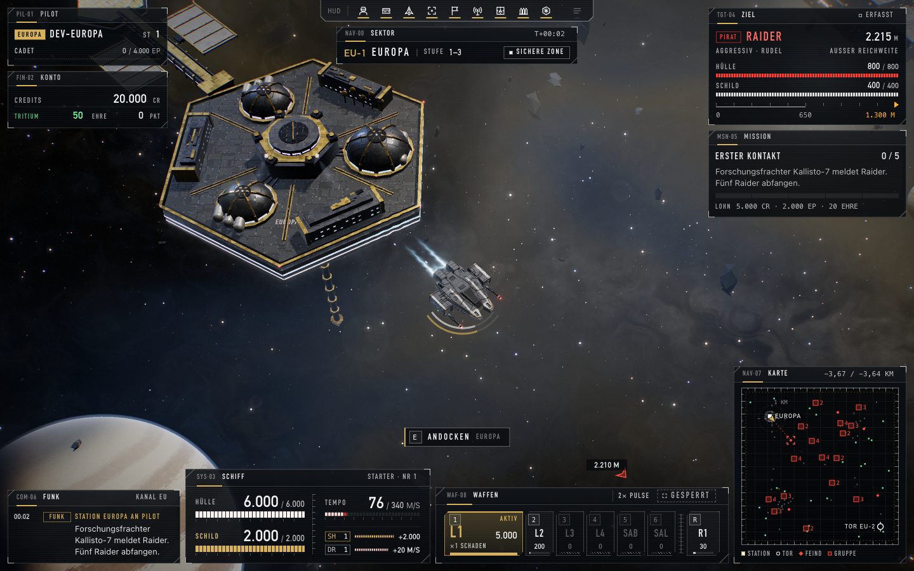
- 9,8 s · Erster Kampf (1,5 s nach dem ersten Schuss): 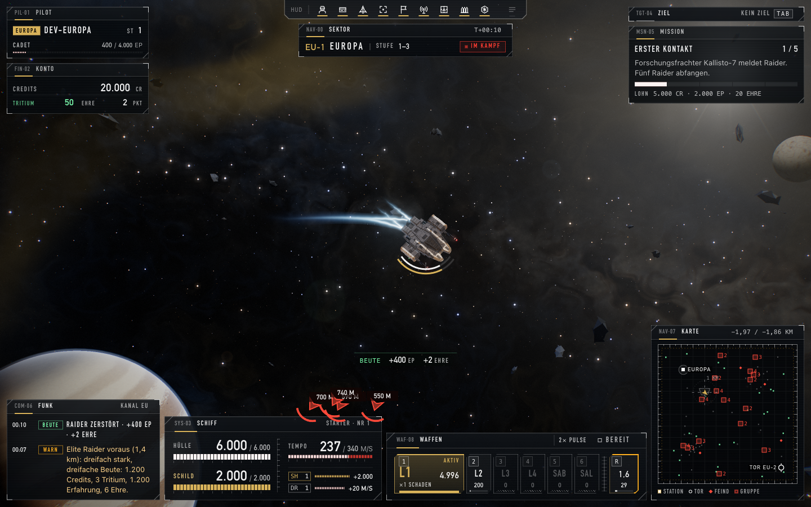
- 27,6 s · Hänger 450 ms (Angedockt: Shop): 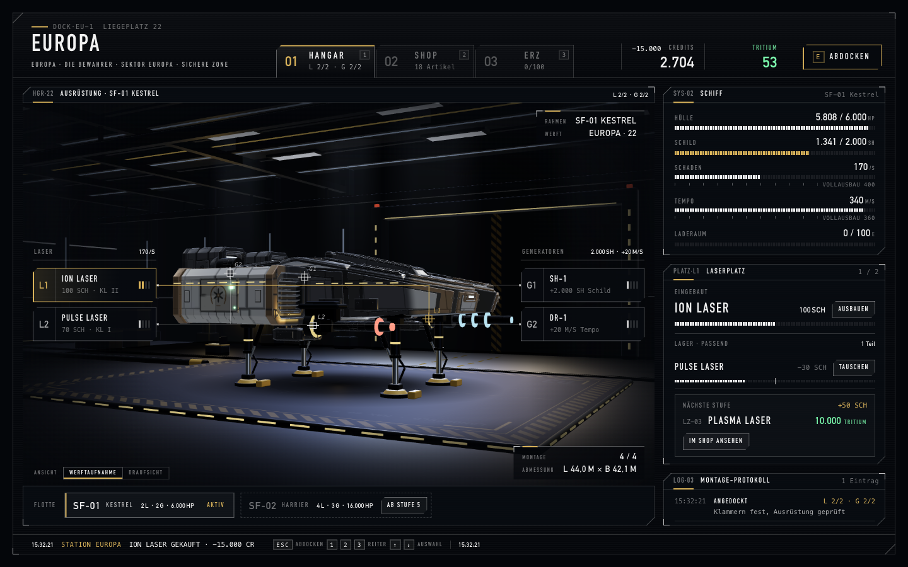
- 28,8 s · Angedockt: Station/Shop: 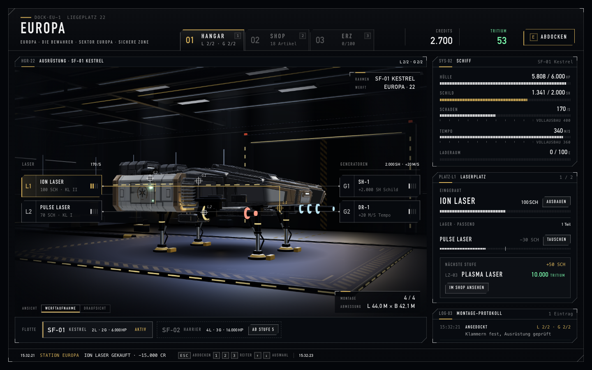
- 59,6 s · 6 Gegner greifen gleichzeitig an: 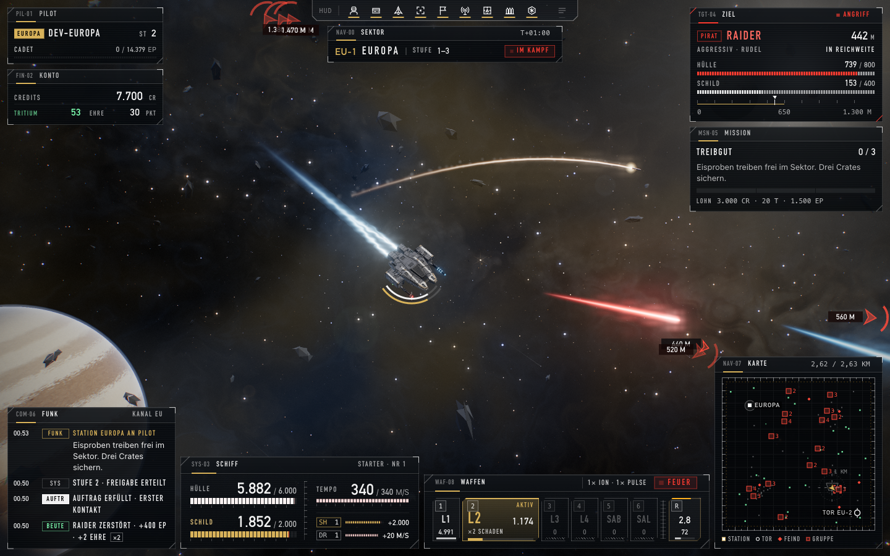
- 74,6 s · Neuer Sektor EU-2 (Io): 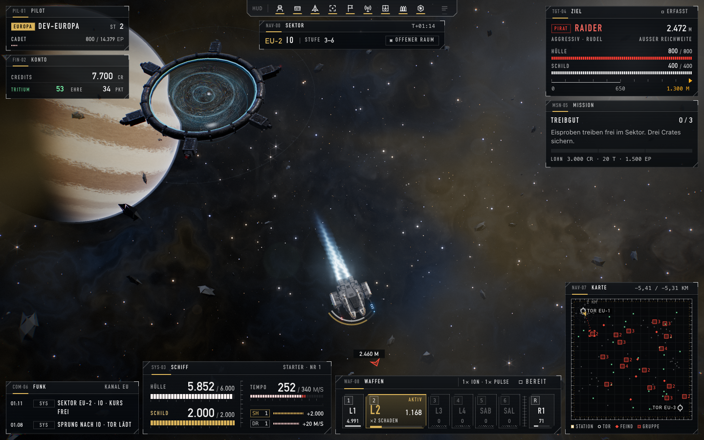
- 81,3 s · Abschuss raider (elite): 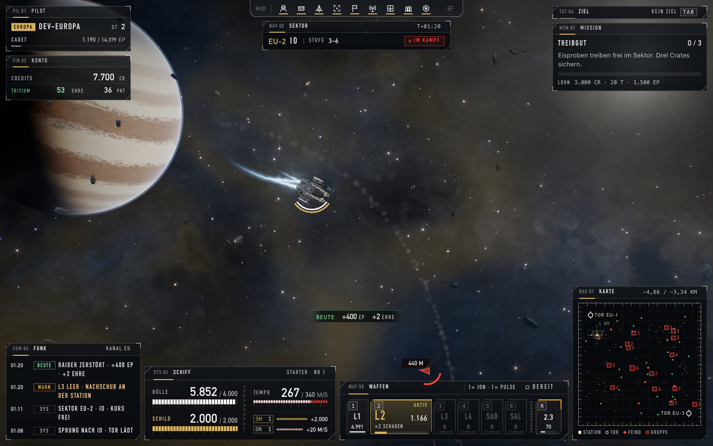
- 102,9 s · Abgeschossen: Reparatur-Auswahl: 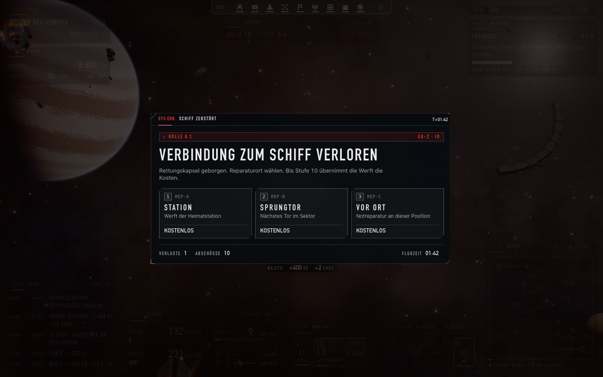
- 120,0 s · Ende der Spielzeit: 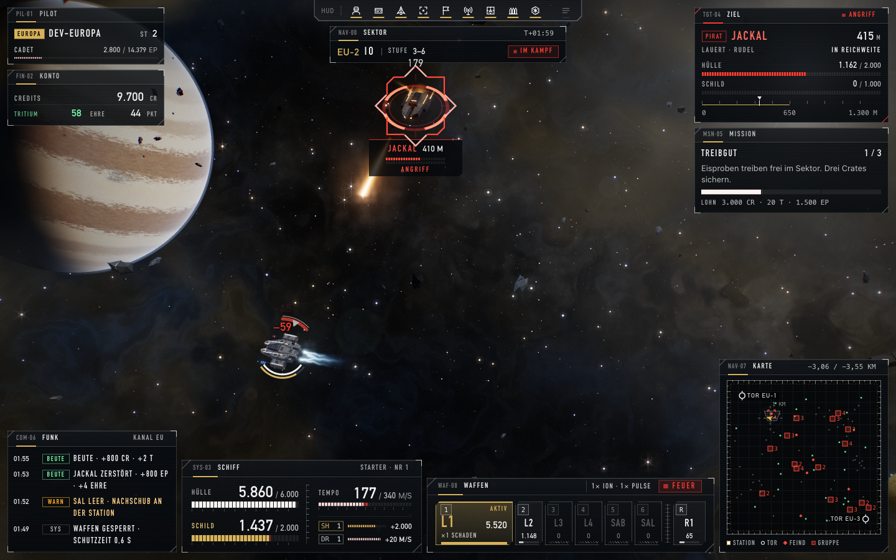
- 123,5 s · Ausrichtung ship:s1:europa: 0° (Beispiel, in Ordnung): 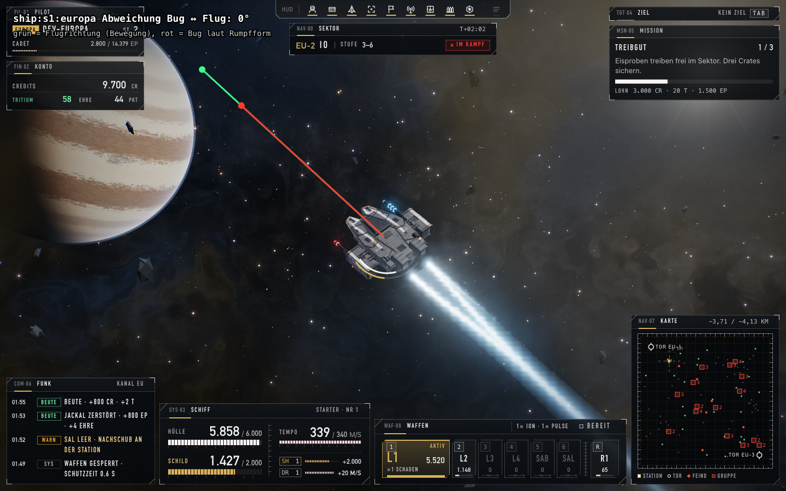

## SATURN · 120 s gespielt · SA-1 → SA-2

Qualität: Stufe HOCH, Auflösungsfaktor 1,00, Pixeldichte 2,00, Puffer 2880x1800, GPU-Zeitmessung ja. Ladezeit bis Flug 0,8 s.

### Bildzeiten (Mittel / p95 / längste, ms)
| Abschnitt | Bilder | Bilder/s | Bildabstand | CPU-Rechenzeit | GPU | Bildzeit max(CPU,GPU) | > 20 ms | > 25 ms | > 33 ms |
|---|---|---|---|---|---|---|---|---|---|
| Gesamt | 6.934 | 59,5 | 16,8 / 18,6 / 515,5 | 1,9 / 3,3 / 362,7 | 8,6 / 12,2 / 27,2 | 8,7 / 12,2 / 362,7 | 4 | 4 | 3 |
| Kampf | 4.173 | 60,0 | 16,7 / 18,6 / 18,8 | 1,6 / 2,9 / 5,2 | 8,5 / 11,8 / 21,1 | 8,5 / 11,8 / 21,1 | 0 | 0 | 0 |
| Ruhe | 2.557 | 59,5 | 16,8 / 18,6 / 350,0 | 2,3 / 3,5 / 362,7 | 8,4 / 11,6 / 26,2 | 8,6 / 11,6 / 362,7 | 2 | 2 | 1 |
| Erster Kampf (10 s) | 565 | 60,0 | 16,7 / 18,6 / 18,8 | 1,5 / 2,1 / 4,8 | 8,2 / 11,3 / 12,6 | 8,2 / 11,3 / 12,6 | 0 | 0 | 0 |
| Angedockt | 204 | 49,6 | 20,2 / 18,4 / 515,5 | 1,4 / 4,5 / 7,7 | 14,6 / 24,5 / 27,2 | 14,6 / 24,5 / 27,2 | 2 | 2 | 2 |

Längste Bilder mit Situation:
- 30,3 s: Bildabstand 515,5 ms, CPU 1,5 ms, GPU 11,4 ms · Angedockt: Shop · SA-1, 0 Gegner nah, 0 greifen an · zuletzt: message×4, profile×3 · 84 Draw Calls
- 73,6 s: Bildabstand 350,0 ms, CPU 1,5 ms, GPU 8,2 ms · Sprung lädt · SA-2, 0 Gegner nah, 0 greifen an · zuletzt: despawn×78, sector×1, message×1 · 69 Draw Calls
- 30,3 s: Bildabstand 234,4 ms, CPU 0,4 ms, GPU 11,4 ms · Angedockt: Shop · SA-1, 0 Gegner nah, 0 greifen an · zuletzt: message×4, profile×3 · 84 Draw Calls
- 0,6 s: Bildabstand 32,5 ms, CPU 1,2 ms, GPU 26,2 ms · Anflug auf Raider (2509 m) · SA-1, 0 Gegner nah, 0 greifen an · zuletzt: nichts · 84 Draw Calls
- 73,6 s: Bildabstand 17,0 ms, CPU 362,7 ms, GPU 8,2 ms · Sprung lädt · SA-2, 0 Gegner nah, 0 greifen an · zuletzt: despawn×78, sector×1, message×1 · 67 Draw Calls

### Kampfwerte
Schüsse 59 (Treffer 88,1 %), Raketen 13, Tode 1 (Todestest nachgeholfen: Stufe 1).
Eingesteckt: 1.009 Hülle + 3.247 Schild · je Quelle: raider 813, larva 28, jackal 3.415.
Beute gesamt: 2.600 Credits, 23 Tritium, 3.000 Erfahrung, 14 Ehre.
Je Minute: **1.300 Credits, 11,5 Tritium, 1.500 Erfahrung, 7,0 Ehre**.
Profil: 20.000 → 4.100 Credits, 50 → 73 Tritium, Stufe 1 → 1.

| Gegner | Abschüsse | Zeit bis Abschuss Mittel / Median / max (s) |
|---|---|---|
| raider | 4 | 0,8 / 0,6 / 1,1 |
| larva | 2 | 0,9 / 0,8 / 0,9 |
| jackal | 1 | 4,0 / 4,0 / 4,0 |

Munition (Versuche/erfolgreich/Vorrat danach): L1 2/2/5.390 · L2 2/2/1.160 · L3 1/0/0 · L4 1/0/0 · SAB 1/0/0 · SAL 1/0/0. Schüsse je Munition: L1 16, L2 43.
Schussrichtung zur Schiffsnase: Mittel 84,1°, p95 145,8°, 47 Schüsse über 45°, 37 über 90° (Laser feuern dann seitlich/rückwärts aus den Mündungen).
Einkäufe: ammo L2 ok (−1.000 Credits, −0 Tritium) · rocket R1 ok (−2.500 Credits, −0 Tritium) · ammo L3 abgelehnt: Zu wenig Tritium: 250 nötig, du hast 68. · ammo SAL abgelehnt: Zu wenig Tritium: 200 nötig, du hast 68. · ammo SAB abgelehnt: Zu wenig Tritium: 500 nötig, du hast 68. · laser ion ok (−15.000 Credits, −0 Tritium).
Dauer der Aufrufe: Andocken 354,5 ms, 6 Einkäufe 243,2 ms, Abdocken 0,5 ms.
Reparaturen: 99,9 s here ok (kostenlos (bis Stufe 10)). Sprünge: 73,6 s → SA-2. Stufenaufstiege: keine.

### Gegnerverhalten
| Typ | Stichproben | Zeitanteile | Abstand zum Spieler im Angriff (Mittel/Median/min m) | Ausweichen | Angriffsbeginn selbst/Sicht/mitgezogen | Flucht | übereinander | Schüsse/Treffer |
|---|---|---|---|---|---|---|---|---|
| raider | 2.081 | patrouille 85,0 %, anfliegen 9,5 %, abdrehen 3,0 %, umkreisen 2,1 %, ausweichen 0,3 %, angreifen (stehend) 0,0 % | 762 / 643 / 42 | 2 | 4/3/2 | 0 | 0,0 % | 26/21 |
| larva | 96 | patrouille 77,1 %, abdrehen 10,4 %, umkreisen 6,3 %, anfliegen 6,3 % | 348 / 329 / 110 | 0 | 1/0/1 | 0 | 0,0 % | 2/2 |
| jackal | 603 | patrouille 80,6 %, umkreisen 10,3 %, anfliegen 6,1 %, ausweichen 2,3 %, fliehen 0,3 %, abdrehen 0,2 %, angreifen (stehend) 0,2 % | 329 / 310 / 157 | 4 | 2/0/1 | 1 | 0,0 % | 24/21 |

Übereinander (Abstand < 0,75 × Summe der Trefferradien): in 0,0 % der Stichproben, Vorfälle keine, höchstens 0 Paare gleichzeitig. Hilfe-/Verstärkungsmeldungen: 0, vorübergehend erzeugte Gegner: 9.

### Ausrichtung der Modelle
| Modell | Art | Bug laut Rumpfform (°) | Form eindeutig | Mündungen vor Mitte | Laufrichtung (°) | Triebwerke hinter Mitte | Schweif (°) | Flug im Spiel (Median/p95 °) | Flug in Szene (°) | Befund · Hinweise |
|---|---|---|---|---|---|---|---|---|---|---|
| ship:s1:europa | GLB | 0,0 | ja (Achse 0,84, Verjüngung 1,62) | 0,77 0,92 | -0 -0 | 1,14 1,14 | 0 0 | – | 0,0 | ok · Cockpit-Glas vorn 0°, Hoheitszeichen links/rechts 0°, Rumpf verjüngt sich zum Bug -180° |
| ship:s1:europa:platzhalter | Platzhalter | 0,0 | ja (Achse 0,63, Verjüngung 2,05) | 0,64 0,77 | 0 0 | 1,00 1,00 0,58 0,58 | 0 0 0 0 | – | – | ok · Rumpf verjüngt sich zum Bug 0° |
| ship:s2:europa | GLB | -0,3 | ja (Achse 0,74, Verjüngung 1,04) | 0,66 0,78 0,59 0,69 | -0 -0 -0 0 | 1,10 1,10 1,10 | 0 0 0 | – | 0,6 | ok · Hoheitszeichen links/rechts 0°, eigene Laser des Modells vorn -1° |
| ship:s2:europa:platzhalter | Platzhalter | 0,0 | ja (Achse 0,68, Verjüngung 1,49) | 0,64 0,76 0,56 0,66 | 0 0 0 0 | 1,00 1,00 0,58 0,58 1,00 | 0 0 0 0 0 | – | – | ok · Rumpf verjüngt sich zum Bug 0° |
| ship:s1:saturn | GLB | 0,0 | ja (Achse 0,85, Verjüngung 1,62) | 0,77 0,92 | -0 -0 | 1,14 1,14 | 0 0 | 0,0 / 5,5 (739) | 0,1 | ok · Cockpit-Glas vorn 0°, Hoheitszeichen links/rechts 0°, Rumpf verjüngt sich zum Bug -180° |
| ship:s1:saturn:platzhalter | Platzhalter | 0,0 | ja (Achse 0,71, Verjüngung 2,07) | 0,64 0,76 | 0 0 | 1,00 1,00 0,58 0,58 | 0 0 0 0 | – | – | ok · Rumpf verjüngt sich zum Bug 0° |
| ship:s2:saturn | GLB | -0,3 | ja (Achse 0,75, Verjüngung 1,04) | 0,67 0,79 0,59 0,69 | -0 -0 -0 0 | 1,10 1,10 1,10 | 0 0 0 | – | 0,5 | ok · Hoheitszeichen links/rechts 0°, eigene Laser des Modells vorn -1° |
| ship:s2:saturn:platzhalter | Platzhalter | 0,0 | ja (Achse 0,66, Verjüngung 1,50) | 0,64 0,76 0,56 0,66 | 0 0 0 0 | 1,00 1,00 0,58 0,58 1,00 | 0 0 0 0 0 | – | – | ok · Rumpf verjüngt sich zum Bug 0° |
| ship:s1:eris | GLB | 0,0 | ja (Achse 0,85, Verjüngung 1,62) | 0,77 0,92 | -0 -0 | 1,14 1,14 | 0 0 | – | 0,7 | ok · Cockpit-Glas vorn 0°, Hoheitszeichen links/rechts 0°, Rumpf verjüngt sich zum Bug -180° |
| ship:s1:eris:platzhalter | Platzhalter | 0,0 | ja (Achse 0,63, Verjüngung 2,01) | 0,64 0,76 | 0 0 | 1,00 1,00 0,58 0,58 | 0 0 0 0 | – | – | ok · Rumpf verjüngt sich zum Bug 0° |
| ship:s2:eris | GLB | -0,3 | ja (Achse 0,73, Verjüngung 1,04) | 0,66 0,78 0,59 0,69 | -0 -0 -0 0 | 1,10 1,10 1,10 | 0 0 0 | – | 0,3 | ok · Hoheitszeichen links/rechts 0°, eigene Laser des Modells vorn -1° |
| ship:s2:eris:platzhalter | Platzhalter | 0,0 | ja (Achse 0,60, Verjüngung 1,47) | 0,64 0,76 0,56 0,66 | 0 0 0 0 | 1,00 1,00 0,58 0,58 1,00 | 0 0 0 0 0 | – | – | ok · Rumpf verjüngt sich zum Bug 0° |
| enemy:raider | Platzhalter | 0,0 | ja (Achse 1,00, Verjüngung 2.085.278,75) | – | – | 0,98 0,98 | 0 0 | 0,0 / 0,0 (1294) | 0,0 | ok · Rumpf verjüngt sich zum Bug 0° |
| enemy:larva | Platzhalter | 0,0 | ja (Achse 1,00, Verjüngung 2,49) | – | – | – | – | 0,0 / 0,0 (64) | 0,0 | ok · Rumpf verjüngt sich zum Bug 0° |
| enemy:jackal | Platzhalter | 0,0 | ja (Achse 1,00, Verjüngung 1,50) | – | – | 0,68 0,68 | 0 0 | 0,0 / 0,0 (430) | 0,0 | ok · Rumpf verjüngt sich zum Bug 0° |
| enemy:spiker | Platzhalter | 165,0 | ja (Achse 0,47, Verjüngung 3,12) | – | – | – | – | – | dreht | dreht sich ständig (gewollt), keine Bugprüfung · Rumpf verjüngt sich zum Bug 165° |
| enemy:vulture | Platzhalter | 0,0 | ja (Achse 1,00, Verjüngung 3,25) | – | – | 0,50 0,50 | 0 0 | – | 0,0 | ok · Rumpf verjüngt sich zum Bug 0° |

Keine Abweichungen über 20°: Bug zeigt bei allen Modellen in Flugrichtung, Mündungen vorn, Triebwerke und Schweif hinten.

### Konsole
2 Fehler, 0 Warnungen, 5 Hinweise (Netz).
- 2× Fehler: Failed to load resource: the server responded with a status of 404 (Not Found)
- 1× Hinweis: HEAD /models/station-europa.glb abgebrochen
- 1× Hinweis: HEAD /models/station-saturn.glb abgebrochen
- 1× Hinweis: HEAD /models/station-eris.glb abgebrochen
- 1× Hinweis: HEAD /models/europa-starter.glb abgebrochen
- 1× Hinweis: HEAD /models/eris-starter.glb abgebrochen

### Bilder
- 1,2 s · Ereignis: Erster Kontakt: 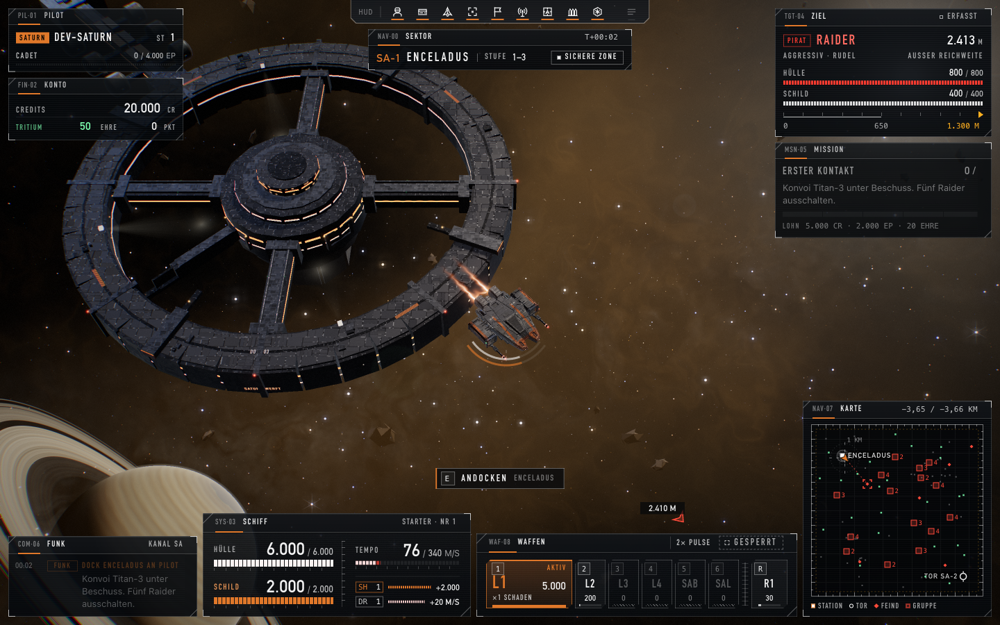
- 7,8 s · Erster Kampf (1,5 s nach dem ersten Schuss): 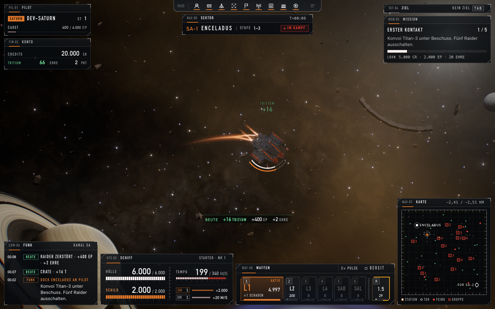
- 30,3 s · Hänger 516 ms (Angedockt: Shop): 
- 31,5 s · Angedockt: Station/Shop: 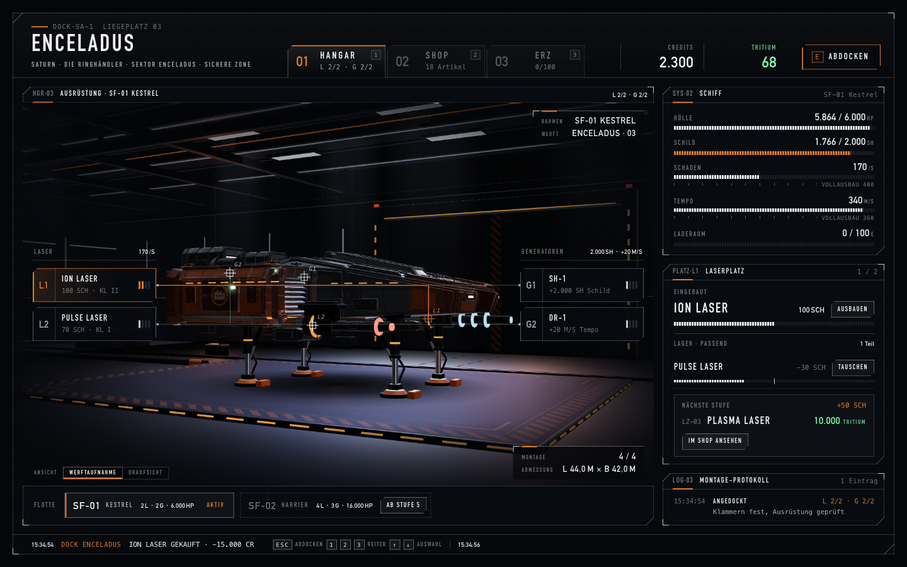
- 76,1 s · Neuer Sektor SA-2 (Mimas): 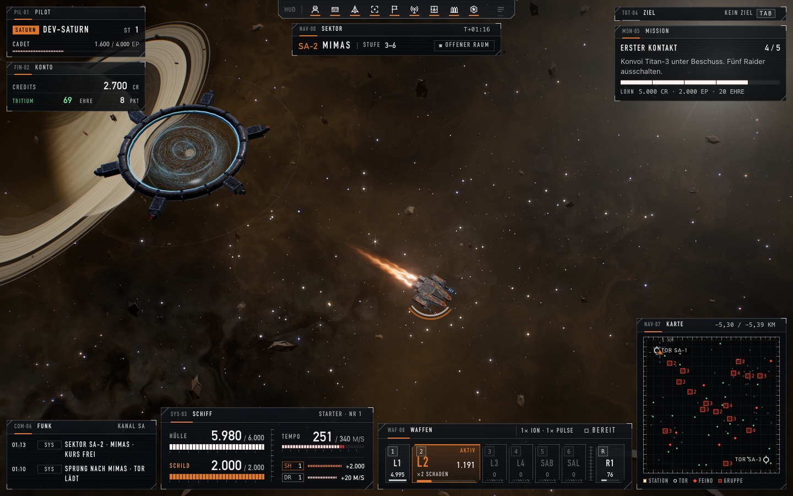
- 97,3 s · Abgeschossen: Reparatur-Auswahl: 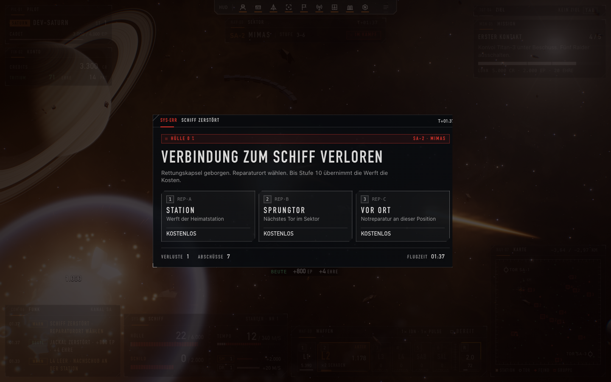
- 120,0 s · Ende der Spielzeit: 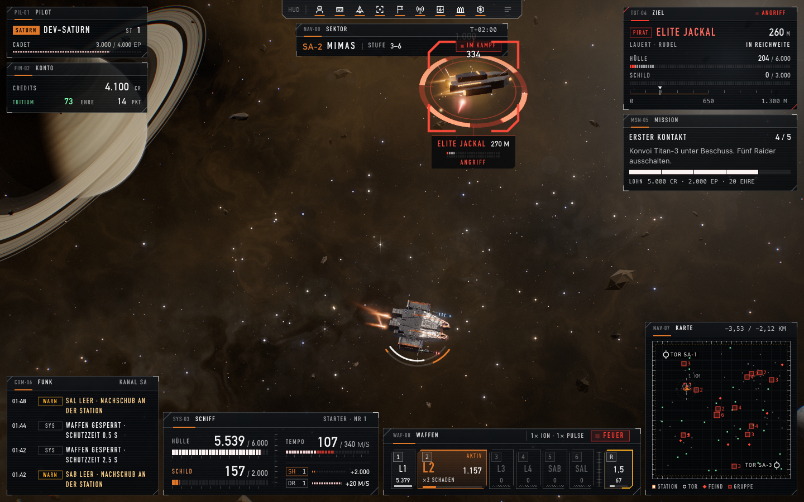
- 128,9 s · Ausrichtung ship:s1:saturn: 0.1° (Beispiel, in Ordnung): 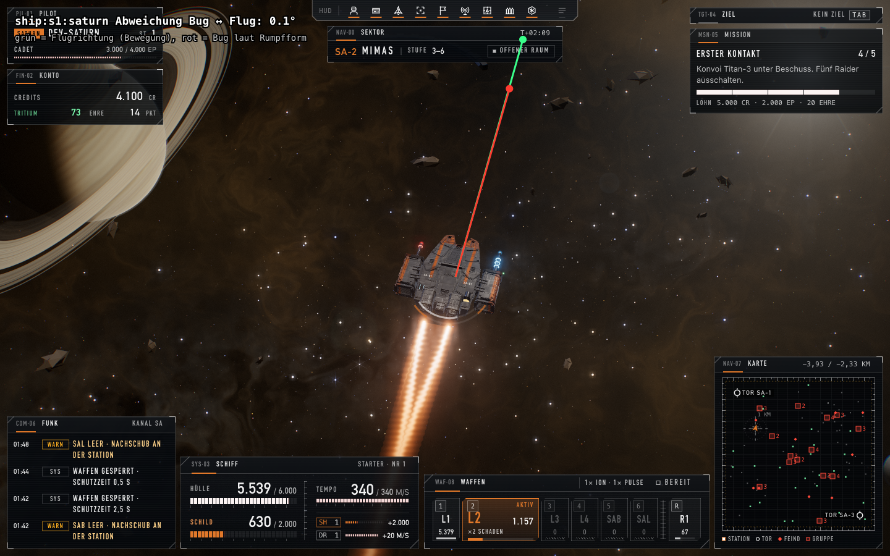

## ERIS · 120 s gespielt · ER-1 → ER-2

Qualität: Stufe HOCH, Auflösungsfaktor 1,00, Pixeldichte 2,00, Puffer 2880x1800, GPU-Zeitmessung ja. Ladezeit bis Flug 0,7 s.

### Bildzeiten (Mittel / p95 / längste, ms)
| Abschnitt | Bilder | Bilder/s | Bildabstand | CPU-Rechenzeit | GPU | Bildzeit max(CPU,GPU) | > 20 ms | > 25 ms | > 33 ms |
|---|---|---|---|---|---|---|---|---|---|
| Gesamt | 6.921 | 59,6 | 16,8 / 18,6 / 416,8 | 1,7 / 2,8 / 228,6 | 8,7 / 12,1 / 31,3 | 8,7 / 12,1 / 228,6 | 5 | 5 | 4 |
| Kampf | 4.085 | 60,0 | 16,7 / 18,6 / 18,8 | 1,6 / 2,5 / 5,8 | 8,5 / 11,8 / 13,9 | 8,5 / 11,8 / 13,9 | 0 | 0 | 0 |
| Ruhe | 2.627 | 59,7 | 16,8 / 18,6 / 216,1 | 1,9 / 3,1 / 228,6 | 8,6 / 12,0 / 31,3 | 8,7 / 12,0 / 228,6 | 3 | 3 | 2 |
| Erster Kampf (10 s) | 565 | 60,0 | 16,7 / 18,7 / 18,8 | 1,4 / 2,1 / 4,5 | 8,3 / 11,1 / 12,3 | 8,3 / 11,1 / 12,3 | 0 | 0 | 0 |
| Angedockt | 209 | 51,6 | 19,4 / 18,4 / 416,8 | 1,3 / 4,3 / 5,0 | 12,8 / 25,3 / 26,8 | 12,8 / 25,3 / 26,8 | 2 | 2 | 2 |

Längste Bilder mit Situation:
- 24,3 s: Bildabstand 416,8 ms, CPU 1,4 ms, GPU 12,3 ms · Angedockt: Shop · ER-1, 0 Gegner nah, 0 greifen an · zuletzt: docked×1, message×5, profile×3 · 72 Draw Calls
- 67,5 s: Bildabstand 216,1 ms, CPU 1,4 ms, GPU 8,6 ms · Sprung lädt · ER-2, 0 Gegner nah, 0 greifen an · zuletzt: despawn×78, sector×1, message×1 · 66 Draw Calls
- 24,3 s: Bildabstand 183,3 ms, CPU 0,5 ms, GPU 12,3 ms · Angedockt: Shop · ER-1, 0 Gegner nah, 0 greifen an · zuletzt: docked×1, message×5, profile×3 · 72 Draw Calls
- 0,7 s: Bildabstand 33,4 ms, CPU 1,8 ms, GPU 8,3 ms · Anflug auf Raider (2016 m) · ER-1, 0 Gegner nah, 0 greifen an · zuletzt: nichts · 71 Draw Calls
- 0,6 s: Bildabstand 32,5 ms, CPU 1,8 ms, GPU 9,7 ms · Anflug auf Raider (2017 m) · ER-1, 0 Gegner nah, 0 greifen an · zuletzt: nichts · 71 Draw Calls
- 67,5 s: Bildabstand 15,8 ms, CPU 228,6 ms, GPU 8,6 ms · Sprung lädt · ER-2, 0 Gegner nah, 0 greifen an · zuletzt: despawn×78, sector×1, message×1 · 63 Draw Calls

### Kampfwerte
Schüsse 62 (Treffer 87,1 %), Raketen 14, Tode 1 (Todestest nachgeholfen: Stufe 2).
Eingesteckt: 423 Hülle + 1.693 Schild · je Quelle: raider 749, jackal 1.367.
Beute gesamt: 9.234 Credits, 9 Tritium, 7.200 Erfahrung, 46 Ehre.
Je Minute: **4.617 Credits, 4,5 Tritium, 3.600 Erfahrung, 23,0 Ehre**.
Profil: 20.000 → 10.734 Credits, 50 → 59 Tritium, Stufe 1 → 2.

| Gegner | Abschüsse | Zeit bis Abschuss Mittel / Median / max (s) |
|---|---|---|
| raider | 7 | 1,0 / 1,0 / 1,7 |
| jackal | 3 | 8,0 / 4,2 / 15,9 |

Munition (Versuche/erfolgreich/Vorrat danach): L1 2/2/4.993 · L2 2/2/1.153 · L3 1/0/0 · L4 1/0/0 · SAB 1/0/0 · SAL 1/0/0. Schüsse je Munition: L1 13, L2 49.
Schussrichtung zur Schiffsnase: Mittel 79,7°, p95 149,7°, 50 Schüsse über 45°, 25 über 90° (Laser feuern dann seitlich/rückwärts aus den Mündungen).
Einkäufe: ammo L2 ok (−1.000 Credits, −0 Tritium) · rocket R1 ok (−2.500 Credits, −0 Tritium) · ammo L3 abgelehnt: Zu wenig Tritium: 250 nötig, du hast 53. · ammo SAL abgelehnt: Zu wenig Tritium: 200 nötig, du hast 53. · ammo SAB abgelehnt: Zu wenig Tritium: 500 nötig, du hast 53. · laser ion ok (−15.000 Credits, −0 Tritium).
Dauer der Aufrufe: Andocken 288,5 ms, 6 Einkäufe 166,0 ms, Abdocken 0,4 ms.
Reparaturen: 105,5 s here ok (kostenlos (bis Stufe 10)). Sprünge: 67,5 s → ER-2. Stufenaufstiege: 44,2 s → 2.

### Gegnerverhalten
| Typ | Stichproben | Zeitanteile | Abstand zum Spieler im Angriff (Mittel/Median/min m) | Ausweichen | Angriffsbeginn selbst/Sicht/mitgezogen | Flucht | übereinander | Schüsse/Treffer |
|---|---|---|---|---|---|---|---|---|
| raider | 2.612 | patrouille 82,5 %, anfliegen 13,3 %, umkreisen 2,4 %, abdrehen 1,3 %, ausweichen 0,5 %, angreifen (stehend) 0,0 % | 791 / 713 / 53 | 5 | 2/4/7 | 0 | 0,0 % | 36/30 |
| larva | 142 | patrouille 100,0 % | – | 0 | 0/0/0 | 0 | 0,0 % | 0/0 |
| jackal | 1.055 | patrouille 76,8 %, umkreisen 8,7 %, anfliegen 8,1 %, abdrehen 3,2 %, fliehen 1,9 %, ausweichen 1,2 %, angreifen (stehend) 0,1 % | 439 / 443 / 114 | 4 | 3/3/2 | 1 | 0,0 % | 31/23 |

Übereinander (Abstand < 0,75 × Summe der Trefferradien): in 0,0 % der Stichproben, Vorfälle keine, höchstens 0 Paare gleichzeitig. Hilfe-/Verstärkungsmeldungen: 0, vorübergehend erzeugte Gegner: 11.

### Ausrichtung der Modelle
| Modell | Art | Bug laut Rumpfform (°) | Form eindeutig | Mündungen vor Mitte | Laufrichtung (°) | Triebwerke hinter Mitte | Schweif (°) | Flug im Spiel (Median/p95 °) | Flug in Szene (°) | Befund · Hinweise |
|---|---|---|---|---|---|---|---|---|---|---|
| ship:s1:europa | GLB | 0,0 | ja (Achse 0,84, Verjüngung 1,62) | 0,77 0,92 | -0 -0 | 1,14 1,14 | 0 0 | – | 1,1 | ok · Cockpit-Glas vorn 0°, Hoheitszeichen links/rechts 0°, Rumpf verjüngt sich zum Bug -180° |
| ship:s1:europa:platzhalter | Platzhalter | 0,0 | ja (Achse 0,63, Verjüngung 2,05) | 0,64 0,77 | 0 0 | 1,00 1,00 0,58 0,58 | 0 0 0 0 | – | – | ok · Rumpf verjüngt sich zum Bug 0° |
| ship:s2:europa | GLB | -0,3 | ja (Achse 0,74, Verjüngung 1,04) | 0,66 0,78 0,59 0,69 | -0 -0 -0 0 | 1,10 1,10 1,10 | 0 0 0 | – | 0,3 | ok · Hoheitszeichen links/rechts 0°, eigene Laser des Modells vorn -1° |
| ship:s2:europa:platzhalter | Platzhalter | 0,0 | ja (Achse 0,68, Verjüngung 1,49) | 0,64 0,76 0,56 0,66 | 0 0 0 0 | 1,00 1,00 0,58 0,58 1,00 | 0 0 0 0 0 | – | – | ok · Rumpf verjüngt sich zum Bug 0° |
| ship:s1:saturn | GLB | 0,0 | ja (Achse 0,85, Verjüngung 1,62) | 0,77 0,92 | -0 -0 | 1,14 1,14 | 0 0 | – | 0,0 | ok · Cockpit-Glas vorn 0°, Hoheitszeichen links/rechts 0°, Rumpf verjüngt sich zum Bug -180° |
| ship:s1:saturn:platzhalter | Platzhalter | 0,0 | ja (Achse 0,71, Verjüngung 2,07) | 0,64 0,76 | 0 0 | 1,00 1,00 0,58 0,58 | 0 0 0 0 | – | – | ok · Rumpf verjüngt sich zum Bug 0° |
| ship:s2:saturn | GLB | -0,3 | ja (Achse 0,75, Verjüngung 1,04) | 0,67 0,79 0,59 0,69 | -0 -0 -0 0 | 1,10 1,10 1,10 | 0 0 0 | – | 0,6 | ok · Hoheitszeichen links/rechts 0°, eigene Laser des Modells vorn -1° |
| ship:s2:saturn:platzhalter | Platzhalter | 0,0 | ja (Achse 0,66, Verjüngung 1,50) | 0,64 0,76 0,56 0,66 | 0 0 0 0 | 1,00 1,00 0,58 0,58 1,00 | 0 0 0 0 0 | – | – | ok · Rumpf verjüngt sich zum Bug 0° |
| ship:s1:eris | GLB | 0,0 | ja (Achse 0,85, Verjüngung 1,62) | 0,77 0,92 | -0 -0 | 1,14 1,14 | 0 0 | 0,0 / 6,3 (752) | 0,0 | ok · Cockpit-Glas vorn 0°, Hoheitszeichen links/rechts 0°, Rumpf verjüngt sich zum Bug -180° |
| ship:s1:eris:platzhalter | Platzhalter | 0,0 | ja (Achse 0,63, Verjüngung 2,01) | 0,64 0,76 | 0 0 | 1,00 1,00 0,58 0,58 | 0 0 0 0 | – | – | ok · Rumpf verjüngt sich zum Bug 0° |
| ship:s2:eris | GLB | -0,3 | ja (Achse 0,73, Verjüngung 1,04) | 0,66 0,78 0,59 0,69 | -0 -0 -0 0 | 1,10 1,10 1,10 | 0 0 0 | – | 0,3 | ok · Hoheitszeichen links/rechts 0°, eigene Laser des Modells vorn -1° |
| ship:s2:eris:platzhalter | Platzhalter | 0,0 | ja (Achse 0,60, Verjüngung 1,47) | 0,64 0,76 0,56 0,66 | 0 0 0 0 | 1,00 1,00 0,58 0,58 1,00 | 0 0 0 0 0 | – | – | ok · Rumpf verjüngt sich zum Bug 0° |
| enemy:raider | Platzhalter | 0,0 | ja (Achse 1,00, Verjüngung 2.085.278,75) | – | – | 0,98 0,98 | 0 0 | 0,0 / 0,0 (1797) | 0,0 | ok · Rumpf verjüngt sich zum Bug 0° |
| enemy:larva | Platzhalter | 0,0 | ja (Achse 1,00, Verjüngung 2,49) | – | – | – | – | 0,0 / 0,0 (96) | 0,0 | ok · Rumpf verjüngt sich zum Bug 0° |
| enemy:jackal | Platzhalter | 0,0 | ja (Achse 1,00, Verjüngung 1,50) | – | – | 0,68 0,68 | 0 0 | 0,0 / 0,0 (594) | 0,0 | ok · Rumpf verjüngt sich zum Bug 0° |
| enemy:spiker | Platzhalter | 165,0 | ja (Achse 0,47, Verjüngung 3,12) | – | – | – | – | – | dreht | dreht sich ständig (gewollt), keine Bugprüfung · Rumpf verjüngt sich zum Bug 165° |
| enemy:vulture | Platzhalter | 0,0 | ja (Achse 1,00, Verjüngung 3,25) | – | – | 0,50 0,50 | 0 0 | – | 0,0 | ok · Rumpf verjüngt sich zum Bug 0° |

Keine Abweichungen über 20°: Bug zeigt bei allen Modellen in Flugrichtung, Mündungen vorn, Triebwerke und Schweif hinten.

### Konsole
2 Fehler, 0 Warnungen, 5 Hinweise (Netz).
- 2× Fehler: Failed to load resource: the server responded with a status of 404 (Not Found)
- 1× Hinweis: HEAD /models/station-europa.glb abgebrochen
- 1× Hinweis: HEAD /models/station-saturn.glb abgebrochen
- 1× Hinweis: HEAD /models/station-eris.glb abgebrochen
- 1× Hinweis: HEAD /models/europa-starter.glb abgebrochen
- 1× Hinweis: HEAD /models/eris-starter.glb abgebrochen

### Bilder
- 1,2 s · Ereignis: Erster Kontakt: 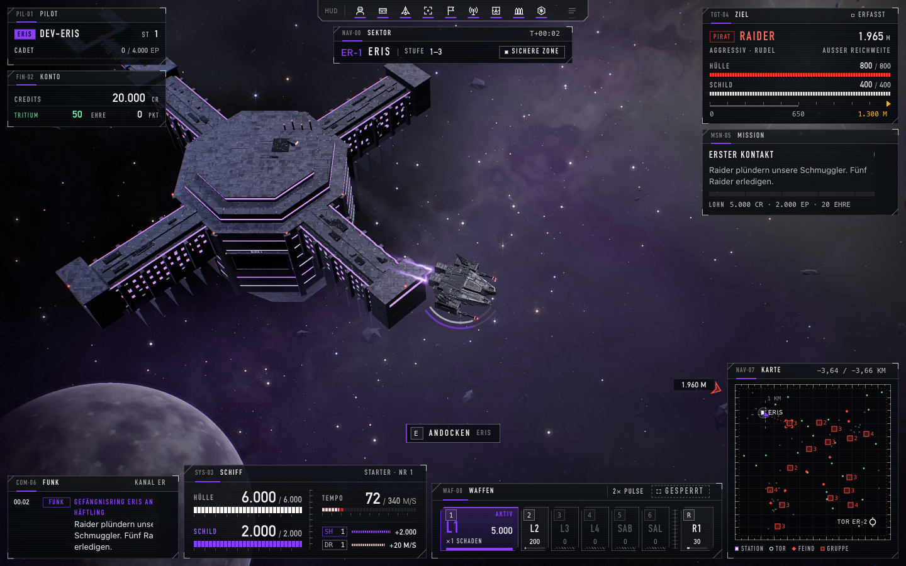
- 6,8 s · Erster Kampf (1,5 s nach dem ersten Schuss): 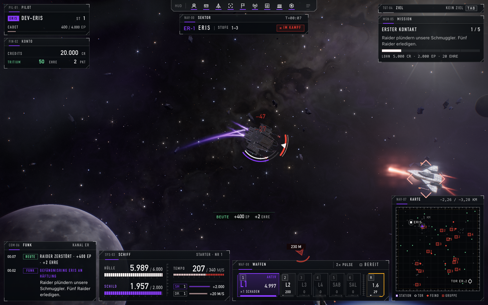
- 24,3 s · Hänger 417 ms (Angedockt: Shop): 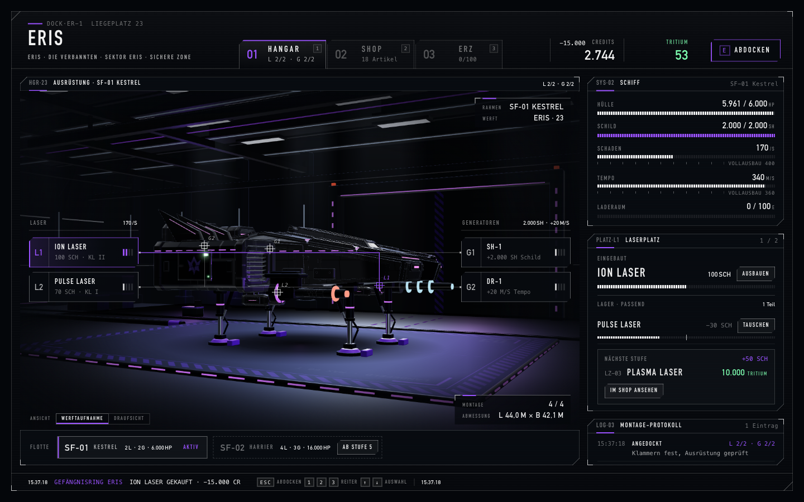
- 25,5 s · Angedockt: Station/Shop: 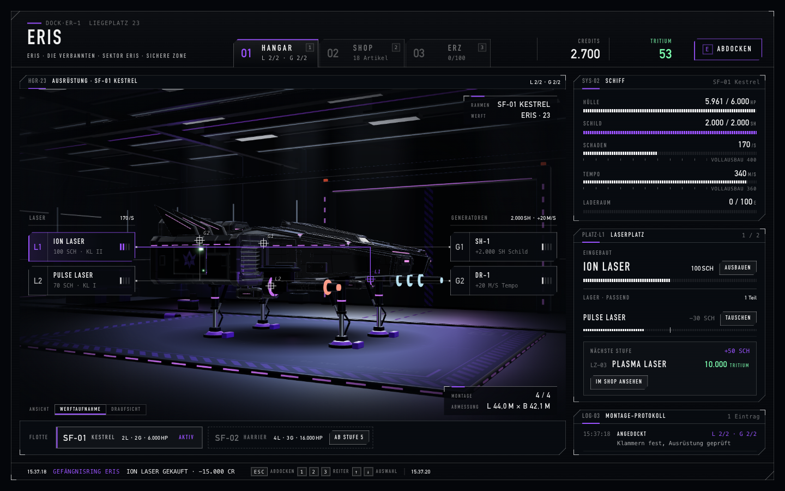
- 54,8 s · 7 Gegner greifen gleichzeitig an: 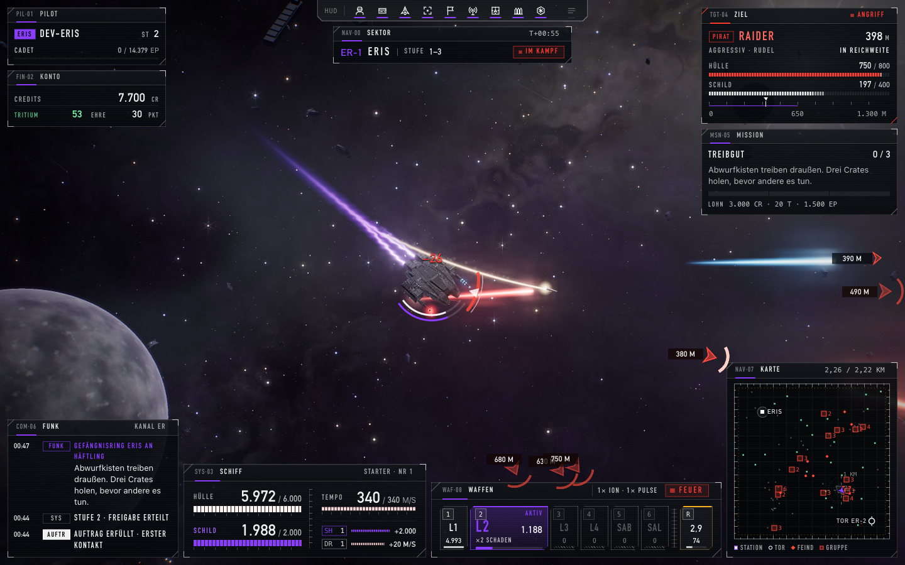
- 70,0 s · Neuer Sektor ER-2 (Dysnomia): 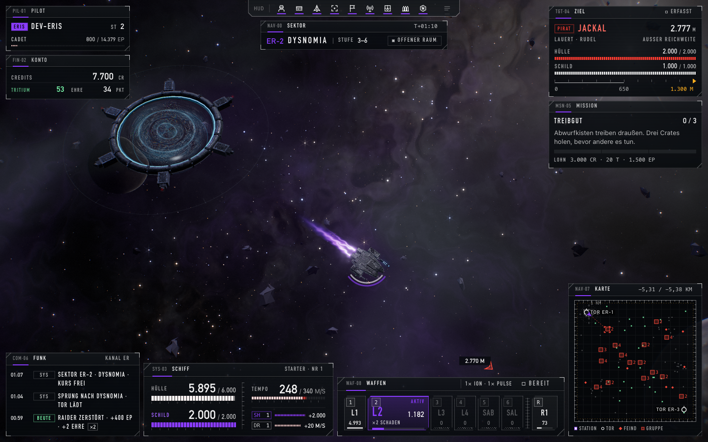
- 102,9 s · Abgeschossen: Reparatur-Auswahl: 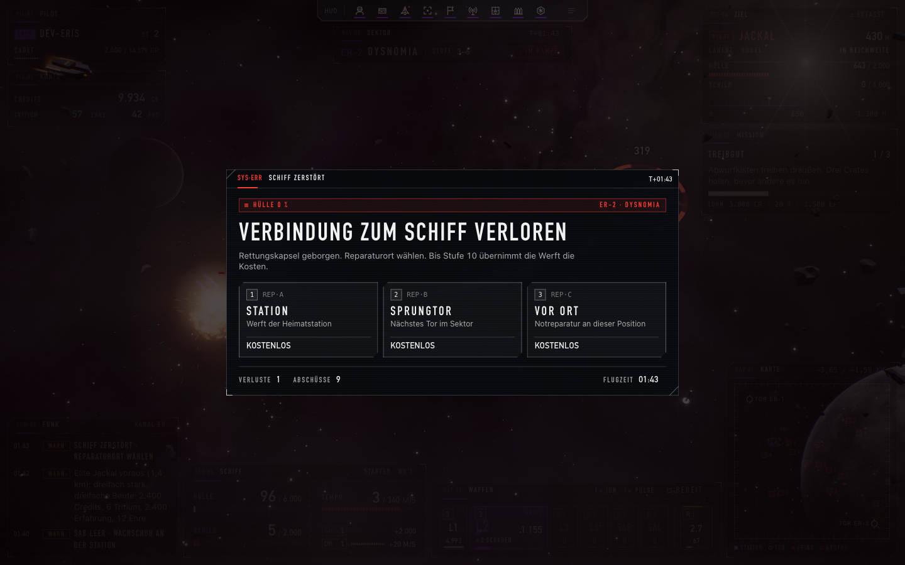
- 120,0 s · Ende der Spielzeit: 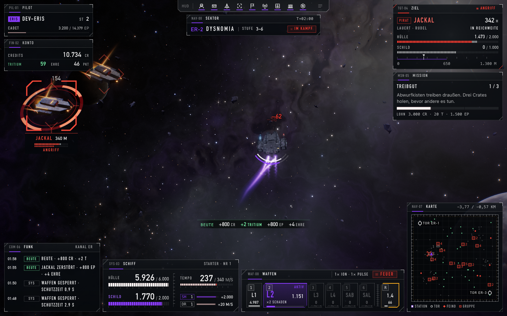
- 134,1 s · Ausrichtung ship:s1:eris: 0° (Beispiel, in Ordnung): 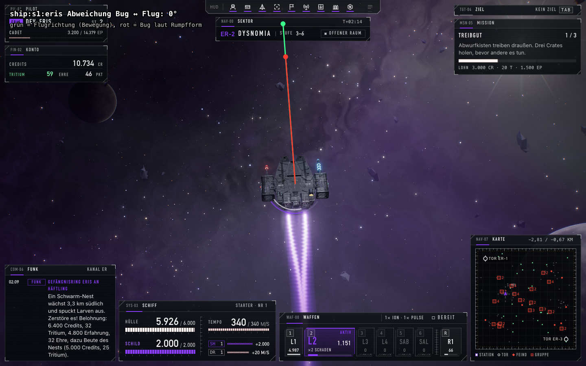
