# Test-Pilot · 2026-10-30_16-25-45

europa, saturn, eris · je 2,0 min · Qualität hoch · Fenster 1440×900 (Pixeldichte 2) · Chrome sichtbar

Ziele: Mac Qualität HOCH im Kampf unter 8 ms je Bild · normaler Laptop Full HD MITTEL mindestens 60 Bilder/s · erster Kampf ohne Hänger über 25 ms.

## EUROPA · 120 s gespielt · EU-1 → EU-2

Qualität: Stufe HOCH, Auflösungsfaktor 0,68, Pixeldichte 1,36, Puffer 1958x1224, GPU-Zeitmessung ja. Ladezeit bis Flug 9,6 s.

### Bildzeiten (Mittel / p95 / längste, ms)
| Abschnitt | Bilder | Bilder/s | Bildabstand | CPU-Rechenzeit | GPU | Bildzeit max(CPU,GPU) | > 20 ms | > 25 ms | > 33 ms |
|---|---|---|---|---|---|---|---|---|---|
| Gesamt | 4.421 | 43,7 | 22,9 / 33,4 / 13.065,4 | 7,9 / 8,1 / 13.069,1 | 8,2 / 15,8 / 78,9 | 11,8 / 16,6 / 13.069,1 | 377 | 376 | 225 |
| Kampf | 2.690 | 52,7 | 19,0 / 33,4 / 150,1 | 5,2 / 8,7 / 129,4 | 8,2 / 15,9 / 36,3 | 8,9 / 16,6 / 129,4 | 270 | 269 | 148 |
| Ruhe | 1.667 | 36,8 | 27,2 / 33,1 / 13.065,4 | 12,5 / 7,2 / 13.069,1 | 7,9 / 15,1 / 45,7 | 16,4 / 15,7 / 13.069,1 | 100 | 100 | 70 |
| Erster Kampf (10 s) | 200 | 46,9 | 21,3 / 49,2 / 150,0 | 5,3 / 8,7 / 27,1 | 7,1 / 12,4 / 25,7 | 8,2 / 14,3 / 27,1 | 29 | 29 | 20 |
| Angedockt | 64 | 13,2 | 75,5 / 49,8 / 2.434,2 | 4,3 / 8,8 / 97,8 | 14,3 / 18,2 / 78,9 | 15,7 / 78,9 / 97,8 | 7 | 7 | 7 |

Längste Bilder mit Situation:
- 87,8 s: Bildabstand 13.065,4 ms, CPU 8,7 ms, GPU 11,9 ms · Sprung lädt · EU-2, 0 Gegner nah, 0 greifen an · zuletzt: sector×1, message×1 · 68 Draw Calls
- 25,0 s: Bildabstand 2.434,2 ms, CPU 9,3 ms, GPU 10,7 ms · Angedockt: Shop · EU-1, 4 Gegner nah, 0 greifen an · zuletzt: profile×1 · 89 Draw Calls
- 89,6 s: Bildabstand 1.699,9 ms, CPU 9,5 ms, GPU 26,7 ms · Todestest: kämpfen ohne Rückzug · EU-2, 0 Gegner nah, 0 greifen an · zuletzt: nichts · 65 Draw Calls
- 25,0 s: Bildabstand 1.049,3 ms, CPU 4,1 ms, GPU 10,7 ms · Angedockt: Shop · EU-1, 4 Gegner nah, 0 greifen an · zuletzt: profile×1 · 89 Draw Calls
- 94,8 s: Bildabstand 183,3 ms, CPU 4,8 ms, GPU 19,7 ms · Todestest: kämpfen ohne Rückzug · EU-2, 0 Gegner nah, 0 greifen an · zuletzt: nichts · 53 Draw Calls
- 3,7 s: Bildabstand 183,2 ms, CPU 5,6 ms, GPU 6,7 ms · Anflug auf Raider (1836 m) · EU-1, 0 Gegner nah, 0 greifen an · zuletzt: nichts · 79 Draw Calls
- 111,1 s: Bildabstand 150,1 ms, CPU 5,3 ms, GPU 22,6 ms · Kampf: Jackal umkreisen · EU-2, 3 Gegner nah, 3 greifen an · zuletzt: damage×1, profile×1 · 80 Draw Calls
- 6,7 s: Bildabstand 150,0 ms, CPU 9,0 ms, GPU 2,5 ms · Kampf: Raider umkreisen · EU-1, 3 Gegner nah, 3 greifen an · zuletzt: profile×2, damage×1, rocket×1 · 93 Draw Calls

### Kampfwerte
Schüsse 61 (Treffer 82,0 %), Raketen 11, Tode 1 (Todestest nachgeholfen: Stufe 2).
Eingesteckt: 597 Hülle + 2.403 Schild · je Quelle: raider 1.651, jackal 1.349.
Beute gesamt: 8.763 Credits, 4 Tritium, 5.680 Erfahrung, 38 Ehre.
Je Minute: **4.381 Credits, 2,0 Tritium, 2.840 Erfahrung, 19,0 Ehre**.
Profil: 20.000 → 10.263 Credits, 50 → 54 Tritium, Stufe 1 → 2.

| Gegner | Abschüsse | Zeit bis Abschuss Mittel / Median / max (s) |
|---|---|---|
| raider | 6 | 3,4 / 3,0 / 5,0 |
| jackal | 1 | 7,1 / 7,1 / 7,1 |

Munition (Versuche/erfolgreich/Vorrat danach): L1 1/1/4.998 · L2 1/1/200 · L3 1/0/0 · L4 1/0/0. Schüsse je Munition: L1 9, L2 52.
Schussrichtung zur Schiffsnase: Mittel 9,9°, p95 60,9°, 7 Schüsse über 45°, 0 über 90° (Laser feuern dann seitlich/rückwärts aus den Mündungen).
Einkäufe: ammo L2 ok (−1.000 Credits, −0 Tritium) · rocket R1 ok (−2.500 Credits, −0 Tritium) · ammo L3 abgelehnt: Zu wenig Tritium: 250 nötig, du hast 51. · ammo SAL abgelehnt: Zu wenig Tritium: 200 nötig, du hast 51. · ammo SAB abgelehnt: Zu wenig Tritium: 500 nötig, du hast 51. · laser ion ok (−15.000 Credits, −0 Tritium).
Dauer der Aufrufe: Andocken 1.455,2 ms, 6 Einkäufe 1.022,9 ms, Abdocken 0,4 ms.
Reparaturen: 105,4 s here ok (kostenlos (bis Stufe 10)). Sprünge: 87,8 s → EU-2. Stufenaufstiege: 51,2 s → 2.

### Gegnerverhalten
| Typ | Stichproben | Zeitanteile | Abstand zum Spieler im Angriff (Mittel/Median/min m) | Ausweichen | Angriffsbeginn selbst/Sicht/mitgezogen | Flucht | übereinander | Schüsse/Treffer |
|---|---|---|---|---|---|---|---|---|
| raider | 2.462 | patrouille 65,3 %, anfliegen / flanke 20,6 %, umkreisen / flanke 4,0 %, hold / wartet im kreis 3,0 %, abdrehen / flanke 2,2 %, ausweichen / flanke 1,2 %, anfliegen / lädt salve 0,7 %, fliehen / rückzug zum heilen 0,5 %, angreifen (stehend) / lädt salve 0,5 %, umkreisen / lädt salve 0,4 %, angreifen (stehend) / salve 0,4 %, hold 0,3 %, angreifen (stehend) / flanke 0,2 %, anfliegen 0,2 %, abdrehen 0,1 %, angreifen (stehend) 0,1 %, ausweichen 0,0 %, umkreisen 0,0 %, abdrehen / lädt salve 0,0 % | 769 / 676 / 62 | 10 | 1/8/8 | 2 | 0,0 % | 58/33 |
| larva | 102 | patrouille 100,0 % | – | 0 | 0/0/0 | 0 | 0,0 % | 0/0 |
| jackal | 566 | patrouille 65,4 %, umkreisen / springt an 7,8 %, anfliegen / springt an 7,8 %, patrouille / lauert getarnt 3,9 %, abdrehen / springt an 3,4 %, anfliegen / rammt 3,0 %, abdrehen / lädt rammangriff 1,8 %, umkreisen / lädt rammangriff 1,2 %, fliehen / rückzug zum heilen 1,2 %, anfliegen / lädt rammangriff 0,9 %, ausweichen / springt an 0,7 %, hold / wartet im kreis 0,5 %, hold 0,4 %, umkreisen 0,4 %, angreifen (stehend) / springt an 0,4 %, umkreisen / rammt 0,4 %, hold / lauert getarnt 0,4 %, anfliegen 0,2 %, ausweichen 0,2 %, ausweichen / lädt rammangriff 0,2 %, abdrehen / rammt 0,2 % | 432 / 405 / 108 | 2 | 1/2/3 | 1 | 0,0 % | 22/19 |

Übereinander (Abstand < 0,75 × Summe der Trefferradien): in 0,0 % der Stichproben, Vorfälle keine, höchstens 0 Paare gleichzeitig. Hilfe-/Verstärkungsmeldungen: 8, vorübergehend erzeugte Gegner: 5.

### Ausrichtung der Modelle
| Modell | Art | Bug laut Rumpfform (°) | Form eindeutig | Mündungen vor Mitte | Laufrichtung (°) | Triebwerke hinter Mitte | Schweif (°) | Flug im Spiel (Median/p95 °) | Flug in Szene (°) | Befund · Hinweise |
|---|---|---|---|---|---|---|---|---|---|---|
| ship:s1:europa | GLB | 0,0 | ja (Achse 0,84, Verjüngung 1,62) | 0,77 0,92 | -0 -0 | 1,14 1,14 | 0 0 | 0,1 / 117,8 (499) | 0,0 | ok · Cockpit-Glas vorn 0°, Hoheitszeichen links/rechts 0°, Rumpf verjüngt sich zum Bug -180° |
| ship:s1:europa:platzhalter | Platzhalter | 0,0 | ja (Achse 0,63, Verjüngung 2,05) | 0,64 0,77 | 0 0 | 1,00 1,00 0,58 0,58 | 0 0 0 0 | – | – | ok · Rumpf verjüngt sich zum Bug 0° |
| ship:s2:europa | GLB | -0,3 | ja (Achse 0,74, Verjüngung 1,04) | 0,66 0,78 0,59 0,69 | -0 -0 -0 0 | 1,10 1,10 1,10 | 0 0 0 | – | 0,3 | ok · Hoheitszeichen links/rechts 0°, eigene Laser des Modells vorn -1° |
| ship:s2:europa:platzhalter | Platzhalter | 0,0 | ja (Achse 0,68, Verjüngung 1,49) | 0,64 0,76 0,56 0,66 | 0 0 0 0 | 1,00 1,00 0,58 0,58 1,00 | 0 0 0 0 0 | – | – | ok · Rumpf verjüngt sich zum Bug 0° |
| ship:s1:saturn | GLB | 0,0 | ja (Achse 0,85, Verjüngung 1,62) | 0,77 0,92 | -0 -0 | 1,14 1,14 | 0 0 | – | 0,2 | ok · Cockpit-Glas vorn 0°, Hoheitszeichen links/rechts 0°, Rumpf verjüngt sich zum Bug -180° |
| ship:s1:saturn:platzhalter | Platzhalter | 0,0 | ja (Achse 0,71, Verjüngung 2,07) | 0,64 0,76 | 0 0 | 1,00 1,00 0,58 0,58 | 0 0 0 0 | – | – | ok · Rumpf verjüngt sich zum Bug 0° |
| ship:s2:saturn | GLB | -0,3 | ja (Achse 0,75, Verjüngung 1,04) | 0,67 0,79 0,59 0,69 | -0 -0 -0 0 | 1,10 1,10 1,10 | 0 0 0 | – | 0,8 | ok · Hoheitszeichen links/rechts 0°, eigene Laser des Modells vorn -1° |
| ship:s2:saturn:platzhalter | Platzhalter | 0,0 | ja (Achse 0,66, Verjüngung 1,50) | 0,64 0,76 0,56 0,66 | 0 0 0 0 | 1,00 1,00 0,58 0,58 1,00 | 0 0 0 0 0 | – | – | ok · Rumpf verjüngt sich zum Bug 0° |
| ship:s1:eris | GLB | 0,0 | ja (Achse 0,85, Verjüngung 1,62) | 0,77 0,92 | -0 -0 | 1,14 1,14 | 0 0 | – | 0,0 | ok · Cockpit-Glas vorn 0°, Hoheitszeichen links/rechts 0°, Rumpf verjüngt sich zum Bug -180° |
| ship:s1:eris:platzhalter | Platzhalter | 0,0 | ja (Achse 0,63, Verjüngung 2,01) | 0,64 0,76 | 0 0 | 1,00 1,00 0,58 0,58 | 0 0 0 0 | – | – | ok · Rumpf verjüngt sich zum Bug 0° |
| ship:s2:eris | GLB | -0,3 | ja (Achse 0,73, Verjüngung 1,04) | 0,66 0,78 0,59 0,69 | -0 -0 -0 0 | 1,10 1,10 1,10 | 0 0 0 | – | 0,6 | ok · Hoheitszeichen links/rechts 0°, eigene Laser des Modells vorn -1° |
| ship:s2:eris:platzhalter | Platzhalter | 0,0 | ja (Achse 0,60, Verjüngung 1,47) | 0,64 0,76 0,56 0,66 | 0 0 0 0 | 1,00 1,00 0,58 0,58 1,00 | 0 0 0 0 0 | – | – | ok · Rumpf verjüngt sich zum Bug 0° |
| enemy:raider | Platzhalter | 0,0 | ja (Achse 1,00, Verjüngung 2.085.278,75) | – | – | 0,98 0,98 | 0 0 | 0,0 / 0,0 (1471) | 0,0 | ok · Rumpf verjüngt sich zum Bug 0° |
| enemy:larva | Platzhalter | 0,0 | ja (Achse 1,00, Verjüngung 2,49) | – | – | – | – | 0,0 / 0,0 (46) | 0,0 | ok · Rumpf verjüngt sich zum Bug 0° |
| enemy:jackal | Platzhalter | 0,0 | ja (Achse 1,00, Verjüngung 1,50) | – | – | 0,68 0,68 | 0 0 | 0,0 / 0,0 (218) | 0,0 | ok · Rumpf verjüngt sich zum Bug 0° |
| enemy:spiker | Platzhalter | 165,0 | ja (Achse 0,47, Verjüngung 3,12) | – | – | – | – | – | dreht | dreht sich ständig (gewollt), keine Bugprüfung · Rumpf verjüngt sich zum Bug 165° |
| enemy:vulture | Platzhalter | 0,0 | ja (Achse 1,00, Verjüngung 3,25) | – | – | 0,50 0,50 | 0 0 | – | 0,0 | ok · Rumpf verjüngt sich zum Bug 0° |

Keine Abweichungen über 20°: Bug zeigt bei allen Modellen in Flugrichtung, Mündungen vorn, Triebwerke und Schweif hinten.

### Konsole
2 Fehler, 25 Warnungen, 5 Hinweise (Netz).
- 2× Fehler: Failed to load resource: the server responded with a status of 404 (Not Found)
- 1× Warnung: The AudioContext was not allowed to start. It must be resumed (or created) after a user gesture on the page. https://developer.chrome.com/blog/autoplay/#web_audio
- 24× Warnung: [.WebGL-0x124000ea800] GL_INVALID_VALUE: glGetProgramiv: Program object expected.
- 1× Hinweis: HEAD /models/station-europa.glb abgebrochen
- 1× Hinweis: HEAD /models/station-saturn.glb abgebrochen
- 1× Hinweis: HEAD /models/station-eris.glb abgebrochen
- 1× Hinweis: HEAD /models/europa-starter.glb abgebrochen
- 1× Hinweis: HEAD /models/eris-starter.glb abgebrochen

### Bilder
- 0,6 s · Hänger 117 ms (Anflug auf Raider (2506 m)): 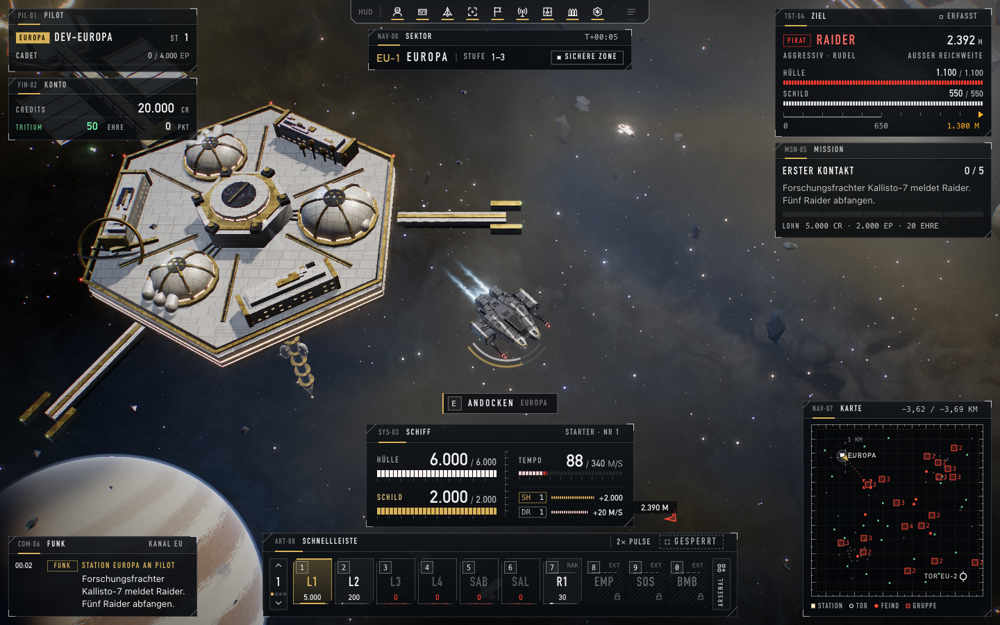
- 7,9 s · Erster Kampf (1,5 s nach dem ersten Schuss): 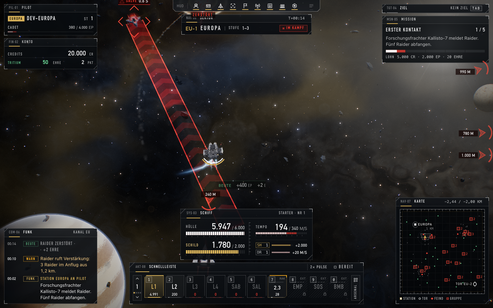
- 12,9 s · Hänger 67 ms (Beute: Wrack einsammeln): 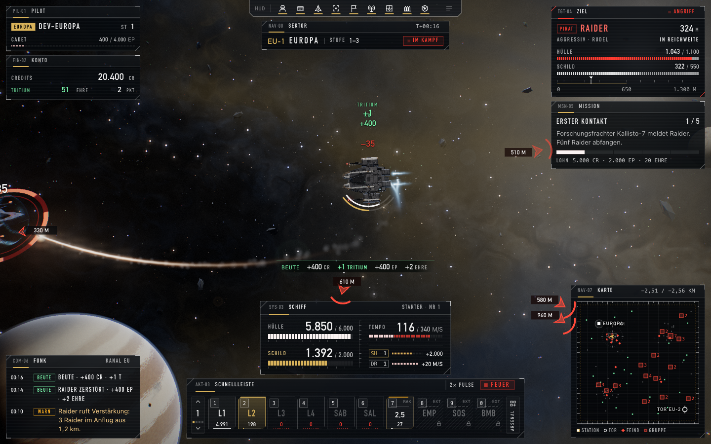
- 26,2 s · Angedockt: Station/Shop: 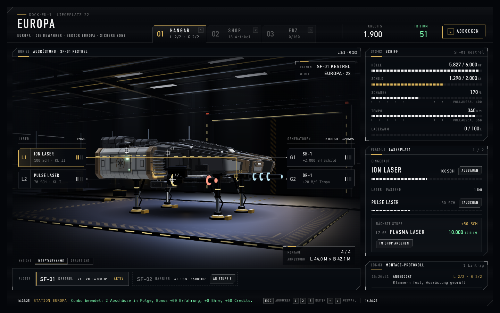
- 54,2 s · Ereignis: Treibgut: 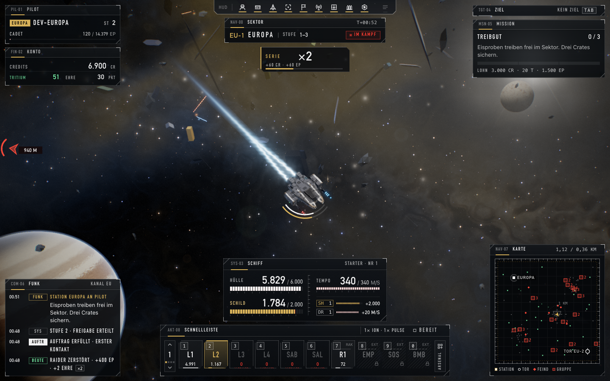
- 90,3 s · Neuer Sektor EU-2 (Io): 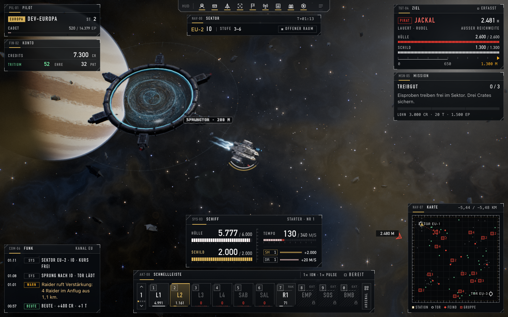
- 102,8 s · Abgeschossen: Reparatur-Auswahl: 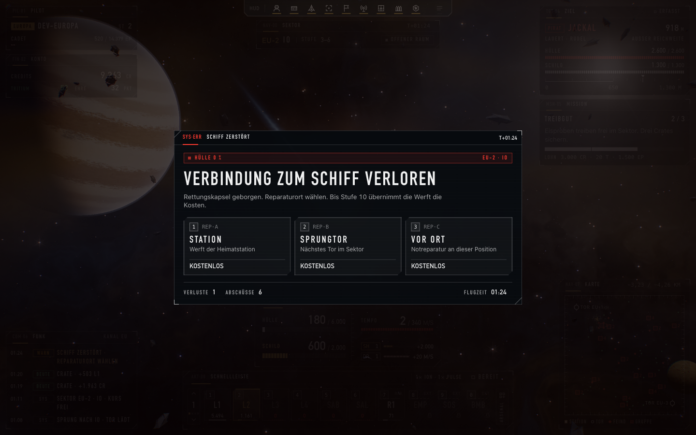
- 120,0 s · Ende der Spielzeit: 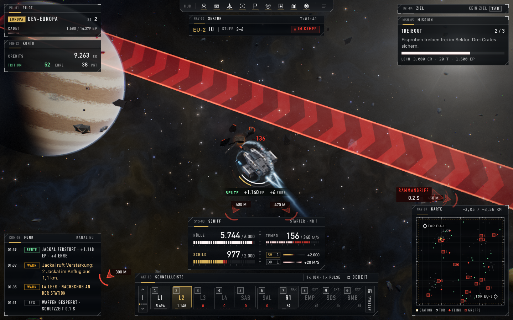
- 125,2 s · Ausrichtung ship:s1:europa: 0° (Beispiel, in Ordnung): 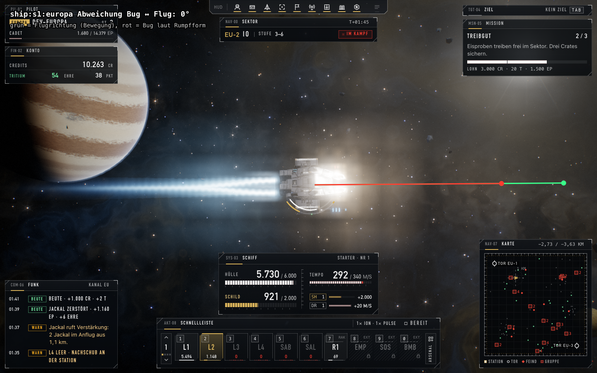

## SATURN · 120 s gespielt · SA-1 → SA-2

Qualität: Stufe MITTEL, Auflösungsfaktor 0,81, Pixeldichte 1,21, Puffer 1749x1093, GPU-Zeitmessung ja. Ladezeit bis Flug 6,9 s.
Grafik-Absicherung: 68,0 s „Bildrate dauerhaft unter 50 – Grafik für diese Sitzung auf MITTEL gesenkt. Deine Einstellung bleibt gespeichert.“

### Bildzeiten (Mittel / p95 / längste, ms)
| Abschnitt | Bilder | Bilder/s | Bildabstand | CPU-Rechenzeit | GPU | Bildzeit max(CPU,GPU) | > 20 ms | > 25 ms | > 33 ms |
|---|---|---|---|---|---|---|---|---|---|
| Gesamt | 5.136 | 46,9 | 21,3 / 33,4 / 6.983,3 | 6,7 / 9,0 / 6.982,4 | 8,1 / 15,5 / 62,3 | 10,5 / 17,8 / 6.982,4 | 468 | 468 | 300 |
| Kampf | 3.195 | 45,7 | 21,9 / 33,6 / 6.983,3 | 7,7 / 8,9 / 6.982,4 | 7,9 / 13,3 / 62,3 | 11,1 / 15,6 / 6.982,4 | 330 | 330 | 218 |
| Ruhe | 1.778 | 53,6 | 18,7 / 33,3 / 450,0 | 5,4 / 9,5 / 442,5 | 8,0 / 16,4 / 46,2 | 9,0 / 17,9 / 442,5 | 134 | 134 | 79 |
| Erster Kampf (10 s) | 363 | 56,4 | 17,7 / 32,4 / 83,5 | 5,5 / 8,2 / 36,5 | 7,7 / 11,5 / 27,2 | 8,3 / 12,3 / 36,5 | 20 | 20 | 9 |
| Angedockt | 163 | 26,1 | 38,3 / 17,5 / 2.399,9 | 2,1 / 5,0 / 10,1 | 15,2 / 30,0 / 34,2 | 15,2 / 30,0 / 34,2 | 4 | 4 | 3 |

Längste Bilder mit Situation:
- 68,0 s: Bildabstand 6.983,3 ms, CPU 18,1 ms, GPU 8,3 ms · Flug zum Sprungtor (5438 m) · SA-1, 8 Gegner nah, 3 greifen an · zuletzt: message×2 · 63 Draw Calls
- 29,1 s: Bildabstand 2.399,9 ms, CPU 6,0 ms, GPU 9,7 ms · Angedockt: Shop · SA-1, 1 Gegner nah, 0 greifen an · zuletzt: profile×1 · 90 Draw Calls
- 29,1 s: Bildabstand 1.133,5 ms, CPU 6,2 ms, GPU 10,2 ms · Angedockt: Shop · SA-1, 1 Gegner nah, 0 greifen an · zuletzt: profile×1 · 93 Draw Calls
- 87,7 s: Bildabstand 450,0 ms, CPU 21,9 ms, GPU 8,9 ms · Sprung lädt · SA-2, 4 Gegner nah, 0 greifen an · zuletzt: sector×1, message×2 · 69 Draw Calls
- 49,3 s: Bildabstand 315,9 ms, CPU 45,7 ms, GPU 18,8 ms · Flug zum Sprungtor (7186 m) · SA-1, 6 Gegner nah, 4 greifen an · zuletzt: nichts · 109 Draw Calls
- 59,7 s: Bildabstand 182,9 ms, CPU 18,5 ms, GPU 7,2 ms · Flug zum Sprungtor (5889 m) · SA-1, 8 Gegner nah, 4 greifen an · zuletzt: special×1, damage×4, telegraph×1 · 90 Draw Calls
- 68,4 s: Bildabstand 165,7 ms, CPU 128,1 ms, GPU 8,3 ms · Flug zum Sprungtor (5312 m) · SA-1, 8 Gegner nah, 3 greifen an · zuletzt: nichts · 66 Draw Calls
- 1,4 s: Bildabstand 150,6 ms, CPU 9,4 ms, GPU 30,6 ms · Anflug auf Raider (1922 m) · SA-1, 0 Gegner nah, 0 greifen an · zuletzt: modell-geladen×1 · 106 Draw Calls

### Kampfwerte
Schüsse 75 (Treffer 80,0 %), Raketen 13, Tode 1 (Todestest nachgeholfen: Stufe 1).
Eingesteckt: 1.013 Hülle + 3.138 Schild · je Quelle: raider 2.750, jackal 1.401.
Beute gesamt: 8.476 Credits, 4 Tritium, 5.820 Erfahrung, 40 Ehre.
Je Minute: **4.238 Credits, 2,0 Tritium, 2.910 Erfahrung, 20,0 Ehre**.
Profil: 20.000 → 9.976 Credits, 50 → 54 Tritium, Stufe 1 → 2.

| Gegner | Abschüsse | Zeit bis Abschuss Mittel / Median / max (s) |
|---|---|---|
| raider | 6 | 3,5 / 2,8 / 5,4 |
| jackal | 1 | 8,2 / 8,2 / 8,2 |

Munition (Versuche/erfolgreich/Vorrat danach): L1 2/2/4.992 · L2 1/1/200 · L3 1/0/0 · L4 1/0/0 · SAB 1/0/0 · SAL 1/0/0. Schüsse je Munition: L1 16, L2 59.
Schussrichtung zur Schiffsnase: Mittel 17,1°, p95 73,8°, 19 Schüsse über 45°, 0 über 90° (Laser feuern dann seitlich/rückwärts aus den Mündungen).
Einkäufe: ammo L2 ok (−1.000 Credits, −0 Tritium) · rocket R1 ok (−2.500 Credits, −0 Tritium) · ammo L3 abgelehnt: Zu wenig Tritium: 250 nötig, du hast 51. · ammo SAL abgelehnt: Zu wenig Tritium: 200 nötig, du hast 51. · ammo SAB abgelehnt: Zu wenig Tritium: 500 nötig, du hast 51. · laser ion ok (−15.000 Credits, −0 Tritium).
Dauer der Aufrufe: Andocken 1.832,4 ms, 6 Einkäufe 1.123,2 ms, Abdocken 0,6 ms.
Reparaturen: 102,8 s here ok (kostenlos (bis Stufe 10)). Sprünge: 87,6 s → SA-2. Stufenaufstiege: 97,3 s → 2.

### Gegnerverhalten
| Typ | Stichproben | Zeitanteile | Abstand zum Spieler im Angriff (Mittel/Median/min m) | Ausweichen | Angriffsbeginn selbst/Sicht/mitgezogen | Flucht | übereinander | Schüsse/Treffer |
|---|---|---|---|---|---|---|---|---|
| raider | 2.694 | patrouille 61,1 %, anfliegen / flanke 23,3 %, umkreisen / flanke 4,0 %, hold / wartet im kreis 3,4 %, fliehen / rückzug zum heilen 3,0 %, abdrehen / flanke 1,3 %, ausweichen / flanke 1,0 %, anfliegen / lädt salve 0,7 %, angreifen (stehend) / lädt salve 0,6 %, angreifen (stehend) / salve 0,4 %, anfliegen 0,3 %, umkreisen / lädt salve 0,3 %, angreifen (stehend) / flanke 0,2 %, umkreisen 0,1 %, ausweichen / rückzug zum heilen 0,1 %, abdrehen 0,1 %, hold 0,1 %, angreifen (stehend) 0,0 % | 729 / 666 / 85 | 9 | 2/5/14 | 5 | 0,0 % | 89/56 |
| larva | 218 | patrouille 100,0 % | – | 0 | 0/0/0 | 0 | 0,0 % | 0/0 |
| jackal | 242 | patrouille 43,0 %, anfliegen / springt an 14,5 %, umkreisen / springt an 12,0 %, abdrehen / springt an 9,9 %, anfliegen / rammt 4,5 %, patrouille / lauert getarnt 2,9 %, anfliegen / lädt rammangriff 2,9 %, ausweichen / springt an 2,9 %, umkreisen / lädt rammangriff 2,5 %, fliehen / rückzug zum heilen 2,5 %, hold / wartet im kreis 1,2 %, anfliegen 0,8 %, abdrehen / lädt rammangriff 0,4 % | 431 / 418 / 126 | 2 | 1/1/2 | 1 | 0,0 % | 22/19 |

Übereinander (Abstand < 0,75 × Summe der Trefferradien): in 0,0 % der Stichproben, Vorfälle keine, höchstens 0 Paare gleichzeitig. Hilfe-/Verstärkungsmeldungen: 9, vorübergehend erzeugte Gegner: 5.

### Ausrichtung der Modelle
| Modell | Art | Bug laut Rumpfform (°) | Form eindeutig | Mündungen vor Mitte | Laufrichtung (°) | Triebwerke hinter Mitte | Schweif (°) | Flug im Spiel (Median/p95 °) | Flug in Szene (°) | Befund · Hinweise |
|---|---|---|---|---|---|---|---|---|---|---|
| ship:s1:europa | GLB | 0,0 | ja (Achse 0,84, Verjüngung 1,62) | 0,77 0,92 | -0 -0 | 1,14 1,14 | 0 0 | – | 0,0 | ok · Cockpit-Glas vorn 0°, Hoheitszeichen links/rechts 0°, Rumpf verjüngt sich zum Bug -180° |
| ship:s1:europa:platzhalter | Platzhalter | 0,0 | ja (Achse 0,63, Verjüngung 2,05) | 0,64 0,77 | 0 0 | 1,00 1,00 0,58 0,58 | 0 0 0 0 | – | – | ok · Rumpf verjüngt sich zum Bug 0° |
| ship:s2:europa | GLB | -0,3 | ja (Achse 0,74, Verjüngung 1,04) | 0,66 0,78 0,59 0,69 | -0 -0 -0 0 | 1,10 1,10 1,10 | 0 0 0 | – | 0,3 | ok · Hoheitszeichen links/rechts 0°, eigene Laser des Modells vorn -1° |
| ship:s2:europa:platzhalter | Platzhalter | 0,0 | ja (Achse 0,68, Verjüngung 1,49) | 0,64 0,76 0,56 0,66 | 0 0 0 0 | 1,00 1,00 0,58 0,58 1,00 | 0 0 0 0 0 | – | – | ok · Rumpf verjüngt sich zum Bug 0° |
| ship:s1:saturn | GLB | 0,0 | ja (Achse 0,85, Verjüngung 1,62) | 0,77 0,92 | -0 -0 | 1,14 1,14 | 0 0 | 0,1 / 136,1 (550) | 0,0 | ok · Cockpit-Glas vorn 0°, Hoheitszeichen links/rechts 0°, Rumpf verjüngt sich zum Bug -180° |
| ship:s1:saturn:platzhalter | Platzhalter | 0,0 | ja (Achse 0,71, Verjüngung 2,07) | 0,64 0,76 | 0 0 | 1,00 1,00 0,58 0,58 | 0 0 0 0 | – | – | ok · Rumpf verjüngt sich zum Bug 0° |
| ship:s2:saturn | GLB | -0,3 | ja (Achse 0,75, Verjüngung 1,04) | 0,67 0,79 0,59 0,69 | -0 -0 -0 0 | 1,10 1,10 1,10 | 0 0 0 | – | 0,2 | ok · Hoheitszeichen links/rechts 0°, eigene Laser des Modells vorn -1° |
| ship:s2:saturn:platzhalter | Platzhalter | 0,0 | ja (Achse 0,66, Verjüngung 1,50) | 0,64 0,76 0,56 0,66 | 0 0 0 0 | 1,00 1,00 0,58 0,58 1,00 | 0 0 0 0 0 | – | – | ok · Rumpf verjüngt sich zum Bug 0° |
| ship:s1:eris | GLB | 0,0 | ja (Achse 0,85, Verjüngung 1,62) | 0,77 0,92 | -0 -0 | 1,14 1,14 | 0 0 | – | 0,0 | ok · Cockpit-Glas vorn 0°, Hoheitszeichen links/rechts 0°, Rumpf verjüngt sich zum Bug -180° |
| ship:s1:eris:platzhalter | Platzhalter | 0,0 | ja (Achse 0,63, Verjüngung 2,01) | 0,64 0,76 | 0 0 | 1,00 1,00 0,58 0,58 | 0 0 0 0 | – | – | ok · Rumpf verjüngt sich zum Bug 0° |
| ship:s2:eris | GLB | -0,3 | ja (Achse 0,73, Verjüngung 1,04) | 0,66 0,78 0,59 0,69 | -0 -0 -0 0 | 1,10 1,10 1,10 | 0 0 0 | – | 0,3 | ok · Hoheitszeichen links/rechts 0°, eigene Laser des Modells vorn -1° |
| ship:s2:eris:platzhalter | Platzhalter | 0,0 | ja (Achse 0,60, Verjüngung 1,47) | 0,64 0,76 0,56 0,66 | 0 0 0 0 | 1,00 1,00 0,58 0,58 1,00 | 0 0 0 0 0 | – | – | ok · Rumpf verjüngt sich zum Bug 0° |
| enemy:raider | Platzhalter | 0,0 | ja (Achse 1,00, Verjüngung 2.085.278,75) | – | – | 0,98 0,98 | 0 0 | 0,0 / 0,1 (1360) | 0,0 | ok · Rumpf verjüngt sich zum Bug 0° |
| enemy:larva | Platzhalter | 0,0 | ja (Achse 1,00, Verjüngung 2,49) | – | – | – | – | 0,0 / 0,0 (151) | 0,0 | ok · Rumpf verjüngt sich zum Bug 0° |
| enemy:jackal | Platzhalter | 0,0 | ja (Achse 1,00, Verjüngung 1,50) | – | – | 0,68 0,68 | 0 0 | 0,0 / 7,4 (75) | 0,0 | ok · Rumpf verjüngt sich zum Bug 0° |
| enemy:spiker | Platzhalter | 165,0 | ja (Achse 0,47, Verjüngung 3,12) | – | – | – | – | – | dreht | dreht sich ständig (gewollt), keine Bugprüfung · Rumpf verjüngt sich zum Bug 165° |
| enemy:vulture | Platzhalter | 0,0 | ja (Achse 1,00, Verjüngung 3,25) | – | – | 0,50 0,50 | 0 0 | – | 0,0 | ok · Rumpf verjüngt sich zum Bug 0° |

Keine Abweichungen über 20°: Bug zeigt bei allen Modellen in Flugrichtung, Mündungen vorn, Triebwerke und Schweif hinten.

### Konsole
2 Fehler, 1 Warnungen, 5 Hinweise (Netz).
- 2× Fehler: Failed to load resource: the server responded with a status of 404 (Not Found)
- 1× Warnung: The AudioContext was not allowed to start. It must be resumed (or created) after a user gesture on the page. https://developer.chrome.com/blog/autoplay/#web_audio
- 1× Hinweis: HEAD /models/station-europa.glb abgebrochen
- 1× Hinweis: HEAD /models/station-saturn.glb abgebrochen
- 1× Hinweis: HEAD /models/station-eris.glb abgebrochen
- 1× Hinweis: HEAD /models/europa-starter.glb abgebrochen
- 1× Hinweis: HEAD /models/eris-starter.glb abgebrochen

### Bilder
- 0,5 s · Ereignis: Erster Kontakt: 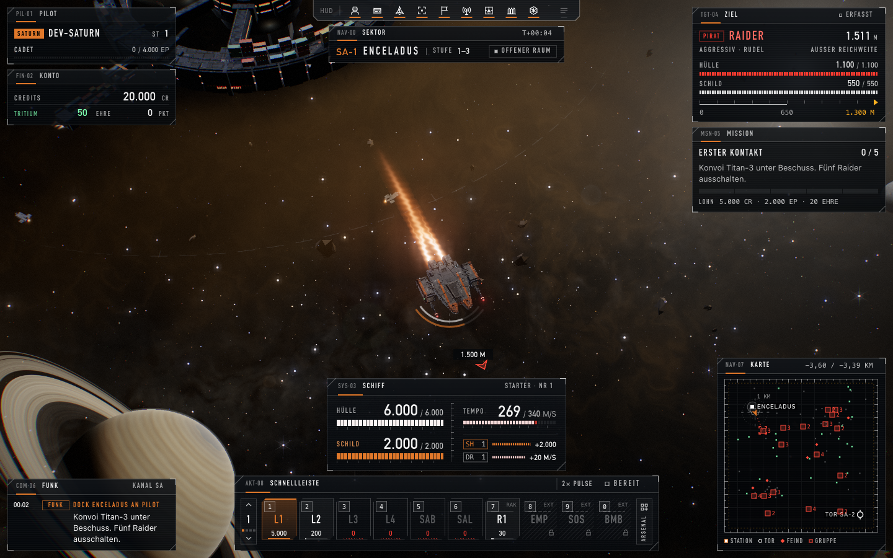
- 1,3 s · Hänger 66 ms (Anflug auf Raider (1922 m)): 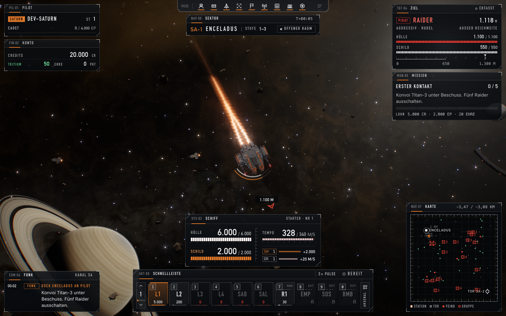
- 6,2 s · Hänger 84 ms (Kampf: Raider umkreisen): 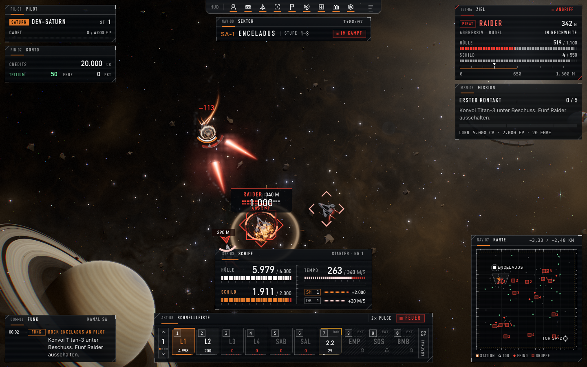
- 7,2 s · Erster Kampf (1,5 s nach dem ersten Schuss): 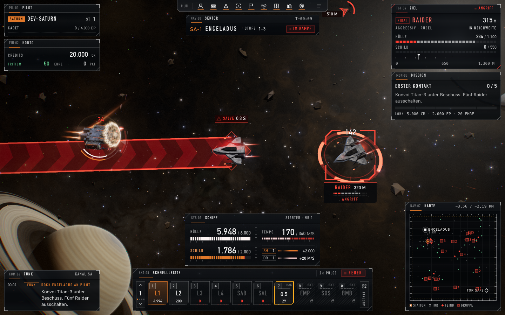
- 30,3 s · Angedockt: Station/Shop: 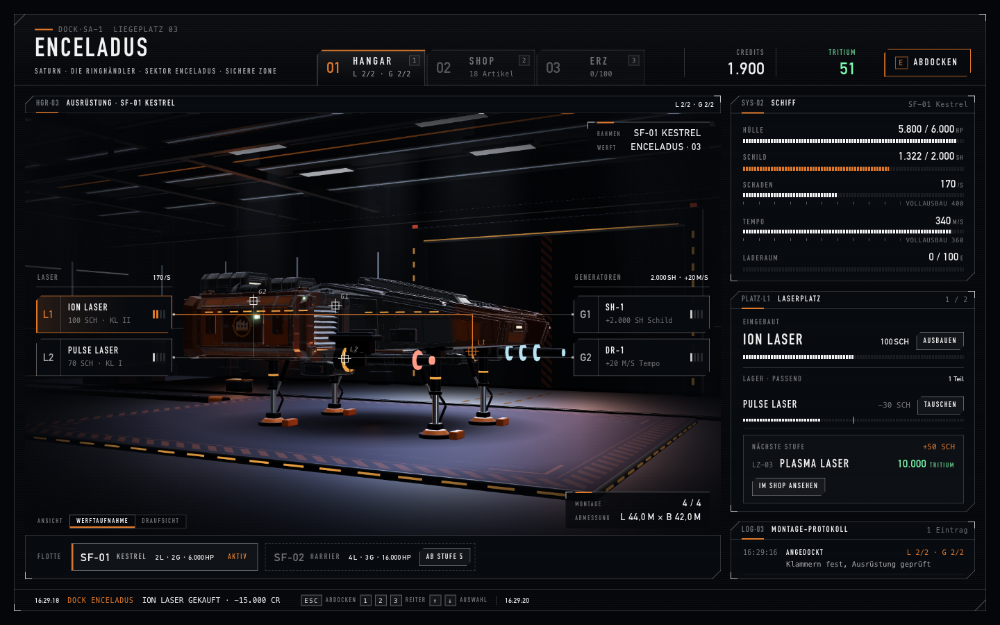
- 90,2 s · Neuer Sektor SA-2 (Mimas): 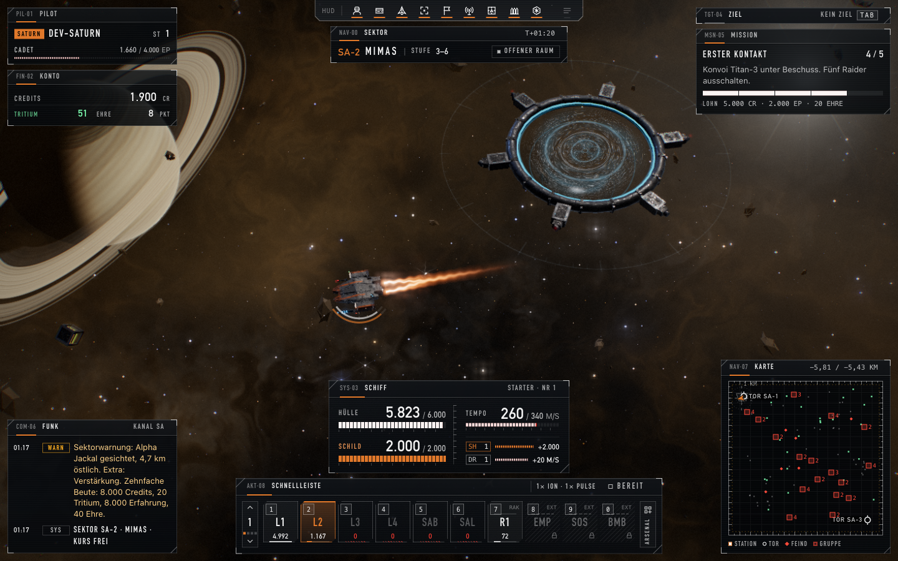
- 100,2 s · Abgeschossen: Reparatur-Auswahl: 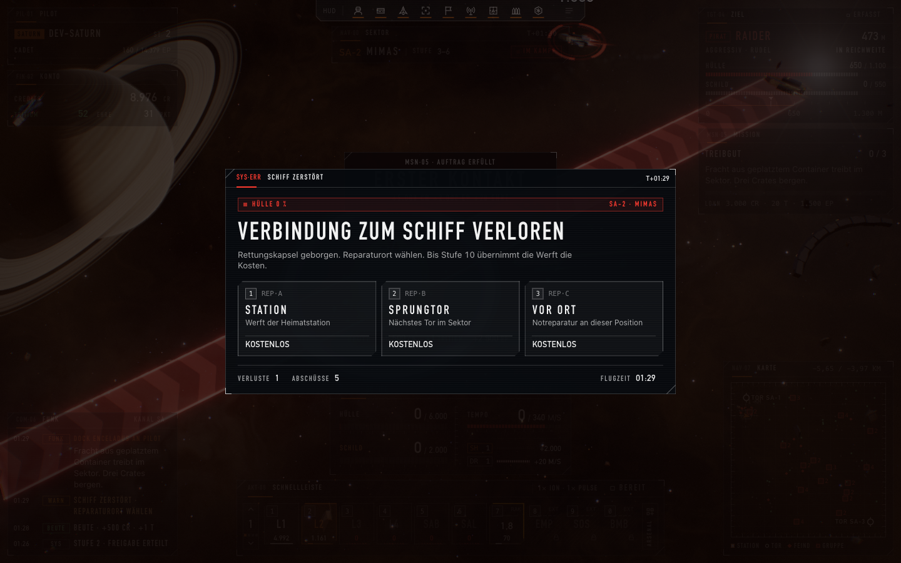
- 120,0 s · Ende der Spielzeit: 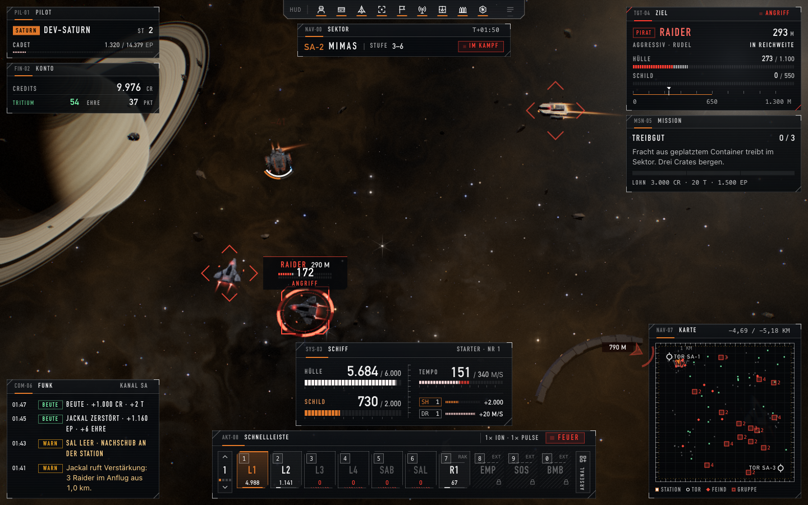
- 135,1 s · Ausrichtung ship:s1:saturn: 0° (Beispiel, in Ordnung): 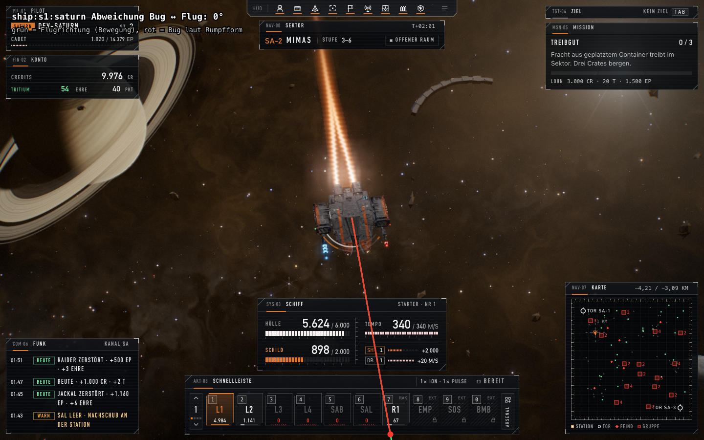

## ERIS · 120 s gespielt · ER-1 → ER-2

Qualität: Stufe HOCH, Auflösungsfaktor 0,76, Pixeldichte 1,52, Puffer 2188x1367, GPU-Zeitmessung ja. Ladezeit bis Flug 6,0 s.

### Bildzeiten (Mittel / p95 / längste, ms)
| Abschnitt | Bilder | Bilder/s | Bildabstand | CPU-Rechenzeit | GPU | Bildzeit max(CPU,GPU) | > 20 ms | > 25 ms | > 33 ms |
|---|---|---|---|---|---|---|---|---|---|
| Gesamt | 5.287 | 46,8 | 21,4 / 33,4 / 9.732,7 | 6,7 / 8,7 / 9.733,0 | 8,6 / 17,4 / 79,8 | 11,1 / 18,0 / 9.733,0 | 466 | 466 | 287 |
| Kampf | 2.694 | 54,0 | 18,5 / 33,4 / 166,7 | 5,1 / 9,2 / 154,4 | 8,5 / 15,5 / 41,0 | 9,1 / 16,2 / 154,4 | 254 | 254 | 137 |
| Ruhe | 2.457 | 42,9 | 23,3 / 33,6 / 9.732,7 | 8,7 / 8,1 / 9.733,0 | 8,3 / 17,0 / 56,0 | 12,9 / 17,7 / 9.733,0 | 206 | 206 | 144 |
| Erster Kampf (10 s) | 432 | 55,3 | 18,1 / 32,9 / 100,0 | 5,6 / 9,8 / 93,8 | 9,3 / 17,9 / 41,0 | 9,8 / 18,1 / 93,8 | 30 | 30 | 11 |
| Angedockt | 136 | 23,5 | 42,5 / 18,6 / 2.235,0 | 2,2 / 4,7 / 34,1 | 19,4 / 31,6 / 79,8 | 19,4 / 31,6 / 79,8 | 6 | 6 | 6 |

Längste Bilder mit Situation:
- 91,9 s: Bildabstand 9.732,7 ms, CPU 14,4 ms, GPU 9,8 ms · Sprung lädt · ER-2, 0 Gegner nah, 0 greifen an · zuletzt: sector×1, message×2 · 65 Draw Calls
- 31,8 s: Bildabstand 2.235,0 ms, CPU 12,5 ms, GPU 13,4 ms · Angedockt: Shop · ER-1, 0 Gegner nah, 0 greifen an · zuletzt: profile×1 · 79 Draw Calls
- 31,9 s: Bildabstand 1.098,5 ms, CPU 4,1 ms, GPU 13,4 ms · Angedockt: Shop · ER-1, 0 Gegner nah, 0 greifen an · zuletzt: profile×1 · 79 Draw Calls
- 38,1 s: Bildabstand 199,8 ms, CPU 8,8 ms, GPU 44,8 ms · Flug zum Sprungtor (11404 m) · ER-1, 0 Gegner nah, 0 greifen an · zuletzt: nichts · 74 Draw Calls
- 81,8 s: Bildabstand 184,8 ms, CPU 6,0 ms, GPU 7,4 ms · Sprung lädt · ER-1, 0 Gegner nah, 0 greifen an · zuletzt: nichts · 78 Draw Calls
- 92,1 s: Bildabstand 182,6 ms, CPU 9,0 ms, GPU 10,9 ms · Todestest: kämpfen ohne Rückzug · ER-2, 0 Gegner nah, 0 greifen an · zuletzt: sector×1, message×2 · 65 Draw Calls
- 79,9 s: Bildabstand 167,6 ms, CPU 6,6 ms, GPU 1,7 ms · Sprung lädt · ER-1, 2 Gegner nah, 0 greifen an · zuletzt: nichts · 78 Draw Calls
- 70,6 s: Bildabstand 166,7 ms, CPU 6,1 ms, GPU 14,5 ms · Flug zum Sprungtor (2795 m) · ER-1, 6 Gegner nah, 2 greifen an · zuletzt: damage×1, explode×1, despawn×1, loot×1, message×1, spawn×1, profile×1, quest×1 · 77 Draw Calls

### Kampfwerte
Schüsse 43 (Treffer 79,1 %), Raketen 9, Tode 1 (Todestest nachgeholfen: Stufe 2).
Eingesteckt: 196 Hülle + 790 Schild · je Quelle: larva 351, raider 158, jackal 477.
Beute gesamt: 1.776 Credits, 3 Tritium, 3.445 Erfahrung, 15 Ehre.
Je Minute: **888 Credits, 1,5 Tritium, 1.722 Erfahrung, 7,5 Ehre**.
Profil: 20.000 → 3.276 Credits, 50 → 53 Tritium, Stufe 1 → 1.

| Gegner | Abschüsse | Zeit bis Abschuss Mittel / Median / max (s) |
|---|---|---|
| larva | 3 | 0,7 / 0,7 / 0,8 |
| raider | 3 | 5,8 / 4,7 / 10,6 |
| jackal | 1 | 6,1 / 6,1 / 6,1 |

Munition (Versuche/erfolgreich/Vorrat danach): L1 1/1/4.998 · L2 1/1/200 · L3 1/0/0 · L4 1/0/0. Schüsse je Munition: L1 6, L2 37.
Schussrichtung zur Schiffsnase: Mittel 13,9°, p95 58,6°, 5 Schüsse über 45°, 0 über 90° (Laser feuern dann seitlich/rückwärts aus den Mündungen).
Einkäufe: ammo L2 ok (−1.000 Credits, −0 Tritium) · rocket R1 ok (−2.500 Credits, −0 Tritium) · ammo L3 abgelehnt: Zu wenig Tritium: 250 nötig, du hast 53. · ammo SAL abgelehnt: Zu wenig Tritium: 200 nötig, du hast 53. · ammo SAB abgelehnt: Zu wenig Tritium: 500 nötig, du hast 53. · laser ion ok (−15.000 Credits, −0 Tritium).
Dauer der Aufrufe: Andocken 1.577,4 ms, 6 Einkäufe 1.087,3 ms, Abdocken 0,9 ms.
Reparaturen: 108,7 s here ok (kostenlos (bis Stufe 10)). Sprünge: 91,8 s → ER-2. Stufenaufstiege: keine.

### Gegnerverhalten
| Typ | Stichproben | Zeitanteile | Abstand zum Spieler im Angriff (Mittel/Median/min m) | Ausweichen | Angriffsbeginn selbst/Sicht/mitgezogen | Flucht | übereinander | Schüsse/Treffer |
|---|---|---|---|---|---|---|---|---|
| larva | 610 | patrouille 76,1 %, anfliegen / umzingeln 13,4 %, umkreisen / umzingeln 4,4 %, abdrehen / umzingeln 1,1 %, anfliegen / springt 1,0 %, abdrehen / lädt sprungbiss 0,8 %, abdrehen 0,5 %, angreifen (stehend) / umzingeln 0,5 %, hold 0,3 %, umkreisen 0,3 %, anfliegen / lädt sprungbiss 0,3 %, umkreisen / lädt sprungbiss 0,3 %, angreifen (stehend) 0,2 %, ausweichen / umzingeln 0,2 %, angreifen (stehend) / springt 0,2 %, abdrehen / springt 0,2 %, anfliegen 0,2 % | 673 / 547 / 28 | 1 | 2/0/4 | 0 | 0,0 % | 5/4 |
| raider | 2.069 | patrouille 78,1 %, anfliegen / flanke 12,2 %, hold / wartet im kreis 5,0 %, umkreisen / flanke 2,8 %, ausweichen / flanke 0,6 %, fliehen / rückzug zum heilen 0,4 %, abdrehen / flanke 0,3 %, hold 0,2 %, anfliegen / lädt salve 0,2 %, umkreisen 0,1 %, abdrehen 0,0 % | 969 / 963 / 394 | 4 | 0/4/1 | 2 | 0,3 % | 4/4 |
| jackal | 437 | patrouille 66,1 %, hold / wartet im kreis 10,1 %, anfliegen / springt an 7,8 %, patrouille / lauert getarnt 3,9 %, anfliegen / rammt 3,2 %, ausweichen / springt an 1,8 %, abdrehen / springt an 1,6 %, anfliegen / lädt rammangriff 1,6 %, umkreisen / lädt rammangriff 1,4 %, umkreisen / springt an 1,1 %, anfliegen 0,5 %, abdrehen / lädt rammangriff 0,5 %, abdrehen / rammt 0,2 %, fliehen / rückzug zum heilen 0,2 % | 588 / 601 / 163 | 2 | 1/1/3 | 1 | 0,0 % | 5/5 |

Übereinander (Abstand < 0,75 × Summe der Trefferradien): in 0,6 % der Stichproben, Vorfälle raider 3, höchstens 1 Paare gleichzeitig. Hilfe-/Verstärkungsmeldungen: 7, vorübergehend erzeugte Gegner: 5.

### Ausrichtung der Modelle
| Modell | Art | Bug laut Rumpfform (°) | Form eindeutig | Mündungen vor Mitte | Laufrichtung (°) | Triebwerke hinter Mitte | Schweif (°) | Flug im Spiel (Median/p95 °) | Flug in Szene (°) | Befund · Hinweise |
|---|---|---|---|---|---|---|---|---|---|---|
| ship:s1:europa | GLB | 0,0 | ja (Achse 0,84, Verjüngung 1,62) | 0,77 0,92 | -0 -0 | 1,14 1,14 | 0 0 | – | 1,8 | ok · Cockpit-Glas vorn 0°, Hoheitszeichen links/rechts 0°, Rumpf verjüngt sich zum Bug -180° |
| ship:s1:europa:platzhalter | Platzhalter | 0,0 | ja (Achse 0,63, Verjüngung 2,05) | 0,64 0,77 | 0 0 | 1,00 1,00 0,58 0,58 | 0 0 0 0 | – | – | ok · Rumpf verjüngt sich zum Bug 0° |
| ship:s2:europa | GLB | -0,3 | ja (Achse 0,74, Verjüngung 1,04) | 0,66 0,78 0,59 0,69 | -0 -0 -0 0 | 1,10 1,10 1,10 | 0 0 0 | – | 0,3 | ok · Hoheitszeichen links/rechts 0°, eigene Laser des Modells vorn -1° |
| ship:s2:europa:platzhalter | Platzhalter | 0,0 | ja (Achse 0,68, Verjüngung 1,49) | 0,64 0,76 0,56 0,66 | 0 0 0 0 | 1,00 1,00 0,58 0,58 1,00 | 0 0 0 0 0 | – | – | ok · Rumpf verjüngt sich zum Bug 0° |
| ship:s1:saturn | GLB | 0,0 | ja (Achse 0,85, Verjüngung 1,62) | 0,77 0,92 | -0 -0 | 1,14 1,14 | 0 0 | – | 1,2 | ok · Cockpit-Glas vorn 0°, Hoheitszeichen links/rechts 0°, Rumpf verjüngt sich zum Bug -180° |
| ship:s1:saturn:platzhalter | Platzhalter | 0,0 | ja (Achse 0,71, Verjüngung 2,07) | 0,64 0,76 | 0 0 | 1,00 1,00 0,58 0,58 | 0 0 0 0 | – | – | ok · Rumpf verjüngt sich zum Bug 0° |
| ship:s2:saturn | GLB | -0,3 | ja (Achse 0,75, Verjüngung 1,04) | 0,67 0,79 0,59 0,69 | -0 -0 -0 0 | 1,10 1,10 1,10 | 0 0 0 | – | 0,9 | ok · Hoheitszeichen links/rechts 0°, eigene Laser des Modells vorn -1° |
| ship:s2:saturn:platzhalter | Platzhalter | 0,0 | ja (Achse 0,66, Verjüngung 1,50) | 0,64 0,76 0,56 0,66 | 0 0 0 0 | 1,00 1,00 0,58 0,58 1,00 | 0 0 0 0 0 | – | – | ok · Rumpf verjüngt sich zum Bug 0° |
| ship:s1:eris | GLB | 0,0 | ja (Achse 0,85, Verjüngung 1,62) | 0,77 0,92 | -0 -0 | 1,14 1,14 | 0 0 | 0,1 / 156,7 (655) | 0,1 | ok · Cockpit-Glas vorn 0°, Hoheitszeichen links/rechts 0°, Rumpf verjüngt sich zum Bug -180° |
| ship:s1:eris:platzhalter | Platzhalter | 0,0 | ja (Achse 0,63, Verjüngung 2,01) | 0,64 0,76 | 0 0 | 1,00 1,00 0,58 0,58 | 0 0 0 0 | – | – | ok · Rumpf verjüngt sich zum Bug 0° |
| ship:s2:eris | GLB | -0,3 | ja (Achse 0,73, Verjüngung 1,04) | 0,66 0,78 0,59 0,69 | -0 -0 -0 0 | 1,10 1,10 1,10 | 0 0 0 | – | 0,3 | ok · Hoheitszeichen links/rechts 0°, eigene Laser des Modells vorn -1° |
| ship:s2:eris:platzhalter | Platzhalter | 0,0 | ja (Achse 0,60, Verjüngung 1,47) | 0,64 0,76 0,56 0,66 | 0 0 0 0 | 1,00 1,00 0,58 0,58 1,00 | 0 0 0 0 0 | – | – | ok · Rumpf verjüngt sich zum Bug 0° |
| enemy:raider | Platzhalter | 0,0 | ja (Achse 1,00, Verjüngung 2.085.278,75) | – | – | 0,98 0,98 | 0 0 | 0,0 / 0,2 (1274) | 0,0 | ok · Rumpf verjüngt sich zum Bug 0° |
| enemy:larva | Platzhalter | 0,0 | ja (Achse 1,00, Verjüngung 2,49) | – | – | – | – | 0,0 / 0,1 (382) | 0,0 | ok · Rumpf verjüngt sich zum Bug 0° |
| enemy:jackal | Platzhalter | 0,0 | ja (Achse 1,00, Verjüngung 1,50) | – | – | 0,68 0,68 | 0 0 | 0,0 / 64,5 (178) | 0,0 | ok · Rumpf verjüngt sich zum Bug 0° |
| enemy:spiker | Platzhalter | 165,0 | ja (Achse 0,47, Verjüngung 3,12) | – | – | – | – | – | dreht | dreht sich ständig (gewollt), keine Bugprüfung · Rumpf verjüngt sich zum Bug 165° |
| enemy:vulture | Platzhalter | 0,0 | ja (Achse 1,00, Verjüngung 3,25) | – | – | 0,50 0,50 | 0 0 | – | 0,0 | ok · Rumpf verjüngt sich zum Bug 0° |

Keine Abweichungen über 20°: Bug zeigt bei allen Modellen in Flugrichtung, Mündungen vorn, Triebwerke und Schweif hinten.

### Konsole
2 Fehler, 1 Warnungen, 5 Hinweise (Netz).
- 2× Fehler: Failed to load resource: the server responded with a status of 404 (Not Found)
- 1× Warnung: The AudioContext was not allowed to start. It must be resumed (or created) after a user gesture on the page. https://developer.chrome.com/blog/autoplay/#web_audio
- 1× Hinweis: HEAD /models/station-europa.glb abgebrochen
- 1× Hinweis: HEAD /models/station-saturn.glb abgebrochen
- 1× Hinweis: HEAD /models/station-eris.glb abgebrochen
- 1× Hinweis: HEAD /models/europa-starter.glb abgebrochen
- 1× Hinweis: HEAD /models/eris-starter.glb abgebrochen

### Bilder
- 0,1 s · Hänger 83 ms (Anflug auf Larva (1152 m)): 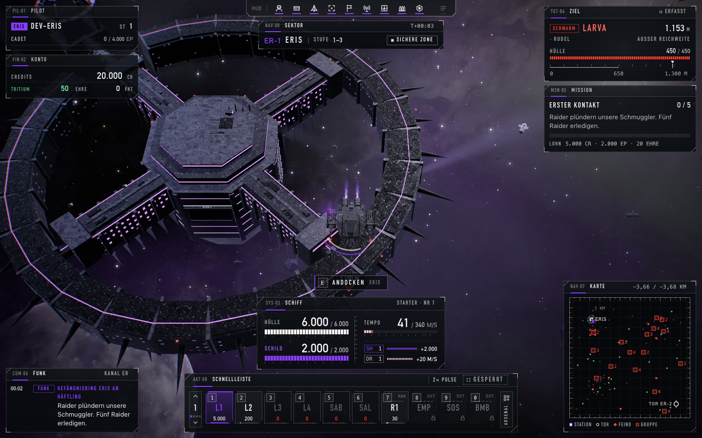
- 5,5 s · Erster Kampf (1,5 s nach dem ersten Schuss): 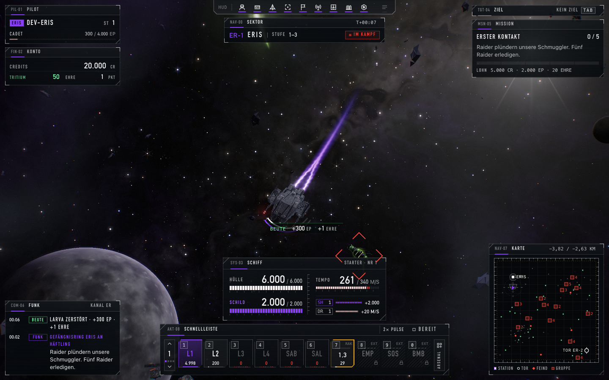
- 9,2 s · Hänger 100 ms (Beute: Wrack einsammeln): 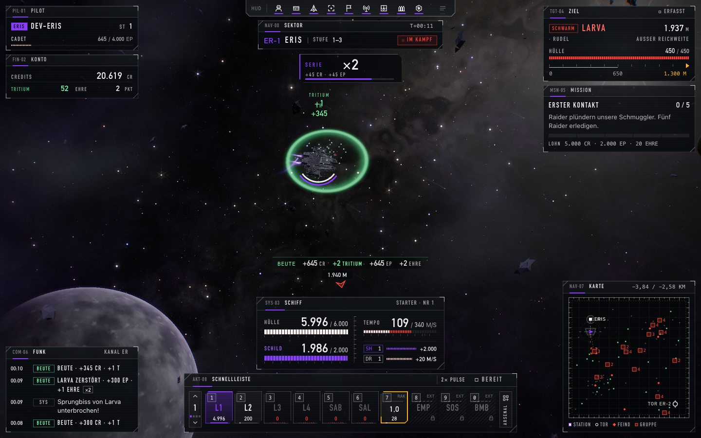
- 33,0 s · Angedockt: Station/Shop: 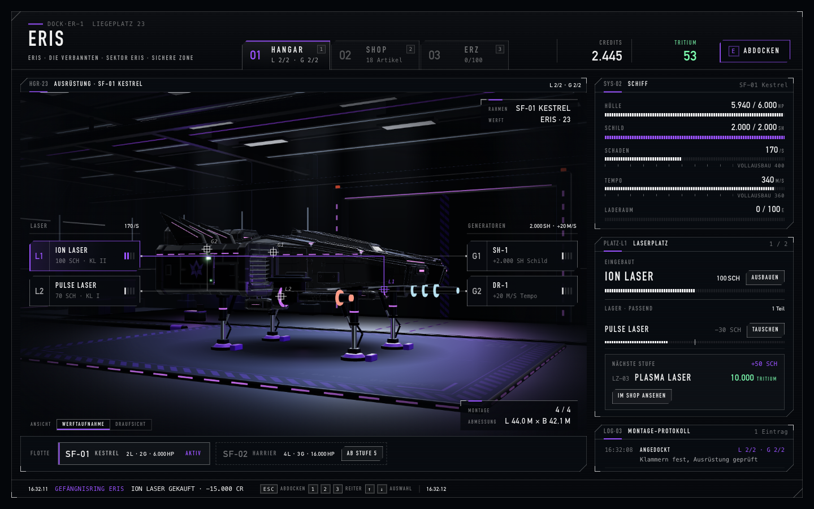
- 94,3 s · Neuer Sektor ER-2 (Dysnomia): 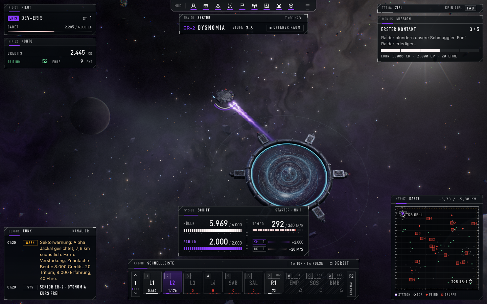
- 106,1 s · Abgeschossen: Reparatur-Auswahl: 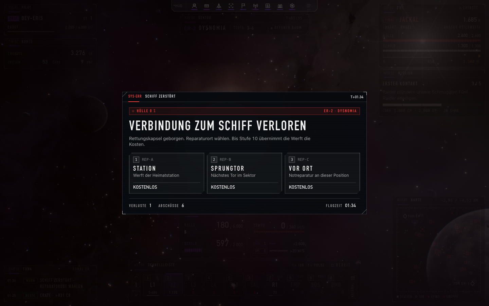
- 120,0 s · Ende der Spielzeit: 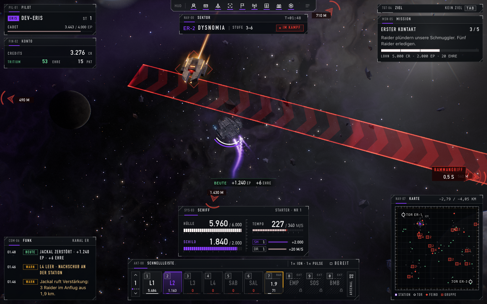
- 136,8 s · Ausrichtung ship:s1:eris: 0.1° (Beispiel, in Ordnung): 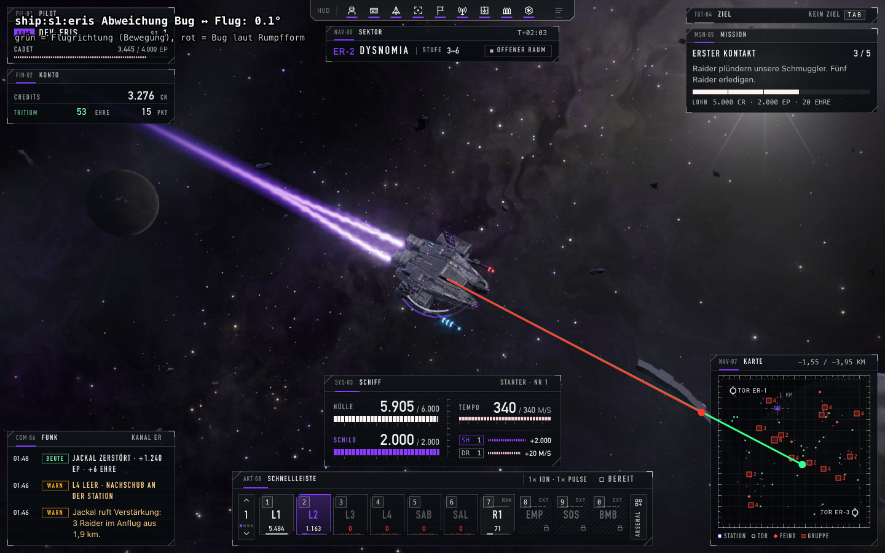
