# Test-Pilot · 2026-10-30_16-38-41

europa, saturn, eris · je 2,0 min · Qualität hoch · Fenster 1440×900 (Pixeldichte 2) · Chrome sichtbar

Ziele: Mac Qualität HOCH im Kampf unter 8 ms je Bild · normaler Laptop Full HD MITTEL mindestens 60 Bilder/s · erster Kampf ohne Hänger über 25 ms.

## EUROPA

Abgebrochen: page.evaluate: Target page, context or browser has been closed
    at runFaction (/Users/077-gaming/Desktop/077/90_Weitere_Projekte/Last-Signals/Code/tools/playtest/spielen.mjs:100:27)
    at async main (/Users/077-gaming/Desktop/077/90_Weitere_Projekte/Last-Signals/Code/tools/playtest/spielen.mjs:232:24)

## SATURN · 120 s gespielt · SA-1 → SA-2

Qualität: Stufe HOCH, Auflösungsfaktor 1,00, Pixeldichte 1,75, Puffer 2520x1575, GPU-Zeitmessung ja. Ladezeit bis Flug 7,7 s.

### Bildzeiten (Mittel / p95 / längste, ms)
| Abschnitt | Bilder | Bilder/s | Bildabstand | CPU-Rechenzeit | GPU | Bildzeit max(CPU,GPU) | > 20 ms | > 25 ms | > 33 ms |
|---|---|---|---|---|---|---|---|---|---|
| Gesamt | 6.073 | 56,5 | 17,7 / 17,6 / 1.167,3 | 3,6 / 5,9 / 1.174,1 | 7,3 / 12,0 / 51,8 | 7,7 / 12,1 / 1.174,1 | 153 | 153 | 104 |
| Kampf | 3.946 | 57,1 | 17,5 / 17,6 / 249,5 | 3,8 / 6,2 / 78,5 | 6,8 / 11,0 / 51,8 | 7,1 / 11,1 / 78,5 | 126 | 126 | 84 |
| Ruhe | 1.933 | 57,0 | 17,6 / 17,5 / 1.167,3 | 3,6 / 5,0 / 1.174,1 | 7,7 / 12,4 / 32,1 | 8,4 / 12,4 / 1.174,1 | 25 | 25 | 18 |
| Erster Kampf (10 s) | 515 | 57,9 | 17,3 / 17,6 / 83,6 | 4,8 / 8,0 / 27,0 | 6,6 / 10,5 / 13,0 | 7,1 / 10,8 / 27,0 | 16 | 16 | 10 |
| Angedockt | 194 | 43,8 | 22,9 / 17,5 / 1.000,9 | 0,8 / 1,8 / 2,7 | 12,2 / 18,4 / 20,2 | 12,2 / 18,4 / 20,2 | 2 | 2 | 2 |

Längste Bilder mit Situation:
- 73,1 s: Bildabstand 1.167,3 ms, CPU 5,1 ms, GPU 10,6 ms · Sprung lädt · SA-2, 0 Gegner nah, 0 greifen an · zuletzt: sector×1, message×1 · 69 Draw Calls
- 25,0 s: Bildabstand 1.000,9 ms, CPU 2,5 ms, GPU 9,2 ms · Angedockt: Shop · SA-1, 1 Gegner nah, 0 greifen an · zuletzt: message×4, profile×3 · 97 Draw Calls
- 86,8 s: Bildabstand 249,5 ms, CPU 5,4 ms, GPU 2,2 ms · Anflug auf Elite Jackal (752 m) · SA-2, 1 Gegner nah, 1 greifen an · zuletzt: nichts · 69 Draw Calls
- 25,1 s: Bildabstand 233,3 ms, CPU 2,7 ms, GPU 7,9 ms · Angedockt: Shop · SA-1, 1 Gegner nah, 0 greifen an · zuletzt: message×4, profile×3 · 97 Draw Calls
- 88,9 s: Bildabstand 133,2 ms, CPU 29,2 ms, GPU 8,9 ms · Todestest: kämpfen ohne Rückzug · SA-2, 1 Gegner nah, 1 greifen an · zuletzt: damage×2 · 69 Draw Calls
- 86,2 s: Bildabstand 100,5 ms, CPU 6,1 ms, GPU 7,1 ms · Anflug auf Elite Jackal (740 m) · SA-2, 1 Gegner nah, 1 greifen an · zuletzt: profile×1 · 70 Draw Calls
- 67,1 s: Bildabstand 100,0 ms, CPU 5,1 ms, GPU 2,6 ms · Flug zum Sprungtor (717 m) · SA-1, 5 Gegner nah, 3 greifen an, Ereignis drift · zuletzt: nichts · 60 Draw Calls
- 16,2 s: Bildabstand 83,6 ms, CPU 5,4 ms, GPU 3,2 ms · Beute: Wrack einsammeln · SA-1, 2 Gegner nah, 2 greifen an · zuletzt: damage×1 · 85 Draw Calls

### Kampfwerte
Schüsse 78 (Treffer 85,9 %), Raketen 13, Tode 1 (Todestest nachgeholfen: Stufe 1).
Eingesteckt: 1.157 Hülle + 3.783 Schild · je Quelle: raider 1.864, jackal 3.076.
Beute gesamt: 4.572 Credits, 8 Tritium, 5.380 Erfahrung, 27 Ehre.
Je Minute: **2.286 Credits, 4,0 Tritium, 2.690 Erfahrung, 13,5 Ehre**.
Profil: 20.000 → 6.072 Credits, 50 → 58 Tritium, Stufe 1 → 2.

| Gegner | Abschüsse | Zeit bis Abschuss Mittel / Median / max (s) |
|---|---|---|
| raider | 4 | 6,4 / 2,7 / 17,3 |
| jackal (elite) | 1 | 35,2 / 35,2 / 35,2 |

Munition (Versuche/erfolgreich/Vorrat danach): L1 2/2/4.992 · L2 2/2/1.148 · L3 1/0/0 · L4 1/0/0 · SAB 1/0/0 · SAL 1/0/0. Schüsse je Munition: L1 10, L2 68.
Schussrichtung zur Schiffsnase: Mittel 9,1°, p95 62,2°, 7 Schüsse über 45°, 0 über 90° (Laser feuern dann seitlich/rückwärts aus den Mündungen).
Einkäufe: ammo L2 ok (−1.000 Credits, −0 Tritium) · rocket R1 ok (−2.500 Credits, −0 Tritium) · ammo L3 abgelehnt: Zu wenig Tritium: 250 nötig, du hast 52. · ammo SAL abgelehnt: Zu wenig Tritium: 200 nötig, du hast 52. · ammo SAB abgelehnt: Zu wenig Tritium: 500 nötig, du hast 52. · laser ion ok (−15.000 Credits, −0 Tritium).
Dauer der Aufrufe: Andocken 377,9 ms, 6 Einkäufe 246,2 ms, Abdocken 0,3 ms.
Reparaturen: 99,6 s here ok (kostenlos (bis Stufe 10)). Sprünge: 73,1 s → SA-2. Stufenaufstiege: 116,9 s → 2.

### Gegnerverhalten
| Typ | Stichproben | Zeitanteile | Abstand zum Spieler im Angriff (Mittel/Median/min m) | Ausweichen | Angriffsbeginn selbst/Sicht/mitgezogen | Flucht | übereinander | Schüsse/Treffer |
|---|---|---|---|---|---|---|---|---|
| raider | 1.706 | patrouille 66,6 %, anfliegen / flanke 20,4 %, umkreisen / flanke 4,9 %, abdrehen / flanke 1,9 %, fliehen / rückzug zum heilen 1,9 %, ausweichen / flanke 0,8 %, angreifen (stehend) / lädt salve 0,8 %, anfliegen / lädt salve 0,6 %, angreifen (stehend) / salve 0,6 %, umkreisen / lädt salve 0,5 %, hold 0,2 %, hold / wartet im kreis 0,2 %, anfliegen 0,2 %, ausweichen / rückzug zum heilen 0,1 %, angreifen (stehend) 0,1 %, angreifen (stehend) / flanke 0,1 %, abdrehen 0,1 %, abdrehen / salve 0,1 % | 723 / 681 / 58 | 5 | 1/4/5 | 3 | 0,0 % | 88/36 |
| larva | 514 | patrouille 100,0 % | – | 0 | 0/0/0 | 0 | 0,0 % | 0/0 |
| jackal | 206 | patrouille 28,2 %, fliehen / rückzug zum heilen 21,8 %, anfliegen / springt an 8,7 %, ausweichen / springt an 8,3 %, umkreisen / springt an 7,3 %, abdrehen / springt an 6,8 %, patrouille / lauert getarnt 4,4 %, abdrehen / lädt rammangriff 3,4 %, anfliegen / rammt 3,4 %, ausweichen / rückzug zum heilen 2,9 %, umkreisen / lädt rammangriff 1,0 %, abdrehen / rammt 1,0 %, abdrehen / schildwall 1,0 %, hold / lauert getarnt 0,5 %, ausweichen / lädt rammangriff 0,5 %, umkreisen / rammt 0,5 %, abdrehen 0,5 % | 380 / 384 / 74 | 7 | 2/0/0 | 1 | 0,0 % | 35/14 |

Übereinander (Abstand < 0,75 × Summe der Trefferradien): in 0,0 % der Stichproben, Vorfälle keine, höchstens 0 Paare gleichzeitig. Hilfe-/Verstärkungsmeldungen: 2, vorübergehend erzeugte Gegner: 10.

### Ausrichtung der Modelle
| Modell | Art | Bug laut Rumpfform (°) | Form eindeutig | Mündungen vor Mitte | Laufrichtung (°) | Triebwerke hinter Mitte | Schweif (°) | Flug im Spiel (Median/p95 °) | Flug in Szene (°) | Befund · Hinweise |
|---|---|---|---|---|---|---|---|---|---|---|
| ship:s1:europa | GLB | 0,0 | ja (Achse 0,84, Verjüngung 1,62) | 0,77 0,92 | -0 -0 | 1,14 1,14 | 0 0 | – | 0,8 | ok · Cockpit-Glas vorn 0°, Hoheitszeichen links/rechts 0°, Rumpf verjüngt sich zum Bug -180° |
| ship:s1:europa:platzhalter | Platzhalter | 0,0 | ja (Achse 0,63, Verjüngung 2,05) | 0,64 0,77 | 0 0 | 1,00 1,00 0,58 0,58 | 0 0 0 0 | – | – | ok · Rumpf verjüngt sich zum Bug 0° |
| ship:s2:europa | GLB | -0,3 | ja (Achse 0,74, Verjüngung 1,04) | 0,66 0,78 0,59 0,69 | -0 -0 -0 0 | 1,10 1,10 1,10 | 0 0 0 | – | 0,5 | ok · Hoheitszeichen links/rechts 0°, eigene Laser des Modells vorn -1° |
| ship:s2:europa:platzhalter | Platzhalter | 0,0 | ja (Achse 0,68, Verjüngung 1,49) | 0,64 0,76 0,56 0,66 | 0 0 0 0 | 1,00 1,00 0,58 0,58 1,00 | 0 0 0 0 0 | – | – | ok · Rumpf verjüngt sich zum Bug 0° |
| ship:s1:saturn | GLB | 0,0 | ja (Achse 0,85, Verjüngung 1,62) | 0,77 0,92 | -0 -0 | 1,14 1,14 | 0 0 | 0,0 / 80,0 (592) | 0,2 | ok · Cockpit-Glas vorn 0°, Hoheitszeichen links/rechts 0°, Rumpf verjüngt sich zum Bug -180° |
| ship:s1:saturn:platzhalter | Platzhalter | 0,0 | ja (Achse 0,71, Verjüngung 2,07) | 0,64 0,76 | 0 0 | 1,00 1,00 0,58 0,58 | 0 0 0 0 | 0,1 / 0,1 (5) | – | ok · Rumpf verjüngt sich zum Bug 0° |
| ship:s2:saturn | GLB | -0,3 | ja (Achse 0,75, Verjüngung 1,04) | 0,67 0,79 0,59 0,69 | -0 -0 -0 0 | 1,10 1,10 1,10 | 0 0 0 | – | 0,4 | ok · Hoheitszeichen links/rechts 0°, eigene Laser des Modells vorn -1° |
| ship:s2:saturn:platzhalter | Platzhalter | 0,0 | ja (Achse 0,66, Verjüngung 1,50) | 0,64 0,76 0,56 0,66 | 0 0 0 0 | 1,00 1,00 0,58 0,58 1,00 | 0 0 0 0 0 | – | – | ok · Rumpf verjüngt sich zum Bug 0° |
| ship:s1:eris | GLB | 0,0 | ja (Achse 0,85, Verjüngung 1,62) | 0,77 0,92 | -0 -0 | 1,14 1,14 | 0 0 | – | 0,6 | ok · Cockpit-Glas vorn 0°, Hoheitszeichen links/rechts 0°, Rumpf verjüngt sich zum Bug -180° |
| ship:s1:eris:platzhalter | Platzhalter | 0,0 | ja (Achse 0,63, Verjüngung 2,01) | 0,64 0,76 | 0 0 | 1,00 1,00 0,58 0,58 | 0 0 0 0 | – | – | ok · Rumpf verjüngt sich zum Bug 0° |
| ship:s2:eris | GLB | -0,3 | ja (Achse 0,73, Verjüngung 1,04) | 0,66 0,78 0,59 0,69 | -0 -0 -0 0 | 1,10 1,10 1,10 | 0 0 0 | – | 0,2 | ok · Hoheitszeichen links/rechts 0°, eigene Laser des Modells vorn -1° |
| ship:s2:eris:platzhalter | Platzhalter | 0,0 | ja (Achse 0,60, Verjüngung 1,47) | 0,64 0,76 0,56 0,66 | 0 0 0 0 | 1,00 1,00 0,58 0,58 1,00 | 0 0 0 0 0 | – | – | ok · Rumpf verjüngt sich zum Bug 0° |
| enemy:raider | Platzhalter | 0,0 | ja (Achse 1,00, Verjüngung 2.085.278,75) | – | – | 0,98 0,98 | 0 0 | 0,0 / 0,0 (825) | 0,0 | ok · Rumpf verjüngt sich zum Bug 0° |
| enemy:larva | Platzhalter | 0,0 | ja (Achse 1,00, Verjüngung 2,49) | – | – | – | – | 0,0 / 0,0 (313) | 0,0 | ok · Rumpf verjüngt sich zum Bug 0° |
| enemy:jackal | Platzhalter | 0,0 | ja (Achse 1,00, Verjüngung 1,50) | – | – | 0,68 0,68 | 0 0 | 0,0 / 12,0 (80) | 0,0 | ok · Rumpf verjüngt sich zum Bug 0° |
| enemy:spiker | Platzhalter | 165,0 | ja (Achse 0,47, Verjüngung 3,12) | – | – | – | – | – | dreht | dreht sich ständig (gewollt), keine Bugprüfung · Rumpf verjüngt sich zum Bug 165° |
| enemy:vulture | Platzhalter | 0,0 | ja (Achse 1,00, Verjüngung 3,25) | – | – | 0,50 0,50 | 0 0 | – | 0,0 | ok · Rumpf verjüngt sich zum Bug 0° |

Keine Abweichungen über 20°: Bug zeigt bei allen Modellen in Flugrichtung, Mündungen vorn, Triebwerke und Schweif hinten.

### Konsole
2 Fehler, 0 Warnungen, 5 Hinweise (Netz).
- 2× Fehler: Failed to load resource: the server responded with a status of 404 (Not Found)
- 1× Hinweis: HEAD /models/station-europa.glb abgebrochen
- 1× Hinweis: HEAD /models/station-saturn.glb abgebrochen
- 1× Hinweis: HEAD /models/station-eris.glb abgebrochen
- 1× Hinweis: HEAD /models/eris-starter.glb abgebrochen
- 1× Hinweis: HEAD /models/europa-starter.glb abgebrochen

### Bilder
- 0,8 s · Ereignis: Erster Kontakt: 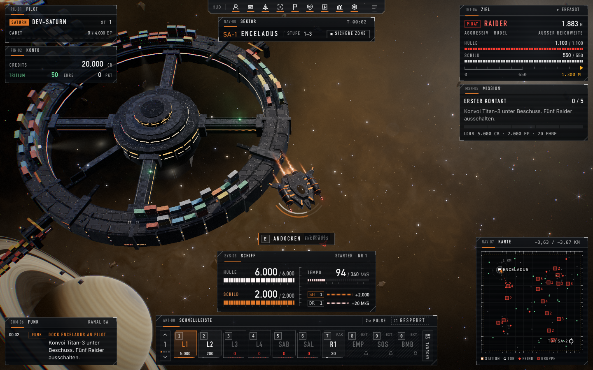
- 4,5 s · Hänger 83 ms (Anflug auf Raider (1371 m)): 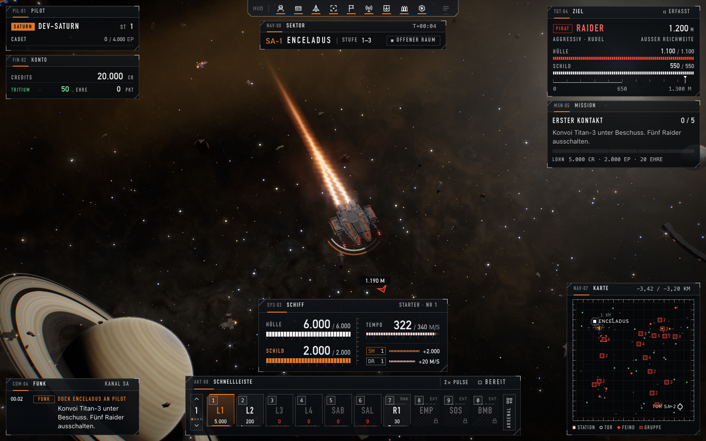
- 7,8 s · Erster Kampf (1,5 s nach dem ersten Schuss): 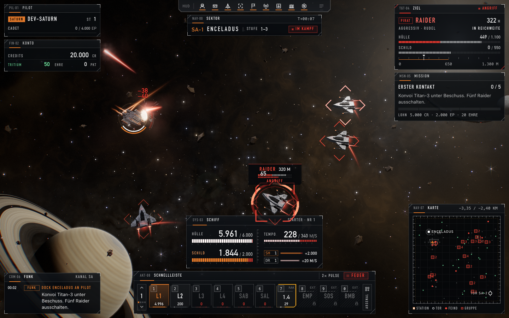
- 26,2 s · Angedockt: Station/Shop: 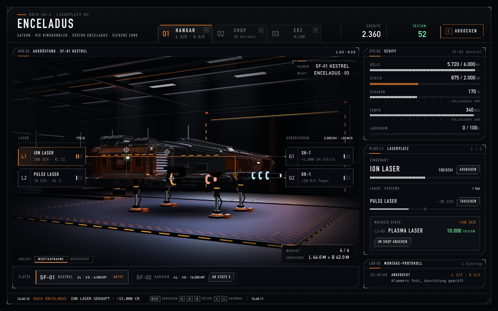
- 62,0 s · Hänger 67 ms (Flug zum Sprungtor (2219 m)): 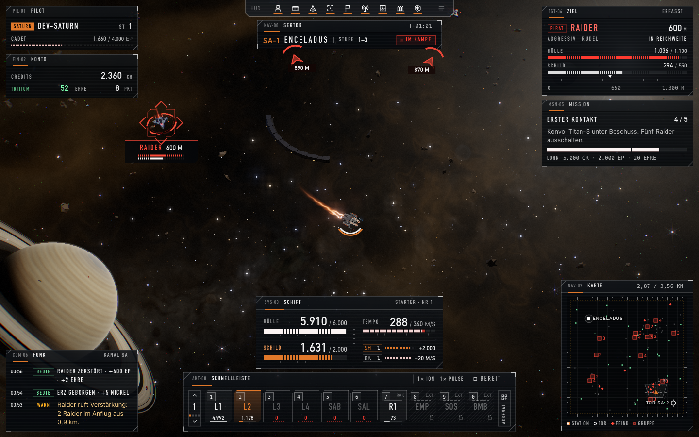
- 75,6 s · Neuer Sektor SA-2 (Mimas): 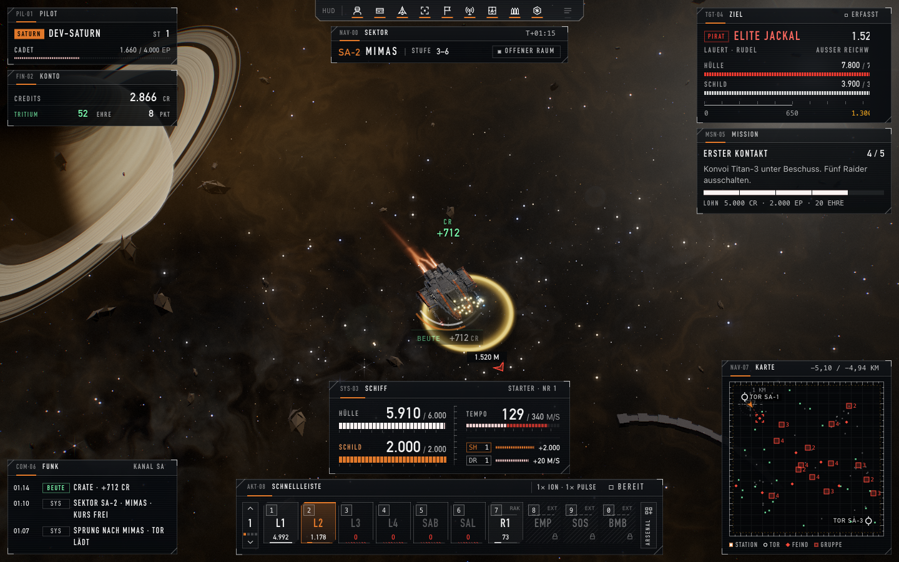
- 97,1 s · Abgeschossen: Reparatur-Auswahl: 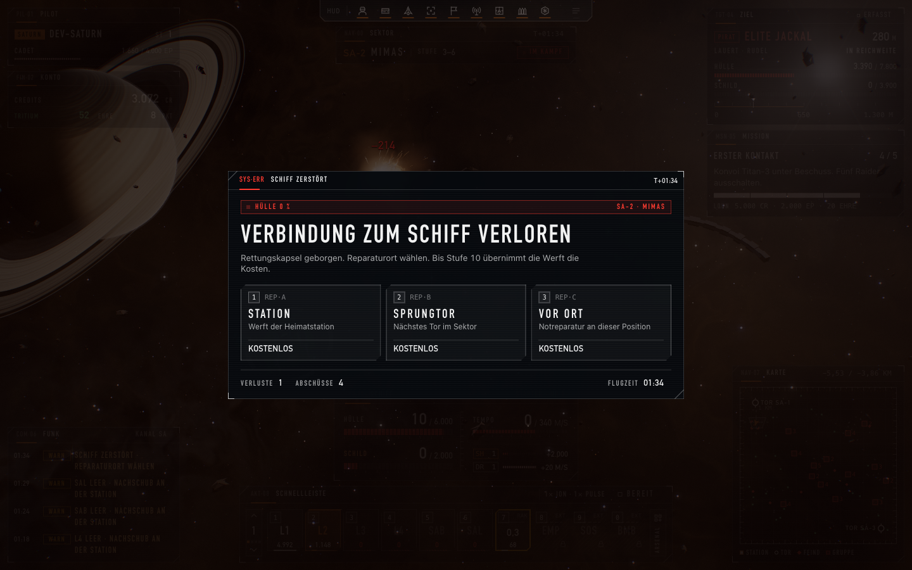
- 116,9 s · Abschuss jackal (elite): 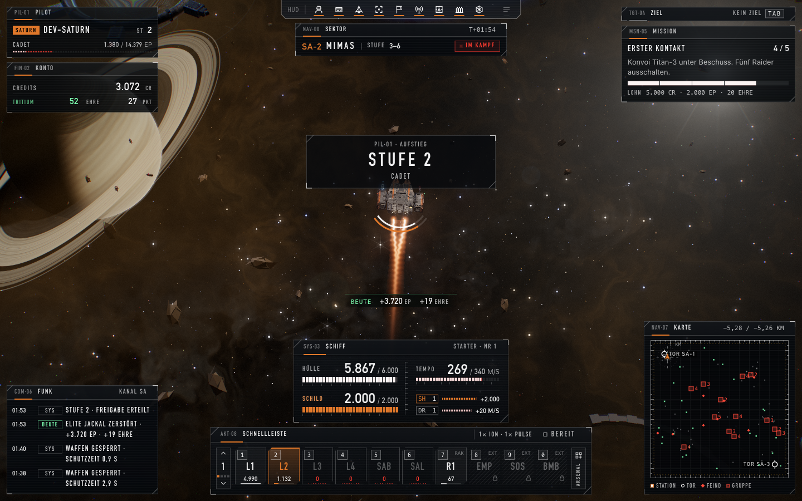
- 120,0 s · Ende der Spielzeit: 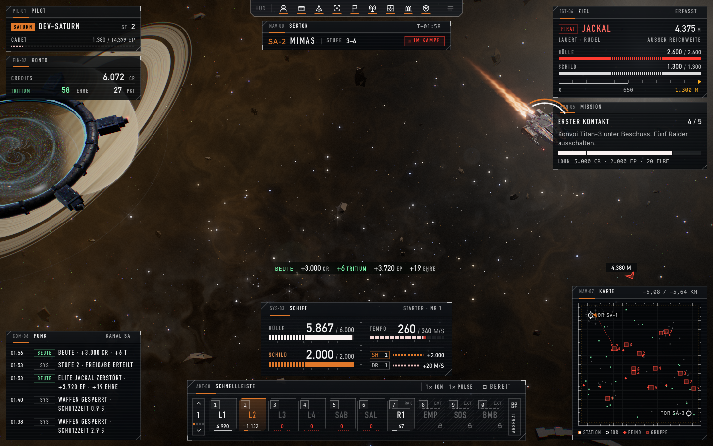
- 131,7 s · Ausrichtung ship:s1:saturn: 0.2° (Beispiel, in Ordnung): 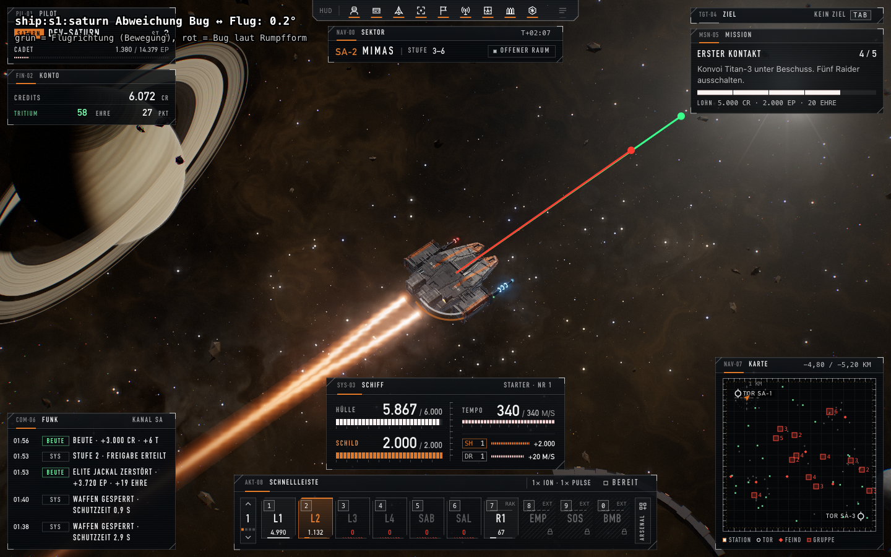

## ERIS · 120 s gespielt · ER-1 → ER-2

Qualität: Stufe MITTEL, Auflösungsfaktor 1,00, Pixeldichte 1,50, Puffer 2160x1350, GPU-Zeitmessung ja. Ladezeit bis Flug 1,7 s.
Grafik-Absicherung: 60,9 s „Bildrate dauerhaft unter 50 – Grafik für diese Sitzung auf MITTEL gesenkt. Deine Einstellung bleibt gespeichert.“

### Bildzeiten (Mittel / p95 / längste, ms)
| Abschnitt | Bilder | Bilder/s | Bildabstand | CPU-Rechenzeit | GPU | Bildzeit max(CPU,GPU) | > 20 ms | > 25 ms | > 33 ms |
|---|---|---|---|---|---|---|---|---|---|
| Gesamt | 5.561 | 50,1 | 19,9 / 17,7 / 5.734,2 | 4,1 / 6,0 / 5.732,6 | 7,0 / 12,2 / 36,3 | 8,5 / 12,4 / 5.732,6 | 243 | 243 | 196 |
| Kampf | 3.665 | 48,6 | 20,6 / 17,7 / 5.734,2 | 4,8 / 6,1 / 5.732,6 | 6,8 / 11,8 / 36,0 | 8,8 / 12,0 / 5.732,6 | 183 | 183 | 151 |
| Ruhe | 1.782 | 56,4 | 17,7 / 17,7 / 233,4 | 2,7 / 5,7 / 201,0 | 7,3 / 12,4 / 28,1 | 7,6 / 12,5 / 201,0 | 54 | 54 | 39 |
| Erster Kampf (10 s) | 549 | 58,2 | 17,2 / 17,7 / 116,4 | 2,4 / 4,4 / 7,8 | 6,6 / 10,3 / 28,3 | 6,7 / 10,3 / 28,3 | 7 | 7 | 6 |
| Angedockt | 114 | 29,5 | 33,9 / 17,7 / 1.116,6 | 2,2 / 5,4 / 12,5 | 10,1 / 22,3 / 36,3 | 10,2 / 22,3 / 36,3 | 6 | 6 | 6 |

Längste Bilder mit Situation:
- 60,9 s: Bildabstand 5.734,2 ms, CPU 7,2 ms, GPU 8,9 ms · Flug zum Sprungtor (6887 m) · ER-1, 7 Gegner nah, 2 greifen an · zuletzt: message×1 · 60 Draw Calls
- 29,6 s: Bildabstand 1.116,6 ms, CPU 8,2 ms, GPU 5,9 ms · Angedockt: Shop · ER-1, 1 Gegner nah, 0 greifen an · zuletzt: profile×1 · 84 Draw Calls
- 29,6 s: Bildabstand 667,3 ms, CPU 12,0 ms, GPU 9,2 ms · Angedockt: Shop · ER-1, 1 Gegner nah, 0 greifen an · zuletzt: profile×1 · 85 Draw Calls
- 47,0 s: Bildabstand 266,2 ms, CPU 10,9 ms, GPU 8,1 ms · Flug zum Sprungtor (8511 m) · ER-1, 7 Gegner nah, 3 greifen an · zuletzt: damage×5, special×1, profile×1 · 77 Draw Calls
- 48,6 s: Bildabstand 234,0 ms, CPU 21,6 ms, GPU 3,4 ms · Flug zum Sprungtor (8094 m) · ER-1, 7 Gegner nah, 3 greifen an · zuletzt: profile×2, special×1, damage×3, rocket×1 · 106 Draw Calls
- 0,4 s: Bildabstand 233,4 ms, CPU 7,6 ms, GPU 14,1 ms · Anflug auf Raider (2062 m) · ER-1, 0 Gegner nah, 0 greifen an · zuletzt: modell-geladen×1 · 85 Draw Calls
- 53,2 s: Bildabstand 200,0 ms, CPU 11,9 ms, GPU 8,7 ms · Flug zum Sprungtor (7172 m) · ER-1, 7 Gegner nah, 2 greifen an · zuletzt: damage×2, profile×1 · 109 Draw Calls
- 85,0 s: Bildabstand 199,0 ms, CPU 5,4 ms, GPU 6,0 ms · Sprung lädt · ER-2, 0 Gegner nah, 0 greifen an · zuletzt: despawn×77, sector×1, message×2 · 66 Draw Calls

### Kampfwerte
Schüsse 73 (Treffer 83,6 %), Raketen 16, Tode 1 (Todestest nachgeholfen: Stufe 2).
Eingesteckt: 2.519 Hülle + 3.145 Schild · je Quelle: raider 5.250, larva 53, jackal 361.
Beute gesamt: 8.444 Credits, 8 Tritium, 7.784 Erfahrung, 45 Ehre.
Je Minute: **4.222 Credits, 4,0 Tritium, 3.892 Erfahrung, 22,5 Ehre**.
Profil: 20.000 → 9.944 Credits, 50 → 58 Tritium, Stufe 1 → 2.

| Gegner | Abschüsse | Zeit bis Abschuss Mittel / Median / max (s) |
|---|---|---|
| raider | 6 | 2,9 / 2,9 / 4,1 |
| larva (elite) | 1 | 1,1 / 1,1 / 1,1 |
| larva | 2 | 0,6 / 0,6 / 0,7 |
| jackal | 1 | 6,1 / 6,1 / 6,1 |

Munition (Versuche/erfolgreich/Vorrat danach): L1 1/1/4.998 · L2 1/1/200 · L3 1/0/0 · L4 1/0/0 · SAB 1/0/0 · SAL 1/0/0. Schüsse je Munition: L1 10, L2 63.
Schussrichtung zur Schiffsnase: Mittel 10,4°, p95 62,4°, 9 Schüsse über 45°, 0 über 90° (Laser feuern dann seitlich/rückwärts aus den Mündungen).
Einkäufe: ammo L2 ok (−1.000 Credits, −0 Tritium) · rocket R1 ok (−2.500 Credits, −0 Tritium) · ammo L3 abgelehnt: Zu wenig Tritium: 250 nötig, du hast 51. · ammo SAL abgelehnt: Zu wenig Tritium: 200 nötig, du hast 51. · ammo SAB abgelehnt: Zu wenig Tritium: 500 nötig, du hast 51. · laser ion ok (−15.000 Credits, −0 Tritium).
Dauer der Aufrufe: Andocken 727,6 ms, 6 Einkäufe 645,5 ms, Abdocken 2,2 ms.
Reparaturen: 105,5 s here ok (kostenlos (bis Stufe 10)). Sprünge: 85,0 s → ER-2. Stufenaufstiege: 61,1 s → 2.

### Gegnerverhalten
| Typ | Stichproben | Zeitanteile | Abstand zum Spieler im Angriff (Mittel/Median/min m) | Ausweichen | Angriffsbeginn selbst/Sicht/mitgezogen | Flucht | übereinander | Schüsse/Treffer |
|---|---|---|---|---|---|---|---|---|
| raider | 2.301 | patrouille 55,6 %, hold / wartet im kreis 18,3 %, anfliegen / flanke 14,6 %, umkreisen / flanke 4,7 %, abdrehen / flanke 1,9 %, angreifen (stehend) / lädt salve 1,0 %, umkreisen / lädt salve 0,9 %, ausweichen / flanke 0,7 %, angreifen (stehend) / salve 0,5 %, fliehen / rückzug zum heilen 0,4 %, anfliegen 0,3 %, hold 0,2 %, anfliegen / lädt salve 0,2 %, abdrehen 0,2 %, angreifen (stehend) / flanke 0,2 %, abdrehen / lädt salve 0,2 %, umkreisen 0,1 %, angreifen (stehend) 0,1 % | 690 / 544 / 16 | 5 | 2/11/6 | 2 | 0,0 % | 82/59 |
| larva | 352 | patrouille 82,7 %, anfliegen / umzingeln 8,0 %, umkreisen / umzingeln 4,3 %, ausweichen / umzingeln 2,3 %, umkreisen / lädt sprungbiss 0,9 %, anfliegen / springt 0,9 %, abdrehen / lädt sprungbiss 0,6 %, angreifen (stehend) / springt 0,3 %, abdrehen 0,3 % | 279 / 221 / 29 | 2 | 1/0/2 | 0 | 0,0 % | 4/3 |
| jackal | 101 | patrouille 70,3 %, ausweichen / springt an 6,9 %, umkreisen / springt an 5,9 %, anfliegen / springt an 4,0 %, abdrehen / lädt rammangriff 4,0 %, anfliegen / rammt 4,0 %, abdrehen / springt an 2,0 %, abdrehen 1,0 %, angreifen (stehend) / rammt 1,0 %, anfliegen 1,0 % | 376 / 382 / 189 | 2 | 1/0/0 | 0 | 0,0 % | 5/5 |

Übereinander (Abstand < 0,75 × Summe der Trefferradien): in 0,0 % der Stichproben, Vorfälle keine, höchstens 0 Paare gleichzeitig. Hilfe-/Verstärkungsmeldungen: 4, vorübergehend erzeugte Gegner: 9.

### Ausrichtung der Modelle
| Modell | Art | Bug laut Rumpfform (°) | Form eindeutig | Mündungen vor Mitte | Laufrichtung (°) | Triebwerke hinter Mitte | Schweif (°) | Flug im Spiel (Median/p95 °) | Flug in Szene (°) | Befund · Hinweise |
|---|---|---|---|---|---|---|---|---|---|---|
| ship:s1:europa | GLB | 0,0 | ja (Achse 0,84, Verjüngung 1,62) | 0,77 0,92 | -0 -0 | 1,14 1,14 | 0 0 | – | 0,0 | ok · Cockpit-Glas vorn 0°, Hoheitszeichen links/rechts 0°, Rumpf verjüngt sich zum Bug -180° |
| ship:s1:europa:platzhalter | Platzhalter | 0,0 | ja (Achse 0,63, Verjüngung 2,05) | 0,64 0,77 | 0 0 | 1,00 1,00 0,58 0,58 | 0 0 0 0 | – | – | ok · Rumpf verjüngt sich zum Bug 0° |
| ship:s2:europa | GLB | -0,3 | ja (Achse 0,74, Verjüngung 1,04) | 0,66 0,78 0,59 0,69 | -0 -0 -0 0 | 1,10 1,10 1,10 | 0 0 0 | – | 0,3 | ok · Hoheitszeichen links/rechts 0°, eigene Laser des Modells vorn -1° |
| ship:s2:europa:platzhalter | Platzhalter | 0,0 | ja (Achse 0,68, Verjüngung 1,49) | 0,64 0,76 0,56 0,66 | 0 0 0 0 | 1,00 1,00 0,58 0,58 1,00 | 0 0 0 0 0 | – | – | ok · Rumpf verjüngt sich zum Bug 0° |
| ship:s1:saturn | GLB | 0,0 | ja (Achse 0,85, Verjüngung 1,62) | 0,77 0,92 | -0 -0 | 1,14 1,14 | 0 0 | – | 0,4 | ok · Cockpit-Glas vorn 0°, Hoheitszeichen links/rechts 0°, Rumpf verjüngt sich zum Bug -180° |
| ship:s1:saturn:platzhalter | Platzhalter | 0,0 | ja (Achse 0,71, Verjüngung 2,07) | 0,64 0,76 | 0 0 | 1,00 1,00 0,58 0,58 | 0 0 0 0 | – | – | ok · Rumpf verjüngt sich zum Bug 0° |
| ship:s2:saturn | GLB | -0,3 | ja (Achse 0,75, Verjüngung 1,04) | 0,67 0,79 0,59 0,69 | -0 -0 -0 0 | 1,10 1,10 1,10 | 0 0 0 | – | 0,3 | ok · Hoheitszeichen links/rechts 0°, eigene Laser des Modells vorn -1° |
| ship:s2:saturn:platzhalter | Platzhalter | 0,0 | ja (Achse 0,66, Verjüngung 1,50) | 0,64 0,76 0,56 0,66 | 0 0 0 0 | 1,00 1,00 0,58 0,58 1,00 | 0 0 0 0 0 | – | – | ok · Rumpf verjüngt sich zum Bug 0° |
| ship:s1:eris | GLB | 0,0 | ja (Achse 0,85, Verjüngung 1,62) | 0,77 0,92 | -0 -0 | 1,14 1,14 | 0 0 | 0,2 / 39,0 (562) | 0,3 | ok · Cockpit-Glas vorn 0°, Hoheitszeichen links/rechts 0°, Rumpf verjüngt sich zum Bug -180° |
| ship:s1:eris:platzhalter | Platzhalter | 0,0 | ja (Achse 0,63, Verjüngung 2,01) | 0,64 0,76 | 0 0 | 1,00 1,00 0,58 0,58 | 0 0 0 0 | – | – | ok · Rumpf verjüngt sich zum Bug 0° |
| ship:s2:eris | GLB | -0,3 | ja (Achse 0,73, Verjüngung 1,04) | 0,66 0,78 0,59 0,69 | -0 -0 -0 0 | 1,10 1,10 1,10 | 0 0 0 | – | 0,2 | ok · Hoheitszeichen links/rechts 0°, eigene Laser des Modells vorn -1° |
| ship:s2:eris:platzhalter | Platzhalter | 0,0 | ja (Achse 0,60, Verjüngung 1,47) | 0,64 0,76 0,56 0,66 | 0 0 0 0 | 1,00 1,00 0,58 0,58 1,00 | 0 0 0 0 0 | – | – | ok · Rumpf verjüngt sich zum Bug 0° |
| enemy:raider | Platzhalter | 0,0 | ja (Achse 1,00, Verjüngung 2.085.278,75) | – | – | 0,98 0,98 | 0 0 | 0,0 / 105,3 (1199) | 0,0 | ok · Rumpf verjüngt sich zum Bug 0° |
| enemy:larva | Platzhalter | 0,0 | ja (Achse 1,00, Verjüngung 2,49) | – | – | – | – | 0,0 / 0,1 (193) | 0,0 | ok · Rumpf verjüngt sich zum Bug 0° |
| enemy:jackal | Platzhalter | 0,0 | ja (Achse 1,00, Verjüngung 1,50) | – | – | 0,68 0,68 | 0 0 | 0,0 / 0,0 (68) | 0,0 | ok · Rumpf verjüngt sich zum Bug 0° |
| enemy:spiker | Platzhalter | 165,0 | ja (Achse 0,47, Verjüngung 3,12) | – | – | – | – | – | dreht | dreht sich ständig (gewollt), keine Bugprüfung · Rumpf verjüngt sich zum Bug 165° |
| enemy:vulture | Platzhalter | 0,0 | ja (Achse 1,00, Verjüngung 3,25) | – | – | 0,50 0,50 | 0 0 | – | 0,0 | ok · Rumpf verjüngt sich zum Bug 0° |

Keine Abweichungen über 20°: Bug zeigt bei allen Modellen in Flugrichtung, Mündungen vorn, Triebwerke und Schweif hinten.

### Konsole
2 Fehler, 0 Warnungen, 5 Hinweise (Netz).
- 2× Fehler: Failed to load resource: the server responded with a status of 404 (Not Found)
- 1× Hinweis: HEAD /models/station-europa.glb abgebrochen
- 1× Hinweis: HEAD /models/station-saturn.glb abgebrochen
- 1× Hinweis: HEAD /models/station-eris.glb abgebrochen
- 1× Hinweis: HEAD /models/eris-starter.glb abgebrochen
- 1× Hinweis: HEAD /models/europa-starter.glb abgebrochen

### Bilder
- 0,4 s · Hänger 233 ms (Anflug auf Raider (2062 m)): 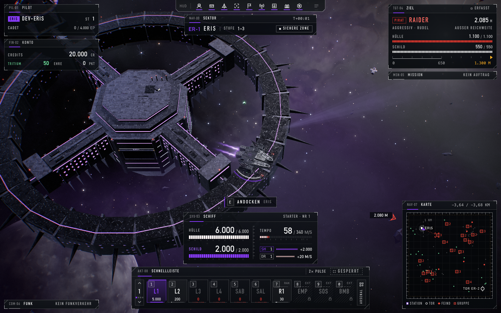
- 1,7 s · Ereignis: Erster Kontakt: 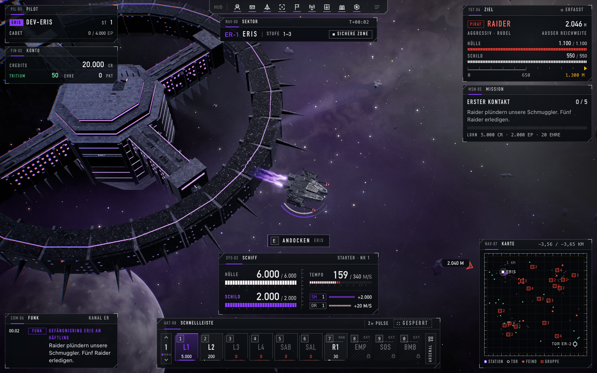
- 8,8 s · Erster Kampf (1,5 s nach dem ersten Schuss): 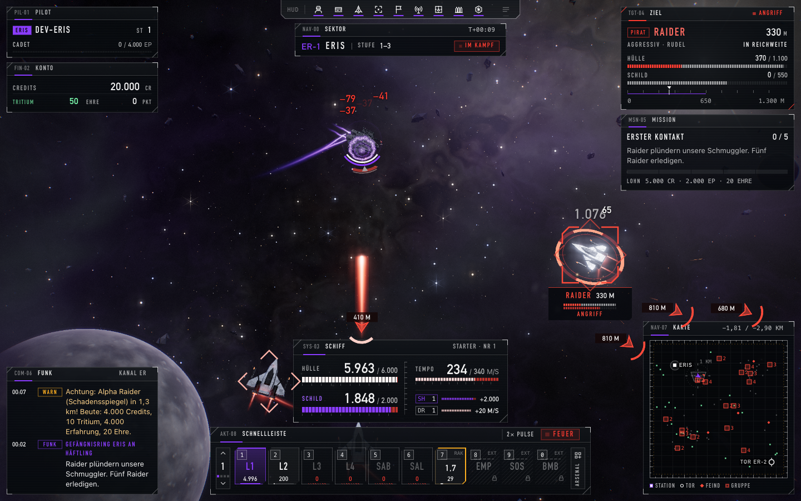
- 21,3 s · Hänger 66 ms (Flug zur Station (Andocken)): 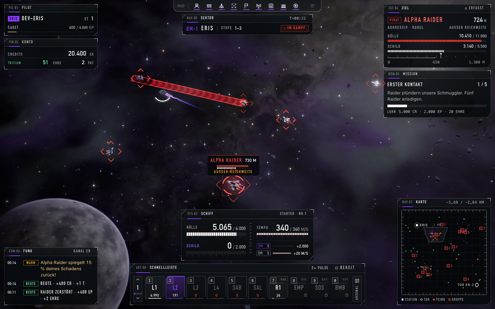
- 30,8 s · Angedockt: Station/Shop: 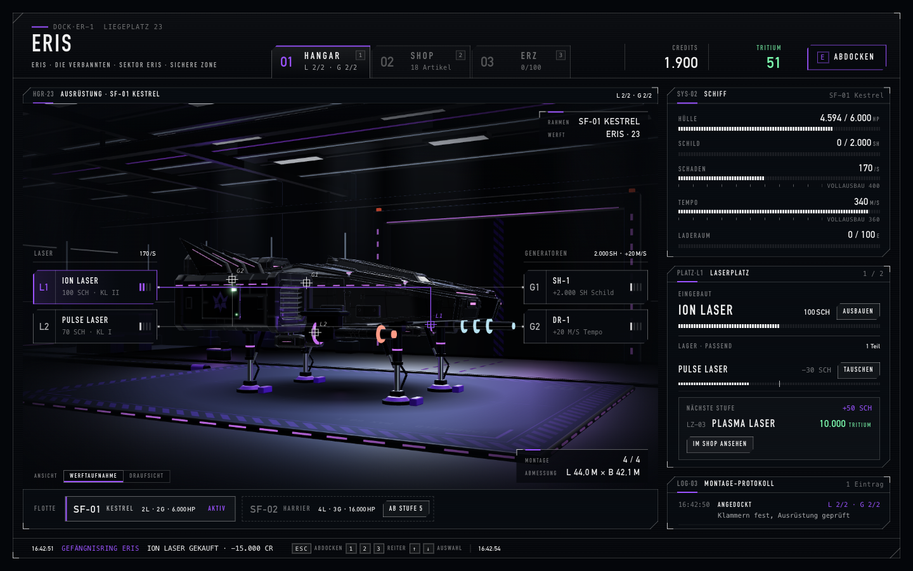
- 87,5 s · Neuer Sektor ER-2 (Dysnomia): 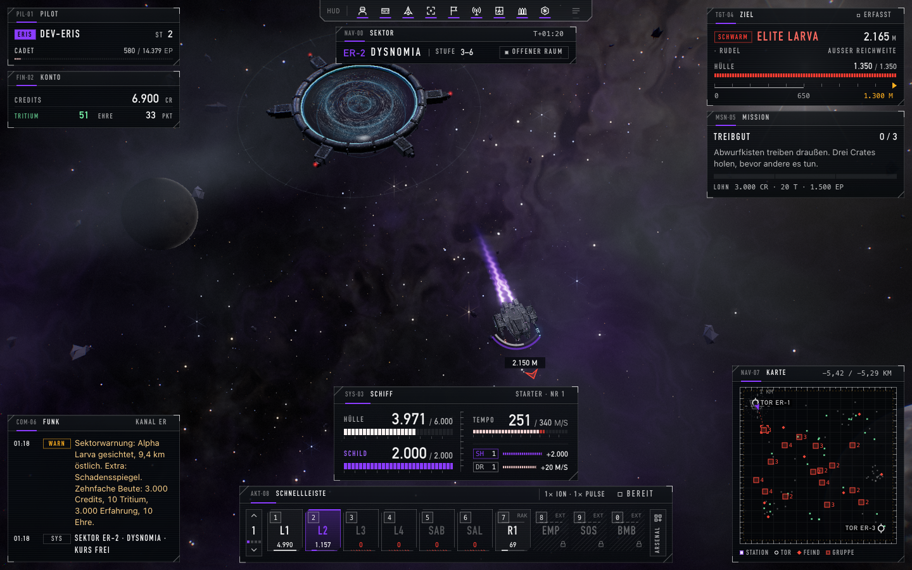
- 92,9 s · Abschuss larva (elite): 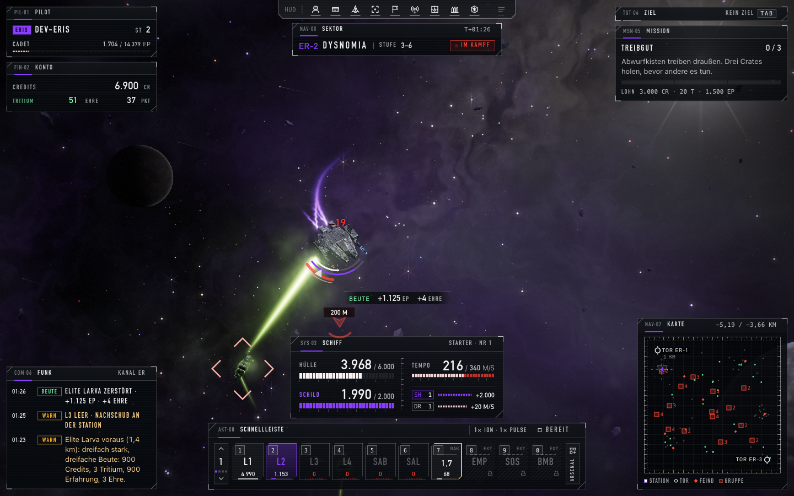
- 102,9 s · Abgeschossen: Reparatur-Auswahl: 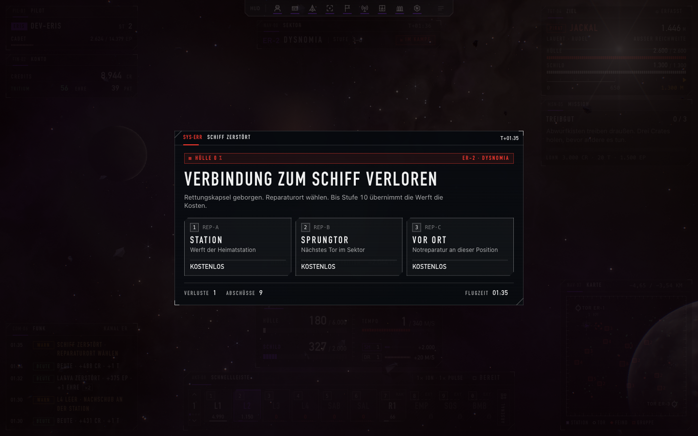
- 120,0 s · Ende der Spielzeit: 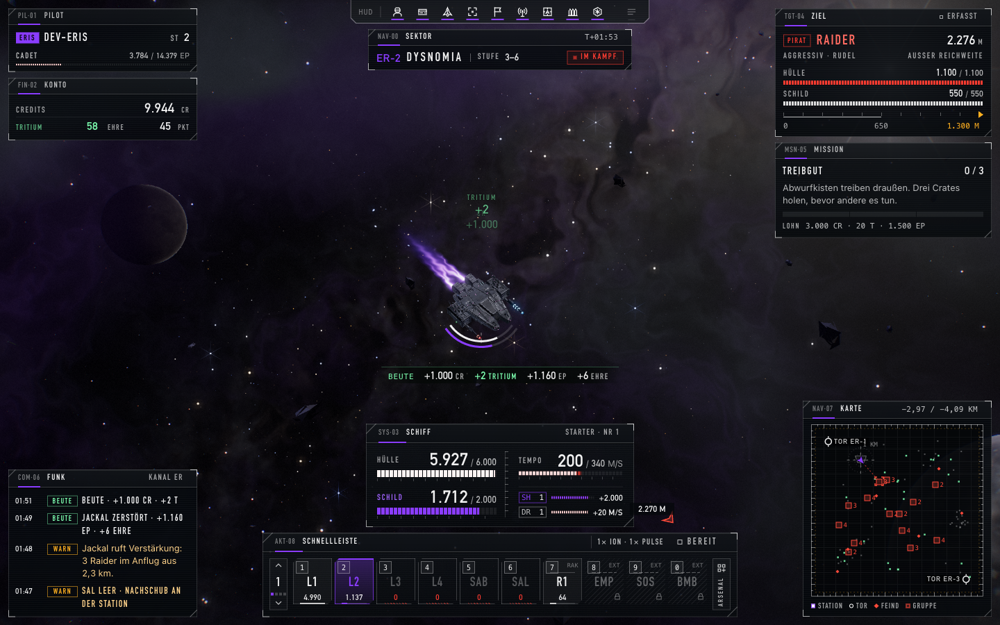
- 137,3 s · Ausrichtung ship:s1:eris: 0.3° (Beispiel, in Ordnung): 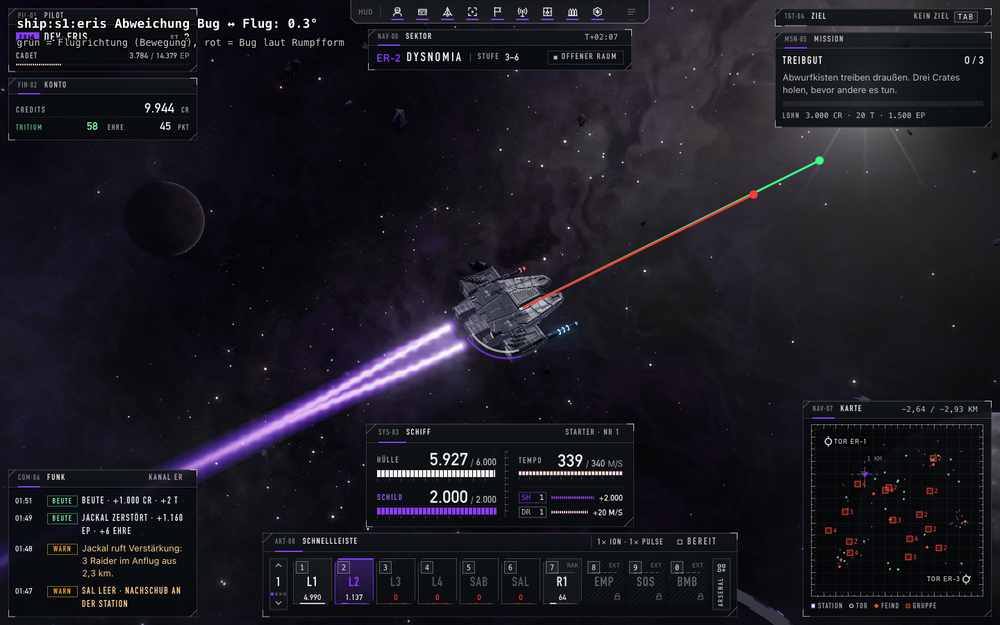
