# Test-Pilot · 2026-10-30_16-48-15

europa, saturn, eris · je 2,0 min · Qualität hoch · Fenster 1440×900 (Pixeldichte 2) · Chrome sichtbar

Ziele: Mac Qualität HOCH im Kampf unter 8 ms je Bild · normaler Laptop Full HD MITTEL mindestens 60 Bilder/s · erster Kampf ohne Hänger über 25 ms.

## EUROPA · 120 s gespielt · EU-1 → EU-2

Qualität: Stufe HOCH, Auflösungsfaktor 0,94, Pixeldichte 1,64, Puffer 2368x1480, GPU-Zeitmessung ja. Ladezeit bis Flug 1,3 s.

### Bildzeiten (Mittel / p95 / längste, ms)
| Abschnitt | Bilder | Bilder/s | Bildabstand | CPU-Rechenzeit | GPU | Bildzeit max(CPU,GPU) | > 20 ms | > 25 ms | > 33 ms |
|---|---|---|---|---|---|---|---|---|---|
| Gesamt | 6.052 | 55,0 | 18,2 / 17,7 / 1.967,5 | 4,2 / 6,4 / 1.320,2 | 7,2 / 11,7 / 48,0 | 7,8 / 12,0 / 1.320,2 | 228 | 228 | 147 |
| Kampf | 4.735 | 55,5 | 18,0 / 17,7 / 1.315,9 | 4,7 / 6,7 / 1.320,2 | 7,0 / 11,1 / 48,0 | 7,7 / 11,4 / 1.320,2 | 213 | 213 | 134 |
| Ruhe | 1.111 | 58,9 | 17,0 / 17,6 / 100,4 | 2,8 / 4,8 / 28,9 | 7,5 / 11,9 / 24,0 | 7,7 / 12,0 / 28,9 | 13 | 13 | 11 |
| Erster Kampf (10 s) | 261 | 49,2 | 20,3 / 49,5 / 100,8 | 5,2 / 8,7 / 102,6 | 7,8 / 19,4 / 39,4 | 8,7 / 20,1 / 102,6 | 33 | 33 | 23 |
| Angedockt | 206 | 35,5 | 28,2 / 17,6 / 1.967,5 | 1,3 / 3,4 / 3,9 | 10,9 / 17,4 / 23,1 | 10,9 / 17,4 / 23,1 | 2 | 2 | 2 |

Längste Bilder mit Situation:
- 30,2 s: Bildabstand 1.967,5 ms, CPU 3,6 ms, GPU 6,4 ms · Angedockt: Shop · EU-1, 3 Gegner nah, 0 greifen an · zuletzt: profile×1 · 87 Draw Calls
- 93,8 s: Bildabstand 1.315,9 ms, CPU 7,1 ms, GPU 6,9 ms · Sprung lädt · EU-2, 0 Gegner nah, 0 greifen an · zuletzt: sector×1, message×1 · 68 Draw Calls
- 30,2 s: Bildabstand 433,0 ms, CPU 1,4 ms, GPU 6,4 ms · Angedockt: Shop · EU-1, 4 Gegner nah, 0 greifen an · zuletzt: profile×1 · 87 Draw Calls
- 94,1 s: Bildabstand 151,0 ms, CPU 5,0 ms, GPU 3,6 ms · Todestest: kämpfen ohne Rückzug · EU-2, 0 Gegner nah, 0 greifen an · zuletzt: sector×1, message×1 · 70 Draw Calls
- 112,2 s: Bildabstand 116,7 ms, CPU 5,4 ms, GPU 9,2 ms · Kampf: Jackal umkreisen · EU-2, 3 Gegner nah, 2 greifen an · zuletzt: profile×1, damage×1 · 77 Draw Calls
- 88,4 s: Bildabstand 101,0 ms, CPU 9,6 ms, GPU 5,0 ms · Flug zum Sprungtor (465 m) · EU-1, 3 Gegner nah, 3 greifen an, Ereignis nest · zuletzt: nichts · 73 Draw Calls
- 14,7 s: Bildabstand 100,8 ms, CPU 8,8 ms, GPU 2,7 ms · Kampf: Raider umkreisen · EU-1, 7 Gegner nah, 4 greifen an · zuletzt: damage×3, profile×1 · 101 Draw Calls
- 0,5 s: Bildabstand 100,4 ms, CPU 5,2 ms, GPU 10,4 ms · Beute: Crate einsammeln · EU-1, 2 Gegner nah, 0 greifen an · zuletzt: nichts · 90 Draw Calls

### Kampfwerte
Schüsse 97 (Treffer 81,4 %), Raketen 19, Tode 1 (Todestest nachgeholfen: Stufe 1).
Eingesteckt: 1.880 Hülle + 4.599 Schild · je Quelle: raider 4.677, jackal 1.802.
Beute gesamt: 1.857 Credits, 2 Tritium, 2.440 Erfahrung, 12 Ehre.
Je Minute: **928 Credits, 1,0 Tritium, 1.220 Erfahrung, 6,0 Ehre**.
Profil: 20.000 → 3.357 Credits, 50 → 52 Tritium, Stufe 1 → 1.

| Gegner | Abschüsse | Zeit bis Abschuss Mittel / Median / max (s) |
|---|---|---|
| raider | 3 | 5,0 / 5,5 / 5,6 |
| jackal | 1 | 13,5 / 13,5 / 13,5 |

Munition (Versuche/erfolgreich/Vorrat danach): L1 1/1/5.388 · L2 1/1/1.200 · L3 1/0/0 · L4 1/0/0 · SAB 1/0/0. Schüsse je Munition: L1 79, L2 18.
Schussrichtung zur Schiffsnase: Mittel 10,9°, p95 71,3°, 10 Schüsse über 45°, 0 über 90° (Laser feuern dann seitlich/rückwärts aus den Mündungen).
Einkäufe: ammo L2 ok (−1.000 Credits, −0 Tritium) · rocket R1 ok (−2.500 Credits, −0 Tritium) · ammo L3 abgelehnt: Zu wenig Tritium: 250 nötig, du hast 50. · ammo SAL abgelehnt: Zu wenig Tritium: 200 nötig, du hast 50. · ammo SAB abgelehnt: Zu wenig Tritium: 500 nötig, du hast 50. · laser ion ok (−15.000 Credits, −0 Tritium).
Dauer der Aufrufe: Andocken 1.551,6 ms, 6 Einkäufe 432,8 ms, Abdocken 0,4 ms.
Reparaturen: 106,9 s here ok (kostenlos (bis Stufe 10)). Sprünge: 93,8 s → EU-2. Stufenaufstiege: keine.

### Gegnerverhalten
| Typ | Stichproben | Zeitanteile | Abstand zum Spieler im Angriff (Mittel/Median/min m) | Ausweichen | Angriffsbeginn selbst/Sicht/mitgezogen | Flucht | übereinander | Schüsse/Treffer |
|---|---|---|---|---|---|---|---|---|
| raider | 3.487 | patrouille 50,6 %, anfliegen / flanke 23,0 %, hold / wartet im kreis 8,7 %, fliehen / rückzug zum heilen 6,3 %, umkreisen / flanke 4,6 %, abdrehen / flanke 1,6 %, ausweichen / flanke 0,9 %, umkreisen / lädt salve 0,7 %, angreifen (stehend) / lädt salve 0,7 %, angreifen (stehend) / salve 0,5 %, anfliegen / lädt salve 0,4 %, angreifen (stehend) / flanke 0,3 %, abdrehen 0,2 %, abdrehen / lädt salve 0,2 %, umkreisen 0,2 %, hold 0,1 %, angreifen (stehend) 0,1 %, ausweichen / lädt salve 0,1 %, ausweichen / rückzug zum heilen 0,1 %, anfliegen 0,1 %, ausweichen 0,1 %, abdrehen / salve 0,1 %, umkreisen / salve 0,0 % | 774 / 709 / 41 | 12 | 3/10/12 | 8 | 0,0 % | 115/86 |
| jackal | 334 | patrouille 47,3 %, umkreisen / springt an 15,3 %, anfliegen / springt an 10,8 %, anfliegen / rammt 5,1 %, umkreisen / lädt rammangriff 3,0 %, abdrehen / springt an 3,0 %, fliehen / rückzug zum heilen 3,0 %, patrouille / lauert getarnt 2,7 %, ausweichen / springt an 2,4 %, abdrehen / lädt rammangriff 1,8 %, anfliegen 1,5 %, hold / wartet im kreis 0,9 %, anfliegen / lädt rammangriff 0,9 %, angreifen (stehend) / rammt 0,6 %, umkreisen / rammt 0,6 %, abdrehen / rammt 0,6 %, angreifen (stehend) / lädt rammangriff 0,3 %, angreifen (stehend) 0,3 % | 423 / 402 / 49 | 2 | 0/3/3 | 1 | 0,0 % | 22/19 |

Übereinander (Abstand < 0,75 × Summe der Trefferradien): in 0,0 % der Stichproben, Vorfälle keine, höchstens 0 Paare gleichzeitig. Hilfe-/Verstärkungsmeldungen: 6, vorübergehend erzeugte Gegner: 10.

### Ausrichtung der Modelle
| Modell | Art | Bug laut Rumpfform (°) | Form eindeutig | Mündungen vor Mitte | Laufrichtung (°) | Triebwerke hinter Mitte | Schweif (°) | Flug im Spiel (Median/p95 °) | Flug in Szene (°) | Befund · Hinweise |
|---|---|---|---|---|---|---|---|---|---|---|
| ship:s1:europa | GLB | 0,0 | ja (Achse 0,84, Verjüngung 1,62) | 0,77 0,92 | -0 -0 | 1,14 1,14 | 0 0 | 0,8 / 149,2 (471) | 0,0 | ok · Cockpit-Glas vorn 0°, Hoheitszeichen links/rechts 0°, Rumpf verjüngt sich zum Bug -180° |
| ship:s1:europa:platzhalter | Platzhalter | 0,0 | ja (Achse 0,63, Verjüngung 2,05) | 0,64 0,77 | 0 0 | 1,00 1,00 0,58 0,58 | 0 0 0 0 | – | – | ok · Rumpf verjüngt sich zum Bug 0° |
| ship:s2:europa | GLB | -0,3 | ja (Achse 0,74, Verjüngung 1,04) | 0,66 0,78 0,59 0,69 | -0 -0 -0 0 | 1,10 1,10 1,10 | 0 0 0 | – | 0,6 | ok · Hoheitszeichen links/rechts 0°, eigene Laser des Modells vorn -1° |
| ship:s2:europa:platzhalter | Platzhalter | 0,0 | ja (Achse 0,68, Verjüngung 1,49) | 0,64 0,76 0,56 0,66 | 0 0 0 0 | 1,00 1,00 0,58 0,58 1,00 | 0 0 0 0 0 | – | – | ok · Rumpf verjüngt sich zum Bug 0° |
| ship:s1:saturn | GLB | 0,0 | ja (Achse 0,85, Verjüngung 1,62) | 0,77 0,92 | -0 -0 | 1,14 1,14 | 0 0 | – | 0,2 | ok · Cockpit-Glas vorn 0°, Hoheitszeichen links/rechts 0°, Rumpf verjüngt sich zum Bug -180° |
| ship:s1:saturn:platzhalter | Platzhalter | 0,0 | ja (Achse 0,71, Verjüngung 2,07) | 0,64 0,76 | 0 0 | 1,00 1,00 0,58 0,58 | 0 0 0 0 | – | – | ok · Rumpf verjüngt sich zum Bug 0° |
| ship:s2:saturn | GLB | -0,3 | ja (Achse 0,75, Verjüngung 1,04) | 0,67 0,79 0,59 0,69 | -0 -0 -0 0 | 1,10 1,10 1,10 | 0 0 0 | – | 1,0 | ok · Hoheitszeichen links/rechts 0°, eigene Laser des Modells vorn -1° |
| ship:s2:saturn:platzhalter | Platzhalter | 0,0 | ja (Achse 0,66, Verjüngung 1,50) | 0,64 0,76 0,56 0,66 | 0 0 0 0 | 1,00 1,00 0,58 0,58 1,00 | 0 0 0 0 0 | – | – | ok · Rumpf verjüngt sich zum Bug 0° |
| ship:s1:eris | GLB | 0,0 | ja (Achse 0,85, Verjüngung 1,62) | 0,77 0,92 | -0 -0 | 1,14 1,14 | 0 0 | – | 0,0 | ok · Cockpit-Glas vorn 0°, Hoheitszeichen links/rechts 0°, Rumpf verjüngt sich zum Bug -180° |
| ship:s1:eris:platzhalter | Platzhalter | 0,0 | ja (Achse 0,63, Verjüngung 2,01) | 0,64 0,76 | 0 0 | 1,00 1,00 0,58 0,58 | 0 0 0 0 | – | – | ok · Rumpf verjüngt sich zum Bug 0° |
| ship:s2:eris | GLB | -0,3 | ja (Achse 0,73, Verjüngung 1,04) | 0,66 0,78 0,59 0,69 | -0 -0 -0 0 | 1,10 1,10 1,10 | 0 0 0 | – | 0,3 | ok · Hoheitszeichen links/rechts 0°, eigene Laser des Modells vorn -1° |
| ship:s2:eris:platzhalter | Platzhalter | 0,0 | ja (Achse 0,60, Verjüngung 1,47) | 0,64 0,76 0,56 0,66 | 0 0 0 0 | 1,00 1,00 0,58 0,58 1,00 | 0 0 0 0 0 | – | – | ok · Rumpf verjüngt sich zum Bug 0° |
| enemy:raider | Platzhalter | 0,0 | ja (Achse 1,00, Verjüngung 2.085.278,75) | – | – | 0,98 0,98 | 0 0 | 0,0 / 0,2 (1971) | 0,0 | ok · Rumpf verjüngt sich zum Bug 0° |
| enemy:larva | Platzhalter | 0,0 | ja (Achse 1,00, Verjüngung 2,49) | – | – | – | – | – | 0,0 | ok · Rumpf verjüngt sich zum Bug 0° |
| enemy:jackal | Platzhalter | 0,0 | ja (Achse 1,00, Verjüngung 1,50) | – | – | 0,68 0,68 | 0 0 | 0,1 / 1,5 (58) | 0,0 | ok · Rumpf verjüngt sich zum Bug 0° |
| enemy:spiker | Platzhalter | 165,0 | ja (Achse 0,47, Verjüngung 3,12) | – | – | – | – | – | dreht | dreht sich ständig (gewollt), keine Bugprüfung · Rumpf verjüngt sich zum Bug 165° |
| enemy:vulture | Platzhalter | 0,0 | ja (Achse 1,00, Verjüngung 3,25) | – | – | 0,50 0,50 | 0 0 | – | 0,0 | ok · Rumpf verjüngt sich zum Bug 0° |

Keine Abweichungen über 20°: Bug zeigt bei allen Modellen in Flugrichtung, Mündungen vorn, Triebwerke und Schweif hinten.

### Konsole
2 Fehler, 0 Warnungen, 5 Hinweise (Netz).
- 2× Fehler: Failed to load resource: the server responded with a status of 404 (Not Found)
- 1× Hinweis: HEAD /models/station-europa.glb abgebrochen
- 1× Hinweis: HEAD /models/station-saturn.glb abgebrochen
- 1× Hinweis: HEAD /models/station-eris.glb abgebrochen
- 1× Hinweis: HEAD /models/europa-starter.glb abgebrochen
- 1× Hinweis: HEAD /models/eris-starter.glb abgebrochen

### Bilder
- 0,5 s · Hänger 100 ms (Beute: Crate einsammeln): 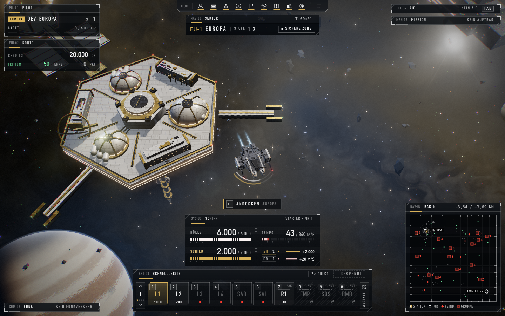
- 1,6 s · Ereignis: Erster Kontakt: 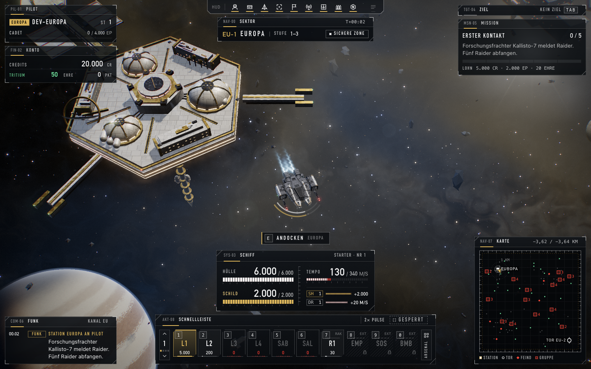
- 14,5 s · Erster Kampf (1,5 s nach dem ersten Schuss): 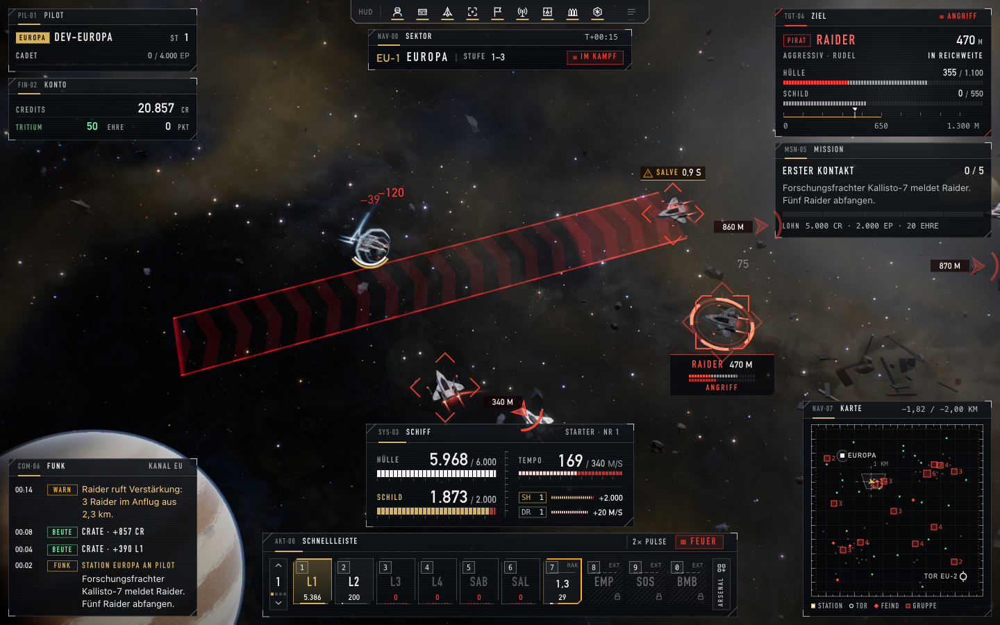
- 18,8 s · Hänger 67 ms (Flug zur Station (Andocken)): 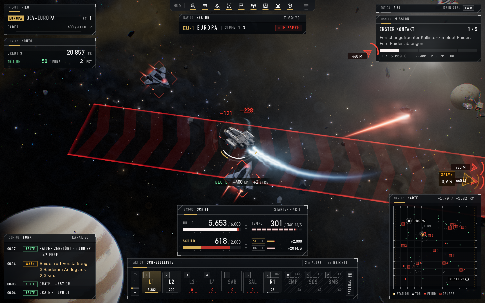
- 31,4 s · Angedockt: Station/Shop: 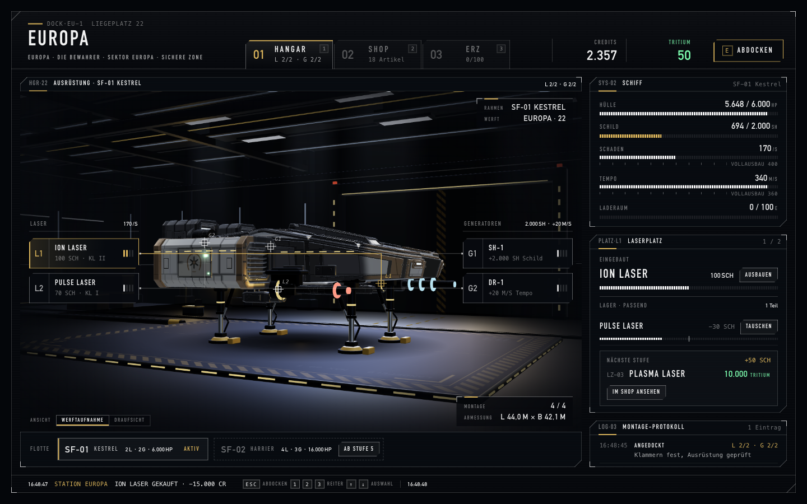
- 96,3 s · Neuer Sektor EU-2 (Io): 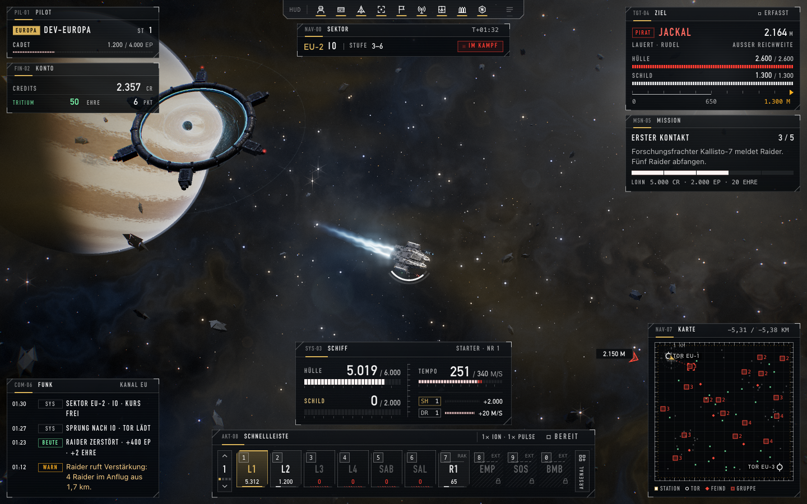
- 104,4 s · Abgeschossen: Reparatur-Auswahl: 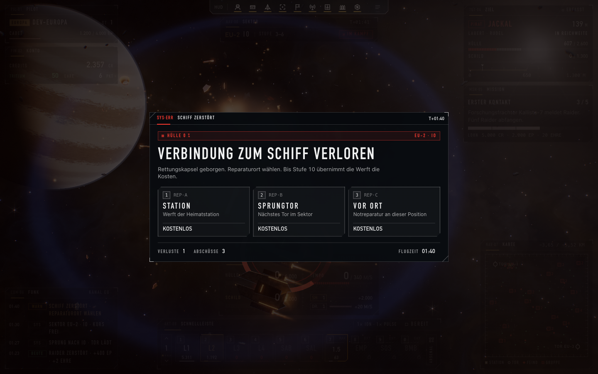
- 120,0 s · Ende der Spielzeit: 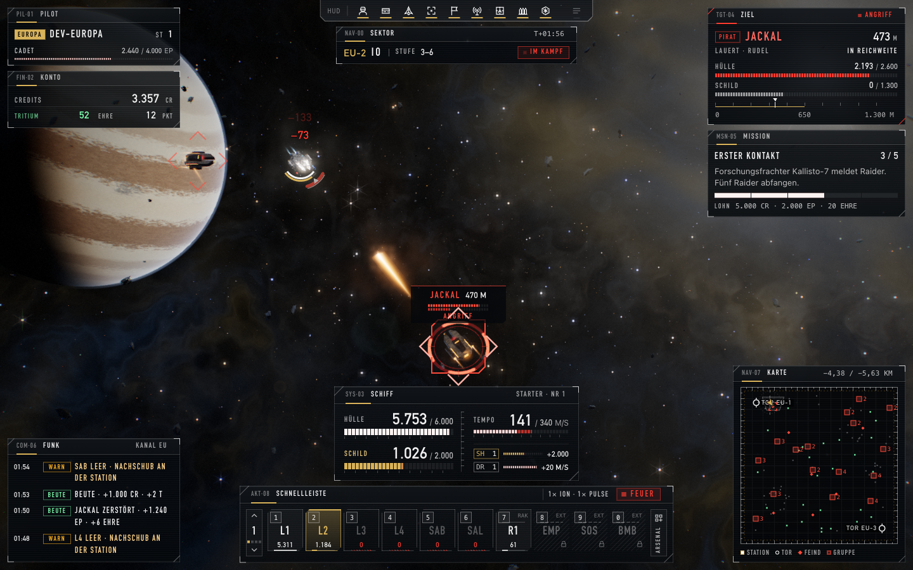
- 125,5 s · Ausrichtung ship:s1:europa: 0° (Beispiel, in Ordnung): 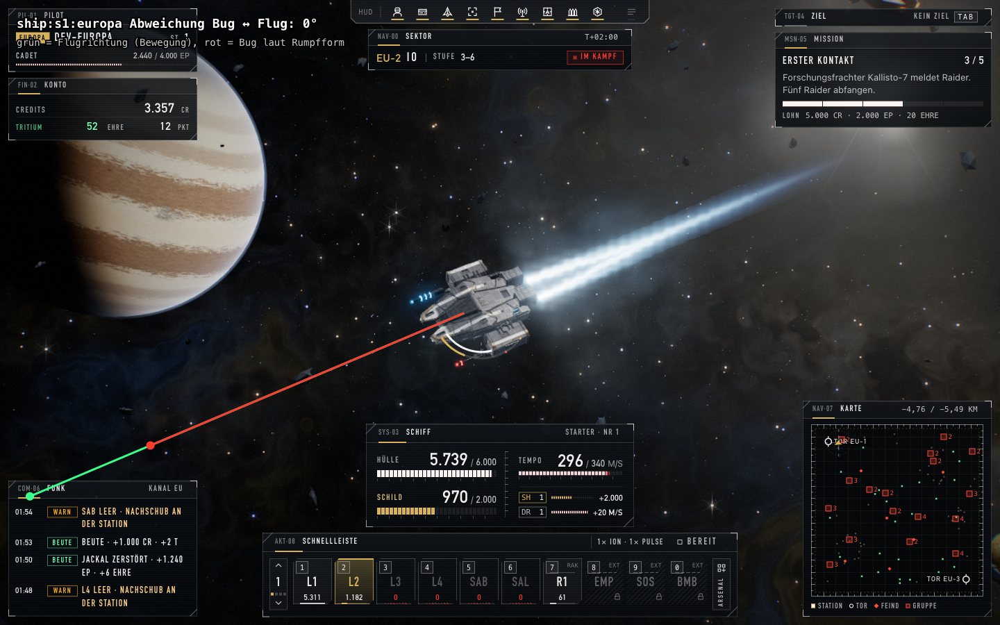

## SATURN · 134 s gespielt · SA-1 → SA-2

Qualität: Stufe NIEDRIG, Auflösungsfaktor 0,70, Pixeldichte 0,70, Puffer 1007x630, GPU-Zeitmessung ja. Ladezeit bis Flug 7,3 s.
Grafik-Absicherung: 21,4 s „Bildrate dauerhaft unter 50 – Grafik für diese Sitzung auf MITTEL gesenkt. Deine Einstellung bleibt gespeichert.“; 133,6 s „Bildrate dauerhaft unter 50 – Grafik für diese Sitzung auf NIEDRIG gesenkt. Deine Einstellung bleibt gespeichert.“

### Bildzeiten (Mittel / p95 / längste, ms)
| Abschnitt | Bilder | Bilder/s | Bildabstand | CPU-Rechenzeit | GPU | Bildzeit max(CPU,GPU) | > 20 ms | > 25 ms | > 33 ms |
|---|---|---|---|---|---|---|---|---|---|
| Gesamt | 3.938 | 42,9 | 23,3 / 50,0 / 3.700,1 | 10,0 / 10,5 / 17.978,9 | 6,2 / 12,3 / 103,7 | 12,3 / 14,7 / 17.978,9 | 676 | 675 | 442 |
| Kampf | 2.388 | 43,6 | 22,9 / 50,1 / 483,4 | 13,3 / 11,0 / 17.978,9 | 6,0 / 11,8 / 48,1 | 15,3 / 14,0 / 17.978,9 | 479 | 478 | 312 |
| Ruhe | 1.425 | 47,7 | 21,0 / 49,0 / 433,3 | 5,2 / 10,3 / 94,5 | 5,7 / 11,1 / 39,7 | 7,0 / 12,6 / 94,5 | 190 | 190 | 123 |
| Erster Kampf (10 s) | 23 | 27,6 | 36,2 / 83,3 / 183,4 | 5,4 / 9,1 / 10,5 | 5,7 / 7,9 / 9,5 | 6,6 / 9,5 / 10,5 | 5 | 5 | 4 |
| Angedockt | 125 | 17,5 | 57,2 / 18,4 / 3.700,1 | 2,8 / 6,9 / 82,8 | 16,1 / 36,7 / 103,7 | 16,2 / 36,7 / 103,7 | 7 | 7 | 7 |

Längste Bilder mit Situation:
- 32,5 s: Bildabstand 3.700,1 ms, CPU 7,1 ms, GPU 4,6 ms · Angedockt: Shop · SA-1, 2 Gegner nah, 0 greifen an · zuletzt: profile×1 · 107 Draw Calls
- 32,5 s: Bildabstand 1.066,6 ms, CPU 2,0 ms, GPU 4,6 ms · Angedockt: Shop · SA-1, 2 Gegner nah, 0 greifen an · zuletzt: profile×1 · 107 Draw Calls
- 6,9 s: Bildabstand 433,3 ms, CPU 34,5 ms, GPU 39,7 ms · Anflug auf Raider (1253 m) · SA-1, 3 Gegner nah, 0 greifen an · zuletzt: nichts · 68 Draw Calls
- 7,2 s: Bildabstand 283,2 ms, CPU 7,2 ms, GPU 2,5 ms · Anflug auf Raider (1152 m) · SA-1, 3 Gegner nah, 0 greifen an · zuletzt: nichts · 68 Draw Calls
- 42,3 s: Bildabstand 200,0 ms, CPU 16,0 ms, GPU 5,0 ms · Flug zum Sprungtor (10287 m) · SA-1, 4 Gegner nah, 2 greifen an · zuletzt: damage×2 · 90 Draw Calls
- 41,7 s: Bildabstand 199,9 ms, CPU 8,8 ms, GPU 9,5 ms · Flug zum Sprungtor (10425 m) · SA-1, 4 Gegner nah, 2 greifen an · zuletzt: profile×1 · 94 Draw Calls
- 8,8 s: Bildabstand 183,4 ms, CPU 9,5 ms, GPU 7,9 ms · Kampf: Raider umkreisen · SA-1, 3 Gegner nah, 3 greifen an · zuletzt: rocket×1, profile×1 · 97 Draw Calls
- 9,1 s: Bildabstand 183,3 ms, CPU 9,1 ms, GPU 7,4 ms · Kampf: Raider umkreisen · SA-1, 3 Gegner nah, 3 greifen an · zuletzt: nichts · 94 Draw Calls

### Kampfwerte
Schüsse 65 (Treffer 73,8 %), Raketen 14, Tode 1 (Todestest nachgeholfen: Stufe 2).
Eingesteckt: 371 Hülle + 1.493 Schild · je Quelle: raider 1.810, larva 54.
Beute gesamt: 12.631 Credits, 23 Tritium, 7.160 Erfahrung, 35 Ehre.
Je Minute: **5.671 Credits, 10,3 Tritium, 3.214 Erfahrung, 15,7 Ehre**.
Profil: 20.000 → 14.131 Credits, 50 → 73 Tritium, Stufe 1 → 2.

| Gegner | Abschüsse | Zeit bis Abschuss Mittel / Median / max (s) |
|---|---|---|
| raider | 6 | 7,8 / 3,8 / 22,1 |
| larva | 3 | 0,7 / 0,7 / 0,8 |

Munition (Versuche/erfolgreich/Vorrat danach): L1 1/1/5.397 · L2 1/1/1.200 · L3 1/0/0. Schüsse je Munition: L1 65.
Schussrichtung zur Schiffsnase: Mittel 18,2°, p95 71,8°, 15 Schüsse über 45°, 0 über 90° (Laser feuern dann seitlich/rückwärts aus den Mündungen).
Einkäufe: ammo L2 ok (−1.000 Credits, −0 Tritium) · rocket R1 ok (−2.500 Credits, −0 Tritium) · ammo L3 abgelehnt: Zu wenig Tritium: 250 nötig, du hast 51. · ammo SAL abgelehnt: Zu wenig Tritium: 200 nötig, du hast 51. · ammo SAB abgelehnt: Zu wenig Tritium: 500 nötig, du hast 51. · laser ion ok (−15.000 Credits, −0 Tritium).
Dauer der Aufrufe: Andocken 1.675,6 ms, 6 Einkäufe 1.045,1 ms, Abdocken 0,8 ms.
Reparaturen: 106,5 s here ok (kostenlos (bis Stufe 10)). Sprünge: 89,9 s → SA-2. Stufenaufstiege: 77,6 s → 2.

### Gegnerverhalten
| Typ | Stichproben | Zeitanteile | Abstand zum Spieler im Angriff (Mittel/Median/min m) | Ausweichen | Angriffsbeginn selbst/Sicht/mitgezogen | Flucht | übereinander | Schüsse/Treffer |
|---|---|---|---|---|---|---|---|---|
| raider | 1.930 | patrouille 68,3 %, anfliegen / flanke 17,2 %, umkreisen / flanke 5,2 %, hold / wartet im kreis 2,2 %, fliehen / rückzug zum heilen 1,7 %, ausweichen / flanke 1,1 %, abdrehen / flanke 1,1 %, umkreisen / lädt salve 0,6 %, angreifen (stehend) / lädt salve 0,5 %, anfliegen / lädt salve 0,5 %, hold 0,3 %, angreifen (stehend) / flanke 0,3 %, angreifen (stehend) / salve 0,2 %, abdrehen 0,2 %, anfliegen 0,2 %, ausweichen / lädt salve 0,1 %, abdrehen / lädt salve 0,1 %, ausweichen 0,1 %, umkreisen / salve 0,1 %, umkreisen 0,1 % | 660 / 580 / 142 | 8 | 1/7/3 | 1 | 0,0 % | 71/37 |
| larva | 613 | patrouille 84,7 %, anfliegen / umzingeln 9,8 %, umkreisen / umzingeln 2,0 %, abdrehen / umzingeln 1,1 %, hold / wartet im kreis 0,7 %, angreifen (stehend) / umzingeln 0,7 %, ausweichen / umzingeln 0,5 %, abdrehen 0,5 %, anfliegen 0,2 % | 624 / 506 / 30 | 1 | 2/2/3 | 0 | 0,0 % | 3/1 |

Übereinander (Abstand < 0,75 × Summe der Trefferradien): in 0,0 % der Stichproben, Vorfälle keine, höchstens 0 Paare gleichzeitig. Hilfe-/Verstärkungsmeldungen: 6, vorübergehend erzeugte Gegner: 11.

### Ausrichtung der Modelle
| Modell | Art | Bug laut Rumpfform (°) | Form eindeutig | Mündungen vor Mitte | Laufrichtung (°) | Triebwerke hinter Mitte | Schweif (°) | Flug im Spiel (Median/p95 °) | Flug in Szene (°) | Befund · Hinweise |
|---|---|---|---|---|---|---|---|---|---|---|
| ship:s1:europa | GLB | 0,0 | ja (Achse 0,84, Verjüngung 1,62) | 0,77 0,92 | -0 -0 | 1,14 1,14 | 0 0 | – | 0,0 | ok · Cockpit-Glas vorn 0°, Hoheitszeichen links/rechts 0°, Rumpf verjüngt sich zum Bug -180° |
| ship:s1:europa:platzhalter | Platzhalter | 0,0 | ja (Achse 0,63, Verjüngung 2,05) | 0,64 0,77 | 0 0 | 1,00 1,00 0,58 0,58 | 0 0 0 0 | – | – | ok · Rumpf verjüngt sich zum Bug 0° |
| ship:s2:europa | GLB | -0,3 | ja (Achse 0,74, Verjüngung 1,04) | 0,66 0,78 0,59 0,69 | -0 -0 -0 0 | 1,10 1,10 1,10 | 0 0 0 | – | 0,1 | ok · Hoheitszeichen links/rechts 0°, eigene Laser des Modells vorn -1° |
| ship:s2:europa:platzhalter | Platzhalter | 0,0 | ja (Achse 0,68, Verjüngung 1,49) | 0,64 0,76 0,56 0,66 | 0 0 0 0 | 1,00 1,00 0,58 0,58 1,00 | 0 0 0 0 0 | – | – | ok · Rumpf verjüngt sich zum Bug 0° |
| ship:s1:saturn | GLB | 0,0 | ja (Achse 0,85, Verjüngung 1,62) | 0,77 0,92 | -0 -0 | 1,14 1,14 | 0 0 | 0,2 / 151,4 (478) | 0,2 | ok · Cockpit-Glas vorn 0°, Hoheitszeichen links/rechts 0°, Rumpf verjüngt sich zum Bug -180° |
| ship:s1:saturn:platzhalter | Platzhalter | 0,0 | ja (Achse 0,71, Verjüngung 2,07) | 0,64 0,76 | 0 0 | 1,00 1,00 0,58 0,58 | 0 0 0 0 | – | – | ok · Rumpf verjüngt sich zum Bug 0° |
| ship:s2:saturn | GLB | -0,3 | ja (Achse 0,75, Verjüngung 1,04) | 0,67 0,79 0,59 0,69 | -0 -0 -0 0 | 1,10 1,10 1,10 | 0 0 0 | – | 0,3 | ok · Hoheitszeichen links/rechts 0°, eigene Laser des Modells vorn -1° |
| ship:s2:saturn:platzhalter | Platzhalter | 0,0 | ja (Achse 0,66, Verjüngung 1,50) | 0,64 0,76 0,56 0,66 | 0 0 0 0 | 1,00 1,00 0,58 0,58 1,00 | 0 0 0 0 0 | – | – | ok · Rumpf verjüngt sich zum Bug 0° |
| ship:s1:eris | GLB | 0,0 | ja (Achse 0,85, Verjüngung 1,62) | 0,77 0,92 | -0 -0 | 1,14 1,14 | 0 0 | – | 0,0 | ok · Cockpit-Glas vorn 0°, Hoheitszeichen links/rechts 0°, Rumpf verjüngt sich zum Bug -180° |
| ship:s1:eris:platzhalter | Platzhalter | 0,0 | ja (Achse 0,63, Verjüngung 2,01) | 0,64 0,76 | 0 0 | 1,00 1,00 0,58 0,58 | 0 0 0 0 | – | – | ok · Rumpf verjüngt sich zum Bug 0° |
| ship:s2:eris | GLB | -0,3 | ja (Achse 0,73, Verjüngung 1,04) | 0,66 0,78 0,59 0,69 | -0 -0 -0 0 | 1,10 1,10 1,10 | 0 0 0 | – | 0,3 | ok · Hoheitszeichen links/rechts 0°, eigene Laser des Modells vorn -1° |
| ship:s2:eris:platzhalter | Platzhalter | 0,0 | ja (Achse 0,60, Verjüngung 1,47) | 0,64 0,76 0,56 0,66 | 0 0 0 0 | 1,00 1,00 0,58 0,58 1,00 | 0 0 0 0 0 | – | – | ok · Rumpf verjüngt sich zum Bug 0° |
| enemy:raider | Platzhalter | 0,0 | ja (Achse 1,00, Verjüngung 2.085.278,75) | – | – | 0,98 0,98 | 0 0 | 0,0 / 0,1 (1109) | 0,0 | ok · Rumpf verjüngt sich zum Bug 0° |
| enemy:larva | Platzhalter | 0,0 | ja (Achse 1,00, Verjüngung 2,49) | – | – | – | – | 0,0 / 0,0 (441) | 0,0 | ok · Rumpf verjüngt sich zum Bug 0° |
| enemy:jackal | Platzhalter | 0,0 | ja (Achse 1,00, Verjüngung 1,50) | – | – | 0,68 0,68 | 0 0 | – | 0,0 | ok · Rumpf verjüngt sich zum Bug 0° |
| enemy:spiker | Platzhalter | 165,0 | ja (Achse 0,47, Verjüngung 3,12) | – | – | – | – | – | dreht | dreht sich ständig (gewollt), keine Bugprüfung · Rumpf verjüngt sich zum Bug 165° |
| enemy:vulture | Platzhalter | 0,0 | ja (Achse 1,00, Verjüngung 3,25) | – | – | 0,50 0,50 | 0 0 | – | 0,0 | ok · Rumpf verjüngt sich zum Bug 0° |

Keine Abweichungen über 20°: Bug zeigt bei allen Modellen in Flugrichtung, Mündungen vorn, Triebwerke und Schweif hinten.

### Konsole
2 Fehler, 1 Warnungen, 5 Hinweise (Netz).
- 2× Fehler: Failed to load resource: the server responded with a status of 404 (Not Found)
- 1× Warnung: The AudioContext was not allowed to start. It must be resumed (or created) after a user gesture on the page. https://developer.chrome.com/blog/autoplay/#web_audio
- 1× Hinweis: HEAD /models/station-europa.glb abgebrochen
- 1× Hinweis: HEAD /models/station-saturn.glb abgebrochen
- 1× Hinweis: HEAD /models/station-eris.glb abgebrochen
- 1× Hinweis: HEAD /models/europa-starter.glb abgebrochen
- 1× Hinweis: HEAD /models/eris-starter.glb abgebrochen

### Bilder
- 2,9 s · Hänger 67 ms (Beute: Crate einsammeln): 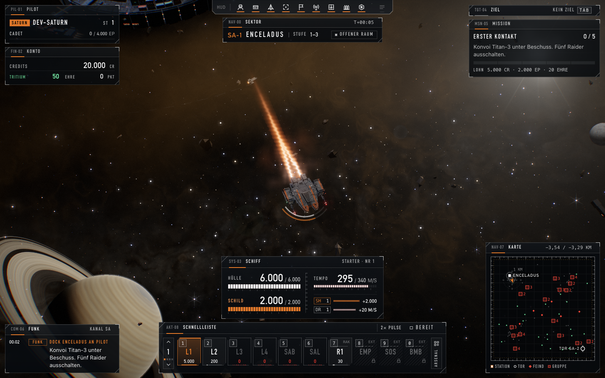
- 8,4 s · Hänger 83 ms (Anflug auf Raider (697 m)): 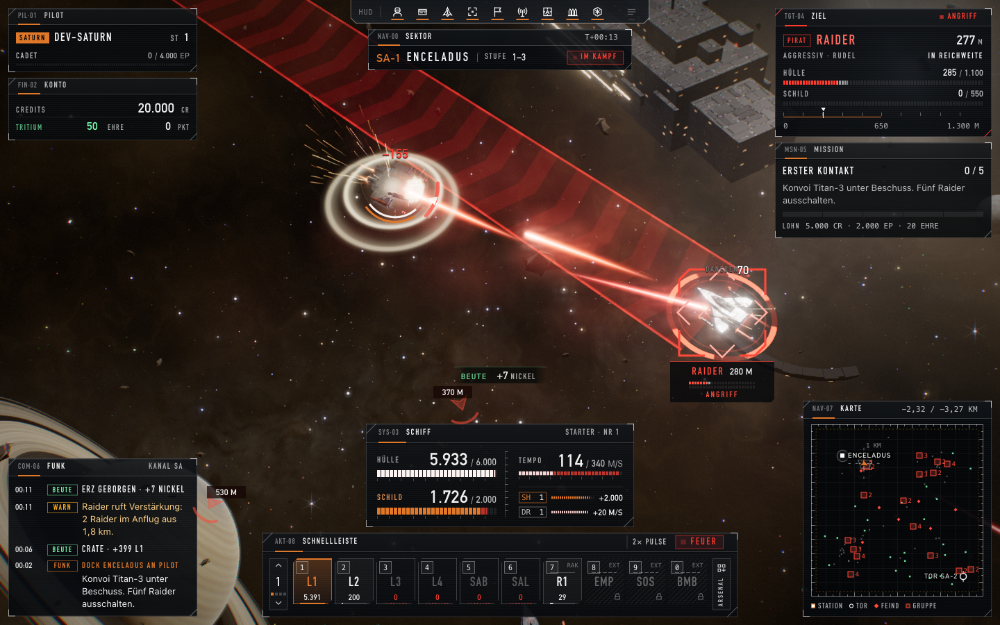
- 9,9 s · Erster Kampf (1,5 s nach dem ersten Schuss): 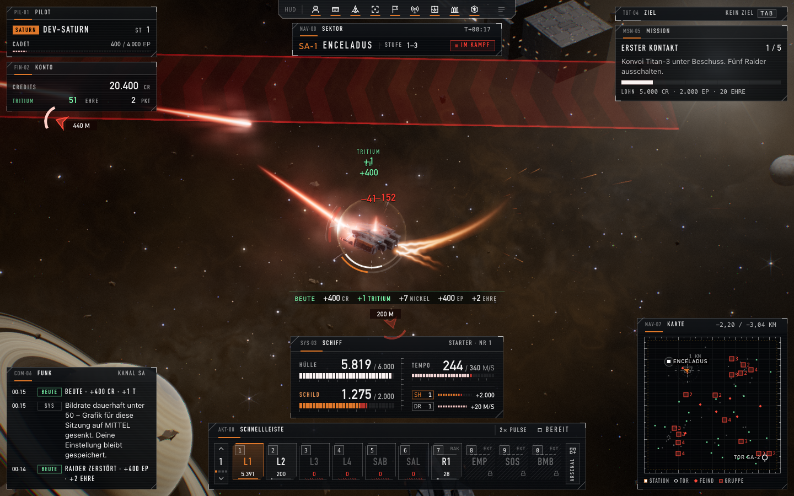
- 33,7 s · Angedockt: Station/Shop: 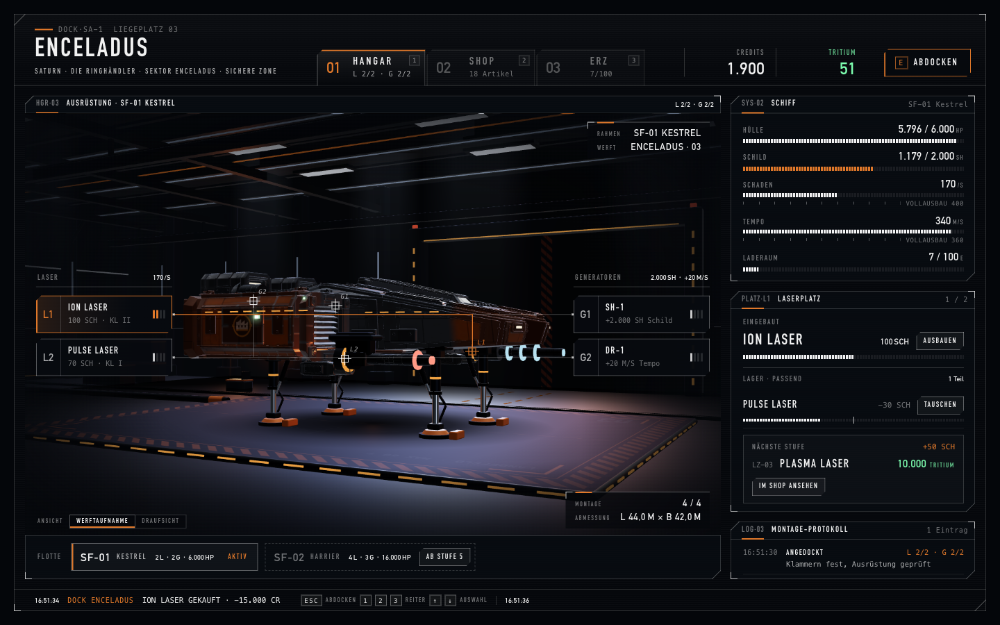
- 80,6 s · Ereignis: Treibgut: 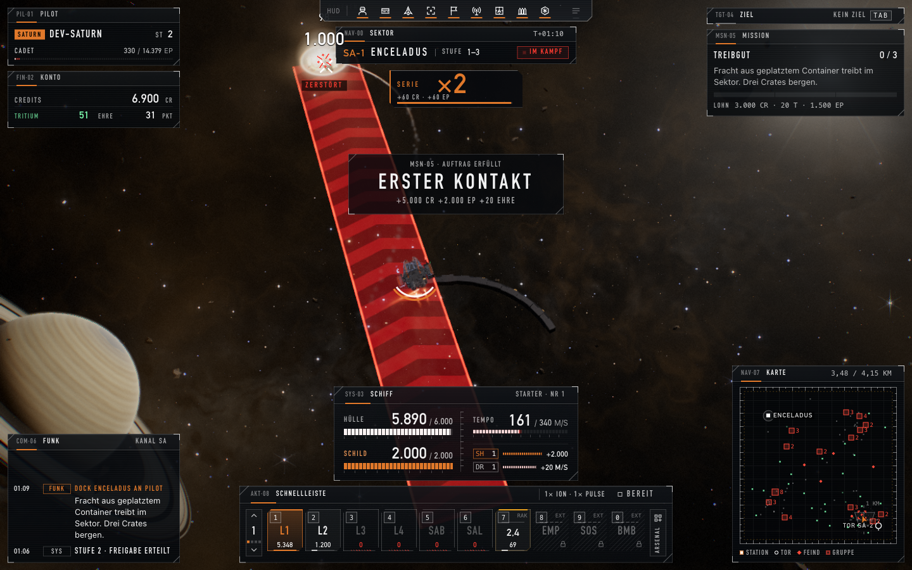
- 92,4 s · Neuer Sektor SA-2 (Mimas): 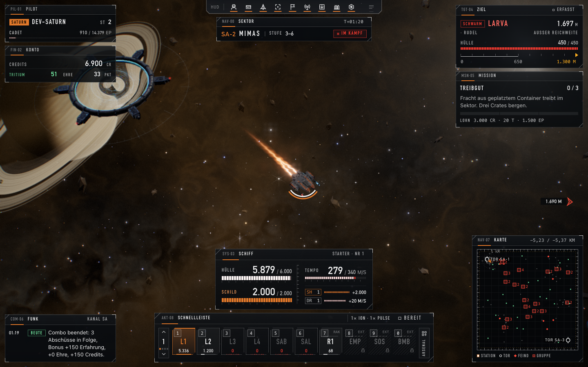
- 103,9 s · Abgeschossen: Reparatur-Auswahl: 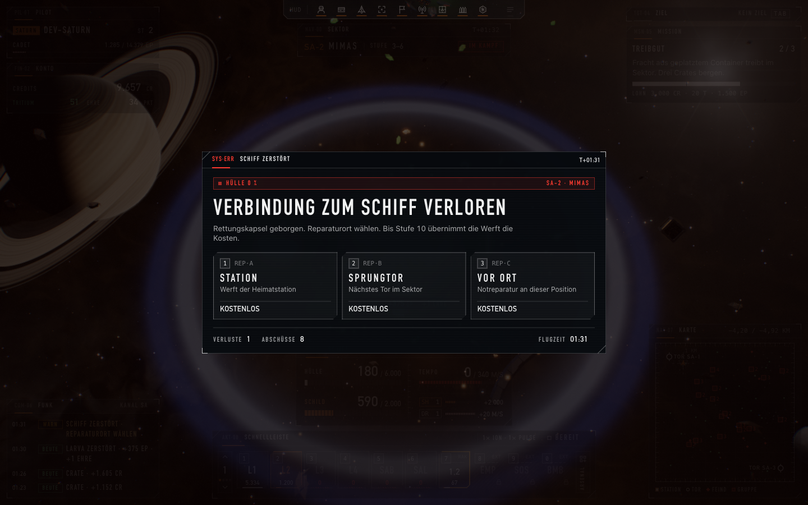
- 120,0 s · Ende der Spielzeit: 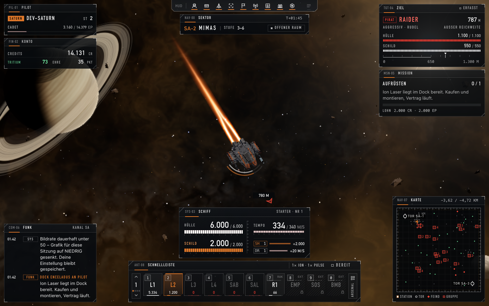
- 151,2 s · Ausrichtung ship:s1:saturn: 0.2° (Beispiel, in Ordnung): 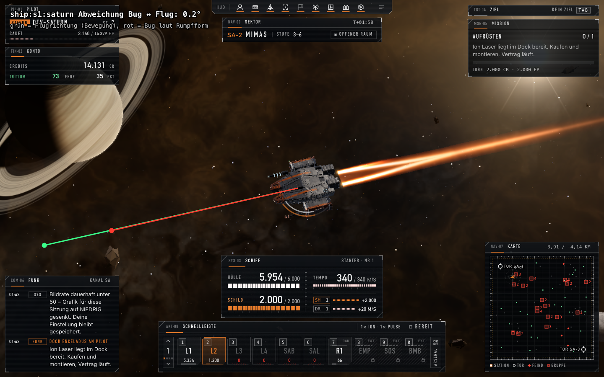

## ERIS

Abgebrochen: page.goto: Timeout 30000ms exceeded.
Call log:
  - navigating to "http://localhost:5199/?dev=game&f=eris", waiting until "domcontentloaded"

    at runFaction (/Users/077-gaming/Desktop/077/90_Weitere_Projekte/Last-Signals/Code/tools/playtest/spielen.mjs:95:14)
    at async main (/Users/077-gaming/Desktop/077/90_Weitere_Projekte/Last-Signals/Code/tools/playtest/spielen.mjs:232:24)
