# Test-Pilot · 2026-10-30_17-49-56

europa, saturn, eris · je 2,0 min · Qualität hoch · Fenster 1440×900 (Pixeldichte 2) · Chrome sichtbar

Ziele: Mac Qualität HOCH im Kampf unter 8 ms je Bild · normaler Laptop Full HD MITTEL mindestens 60 Bilder/s · erster Kampf ohne Hänger über 25 ms.

## EUROPA

Abgebrochen: page.evaluate: TypeError: Cannot read properties of undefined (reading 'start')
    at eval (eval at evaluate (:370:30), <anonymous>:1:20)
    at UtilityScript.evaluate (<anonymous>:372:16)
    at UtilityScript.<anonymous> (<anonymous>:1:44)
    at runFaction (/Users/077-gaming/Desktop/077/90_Weitere_Projekte/Last-Signals/Code/tools/playtest/spielen.mjs:100:27)
    at async main (/Users/077-gaming/Desktop/077/90_Weitere_Projekte/Last-Signals/Code/tools/playtest/spielen.mjs:232:24)

## SATURN · 120 s gespielt · SA-1 → SA-2

Qualität: Stufe HOCH, Auflösungsfaktor 1,00, Pixeldichte 1,75, Puffer 2520x1575, GPU-Zeitmessung ja. Ladezeit bis Flug 2,6 s.

### Bildzeiten (Mittel / p95 / längste, ms)
| Abschnitt | Bilder | Bilder/s | Bildabstand | CPU-Rechenzeit | GPU | Bildzeit max(CPU,GPU) | > 20 ms | > 25 ms | > 33 ms |
|---|---|---|---|---|---|---|---|---|---|
| Gesamt | 5.570 | 50,3 | 19,9 / 18,3 / 9.433,2 | 5,4 / 7,1 / 6.451,6 | 7,9 / 12,3 / 64,4 | 9,5 / 12,4 / 6.451,6 | 39 | 39 | 26 |
| Kampf | 3.644 | 53,7 | 18,6 / 18,3 / 6.448,7 | 6,2 / 7,2 / 6.451,6 | 7,5 / 12,0 / 63,4 | 9,9 / 12,0 / 6.451,6 | 29 | 29 | 19 |
| Ruhe | 1.835 | 59,7 | 16,8 / 18,4 / 66,8 | 4,1 / 6,7 / 10,8 | 8,4 / 12,6 / 23,1 | 8,6 / 12,6 / 23,1 | 7 | 7 | 4 |
| Erster Kampf (10 s) | 533 | 59,4 | 16,8 / 18,2 / 66,5 | 5,4 / 7,2 / 15,4 | 6,0 / 9,9 / 14,9 | 6,9 / 10,0 / 15,4 | 3 | 3 | 2 |
| Angedockt | 91 | 7,5 | 133,3 / 18,3 / 9.433,2 | 2,2 / 6,2 / 12,7 | 13,3 / 26,9 / 64,4 | 13,5 / 26,9 / 64,4 | 3 | 3 | 3 |

Längste Bilder mit Situation:
- 34,6 s: Bildabstand 9.433,2 ms, CPU 12,7 ms, GPU 3,8 ms · Angedockt: Shop · SA-1, 3 Gegner nah, 0 greifen an · zuletzt: profile×1 · 132 Draw Calls
- 91,6 s: Bildabstand 6.448,7 ms, CPU 5,2 ms, GPU 4,9 ms · Sprung lädt · SA-2, 0 Gegner nah, 0 greifen an · zuletzt: sector×1, message×2, profile×1 · 69 Draw Calls
- 34,6 s: Bildabstand 932,4 ms, CPU 2,7 ms, GPU 3,8 ms · Angedockt: Shop · SA-1, 3 Gegner nah, 0 greifen an · zuletzt: profile×1 · 132 Draw Calls
- 34,9 s: Bildabstand 298,7 ms, CPU 3,2 ms, GPU 3,8 ms · Angedockt: Shop · SA-1, 3 Gegner nah, 0 greifen an · zuletzt: profile×1 · 114 Draw Calls
- 6,4 s: Bildabstand 100,5 ms, CPU 4,3 ms, GPU 7,2 ms · Anflug auf Larva (930 m) · SA-1, 3 Gegner nah, 0 greifen an · zuletzt: message×1 · 69 Draw Calls
- 91,9 s: Bildabstand 84,7 ms, CPU 5,9 ms, GPU 10,9 ms · Todestest: kämpfen ohne Rückzug · SA-2, 0 Gegner nah, 0 greifen an · zuletzt: sector×1, message×2, profile×1 · 69 Draw Calls
- 61,6 s: Bildabstand 83,4 ms, CPU 5,7 ms, GPU 6,2 ms · Flug zum Sprungtor (5772 m) · SA-1, 6 Gegner nah, 3 greifen an · zuletzt: damage×2 · 77 Draw Calls
- 0,3 s: Bildabstand 66,8 ms, CPU 4,3 ms, GPU 11,2 ms · Anflug auf Larva (1718 m) · SA-1, 0 Gegner nah, 0 greifen an · zuletzt: nichts · 108 Draw Calls

### Kampfwerte
Schüsse 56 (Treffer 78,6 %), Raketen 13, Tode 1 (Todestest nachgeholfen: Stufe 2).
Eingesteckt: 493 Hülle + 1.963 Schild · je Quelle: larva 74, raider 2.382.
Beute gesamt: 7.110 Credits, 5 Tritium, 5.770 Erfahrung, 37 Ehre.
Je Minute: **3.555 Credits, 2,5 Tritium, 2.885 Erfahrung, 18,5 Ehre**.
Profil: 20.000 → 8.610 Credits, 50 → 55 Tritium, Stufe 1 → 2.

| Gegner | Abschüsse | Zeit bis Abschuss Mittel / Median / max (s) |
|---|---|---|
| larva | 3 | 0,7 / 0,8 / 0,8 |
| raider | 6 | 3,2 / 1,9 / 8,5 |

Munition (Versuche/erfolgreich/Vorrat danach): L1 1/1/4.998 · L2 1/1/200 · L3 1/0/0 · L4 1/0/0. Schüsse je Munition: L1 4, L2 52.
Schussrichtung zur Schiffsnase: Mittel 26,7°, p95 72,6°, 20 Schüsse über 45°, 0 über 90° (Laser feuern dann seitlich/rückwärts aus den Mündungen).
Einkäufe: ammo L2 ok (−1.000 Credits, −0 Tritium) · rocket R1 ok (−2.500 Credits, −0 Tritium) · ammo L3 abgelehnt: Zu wenig Tritium: 250 nötig, du hast 53. · ammo SAL abgelehnt: Zu wenig Tritium: 200 nötig, du hast 53. · ammo SAB abgelehnt: Zu wenig Tritium: 500 nötig, du hast 53. · laser ion ok (−15.000 Credits, −0 Tritium).
Dauer der Aufrufe: Andocken 1.198,0 ms, 6 Einkäufe 903,6 ms, Abdocken 0,3 ms.
Reparaturen: 108,2 s here ok (kostenlos (bis Stufe 10)). Sprünge: 91,6 s → SA-2. Stufenaufstiege: 115,4 s → 2.

### Gegnerverhalten
| Typ | Stichproben | Zeitanteile | Abstand zum Spieler im Angriff (Mittel/Median/min m) | Ausweichen | Angriffsbeginn selbst/Sicht/mitgezogen | Flucht | übereinander | Schüsse/Treffer |
|---|---|---|---|---|---|---|---|---|
| larva | 256 | patrouille 76,2 %, anfliegen / umzingeln 9,0 %, umkreisen / umzingeln 7,0 %, abdrehen / umzingeln 2,7 %, abdrehen 1,2 %, abdrehen / lädt sprungbiss 1,2 %, anfliegen / springt 1,2 %, angreifen (stehend) / umzingeln 0,4 %, abdrehen / springt 0,4 %, anfliegen 0,4 %, anfliegen / lädt sprungbiss 0,4 % | 286 / 253 / 113 | 0 | 1/0/2 | 0 | 0,0 % | 4/4 |
| raider | 2.320 | patrouille 66,8 %, anfliegen / flanke 17,6 %, umkreisen / flanke 7,0 %, hold / wartet im kreis 2,8 %, ausweichen / flanke 1,2 %, anfliegen / lädt salve 1,0 %, abdrehen / flanke 0,8 %, angreifen (stehend) / lädt salve 0,7 %, umkreisen / lädt salve 0,6 %, angreifen (stehend) / salve 0,4 %, angreifen (stehend) / flanke 0,3 %, hold 0,3 %, anfliegen 0,2 %, abdrehen 0,1 %, umkreisen 0,1 %, ausweichen / schildwall 0,1 %, angreifen (stehend) 0,0 %, ausweichen / wartet im kreis 0,0 % | 662 / 590 / 154 | 9 | 2/12/4 | 0 | 0,0 % | 65/44 |
| jackal | 293 | patrouille 68,6 %, hold / wartet im kreis 28,7 %, anfliegen / springt an 2,4 %, hold 0,3 % | 1.189 / 1.186 / 1.104 | 0 | 0/0/1 | 0 | 0,0 % | 0/0 |

Übereinander (Abstand < 0,75 × Summe der Trefferradien): in 0,0 % der Stichproben, Vorfälle keine, höchstens 0 Paare gleichzeitig. Hilfe-/Verstärkungsmeldungen: 7, vorübergehend erzeugte Gegner: 0.

### Ausrichtung der Modelle
nicht geprüft

### Konsole
2 Fehler, 0 Warnungen, 5 Hinweise (Netz).
- 2× Fehler: Failed to load resource: the server responded with a status of 404 (Not Found)
- 1× Hinweis: HEAD /models/station-europa.glb abgebrochen
- 1× Hinweis: HEAD /models/station-saturn.glb abgebrochen
- 1× Hinweis: HEAD /models/station-eris.glb abgebrochen
- 1× Hinweis: HEAD /models/europa-starter.glb abgebrochen
- 1× Hinweis: HEAD /models/eris-starter.glb abgebrochen

### Bilder
- 0,3 s · Hänger 67 ms (Anflug auf Larva (1718 m)): 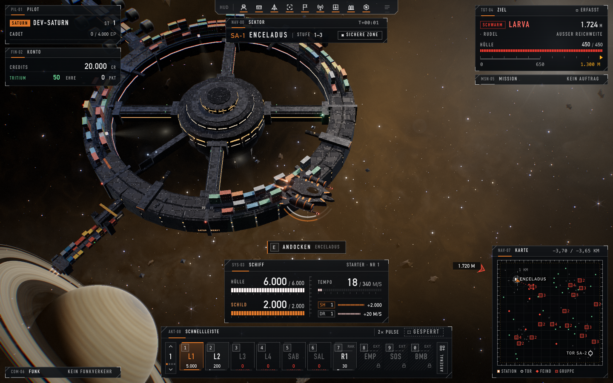
- 2,0 s · Ereignis: Erster Kontakt: 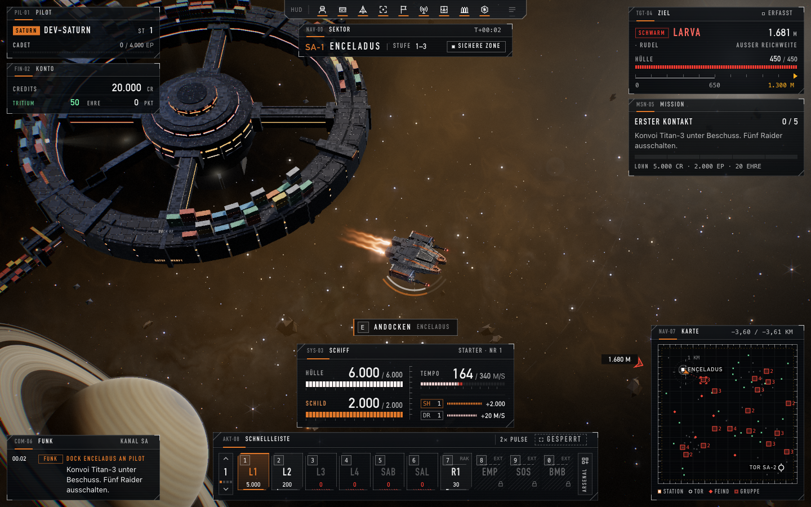
- 8,8 s · Erster Kampf (1,5 s nach dem ersten Schuss): 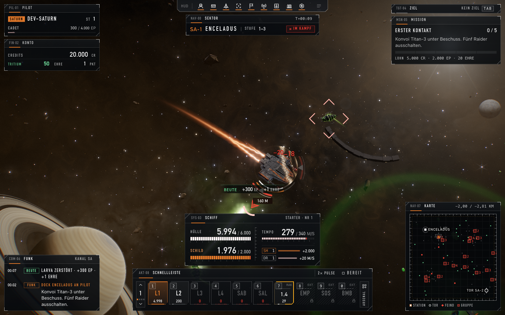
- 35,8 s · Angedockt: Station/Shop: 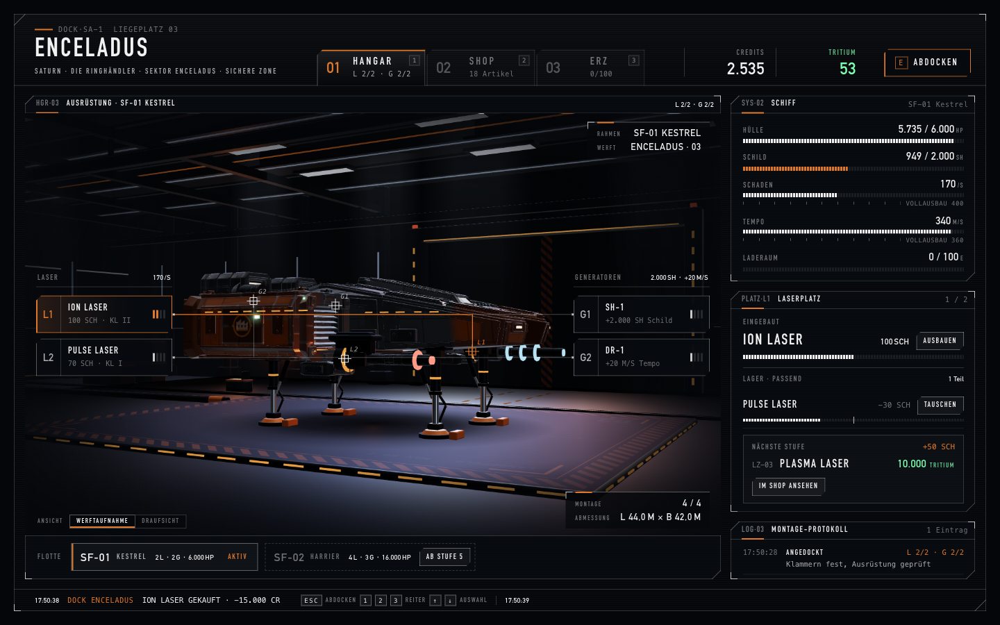
- 91,6 s · Hänger 6449 ms (Sprung lädt): 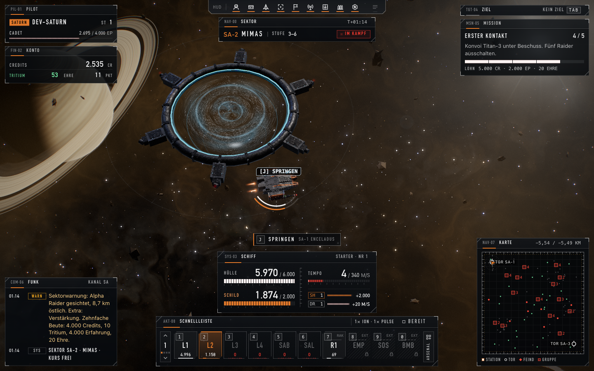
- 94,1 s · Neuer Sektor SA-2 (Mimas): 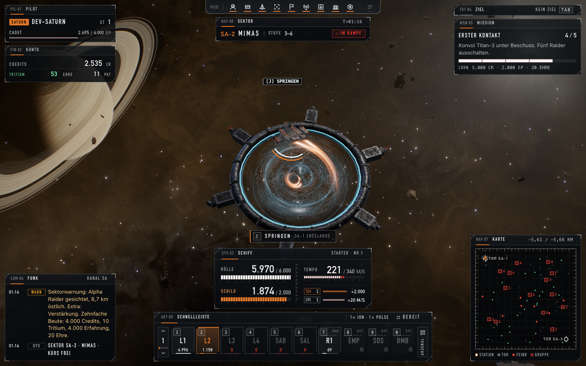
- 105,6 s · Abgeschossen: Reparatur-Auswahl: 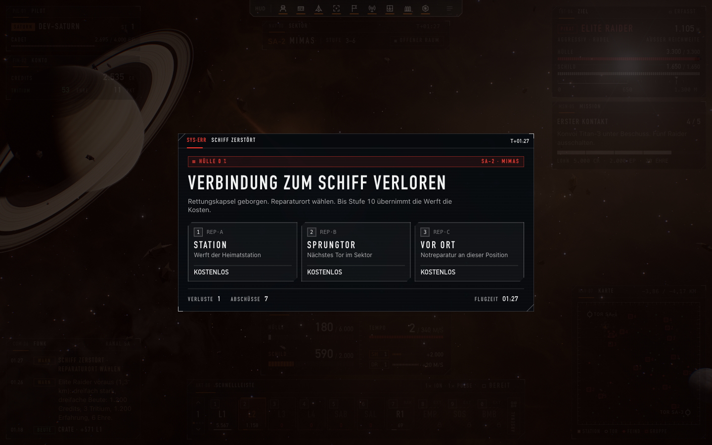
- 120,0 s · Ende der Spielzeit: 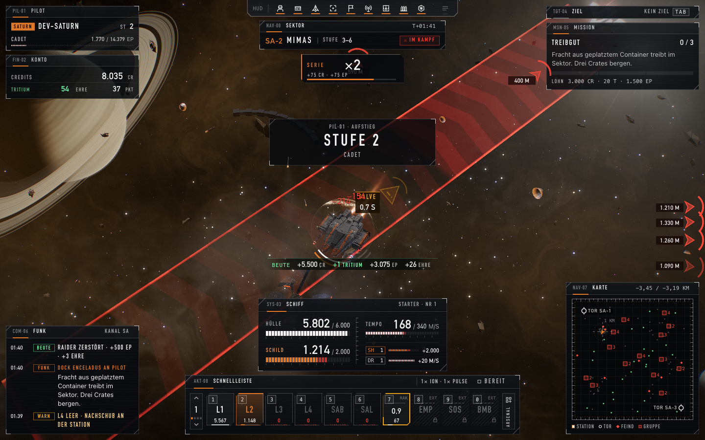

## ERIS · 120 s gespielt · ER-1 → ER-2

Qualität: Stufe HOCH, Auflösungsfaktor 1,00, Pixeldichte 1,75, Puffer 2520x1575, GPU-Zeitmessung ja. Ladezeit bis Flug 3,4 s.

### Bildzeiten (Mittel / p95 / längste, ms)
| Abschnitt | Bilder | Bilder/s | Bildabstand | CPU-Rechenzeit | GPU | Bildzeit max(CPU,GPU) | > 20 ms | > 25 ms | > 33 ms |
|---|---|---|---|---|---|---|---|---|---|
| Gesamt | 6.524 | 57,7 | 17,3 / 18,4 / 1.616,6 | 4,9 / 7,3 / 1.127,3 | 7,7 / 14,2 / 148,2 | 8,5 / 14,4 / 1.127,3 | 51 | 51 | 31 |
| Kampf | 4.617 | 59,4 | 16,8 / 18,4 / 99,9 | 5,0 / 7,5 / 87,4 | 7,1 / 13,1 / 51,8 | 7,9 / 13,2 / 87,4 | 37 | 37 | 23 |
| Ruhe | 1.768 | 57,4 | 17,4 / 18,4 / 1.135,0 | 5,1 / 6,8 / 1.127,3 | 8,7 / 14,4 / 148,2 | 9,7 / 14,5 / 1.127,3 | 10 | 10 | 5 |
| Erster Kampf (10 s) | 544 | 59,8 | 16,7 / 18,3 / 33,4 | 4,7 / 7,2 / 16,7 | 7,7 / 13,5 / 30,9 | 8,3 / 13,5 / 30,9 | 2 | 2 | 1 |
| Angedockt | 139 | 29,8 | 33,6 / 18,5 / 1.616,6 | 2,1 / 6,1 / 7,8 | 14,4 / 28,5 / 32,8 | 14,4 / 28,5 / 32,8 | 4 | 4 | 3 |

Längste Bilder mit Situation:
- 25,3 s: Bildabstand 1.616,6 ms, CPU 7,7 ms, GPU 10,6 ms · Angedockt: Shop · ER-1, 2 Gegner nah, 0 greifen an · zuletzt: profile×1 · 87 Draw Calls
- 89,1 s: Bildabstand 1.135,0 ms, CPU 9,3 ms, GPU 16,8 ms · Sprung lädt · ER-2, 0 Gegner nah, 0 greifen an · zuletzt: sector×1, message×1 · 65 Draw Calls
- 25,3 s: Bildabstand 699,9 ms, CPU 1,9 ms, GPU 10,6 ms · Angedockt: Shop · ER-1, 2 Gegner nah, 0 greifen an · zuletzt: profile×1 · 87 Draw Calls
- 42,3 s: Bildabstand 99,9 ms, CPU 7,6 ms, GPU 17,7 ms · Flug zum Sprungtor (8819 m) · ER-1, 4 Gegner nah, 3 greifen an · zuletzt: profile×1, damage×2 · 92 Draw Calls
- 89,3 s: Bildabstand 67,3 ms, CPU 6,9 ms, GPU 42,2 ms · Todestest: kämpfen ohne Rückzug · ER-2, 0 Gegner nah, 0 greifen an · zuletzt: sector×1, message×1 · 67 Draw Calls
- 25,4 s: Bildabstand 66,2 ms, CPU 1,8 ms, GPU 9,1 ms · Angedockt: Shop · ER-1, 2 Gegner nah, 0 greifen an · zuletzt: profile×1 · 86 Draw Calls
- 47,6 s: Bildabstand 65,7 ms, CPU 4,2 ms, GPU 23,3 ms · Flug zum Sprungtor (7630 m) · ER-1, 3 Gegner nah, 3 greifen an · zuletzt: nichts · 109 Draw Calls
- 64,1 s: Bildabstand 51,2 ms, CPU 5,8 ms, GPU 3,4 ms · Flug zum Sprungtor (4818 m) · ER-1, 7 Gegner nah, 2 greifen an · zuletzt: nichts · 70 Draw Calls

### Kampfwerte
Schüsse 91 (Treffer 86,8 %), Raketen 19, Tode 1 (Todestest nachgeholfen: Stufe 2).
Eingesteckt: 605 Hülle + 2.415 Schild · je Quelle: larva 57, raider 1.633, jackal 1.330.
Beute gesamt: 13.174 Credits, 23 Tritium, 9.315 Erfahrung, 47 Ehre.
Je Minute: **6.587 Credits, 11,5 Tritium, 4.657 Erfahrung, 23,5 Ehre**.
Profil: 20.000 → 14.674 Credits, 50 → 73 Tritium, Stufe 1 → 2.

| Gegner | Abschüsse | Zeit bis Abschuss Mittel / Median / max (s) |
|---|---|---|
| larva | 3 | 0,8 / 0,8 / 0,8 |
| raider | 8 | 3,4 / 3,1 / 6,1 |
| jackal | 1 | 6,0 / 6,0 / 6,0 |

Munition (Versuche/erfolgreich/Vorrat danach): L1 1/1/4.998 · L2 1/1/200 · L3 1/0/0 · L4 1/0/0. Schüsse je Munition: L1 4, L2 87.
Schussrichtung zur Schiffsnase: Mittel 22,7°, p95 72,6°, 24 Schüsse über 45°, 0 über 90° (Laser feuern dann seitlich/rückwärts aus den Mündungen).
Einkäufe: ammo L2 ok (−1.000 Credits, −0 Tritium) · rocket R1 ok (−2.500 Credits, −0 Tritium) · ammo L3 abgelehnt: Zu wenig Tritium: 250 nötig, du hast 53. · ammo SAL abgelehnt: Zu wenig Tritium: 200 nötig, du hast 53. · ammo SAB abgelehnt: Zu wenig Tritium: 500 nötig, du hast 53. · laser ion ok (−15.000 Credits, −0 Tritium).
Dauer der Aufrufe: Andocken 955,2 ms, 6 Einkäufe 700,8 ms, Abdocken 0,5 ms.
Reparaturen: 105,8 s here ok (kostenlos (bis Stufe 10)). Sprünge: 89,1 s → ER-2. Stufenaufstiege: 67,5 s → 2.

### Gegnerverhalten
| Typ | Stichproben | Zeitanteile | Abstand zum Spieler im Angriff (Mittel/Median/min m) | Ausweichen | Angriffsbeginn selbst/Sicht/mitgezogen | Flucht | übereinander | Schüsse/Treffer |
|---|---|---|---|---|---|---|---|---|
| raider | 2.280 | patrouille 45,7 %, anfliegen / flanke 26,4 %, hold / wartet im kreis 15,6 %, umkreisen / flanke 3,4 %, fliehen / rückzug zum heilen 3,2 %, ausweichen / flanke 1,7 %, abdrehen / flanke 1,0 %, anfliegen / lädt salve 0,7 %, angreifen (stehend) / lädt salve 0,5 %, umkreisen 0,3 %, anfliegen 0,2 %, angreifen (stehend) / salve 0,2 %, hold 0,2 %, abdrehen 0,2 %, angreifen (stehend) / flanke 0,2 %, umkreisen / schildwall 0,1 %, abdrehen / lädt salve 0,1 %, angreifen (stehend) 0,1 %, umkreisen / lädt salve 0,1 %, ausweichen 0,1 %, abdrehen / schildwall 0,0 %, ausweichen / lädt salve 0,0 % | 757 / 672 / 94 | 12 | 2/10/9 | 5 | 0,0 % | 45/31 |
| larva | 126 | patrouille 51,6 %, anfliegen / umzingeln 17,5 %, umkreisen / umzingeln 10,3 %, ausweichen / umzingeln 4,8 %, abdrehen / umzingeln 4,0 %, hold 2,4 %, anfliegen 2,4 %, abdrehen / lädt sprungbiss 2,4 %, anfliegen / springt 2,4 %, umkreisen / lädt sprungbiss 1,6 %, anfliegen / lädt sprungbiss 0,8 % | 277 / 227 / 59 | 2 | 1/0/2 | 0 | 0,0 % | 3/3 |
| jackal | 421 | patrouille 59,9 %, anfliegen / springt an 7,6 %, umkreisen / springt an 6,2 %, hold / wartet im kreis 5,7 %, patrouille / lauert getarnt 4,5 %, abdrehen / springt an 3,8 %, anfliegen / rammt 3,8 %, anfliegen / lädt rammangriff 2,9 %, fliehen / rückzug zum heilen 1,9 %, abdrehen / lädt rammangriff 1,0 %, ausweichen / springt an 0,7 %, anfliegen 0,5 %, angreifen (stehend) / springt an 0,5 %, hold / lauert getarnt 0,2 %, abdrehen 0,2 %, abdrehen / rammt 0,2 %, angreifen (stehend) / lädt rammangriff 0,2 %, umkreisen / rammt 0,2 % | 478 / 485 / 29 | 1 | 1/0/3 | 1 | 0,0 % | 12/11 |

Übereinander (Abstand < 0,75 × Summe der Trefferradien): in 0,0 % der Stichproben, Vorfälle keine, höchstens 0 Paare gleichzeitig. Hilfe-/Verstärkungsmeldungen: 4, vorübergehend erzeugte Gegner: 0.

### Ausrichtung der Modelle
nicht geprüft

### Konsole
2 Fehler, 1 Warnungen, 5 Hinweise (Netz).
- 2× Fehler: Failed to load resource: the server responded with a status of 404 (Not Found)
- 1× Warnung: The AudioContext was not allowed to start. It must be resumed (or created) after a user gesture on the page. https://developer.chrome.com/blog/autoplay/#web_audio
- 1× Hinweis: HEAD /models/station-europa.glb abgebrochen
- 1× Hinweis: HEAD /models/station-saturn.glb abgebrochen
- 1× Hinweis: HEAD /models/station-eris.glb abgebrochen
- 1× Hinweis: HEAD /models/eris-starter.glb abgebrochen
- 1× Hinweis: HEAD /models/europa-starter.glb abgebrochen

### Bilder
- 0,4 s · Ereignis: Erster Kontakt: 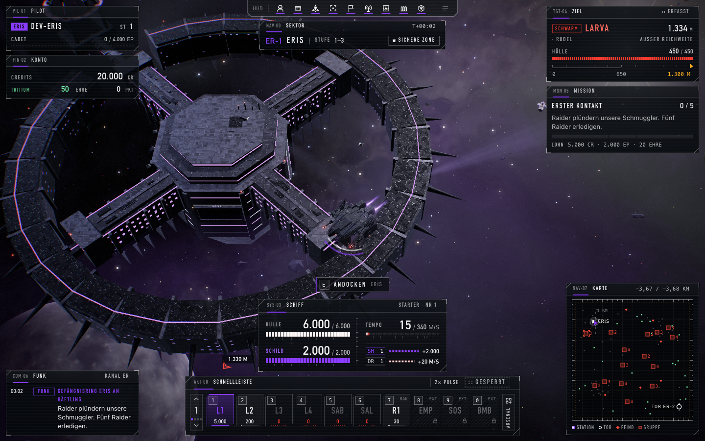
- 5,5 s · Erster Kampf (1,5 s nach dem ersten Schuss): 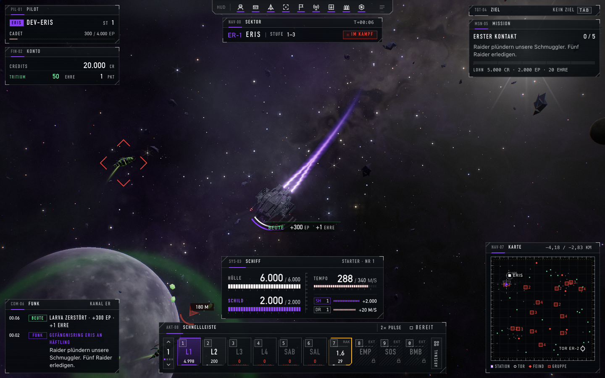
- 25,3 s · Hänger 1617 ms (Angedockt: Shop): 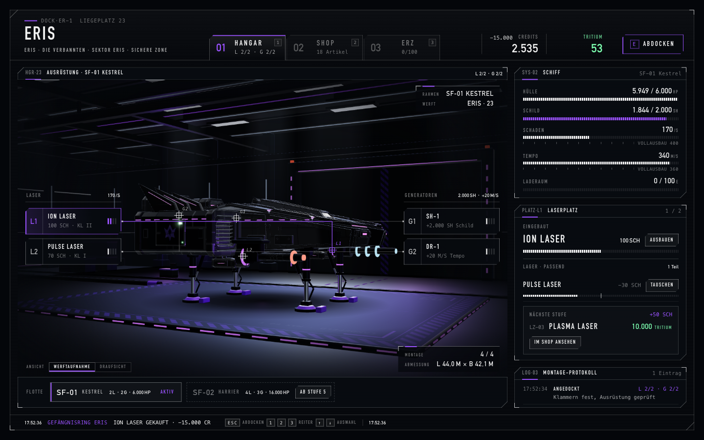
- 26,5 s · Angedockt: Station/Shop: 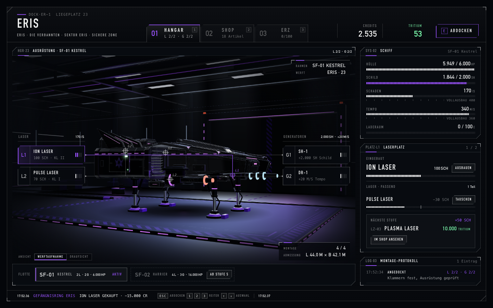
- 89,1 s · Hänger 1135 ms (Sprung lädt): 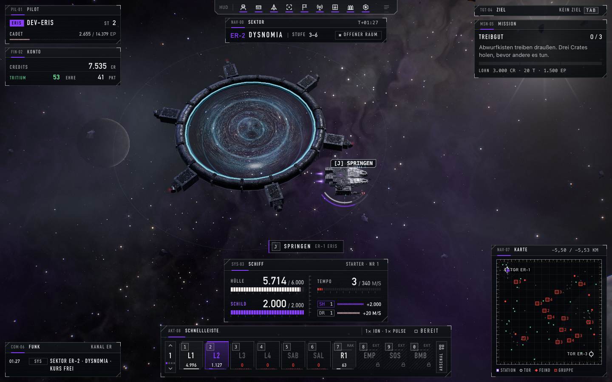
- 91,6 s · Neuer Sektor ER-2 (Dysnomia): 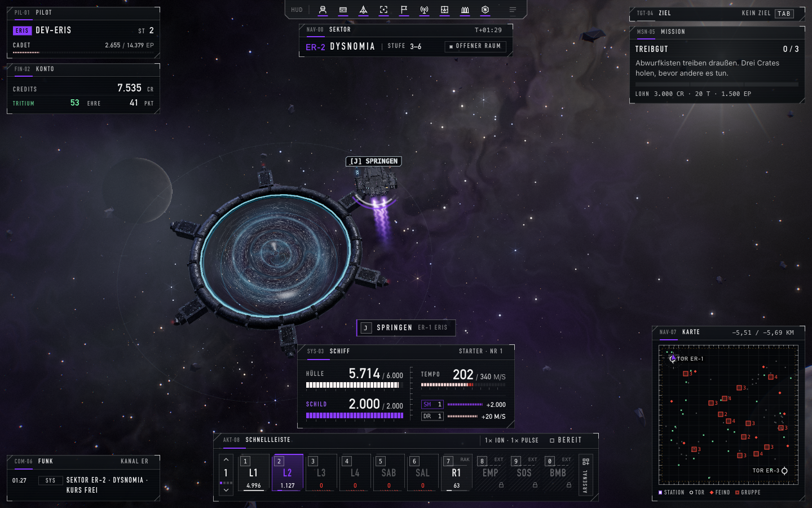
- 103,2 s · Abgeschossen: Reparatur-Auswahl: 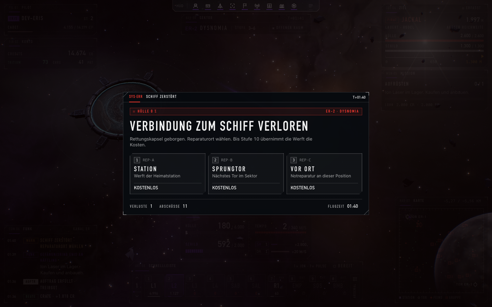
- 120,0 s · Ende der Spielzeit: 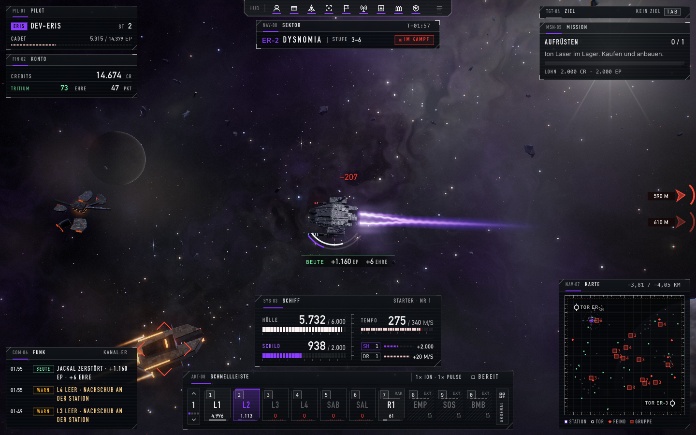
