# Test-Pilot · 2026-10-30_18-16-54

europa, saturn, eris · je 2,0 min · Qualität hoch · Fenster 1440×900 (Pixeldichte 2) · Chrome sichtbar

Ziele: Mac Qualität HOCH im Kampf unter 8 ms je Bild · normaler Laptop Full HD MITTEL mindestens 60 Bilder/s · erster Kampf ohne Hänger über 25 ms.

## EUROPA · 120 s gespielt · EU-1 → EU-2

Qualität: Stufe HOCH, Auflösungsfaktor 1,00, Pixeldichte 1,75, Puffer 2520x1575, GPU-Zeitmessung ja. Ladezeit bis Flug 2,1 s.

### Bildzeiten (Mittel / p95 / längste, ms)
| Abschnitt | Bilder | Bilder/s | Bildabstand | CPU-Rechenzeit | GPU | Bildzeit max(CPU,GPU) | > 20 ms | > 25 ms | > 33 ms |
|---|---|---|---|---|---|---|---|---|---|
| Gesamt | 6.639 | 58,4 | 17,1 / 18,3 / 1.698,7 | 3,3 / 6,0 / 233,3 | 7,5 / 11,7 / 38,6 | 7,6 / 11,7 / 233,3 | 11 | 11 | 7 |
| Kampf | 4.678 | 60,0 | 16,7 / 18,3 / 18,7 | 3,3 / 6,1 / 14,2 | 7,4 / 11,2 / 28,8 | 7,4 / 11,2 / 28,8 | 0 | 0 | 0 |
| Ruhe | 1.788 | 59,5 | 16,8 / 18,3 / 151,2 | 3,3 / 6,0 / 150,0 | 6,9 / 10,7 / 31,9 | 7,1 / 10,8 / 150,0 | 7 | 7 | 4 |
| Erster Kampf (10 s) | 531 | 60,0 | 16,7 / 18,2 / 18,7 | 4,8 / 7,4 / 14,2 | 8,8 / 12,1 / 16,8 | 8,8 / 12,1 / 16,8 | 0 | 0 | 0 |
| Angedockt | 173 | 30,6 | 32,7 / 18,5 / 1.698,7 | 2,8 / 4,8 / 233,3 | 15,9 / 31,0 / 38,6 | 17,1 / 31,0 / 233,3 | 4 | 4 | 3 |

Längste Bilder mit Situation:
- 29,1 s: Bildabstand 1.698,7 ms, CPU 4,7 ms, GPU 6,0 ms · Angedockt: Shop · EU-1, 4 Gegner nah, 0 greifen an · zuletzt: profile×1 · 90 Draw Calls
- 29,1 s: Bildabstand 867,9 ms, CPU 2,9 ms, GPU 6,0 ms · Angedockt: Shop · EU-1, 4 Gegner nah, 0 greifen an · zuletzt: profile×1 · 90 Draw Calls
- 32,5 s: Bildabstand 235,2 ms, CPU 1,9 ms, GPU 16,8 ms · Angedockt: Shop · EU-1, 4 Gegner nah, 0 greifen an · zuletzt: nichts · 320 Draw Calls
- 82,8 s: Bildabstand 151,2 ms, CPU 44,2 ms, GPU 11,2 ms · Sprung lädt · EU-2, 0 Gegner nah, 0 greifen an · zuletzt: despawn×77, sector×1, message×2 · 68 Draw Calls
- 0,2 s: Bildabstand 66,7 ms, CPU 9,4 ms, GPU 9,0 ms · Anflug auf Raider (2017 m) · EU-1, 0 Gegner nah, 0 greifen an · zuletzt: modell-geladen×1 · 300 Draw Calls
- 33,0 s: Bildabstand 34,0 ms, CPU 7,4 ms, GPU 4,2 ms · Flug zum Sprungtor (11513 m) · EU-1, 3 Gegner nah, 0 greifen an · zuletzt: undocked×1 · 323 Draw Calls
- 0,1 s: Bildabstand 33,5 ms, CPU 4,6 ms, GPU 7,1 ms · start · EU-1, 0 Gegner nah, 0 greifen an · zuletzt: modell-geladen×1 · 297 Draw Calls
- 0,2 s: Bildabstand 33,3 ms, CPU 4,7 ms, GPU 9,0 ms · Anflug auf Raider (2017 m) · EU-1, 0 Gegner nah, 0 greifen an · zuletzt: modell-geladen×1 · 300 Draw Calls

### Kampfwerte
Schüsse 75 (Treffer 85,3 %), Raketen 15, Tode 1 (Todestest nachgeholfen: Stufe 2).
Eingesteckt: 751 Hülle + 2.986 Schild · je Quelle: raider 3.517, jackal 220.
Beute gesamt: 6.900 Credits, 4 Tritium, 5.660 Erfahrung, 39 Ehre.
Je Minute: **3.450 Credits, 2,0 Tritium, 2.830 Erfahrung, 19,5 Ehre**.
Profil: 20.000 → 8.400 Credits, 50 → 54 Tritium, Stufe 1 → 2.

| Gegner | Abschüsse | Zeit bis Abschuss Mittel / Median / max (s) |
|---|---|---|
| raider | 6 | 2,8 / 2,0 / 5,2 |
| raider (elite) | 1 | 98,1 / 98,1 / 98,1 |

Munition (Versuche/erfolgreich/Vorrat danach): L1 1/1/4.998 · L2 1/1/200 · L3 1/0/0 · L4 1/0/0 · SAB 1/0/0. Schüsse je Munition: L1 9, L2 66.
Schussrichtung zur Schiffsnase: Mittel 11,4°, p95 59,9°, 10 Schüsse über 45°, 0 über 90° (Laser feuern dann seitlich/rückwärts aus den Mündungen).
Einkäufe: ammo L2 ok (−1.000 Credits, −0 Tritium) · rocket R1 ok (−2.500 Credits, −0 Tritium) · ammo L3 abgelehnt: Zu wenig Tritium: 250 nötig, du hast 51. · ammo SAL abgelehnt: Zu wenig Tritium: 200 nötig, du hast 51. · ammo SAB abgelehnt: Zu wenig Tritium: 500 nötig, du hast 51. · laser ion ok (−15.000 Credits, −0 Tritium).
Dauer der Aufrufe: Andocken 1.175,3 ms, 6 Einkäufe 858,7 ms, Abdocken 0,2 ms.
Reparaturen: 105,5 s here ok (kostenlos (bis Stufe 10)). Sprünge: 82,7 s → EU-2. Stufenaufstiege: 68,6 s → 2.

### Gegnerverhalten
| Typ | Stichproben | Zeitanteile | Abstand zum Spieler im Angriff (Mittel/Median/min m) | Ausweichen | Angriffsbeginn selbst/Sicht/mitgezogen | Flucht | übereinander | Schüsse/Treffer |
|---|---|---|---|---|---|---|---|---|
| raider | 2.463 | patrouille 43,5 %, anfliegen / flanke 21,9 %, hold / wartet im kreis 15,6 %, umkreisen / flanke 6,1 %, fliehen / rückzug zum heilen 5,3 %, abdrehen / flanke 2,3 %, ausweichen / flanke 1,3 %, umkreisen / lädt salve 0,7 %, abdrehen 0,6 %, angreifen (stehend) / salve 0,5 %, anfliegen / lädt salve 0,4 %, angreifen (stehend) / lädt salve 0,4 %, angreifen (stehend) / flanke 0,3 %, abdrehen / lädt salve 0,2 %, hold 0,2 %, anfliegen 0,2 %, umkreisen 0,2 %, ausweichen / schildwall 0,1 %, angreifen (stehend) 0,1 %, ausweichen / rückzug zum heilen 0,1 %, abdrehen / salve 0,0 % | 748 / 680 / 16 | 10 | 2/10/12 | 7 | 0,0 % | 85/53 |
| larva | 399 | patrouille 100,0 % | – | 0 | 0/0/0 | 0 | 0,0 % | 0/0 |
| jackal | 128 | patrouille 45,3 %, anfliegen / springt an 24,2 %, patrouille / lauert getarnt 11,7 %, anfliegen / rammt 3,9 %, anfliegen / lädt rammangriff 3,1 %, ausweichen / springt an 3,1 %, abdrehen / lädt rammangriff 3,1 %, abdrehen / springt an 2,3 %, hold / wartet im kreis 0,8 %, angreifen (stehend) / springt an 0,8 %, umkreisen / springt an 0,8 %, fliehen / rückzug zum heilen 0,8 % | 636 / 709 / 243 | 1 | 1/0/1 | 1 | 0,0 % | 3/3 |

Übereinander (Abstand < 0,75 × Summe der Trefferradien): in 0,0 % der Stichproben, Vorfälle keine, höchstens 0 Paare gleichzeitig. Hilfe-/Verstärkungsmeldungen: 5, vorübergehend erzeugte Gegner: 0.

### Ausrichtung der Modelle
nicht geprüft

### Konsole
2 Fehler, 0 Warnungen, 5 Hinweise (Netz).
- 2× Fehler: Failed to load resource: the server responded with a status of 404 (Not Found)
- 1× Hinweis: HEAD /models/station-europa.glb abgebrochen
- 1× Hinweis: HEAD /models/station-saturn.glb abgebrochen
- 1× Hinweis: HEAD /models/station-eris.glb abgebrochen
- 1× Hinweis: HEAD /models/europa-starter.glb abgebrochen
- 1× Hinweis: HEAD /models/eris-starter.glb abgebrochen

### Bilder
- 0,2 s · Hänger 67 ms (Anflug auf Raider (2017 m)): 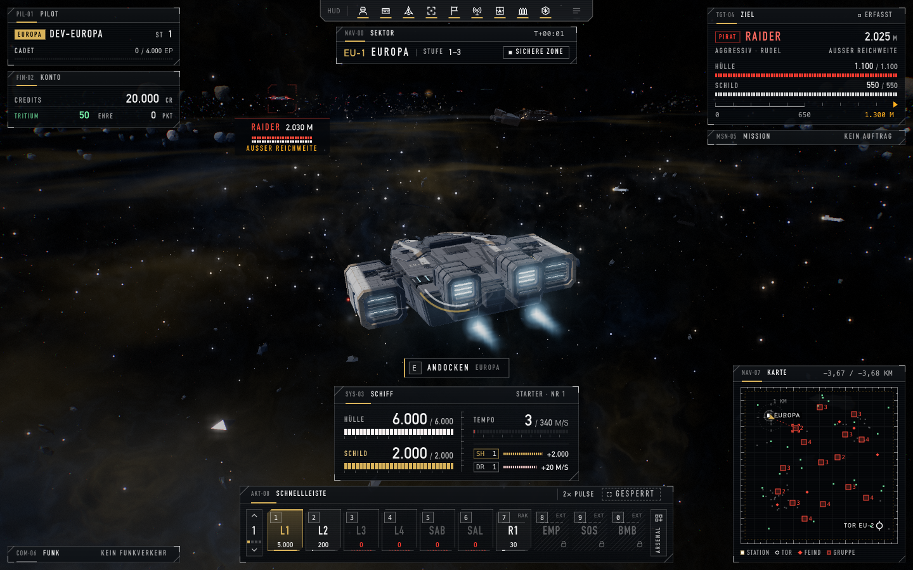
- 1,1 s · Ereignis: Erster Kontakt: 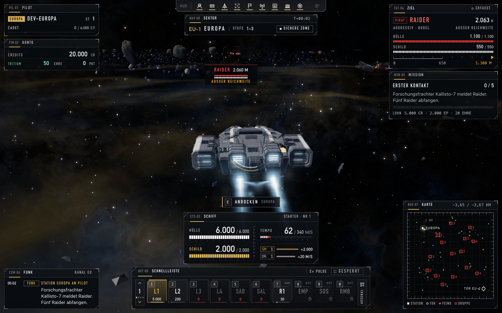
- 9,6 s · Erster Kampf (1,5 s nach dem ersten Schuss): 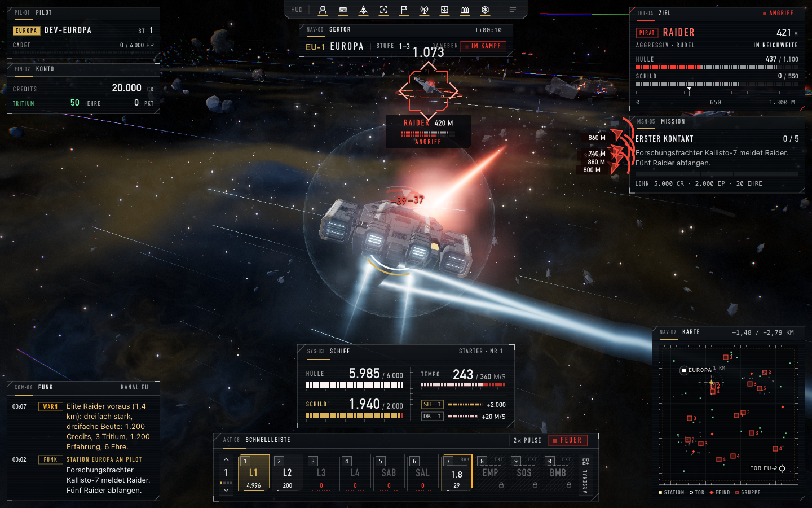
- 30,3 s · Angedockt: Station/Shop: 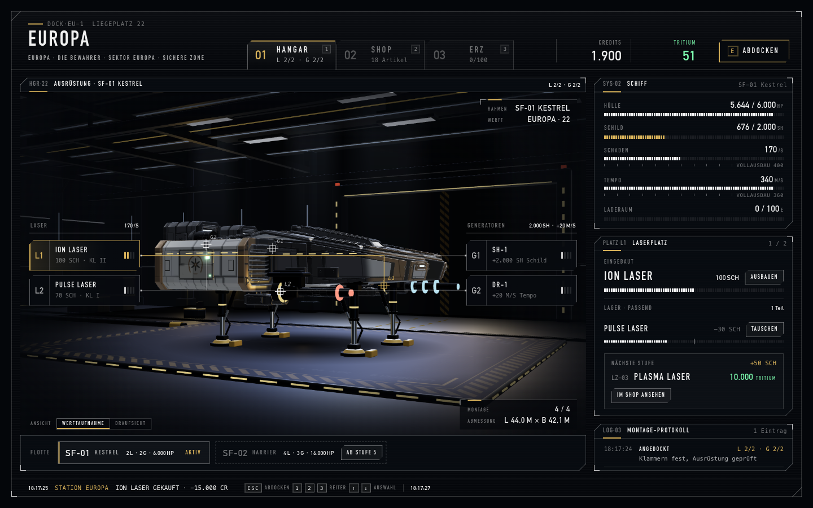
- 85,2 s · Neuer Sektor EU-2 (Io): 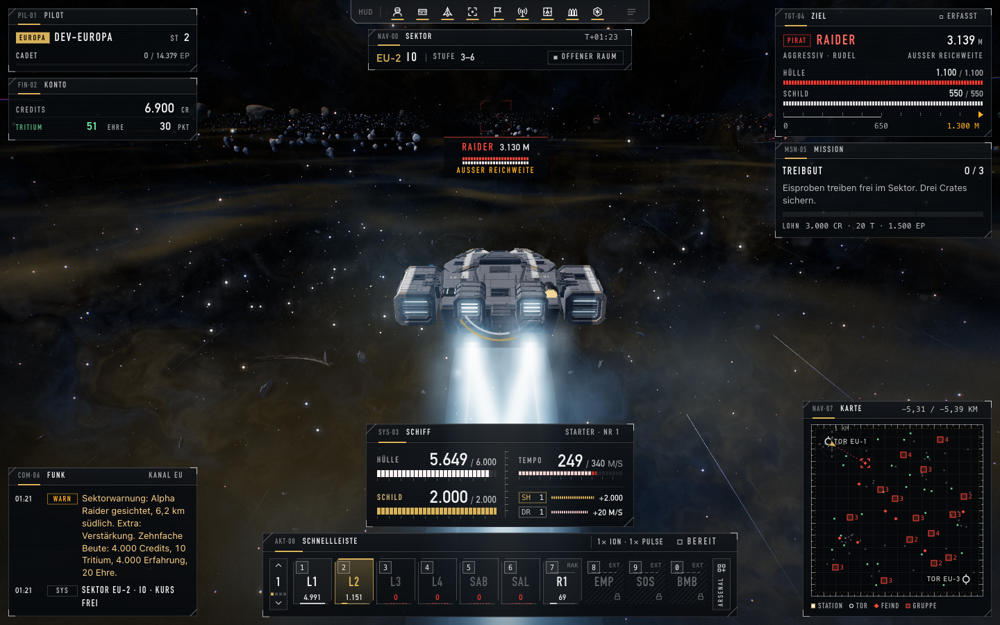
- 102,9 s · Abgeschossen: Reparatur-Auswahl: 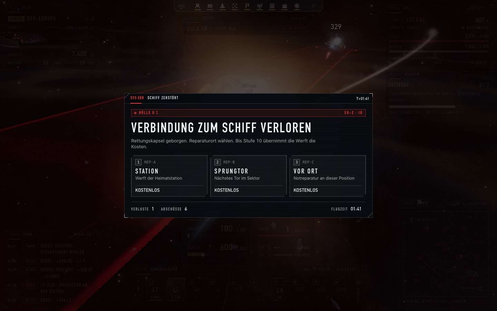
- 115,6 s · Abschuss raider (elite): 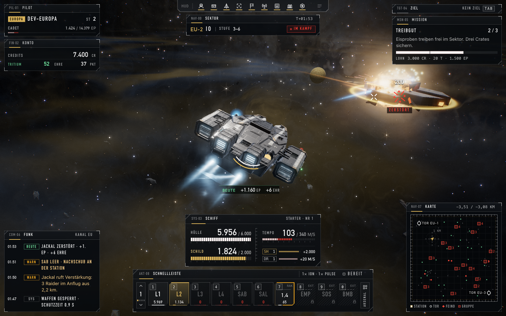
- 120,0 s · Ende der Spielzeit: 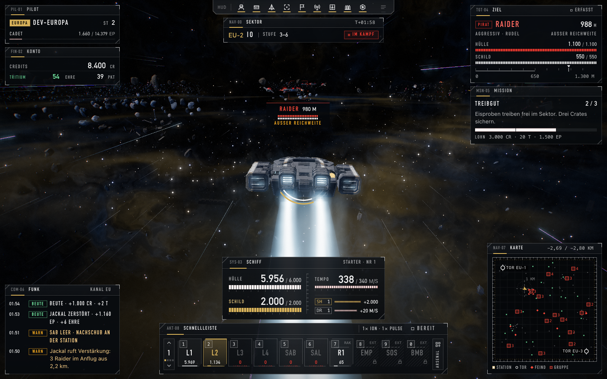

## SATURN · 120 s gespielt · SA-1 → SA-2

Qualität: Stufe HOCH, Auflösungsfaktor 1,00, Pixeldichte 1,75, Puffer 2520x1575, GPU-Zeitmessung ja. Ladezeit bis Flug 2,5 s.

### Bildzeiten (Mittel / p95 / längste, ms)
| Abschnitt | Bilder | Bilder/s | Bildabstand | CPU-Rechenzeit | GPU | Bildzeit max(CPU,GPU) | > 20 ms | > 25 ms | > 33 ms |
|---|---|---|---|---|---|---|---|---|---|
| Gesamt | 6.816 | 59,1 | 16,9 / 18,3 / 1.100,0 | 3,1 / 5,7 / 153,7 | 7,7 / 11,6 / 48,7 | 7,7 / 11,7 / 153,7 | 6 | 6 | 4 |
| Kampf | 3.800 | 60,0 | 16,7 / 18,3 / 18,7 | 3,3 / 5,8 / 13,0 | 7,6 / 11,0 / 48,7 | 7,6 / 11,0 / 48,7 | 0 | 0 | 0 |
| Ruhe | 2.847 | 59,8 | 16,7 / 18,3 / 150,0 | 2,9 / 5,1 / 153,7 | 7,3 / 11,3 / 27,4 | 7,4 / 11,4 / 153,7 | 4 | 4 | 2 |
| Erster Kampf (10 s) | 551 | 60,0 | 16,7 / 18,3 / 18,7 | 3,5 / 6,2 / 13,0 | 7,9 / 11,0 / 15,5 | 8,0 / 11,1 / 15,5 | 0 | 0 | 0 |
| Angedockt | 169 | 38,0 | 26,3 / 18,4 / 1.100,0 | 1,6 / 5,6 / 12,6 | 16,9 / 38,7 / 46,9 | 16,9 / 38,7 / 46,9 | 2 | 2 | 2 |

Längste Bilder mit Situation:
- 25,0 s: Bildabstand 1.100,0 ms, CPU 3,5 ms, GPU 6,8 ms · Angedockt: Shop · SA-1, 0 Gegner nah, 0 greifen an · zuletzt: profile×1 · 130 Draw Calls
- 25,0 s: Bildabstand 565,9 ms, CPU 1,7 ms, GPU 6,8 ms · Angedockt: Shop · SA-1, 0 Gegner nah, 0 greifen an · zuletzt: profile×1 · 130 Draw Calls
- 79,1 s: Bildabstand 150,0 ms, CPU 2,3 ms, GPU 8,4 ms · Sprung lädt · SA-2, 0 Gegner nah, 0 greifen an · zuletzt: despawn×78, sector×1, message×1 · 74 Draw Calls
- 0,2 s: Bildabstand 34,8 ms, CPU 6,3 ms, GPU 3,6 ms · Anflug auf Raider (1633 m) · SA-1, 0 Gegner nah, 0 greifen an · zuletzt: modell-geladen×1 · 283 Draw Calls
- 0,1 s: Bildabstand 33,3 ms, CPU 4,8 ms, GPU 9,7 ms · start · SA-1, 0 Gegner nah, 0 greifen an · zuletzt: nichts · 276 Draw Calls
- 79,1 s: Bildabstand 33,1 ms, CPU 3,8 ms, GPU 11,5 ms · Beute: Crate einsammeln · SA-2, 0 Gegner nah, 0 greifen an · zuletzt: despawn×78, sector×1, message×1 · 314 Draw Calls
- 79,1 s: Bildabstand 16,6 ms, CPU 153,7 ms, GPU 8,4 ms · Sprung lädt · SA-2, 0 Gegner nah, 0 greifen an · zuletzt: despawn×78, sector×1, message×1 · 74 Draw Calls
- 0,2 s: Bildabstand 15,2 ms, CPU 37,2 ms, GPU 3,6 ms · Anflug auf Raider (1641 m) · SA-1, 0 Gegner nah, 0 greifen an · zuletzt: nichts · 278 Draw Calls

### Kampfwerte
Schüsse 76 (Treffer 71,1 %), Raketen 13, Tode 1 (Todestest nachgeholfen: Stufe 2).
Eingesteckt: 539 Hülle + 2.153 Schild · je Quelle: raider 2.692.
Beute gesamt: 8.044 Credits, 18 Tritium, 4.735 Erfahrung, 34 Ehre.
Je Minute: **4.022 Credits, 9,0 Tritium, 2.367 Erfahrung, 17,0 Ehre**.
Profil: 20.000 → 9.544 Credits, 50 → 68 Tritium, Stufe 1 → 2.

| Gegner | Abschüsse | Zeit bis Abschuss Mittel / Median / max (s) |
|---|---|---|
| raider | 6 | 17,0 / 4,8 / 44,0 |

Munition (Versuche/erfolgreich/Vorrat danach): L1 1/1/4.999 · L2 1/1/200 · L3 1/0/0 · L4 1/0/0 · SAB 1/0/0. Schüsse je Munition: L1 8, L2 68.
Schussrichtung zur Schiffsnase: Mittel 12,4°, p95 70,6°, 12 Schüsse über 45°, 0 über 90° (Laser feuern dann seitlich/rückwärts aus den Mündungen).
Einkäufe: ammo L2 ok (−1.000 Credits, −0 Tritium) · rocket R1 ok (−2.500 Credits, −0 Tritium) · ammo L3 abgelehnt: Zu wenig Tritium: 250 nötig, du hast 52. · ammo SAL abgelehnt: Zu wenig Tritium: 200 nötig, du hast 52. · ammo SAB abgelehnt: Zu wenig Tritium: 500 nötig, du hast 52. · laser ion ok (−15.000 Credits, −0 Tritium).
Dauer der Aufrufe: Andocken 781,7 ms, 6 Einkäufe 556,2 ms, Abdocken 0,2 ms.
Reparaturen: 105,5 s here ok (kostenlos (bis Stufe 10)). Sprünge: 79,1 s → SA-2. Stufenaufstiege: 97,7 s → 2.

### Gegnerverhalten
| Typ | Stichproben | Zeitanteile | Abstand zum Spieler im Angriff (Mittel/Median/min m) | Ausweichen | Angriffsbeginn selbst/Sicht/mitgezogen | Flucht | übereinander | Schüsse/Treffer |
|---|---|---|---|---|---|---|---|---|
| raider | 2.020 | patrouille 53,7 %, anfliegen / flanke 24,7 %, fliehen / rückzug zum heilen 6,4 %, umkreisen / flanke 5,1 %, hold / wartet im kreis 3,4 %, ausweichen / flanke 1,7 %, angreifen (stehend) / lädt salve 0,9 %, abdrehen / flanke 0,7 %, umkreisen / lädt salve 0,5 %, angreifen (stehend) / salve 0,5 %, anfliegen 0,4 %, abdrehen / lädt salve 0,3 %, hold 0,3 %, anfliegen / lädt salve 0,3 %, umkreisen 0,2 %, ausweichen / rückzug zum heilen 0,2 %, ausweichen 0,1 %, ausweichen / lädt salve 0,1 %, angreifen (stehend) / flanke 0,1 %, abdrehen 0,1 %, ausweichen / schildwall 0,0 % | 782 / 701 / 30 | 13 | 3/8/8 | 7 | 0,0 % | 53/41 |

Übereinander (Abstand < 0,75 × Summe der Trefferradien): in 0,0 % der Stichproben, Vorfälle keine, höchstens 0 Paare gleichzeitig. Hilfe-/Verstärkungsmeldungen: 6, vorübergehend erzeugte Gegner: 5.

### Ausrichtung der Modelle
nicht geprüft

### Konsole
2 Fehler, 0 Warnungen, 5 Hinweise (Netz).
- 2× Fehler: Failed to load resource: the server responded with a status of 404 (Not Found)
- 1× Hinweis: HEAD /models/station-europa.glb abgebrochen
- 1× Hinweis: HEAD /models/station-saturn.glb abgebrochen
- 1× Hinweis: HEAD /models/station-eris.glb abgebrochen
- 1× Hinweis: HEAD /models/europa-starter.glb abgebrochen
- 1× Hinweis: HEAD /models/eris-starter.glb abgebrochen

### Bilder
- 0,9 s · Ereignis: Erster Kontakt: 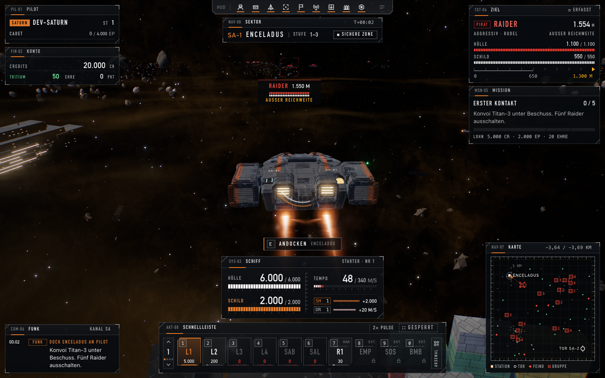
- 5,7 s · Erster Kampf (1,5 s nach dem ersten Schuss): 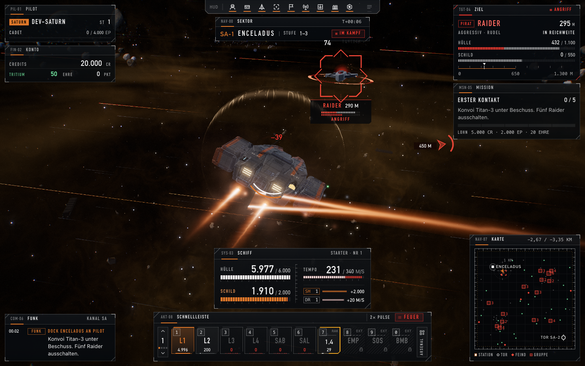
- 25,0 s · Hänger 1100 ms (Angedockt: Shop): 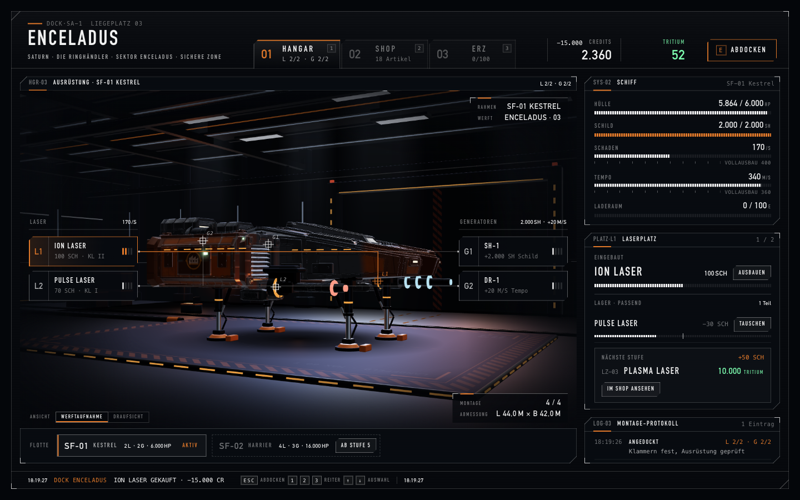
- 26,2 s · Angedockt: Station/Shop: 
- 81,6 s · Neuer Sektor SA-2 (Mimas): 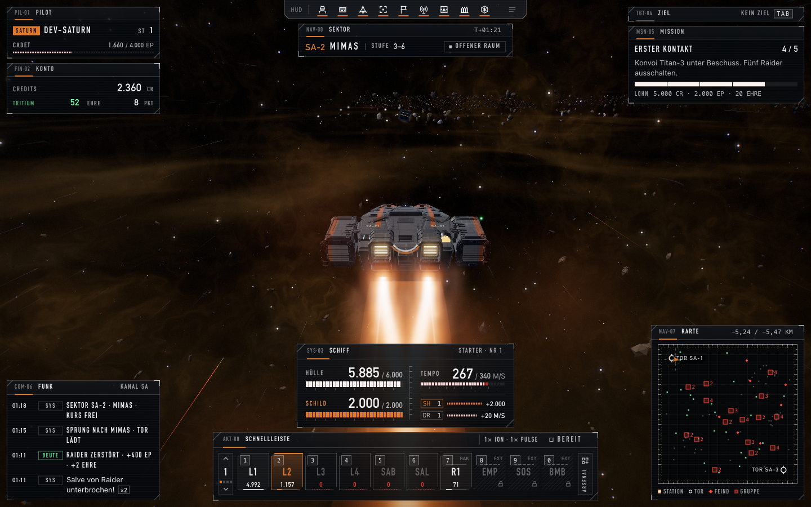
- 102,9 s · Abgeschossen: Reparatur-Auswahl: 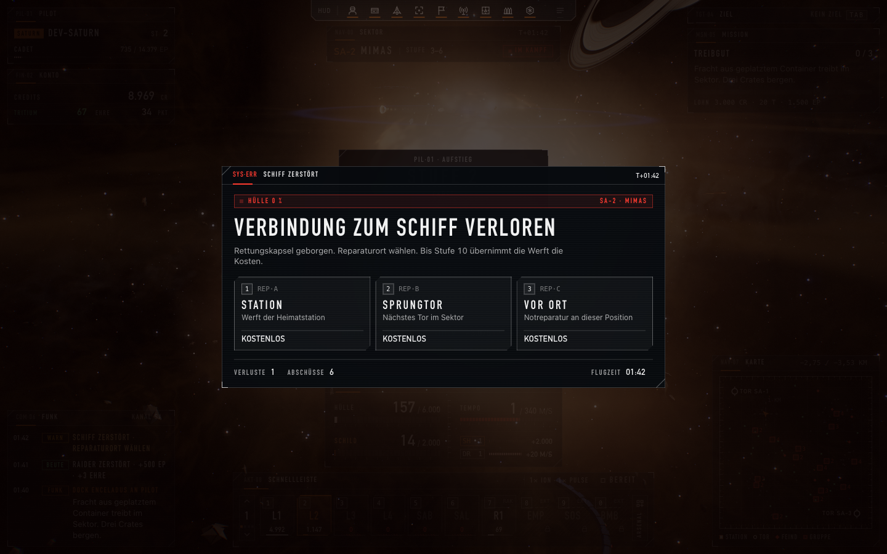
- 120,0 s · Ende der Spielzeit: 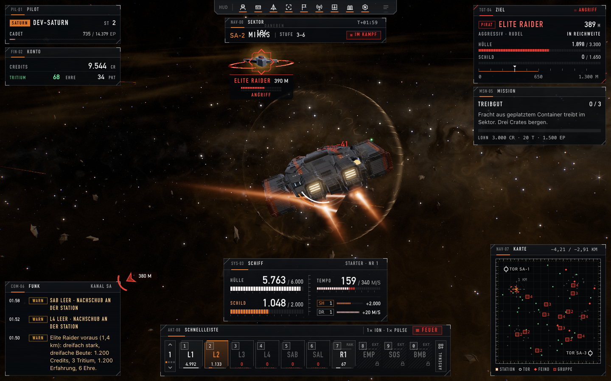

## ERIS · 120 s gespielt · ER-1 → ER-2

Qualität: Stufe HOCH, Auflösungsfaktor 1,00, Pixeldichte 1,75, Puffer 2520x1575, GPU-Zeitmessung ja. Ladezeit bis Flug 1,8 s.

### Bildzeiten (Mittel / p95 / längste, ms)
| Abschnitt | Bilder | Bilder/s | Bildabstand | CPU-Rechenzeit | GPU | Bildzeit max(CPU,GPU) | > 20 ms | > 25 ms | > 33 ms |
|---|---|---|---|---|---|---|---|---|---|
| Gesamt | 6.818 | 59,0 | 16,9 / 18,3 / 1.100,2 | 2,1 / 3,5 / 130,0 | 7,6 / 11,0 / 39,4 | 7,6 / 11,0 / 130,0 | 8 | 8 | 8 |
| Kampf | 3.183 | 60,0 | 16,7 / 18,3 / 18,7 | 2,1 / 3,1 / 10,4 | 7,5 / 10,3 / 15,6 | 7,5 / 10,3 / 15,6 | 0 | 0 | 0 |
| Ruhe | 3.434 | 59,7 | 16,7 / 18,3 / 118,5 | 2,3 / 3,8 / 130,0 | 7,2 / 10,7 / 22,0 | 7,3 / 10,7 / 130,0 | 6 | 6 | 6 |
| Erster Kampf (10 s) | 556 | 60,0 | 16,7 / 18,2 / 18,7 | 1,8 / 2,6 / 4,8 | 7,6 / 10,1 / 11,1 | 7,6 / 10,1 / 11,1 | 0 | 0 | 0 |
| Angedockt | 201 | 40,2 | 24,9 / 18,4 / 1.100,2 | 1,3 / 4,2 / 4,6 | 15,3 / 30,0 / 39,4 | 15,3 / 30,0 / 39,4 | 2 | 2 | 2 |

Längste Bilder mit Situation:
- 32,9 s: Bildabstand 1.100,2 ms, CPU 3,6 ms, GPU 8,9 ms · Angedockt: Shop · ER-1, 0 Gegner nah, 0 greifen an · zuletzt: profile×1 · 91 Draw Calls
- 32,9 s: Bildabstand 583,4 ms, CPU 1,5 ms, GPU 8,9 ms · Angedockt: Shop · ER-1, 0 Gegner nah, 0 greifen an · zuletzt: profile×1 · 91 Draw Calls
- 79,4 s: Bildabstand 118,5 ms, CPU 32,7 ms, GPU 12,5 ms · Sprung lädt · ER-2, 0 Gegner nah, 0 greifen an · zuletzt: despawn×77, sector×1, message×2 · 68 Draw Calls
- 0,3 s: Bildabstand 66,3 ms, CPU 6,4 ms, GPU 4,0 ms · Beute: Crate einsammeln · ER-1, 0 Gegner nah, 0 greifen an · zuletzt: modell-geladen×1 · 261 Draw Calls
- 0,2 s: Bildabstand 51,6 ms, CPU 5,4 ms, GPU 10,8 ms · Beute: Crate einsammeln · ER-1, 0 Gegner nah, 0 greifen an · zuletzt: modell-geladen×1 · 259 Draw Calls
- 79,4 s: Bildabstand 50,0 ms, CPU 3,3 ms, GPU 11,2 ms · Sprung lädt · ER-2, 0 Gegner nah, 0 greifen an · zuletzt: despawn×77, sector×1, message×2 · 341 Draw Calls
- 0,3 s: Bildabstand 34,0 ms, CPU 5,6 ms, GPU 4,0 ms · Beute: Crate einsammeln · ER-1, 0 Gegner nah, 0 greifen an · zuletzt: modell-geladen×1 · 263 Draw Calls
- 0,4 s: Bildabstand 33,7 ms, CPU 4,9 ms, GPU 5,2 ms · Beute: Crate einsammeln · ER-1, 0 Gegner nah, 0 greifen an · zuletzt: modell-geladen×1 · 263 Draw Calls

### Kampfwerte
Schüsse 50 (Treffer 86,0 %), Raketen 10, Tode 1 (Todestest nachgeholfen: Stufe 1).
Eingesteckt: 1.557 Hülle + 4.331 Schild · je Quelle: raider 752, jackal 5.136.
Beute gesamt: 3.144 Credits, 15 Tritium, 1.240 Erfahrung, 6 Ehre.
Je Minute: **1.572 Credits, 7,5 Tritium, 620 Erfahrung, 3,0 Ehre**.
Profil: 20.000 → 4.644 Credits, 50 → 65 Tritium, Stufe 1 → 1.

| Gegner | Abschüsse | Zeit bis Abschuss Mittel / Median / max (s) |
|---|---|---|
| jackal | 1 | 23,3 / 23,3 / 23,3 |

Munition (Versuche/erfolgreich/Vorrat danach): L1 1/1/4.998 · L2 1/1/1.200 · L3 1/0/0 · L4 1/0/0 · SAB 1/0/0. Schüsse je Munition: L1 21, L2 29.
Schussrichtung zur Schiffsnase: Mittel 9,2°, p95 57,1°, 6 Schüsse über 45°, 0 über 90° (Laser feuern dann seitlich/rückwärts aus den Mündungen).
Einkäufe: ammo L2 ok (−1.000 Credits, −0 Tritium) · rocket R1 ok (−2.500 Credits, −0 Tritium) · ammo L3 abgelehnt: Zu wenig Tritium: 250 nötig, du hast 50. · ammo SAL abgelehnt: Zu wenig Tritium: 200 nötig, du hast 50. · ammo SAB abgelehnt: Zu wenig Tritium: 500 nötig, du hast 50. · laser ion ok (−15.000 Credits, −0 Tritium).
Dauer der Aufrufe: Andocken 786,7 ms, 6 Einkäufe 598,5 ms, Abdocken 0,3 ms.
Reparaturen: 105,1 s here ok (kostenlos (bis Stufe 10)). Sprünge: 79,3 s → ER-2. Stufenaufstiege: keine.

### Gegnerverhalten
| Typ | Stichproben | Zeitanteile | Abstand zum Spieler im Angriff (Mittel/Median/min m) | Ausweichen | Angriffsbeginn selbst/Sicht/mitgezogen | Flucht | übereinander | Schüsse/Treffer |
|---|---|---|---|---|---|---|---|---|
| raider | 1.694 | patrouille 62,2 %, anfliegen / flanke 23,2 %, hold / wartet im kreis 5,1 %, fliehen / rückzug zum heilen 2,9 %, angreifen (anderes Ziel) / überfällt konvoi 1,7 %, umkreisen / flanke 1,4 %, ausweichen / flanke 0,8 %, abdrehen / flanke 0,5 %, anfliegen / lädt salve 0,5 %, angreifen (stehend) / lädt salve 0,5 %, angreifen (stehend) / salve 0,4 %, umkreisen / lädt salve 0,4 %, angreifen (stehend) / flanke 0,2 %, angreifen (stehend) 0,1 %, hold 0,1 %, abdrehen / lädt salve 0,1 %, abdrehen / salve 0,1 %, umkreisen 0,1 % | 994 / 991 / 278 | 4 | 1/6/2 | 2 | 0,1 % | 65/16 |
| larva | 406 | patrouille 100,0 % | – | 0 | 0/0/0 | 0 | 0,0 % | 0/0 |
| jackal | 631 | patrouille 48,5 %, anfliegen / springt an 13,3 %, umkreisen / springt an 8,6 %, fliehen / rückzug zum heilen 6,5 %, patrouille / lauert getarnt 5,4 %, abdrehen / springt an 4,8 %, anfliegen / rammt 4,0 %, abdrehen / lädt rammangriff 2,4 %, umkreisen / lädt rammangriff 1,3 %, umkreisen / rammt 1,0 %, hold / lauert getarnt 0,8 %, ausweichen 0,8 %, ausweichen / springt an 0,8 %, angreifen (stehend) / rammt 0,5 %, ausweichen / rückzug zum heilen 0,5 %, anfliegen 0,3 %, abdrehen / rammt 0,3 %, hold / wartet im kreis 0,2 %, angreifen (stehend) 0,2 %, anfliegen / lädt rammangriff 0,2 % | 471 / 466 / 94 | 4 | 2/1/3 | 2 | 0,0 % | 28/22 |

Übereinander (Abstand < 0,75 × Summe der Trefferradien): in 0,2 % der Stichproben, Vorfälle raider 1, höchstens 1 Paare gleichzeitig. Hilfe-/Verstärkungsmeldungen: 8, vorübergehend erzeugte Gegner: 4.

### Ausrichtung der Modelle
nicht geprüft

### Konsole
2 Fehler, 0 Warnungen, 5 Hinweise (Netz).
- 2× Fehler: Failed to load resource: the server responded with a status of 404 (Not Found)
- 1× Hinweis: HEAD /models/station-europa.glb abgebrochen
- 1× Hinweis: HEAD /models/station-saturn.glb abgebrochen
- 1× Hinweis: HEAD /models/station-eris.glb abgebrochen
- 1× Hinweis: HEAD /models/europa-starter.glb abgebrochen
- 1× Hinweis: HEAD /models/eris-starter.glb abgebrochen

### Bilder
- 0,3 s · Hänger 66 ms (Beute: Crate einsammeln): 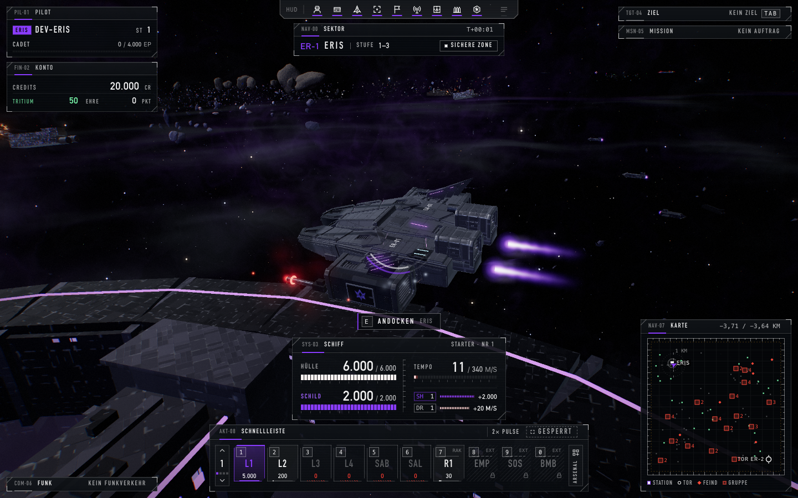
- 1,2 s · Ereignis: Erster Kontakt: 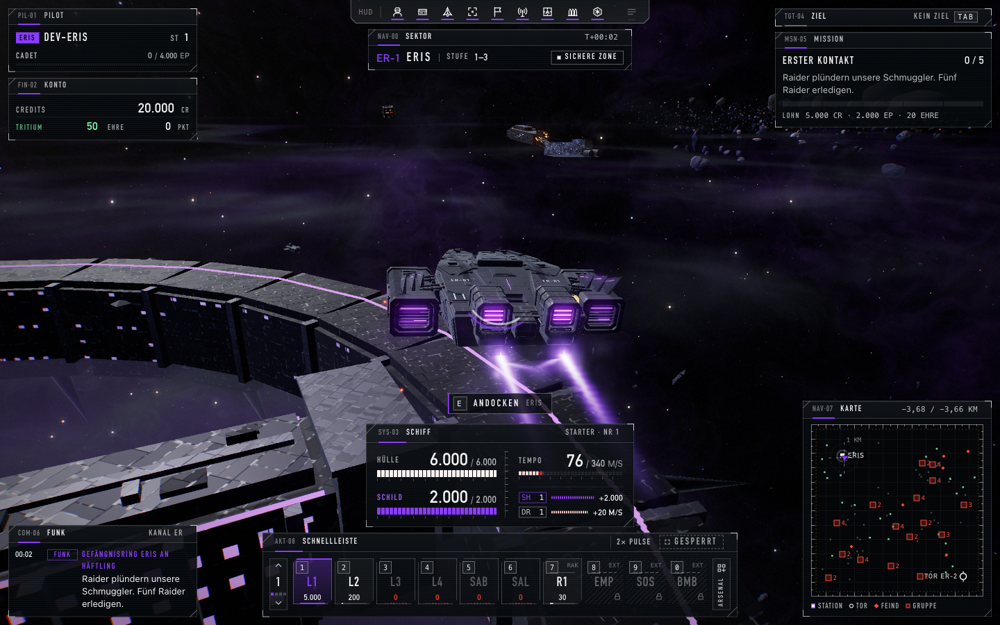
- 18,8 s · Erster Kampf (1,5 s nach dem ersten Schuss): 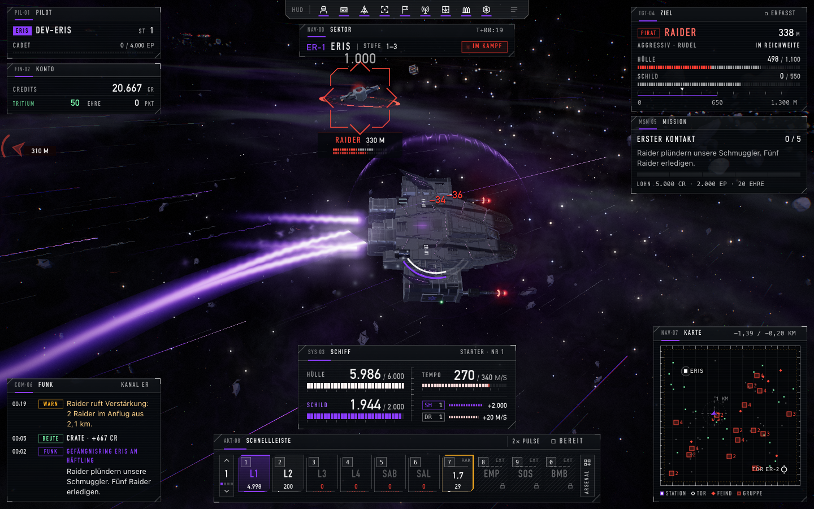
- 34,1 s · Angedockt: Station/Shop: 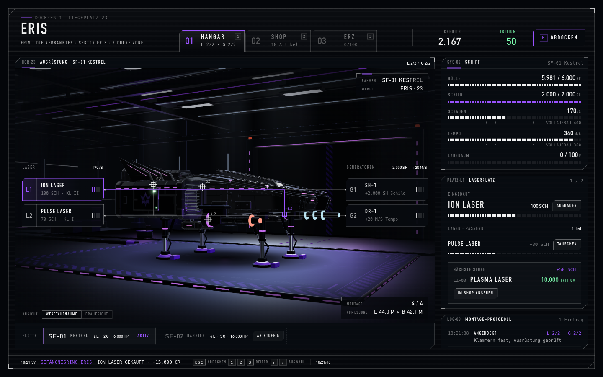
- 81,8 s · Neuer Sektor ER-2 (Dysnomia): 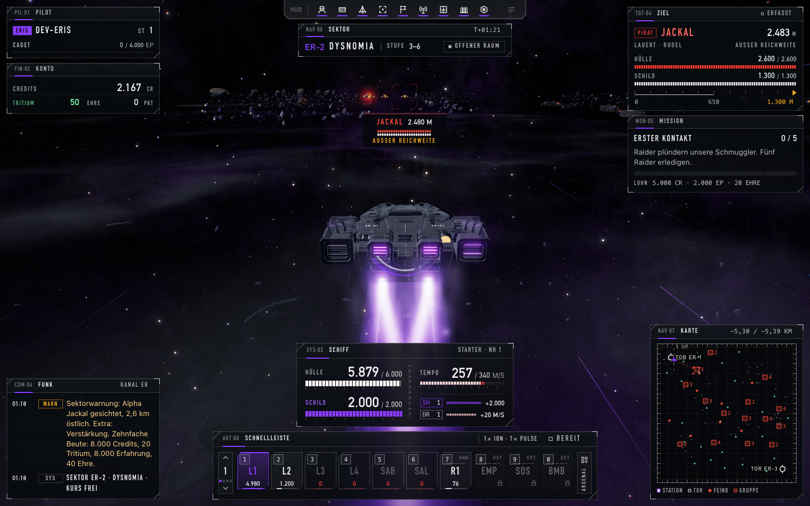
- 102,6 s · Abgeschossen: Reparatur-Auswahl: 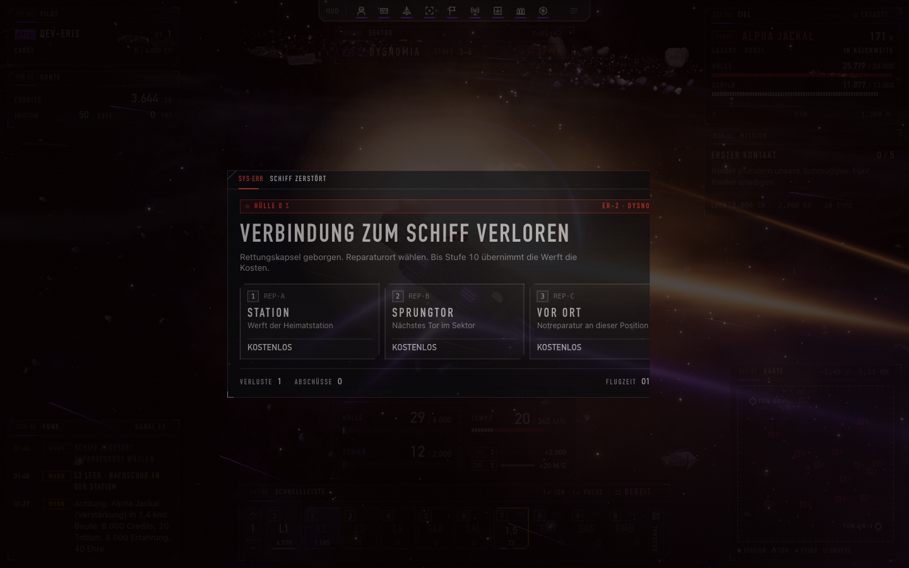
- 120,0 s · Ende der Spielzeit: 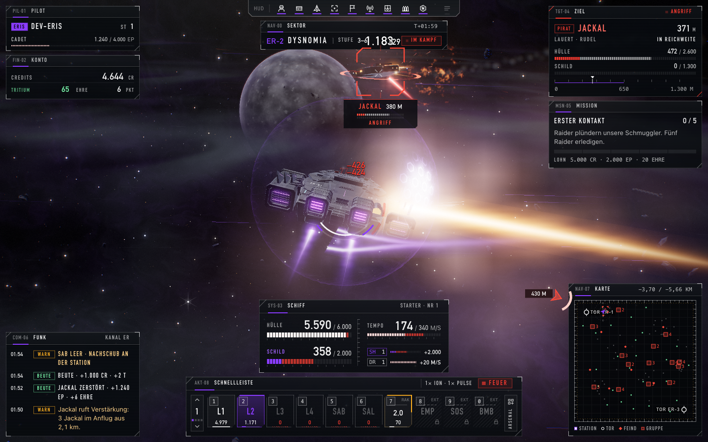
