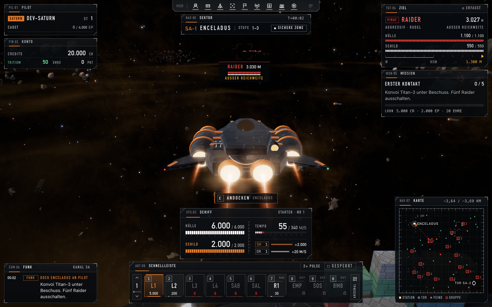
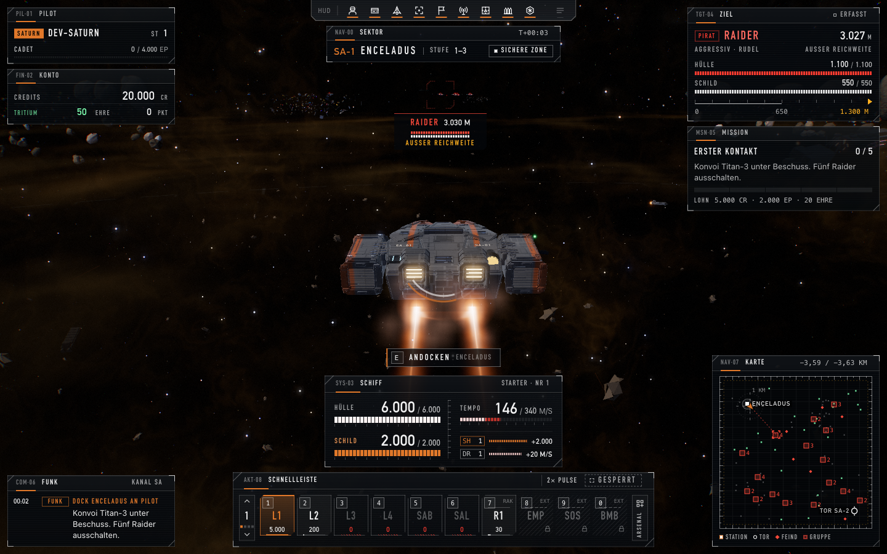
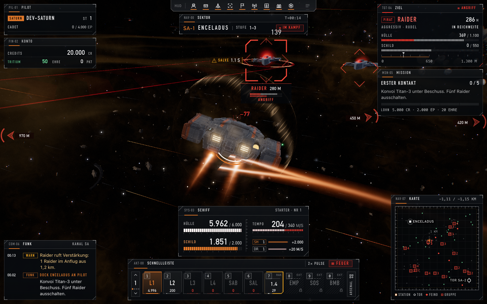
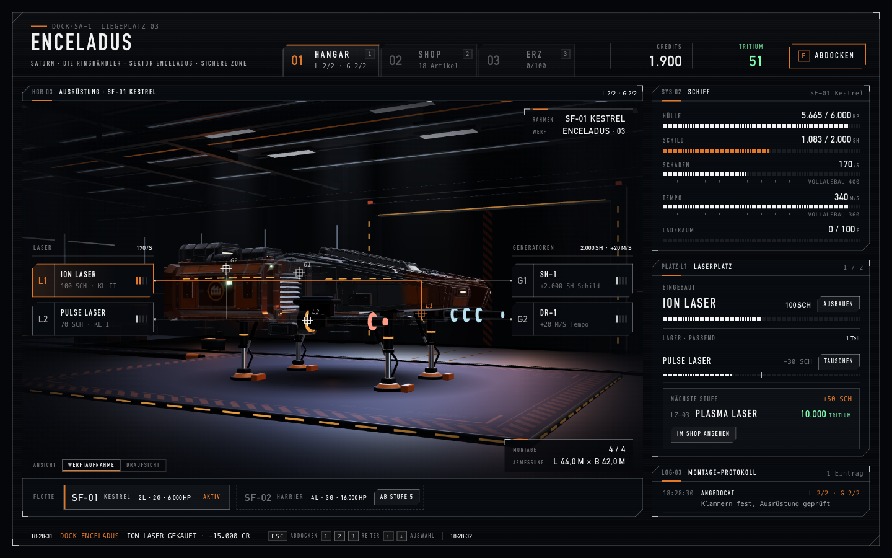
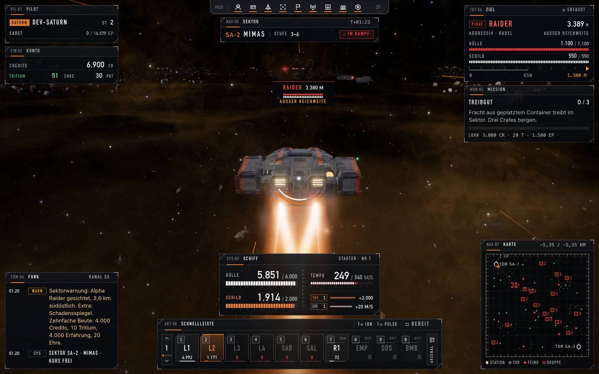
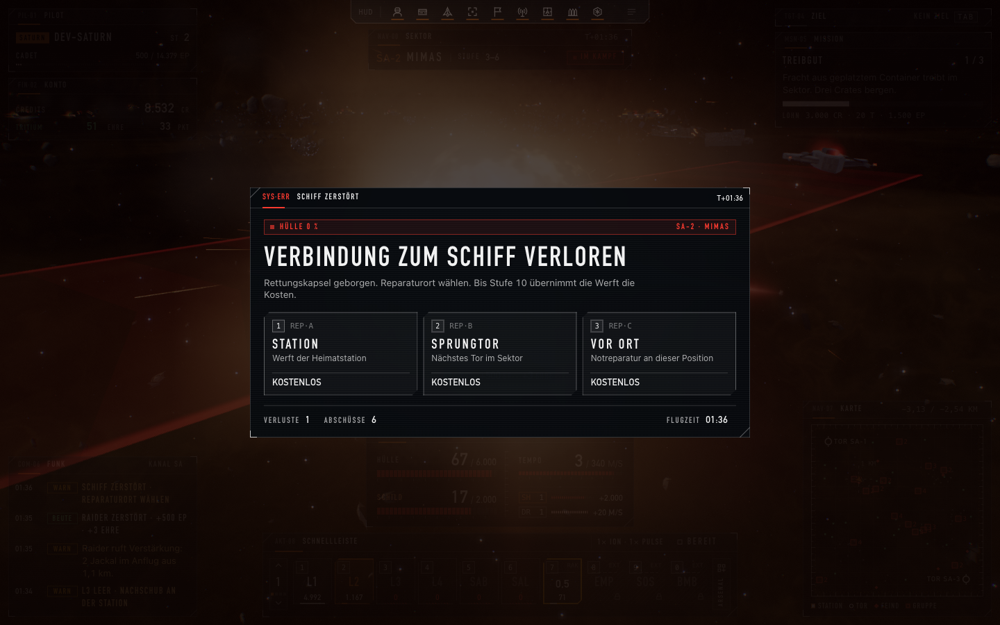
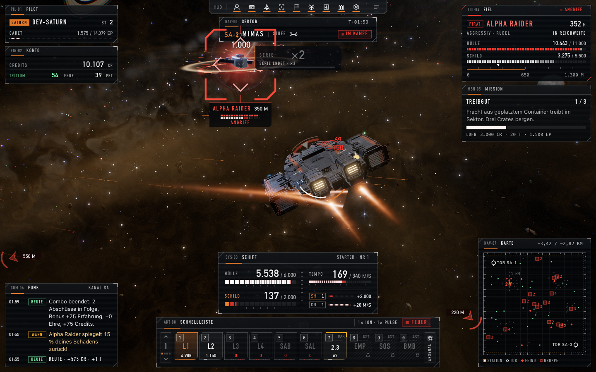

# Test-Pilot · 2026-10-30_18-26-21

europa, saturn, eris · je 2,0 min · Qualität hoch · Fenster 1440×900 (Pixeldichte 2) · Chrome sichtbar

Ziele: Mac Qualität HOCH im Kampf unter 8 ms je Bild · normaler Laptop Full HD MITTEL mindestens 60 Bilder/s · erster Kampf ohne Hänger über 25 ms.

## EUROPA

Abgebrochen: page.evaluate: TypeError: Cannot read properties of undefined (reading 'state')
    at eval (eval at evaluate (:370:30), <anonymous>:1:19)
    at UtilityScript.evaluate (<anonymous>:372:16)
    at UtilityScript.<anonymous> (<anonymous>:1:44)
    at runFaction (/Users/077-gaming/Desktop/077/90_Weitere_Projekte/Last-Signals/Code/tools/playtest/spielen.mjs:106:27)
    at async main (/Users/077-gaming/Desktop/077/90_Weitere_Projekte/Last-Signals/Code/tools/playtest/spielen.mjs:232:24)

## SATURN · 120 s gespielt · SA-1 → SA-2

Qualität: Stufe HOCH, Auflösungsfaktor 0,86, Pixeldichte 1,51, Puffer 2167x1354, GPU-Zeitmessung ja. Ladezeit bis Flug 7,7 s.

### Bildzeiten (Mittel / p95 / längste, ms)
| Abschnitt | Bilder | Bilder/s | Bildabstand | CPU-Rechenzeit | GPU | Bildzeit max(CPU,GPU) | > 20 ms | > 25 ms | > 33 ms |
|---|---|---|---|---|---|---|---|---|---|
| Gesamt | 6.794 | 58,6 | 17,1 / 18,3 / 966,6 | 2,5 / 3,3 / 534,0 | 8,0 / 12,5 / 79,6 | 8,2 / 12,5 / 534,0 | 10 | 9 | 8 |
| Kampf | 4.727 | 59,7 | 16,7 / 18,3 / 206,5 | 2,4 / 3,3 / 94,6 | 7,6 / 11,9 / 79,6 | 7,7 / 11,9 / 94,6 | 5 | 4 | 3 |
| Ruhe | 1.862 | 58,4 | 17,1 / 18,3 / 533,3 | 2,8 / 3,4 / 534,0 | 8,2 / 12,1 / 26,8 | 8,5 / 12,1 / 534,0 | 2 | 2 | 2 |
| Erster Kampf (10 s) | 543 | 58,7 | 17,0 / 18,2 / 206,5 | 2,7 / 3,4 / 8,5 | 10,0 / 12,4 / 13,5 | 10,0 / 12,4 / 13,5 | 2 | 1 | 1 |
| Angedockt | 205 | 41,6 | 24,1 / 18,3 / 966,6 | 1,4 / 2,3 / 140,1 | 16,2 / 27,0 / 27,0 | 16,8 / 27,0 / 140,1 | 3 | 3 | 3 |

Längste Bilder mit Situation:
- 31,7 s: Bildabstand 966,6 ms, CPU 3,1 ms, GPU 13,7 ms · Angedockt: Shop · SA-1, 0 Gegner nah, 0 greifen an · zuletzt: profile×1 · 114 Draw Calls
- 2,2 s: Bildabstand 533,3 ms, CPU 4,5 ms, GPU 4,0 ms · Anflug auf Raider (3033 m) · SA-1, 0 Gegner nah, 0 greifen an · zuletzt: modell-geladen×1 · 282 Draw Calls
- 31,7 s: Bildabstand 466,6 ms, CPU 2,9 ms, GPU 11,7 ms · Angedockt: Shop · SA-1, 0 Gegner nah, 0 greifen an · zuletzt: profile×1 · 113 Draw Calls
- 2,2 s: Bildabstand 351,7 ms, CPU 534,0 ms, GPU 4,0 ms · Anflug auf Raider (3033 m) · SA-1, 0 Gegner nah, 0 greifen an · zuletzt: nichts · 284 Draw Calls
- 12,4 s: Bildabstand 206,5 ms, CPU 8,5 ms, GPU 11,5 ms · Kampf: Raider umkreisen · SA-1, 5 Gegner nah, 4 greifen an · zuletzt: rocket×1, profile×1, damage×1 · 231 Draw Calls
- 34,1 s: Bildabstand 131,4 ms, CPU 1,0 ms, GPU 13,3 ms · Angedockt: Shop · SA-1, 1 Gegner nah, 0 greifen an · zuletzt: nichts · 271 Draw Calls
- 80,9 s: Bildabstand 84,0 ms, CPU 17,5 ms, GPU 6,7 ms · Sprung lädt · SA-2, 0 Gegner nah, 0 greifen an · zuletzt: despawn×77, sector×1, message×2 · 76 Draw Calls
- 111,0 s: Bildabstand 66,7 ms, CPU 6,1 ms, GPU 79,6 ms · Kampf: Raider umkreisen · SA-2, 4 Gegner nah, 2 greifen an · zuletzt: loot×1, message×1, despawn×1, profile×2, rocket×1 · 277 Draw Calls

### Kampfwerte
Schüsse 63 (Treffer 85,7 %), Raketen 13, Tode 1 (Todestest nachgeholfen: Stufe 1).
Eingesteckt: 1.308 Hülle + 4.277 Schild · je Quelle: raider 5.146, jackal 439.
Beute gesamt: 8.607 Credits, 4 Tritium, 5.575 Erfahrung, 39 Ehre.
Je Minute: **4.303 Credits, 2,0 Tritium, 2.787 Erfahrung, 19,5 Ehre**.
Profil: 20.000 → 10.107 Credits, 50 → 54 Tritium, Stufe 1 → 2.

| Gegner | Abschüsse | Zeit bis Abschuss Mittel / Median / max (s) |
|---|---|---|
| raider | 8 | 10,5 / 2,7 / 65,9 |

Munition (Versuche/erfolgreich/Vorrat danach): L1 2/2/4.992 · L2 1/1/200 · L3 1/0/0 · L4 1/0/0 · SAB 1/0/0 · SAL 1/0/0. Schüsse je Munition: L1 13, L2 50.
Schussrichtung zur Schiffsnase: Mittel 10,5°, p95 62,0°, 7 Schüsse über 45°, 0 über 90° (Laser feuern dann seitlich/rückwärts aus den Mündungen).
Einkäufe: ammo L2 ok (−1.000 Credits, −0 Tritium) · rocket R1 ok (−2.500 Credits, −0 Tritium) · ammo L3 abgelehnt: Zu wenig Tritium: 250 nötig, du hast 51. · ammo SAL abgelehnt: Zu wenig Tritium: 200 nötig, du hast 51. · ammo SAB abgelehnt: Zu wenig Tritium: 500 nötig, du hast 51. · laser ion ok (−15.000 Credits, −0 Tritium).
Dauer der Aufrufe: Andocken 676,2 ms, 6 Einkäufe 481,5 ms, Abdocken 0,1 ms.
Reparaturen: 99,5 s here ok (kostenlos (bis Stufe 10)). Sprünge: 80,9 s → SA-2. Stufenaufstiege: 71,4 s → 2.

### Gegnerverhalten
| Typ | Stichproben | Zeitanteile | Abstand zum Spieler im Angriff (Mittel/Median/min m) | Ausweichen | Angriffsbeginn selbst/Sicht/mitgezogen | Flucht | übereinander | Schüsse/Treffer |
|---|---|---|---|---|---|---|---|---|
| raider | 2.342 | patrouille 63,1 %, anfliegen / flanke 17,6 %, umkreisen / flanke 8,0 %, fliehen / rückzug zum heilen 2,5 %, abdrehen / flanke 2,2 %, ausweichen / flanke 1,2 %, umkreisen / lädt salve 1,1 %, hold / wartet im kreis 1,0 %, angreifen (stehend) / lädt salve 0,9 %, angreifen (stehend) / salve 0,6 %, angreifen (stehend) / flanke 0,4 %, anfliegen 0,3 %, abdrehen / lädt salve 0,3 %, umkreisen 0,2 %, anfliegen / lädt salve 0,2 %, abdrehen 0,1 %, hold 0,1 %, ausweichen / rückzug zum heilen 0,1 %, anfliegen / salve 0,0 %, umkreisen / salve 0,0 %, angreifen (stehend) 0,0 % | 681 / 530 / 14 | 9 | 5/15/2 | 6 | 0,2 % | 106/67 |
| larva | 174 | patrouille 100,0 % | – | 0 | 0/0/0 | 0 | 0,0 % | 0/0 |
| jackal | 523 | patrouille 67,5 %, patrouille / lauert getarnt 12,2 %, hold / wartet im kreis 4,6 %, anfliegen / springt an 4,6 %, umkreisen / springt an 3,6 %, abdrehen / springt an 2,7 %, anfliegen / rammt 1,3 %, abdrehen / lädt rammangriff 1,0 %, umkreisen / lädt rammangriff 0,8 %, angreifen (stehend) / springt an 0,6 %, hold 0,4 %, umkreisen 0,4 %, abdrehen 0,2 %, angreifen (stehend) / rammt 0,2 % | 503 / 511 / 81 | 0 | 0/1/1 | 0 | 0,0 % | 7/6 |

Übereinander (Abstand < 0,75 × Summe der Trefferradien): in 0,3 % der Stichproben, Vorfälle raider 1, höchstens 1 Paare gleichzeitig. Hilfe-/Verstärkungsmeldungen: 7, vorübergehend erzeugte Gegner: 0.

### Ausrichtung der Modelle
nicht geprüft

### Konsole
2 Fehler, 0 Warnungen, 5 Hinweise (Netz).
- 2× Fehler: Failed to load resource: the server responded with a status of 404 (Not Found)
- 1× Hinweis: HEAD /models/station-europa.glb abgebrochen
- 1× Hinweis: HEAD /models/station-saturn.glb abgebrochen
- 1× Hinweis: HEAD /models/station-eris.glb abgebrochen
- 1× Hinweis: HEAD /models/eris-starter.glb abgebrochen
- 1× Hinweis: HEAD /models/europa-starter.glb abgebrochen

### Bilder
- 0,8 s · Ereignis: Erster Kontakt: 
- 2,2 s · Hänger 352 ms (Anflug auf Raider (3033 m)): 
- 13,4 s · Erster Kampf (1,5 s nach dem ersten Schuss): 
- 32,9 s · Angedockt: Station/Shop: 
- 83,4 s · Neuer Sektor SA-2 (Mimas): 
- 97,0 s · Abgeschossen: Reparatur-Auswahl: 
- 120,0 s · Ende der Spielzeit: 

## ERIS

Abgebrochen: page.screenshot: Timeout 30000ms exceeded.
Call log:
  - taking page screenshot
  - waiting for fonts to load...
  - fonts loaded

    at takeShots (/Users/077-gaming/Desktop/077/90_Weitere_Projekte/Last-Signals/Code/tools/playtest/spielen.mjs:81:20)
    at async runFaction (/Users/077-gaming/Desktop/077/90_Weitere_Projekte/Last-Signals/Code/tools/playtest/spielen.mjs:105:5)
    at async main (/Users/077-gaming/Desktop/077/90_Weitere_Projekte/Last-Signals/Code/tools/playtest/spielen.mjs:232:24)
