# Test-Pilot · 2026-10-30_18-54-02

europa, saturn, eris · je 2,0 min · Qualität hoch · Fenster 1440×900 (Pixeldichte 2) · Chrome sichtbar

Ziele: Mac Qualität HOCH im Kampf unter 8 ms je Bild · normaler Laptop Full HD MITTEL mindestens 60 Bilder/s · erster Kampf ohne Hänger über 25 ms.

## EUROPA · 120 s gespielt · EU-1 → EU-2

Qualität: Stufe HOCH, Auflösungsfaktor 0,86, Pixeldichte 1,51, Puffer 2167x1354, GPU-Zeitmessung ja. Ladezeit bis Flug 1,4 s.

### Bildzeiten (Mittel / p95 / längste, ms)
| Abschnitt | Bilder | Bilder/s | Bildabstand | CPU-Rechenzeit | GPU | Bildzeit max(CPU,GPU) | > 20 ms | > 25 ms | > 33 ms |
|---|---|---|---|---|---|---|---|---|---|
| Gesamt | 6.863 | 59,3 | 16,9 / 18,2 / 900,0 | 1,7 / 2,5 / 103,2 | 6,8 / 9,3 / 46,1 | 6,8 / 9,4 / 103,2 | 3 | 3 | 3 |
| Kampf | 4.068 | 60,0 | 16,7 / 18,1 / 18,7 | 1,7 / 2,5 / 8,1 | 6,6 / 9,0 / 15,3 | 6,6 / 9,0 / 15,3 | 0 | 0 | 0 |
| Ruhe | 2.625 | 59,9 | 16,7 / 18,2 / 99,9 | 1,8 / 2,6 / 103,2 | 6,6 / 9,0 / 46,1 | 6,7 / 9,0 / 103,2 | 1 | 1 | 1 |
| Erster Kampf (10 s) | 556 | 60,0 | 16,7 / 18,0 / 18,7 | 1,8 / 2,6 / 6,9 | 7,1 / 10,0 / 11,1 | 7,1 / 10,0 / 11,1 | 0 | 0 | 0 |
| Angedockt | 170 | 40,5 | 24,7 / 18,3 / 900,0 | 0,5 / 1,7 / 4,2 | 13,7 / 25,0 / 27,1 | 13,7 / 25,0 / 27,1 | 2 | 2 | 2 |

Längste Bilder mit Situation:
- 28,6 s: Bildabstand 900,0 ms, CPU 4,2 ms, GPU 9,1 ms · Angedockt: Shop · EU-1, 1 Gegner nah, 0 greifen an · zuletzt: profile×1, despawn×1 · 93 Draw Calls
- 28,6 s: Bildabstand 500,0 ms, CPU 3,7 ms, GPU 8,3 ms · Angedockt: Shop · EU-1, 1 Gegner nah, 0 greifen an · zuletzt: profile×1, despawn×1 · 92 Draw Calls
- 78,3 s: Bildabstand 99,9 ms, CPU 15,6 ms, GPU 6,2 ms · Sprung lädt · EU-2, 0 Gegner nah, 0 greifen an · zuletzt: despawn×78, sector×1, message×1 · 77 Draw Calls
- 78,3 s: Bildabstand 17,7 ms, CPU 103,2 ms, GPU 6,2 ms · Sprung lädt · EU-2, 0 Gegner nah, 0 greifen an · zuletzt: despawn×78, sector×1, message×1 · 77 Draw Calls

### Kampfwerte
Schüsse 57 (Treffer 86,0 %), Raketen 13, Tode 1 (Todestest nachgeholfen: Stufe 1).
Eingesteckt: 1.688 Hülle + 3.085 Schild · je Quelle: raider 795, larva 55, jackal 3.923.
Beute gesamt: 5.905 Credits, 3 Tritium, 1.506 Erfahrung, 5 Ehre.
Je Minute: **2.952 Credits, 1,5 Tritium, 753 Erfahrung, 2,5 Ehre**.
Profil: 20.000 → 7.405 Credits, 50 → 53 Tritium, Stufe 1 → 1.

| Gegner | Abschüsse | Zeit bis Abschuss Mittel / Median / max (s) |
|---|---|---|
| larva | 3 | 0,7 / 0,7 / 0,8 |
| raider | 1 | 2,9 / 2,9 / 2,9 |

Munition (Versuche/erfolgreich/Vorrat danach): L1 2/2/4.998 · L2 1/1/200 · L3 1/0/0 · L4 1/0/0 · SAB 1/0/0 · SAL 1/0/0. Schüsse je Munition: L1 9, L2 48.
Schussrichtung zur Schiffsnase: Mittel 7,7°, p95 55,2°, 6 Schüsse über 45°, 0 über 90° (Laser feuern dann seitlich/rückwärts aus den Mündungen).
Einkäufe: ammo L2 ok (−1.000 Credits, −0 Tritium) · rocket R1 ok (−2.500 Credits, −0 Tritium) · ammo L3 abgelehnt: Zu wenig Tritium: 250 nötig, du hast 51. · ammo SAL abgelehnt: Zu wenig Tritium: 200 nötig, du hast 51. · ammo SAB abgelehnt: Zu wenig Tritium: 500 nötig, du hast 51. · laser ion ok (−15.000 Credits, −0 Tritium).
Dauer der Aufrufe: Andocken 572,6 ms, 6 Einkäufe 514,2 ms, Abdocken 0,1 ms.
Reparaturen: 104,3 s here ok (kostenlos (bis Stufe 10)). Sprünge: 78,3 s → EU-2. Stufenaufstiege: keine.

### Gegnerverhalten
| Typ | Stichproben | Zeitanteile | Abstand zum Spieler im Angriff (Mittel/Median/min m) | Ausweichen | Angriffsbeginn selbst/Sicht/mitgezogen | Flucht | übereinander | Schüsse/Treffer |
|---|---|---|---|---|---|---|---|---|
| raider | 1.773 | patrouille 57,1 %, anfliegen / flanke 21,8 %, hold / wartet im kreis 13,8 %, umkreisen / flanke 2,2 %, fliehen / rückzug zum heilen 1,4 %, anfliegen / lädt salve 0,8 %, ausweichen / flanke 0,6 %, abdrehen / flanke 0,6 %, hold 0,3 %, angreifen (stehend) / lädt salve 0,3 %, angreifen (stehend) / salve 0,3 %, angreifen (stehend) / flanke 0,2 %, abdrehen 0,1 %, angreifen (stehend) 0,1 %, abdrehen / lädt salve 0,1 %, anfliegen 0,1 %, ausweichen / schildwall 0,1 %, umkreisen 0,1 % | 910 / 902 / 127 | 4 | 1/5/6 | 1 | 0,0 % | 24/14 |
| larva | 525 | patrouille 61,7 %, anfliegen / umzingeln 22,9 %, umkreisen / umzingeln 5,3 %, hold / wartet im kreis 3,0 %, anfliegen / springt 1,9 %, anfliegen / lädt sprungbiss 1,0 %, hold 0,6 %, angreifen (stehend) / umzingeln 0,6 %, abdrehen / umzingeln 0,6 %, abdrehen / lädt sprungbiss 0,6 %, angreifen (stehend) / springt 0,4 %, ausweichen 0,4 %, ausweichen / umzingeln 0,4 %, umkreisen 0,2 %, angreifen (stehend) / lädt sprungbiss 0,2 %, anfliegen 0,2 %, umkreisen / lädt sprungbiss 0,2 % | 480 / 339 / 76 | 1 | 2/0/5 | 0 | 0,0 % | 5/3 |
| jackal | 615 | patrouille 62,9 %, umkreisen / springt an 10,9 %, anfliegen / springt an 10,7 %, patrouille / lauert getarnt 3,3 %, hold / wartet im kreis 2,3 %, anfliegen / rammt 2,1 %, umkreisen / lädt rammangriff 1,3 %, anfliegen / lädt rammangriff 1,1 %, ausweichen / springt an 1,1 %, ausweichen 0,7 %, abdrehen / springt an 0,7 %, abdrehen / lädt rammangriff 0,5 %, anfliegen 0,3 %, abdrehen / rammt 0,3 %, abdrehen 0,3 %, umkreisen / schildwall 0,3 %, umkreisen / rammt 0,2 %, hold 0,2 %, ausweichen / wartet im kreis 0,2 %, hold / lauert getarnt 0,2 %, angreifen (stehend) / springt an 0,2 %, umkreisen 0,2 %, angreifen (stehend) / lädt rammangriff 0,2 % | 357 / 325 / 91 | 4 | 1/3/3 | 0 | 0,0 % | 34/31 |

Übereinander (Abstand < 0,75 × Summe der Trefferradien): in 0,0 % der Stichproben, Vorfälle keine, höchstens 0 Paare gleichzeitig. Hilfe-/Verstärkungsmeldungen: 2, vorübergehend erzeugte Gegner: 7.

### Ausrichtung der Modelle
nicht geprüft

### Konsole
2 Fehler, 0 Warnungen, 5 Hinweise (Netz).
- 2× Fehler: Failed to load resource: the server responded with a status of 404 (Not Found)
- 1× Hinweis: HEAD /models/station-europa.glb abgebrochen
- 1× Hinweis: HEAD /models/station-saturn.glb abgebrochen
- 1× Hinweis: HEAD /models/station-eris.glb abgebrochen
- 1× Hinweis: HEAD /models/europa-starter.glb abgebrochen
- 1× Hinweis: HEAD /models/eris-starter.glb abgebrochen

### Bilder
- 1,2 s · Ereignis: Erster Kontakt: 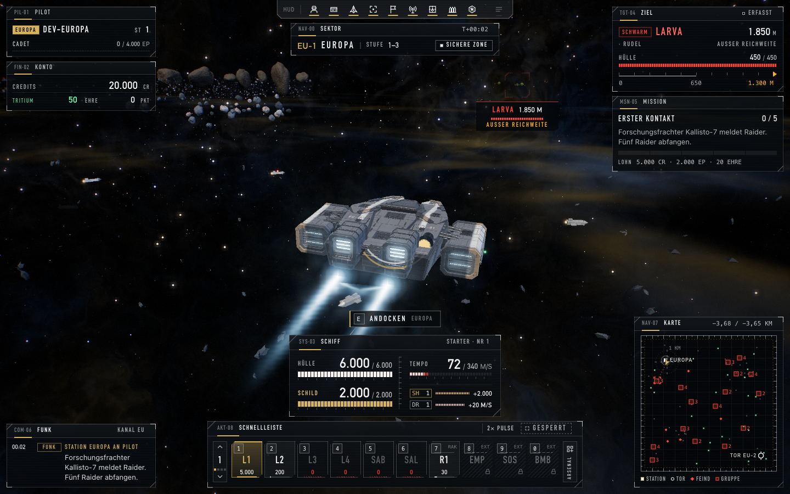
- 10,8 s · Erster Kampf (1,5 s nach dem ersten Schuss): 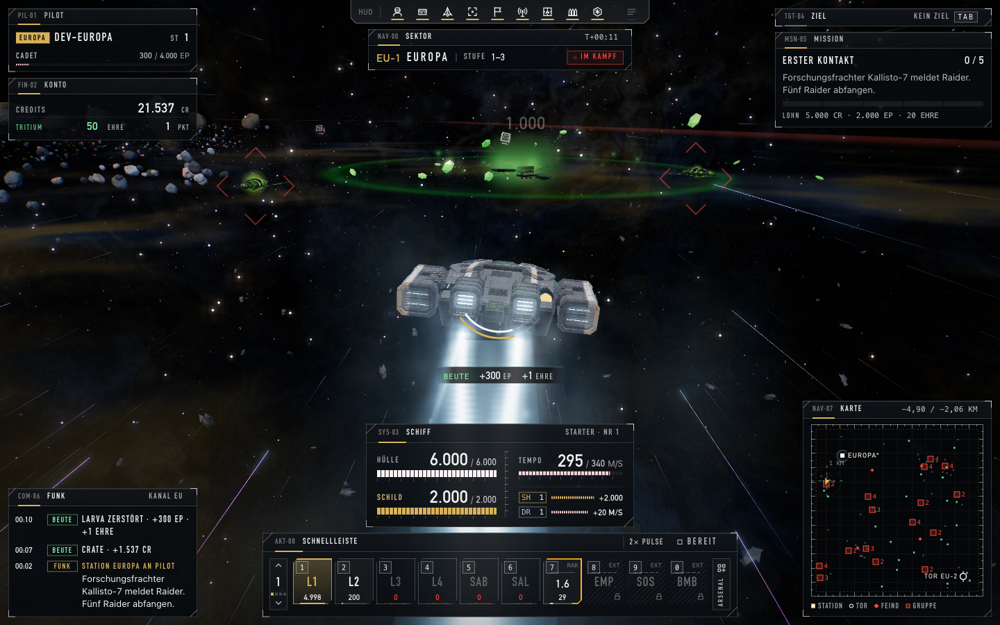
- 28,6 s · Hänger 900 ms (Angedockt: Shop): 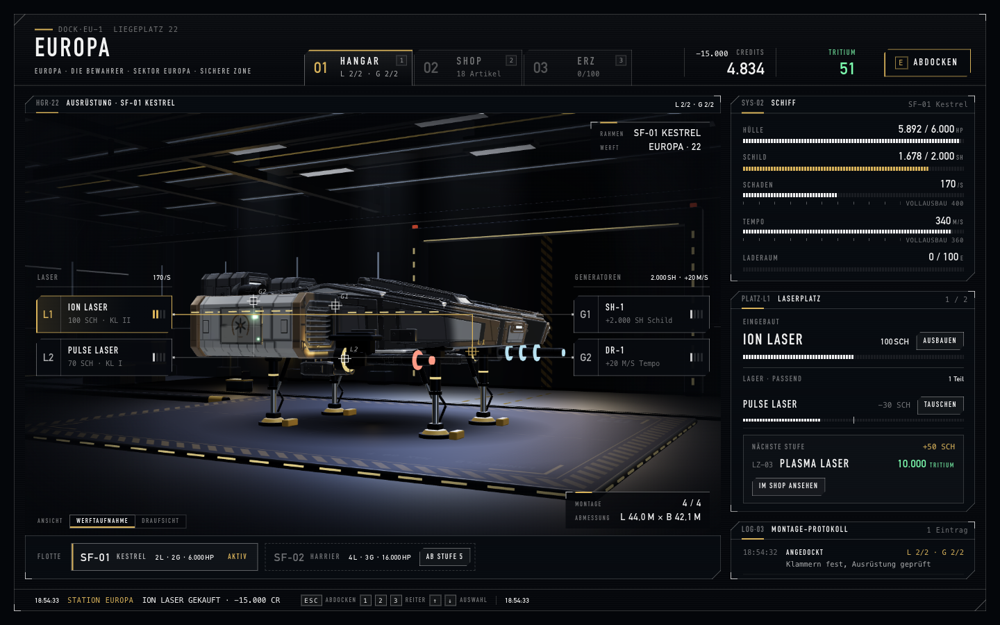
- 29,8 s · Angedockt: Station/Shop: 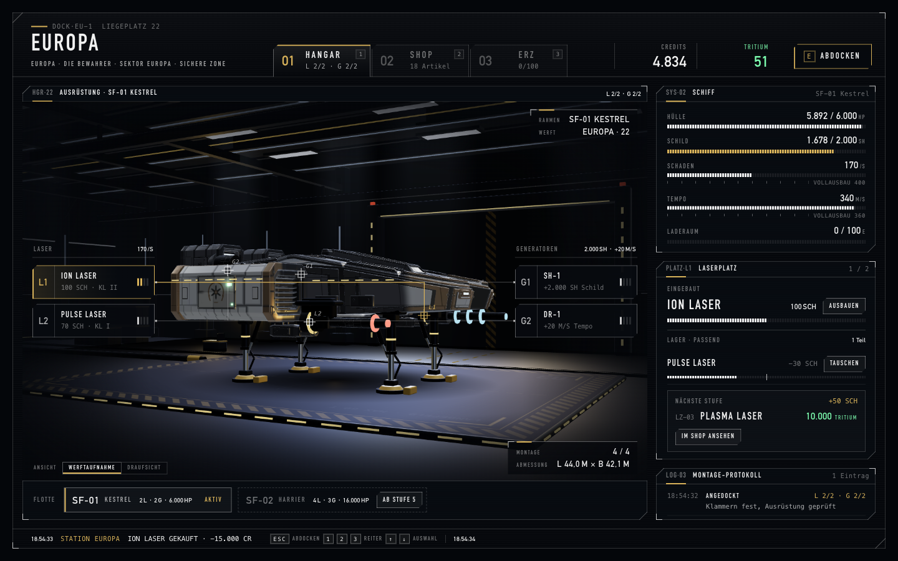
- 80,8 s · Neuer Sektor EU-2 (Io): 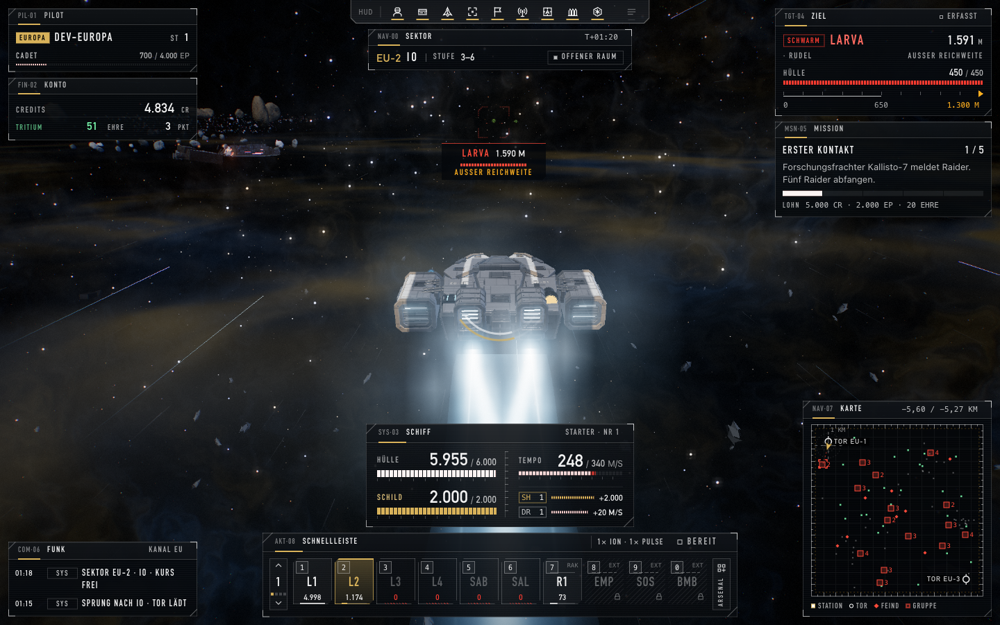
- 101,8 s · Abgeschossen: Reparatur-Auswahl: 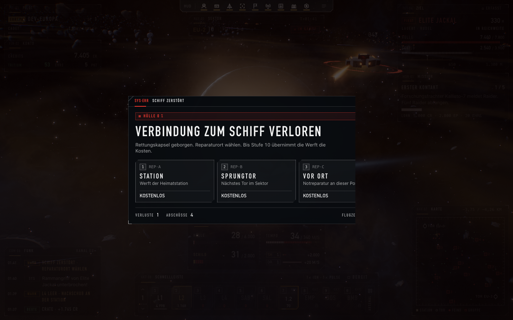
- 120,0 s · Ende der Spielzeit: 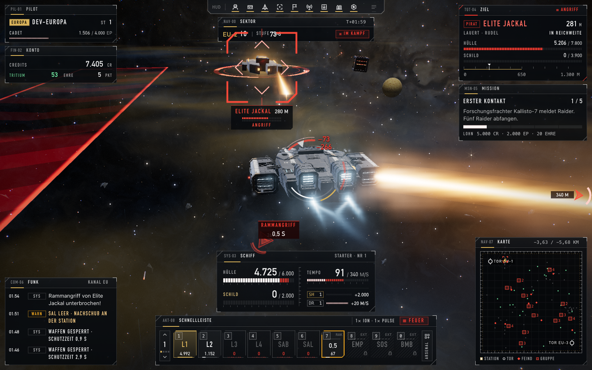

## SATURN · 120 s gespielt · SA-1 → SA-2

Qualität: Stufe HOCH, Auflösungsfaktor 0,86, Pixeldichte 1,51, Puffer 2167x1354, GPU-Zeitmessung ja. Ladezeit bis Flug 1,6 s.

### Bildzeiten (Mittel / p95 / längste, ms)
| Abschnitt | Bilder | Bilder/s | Bildabstand | CPU-Rechenzeit | GPU | Bildzeit max(CPU,GPU) | > 20 ms | > 25 ms | > 33 ms |
|---|---|---|---|---|---|---|---|---|---|
| Gesamt | 6.817 | 59,1 | 16,9 / 18,2 / 933,3 | 2,0 / 2,7 / 266,6 | 6,8 / 10,3 / 34,9 | 6,9 / 10,3 / 266,6 | 5 | 5 | 5 |
| Kampf | 3.696 | 59,9 | 16,7 / 18,1 / 83,1 | 2,1 / 2,8 / 90,0 | 6,6 / 9,4 / 20,7 | 6,6 / 9,4 / 90,0 | 1 | 1 | 1 |
| Ruhe | 2.906 | 59,7 | 16,8 / 18,3 / 266,2 | 2,0 / 2,6 / 266,6 | 6,5 / 8,9 / 26,3 | 6,6 / 8,9 / 266,6 | 2 | 2 | 2 |
| Erster Kampf (10 s) | 555 | 60,0 | 16,7 / 18,0 / 18,8 | 2,1 / 2,7 / 4,3 | 6,6 / 8,9 / 10,5 | 6,6 / 8,9 / 10,5 | 0 | 0 | 0 |
| Angedockt | 215 | 43,6 | 23,0 / 18,4 / 933,3 | 0,6 / 2,9 / 4,3 | 15,9 / 26,3 / 34,9 | 15,9 / 26,3 / 34,9 | 2 | 2 | 2 |

Längste Bilder mit Situation:
- 30,1 s: Bildabstand 933,3 ms, CPU 4,3 ms, GPU 5,8 ms · Angedockt: Shop · SA-1, 0 Gegner nah, 0 greifen an · zuletzt: profile×1 · 111 Draw Calls
- 30,1 s: Bildabstand 450,5 ms, CPU 0,9 ms, GPU 5,8 ms · Angedockt: Shop · SA-1, 0 Gegner nah, 0 greifen an · zuletzt: profile×1 · 111 Draw Calls
- 1,2 s: Bildabstand 266,2 ms, CPU 5,9 ms, GPU 9,9 ms · Beute: Crate einsammeln · SA-1, 0 Gegner nah, 0 greifen an · zuletzt: modell-geladen×1, message×1, quest×1 · 227 Draw Calls
- 87,1 s: Bildabstand 83,1 ms, CPU 18,4 ms, GPU 10,4 ms · Sprung lädt · SA-2, 0 Gegner nah, 0 greifen an · zuletzt: despawn×78, sector×1, message×1 · 115 Draw Calls
- 0,3 s: Bildabstand 49,5 ms, CPU 2,7 ms, GPU 9,2 ms · Beute: Crate einsammeln · SA-1, 0 Gegner nah, 0 greifen an · zuletzt: nichts · 301 Draw Calls
- 87,1 s: Bildabstand 18,6 ms, CPU 90,0 ms, GPU 10,4 ms · Sprung lädt · SA-2, 0 Gegner nah, 0 greifen an · zuletzt: despawn×78, sector×1, message×1 · 115 Draw Calls
- 1,2 s: Bildabstand 16,7 ms, CPU 266,6 ms, GPU 9,9 ms · Beute: Crate einsammeln · SA-1, 0 Gegner nah, 0 greifen an · zuletzt: nichts · 232 Draw Calls

### Kampfwerte
Schüsse 79 (Treffer 83,5 %), Raketen 13, Tode 1 (Todestest nachgeholfen: Stufe 2).
Eingesteckt: 1.029 Hülle + 4.118 Schild · je Quelle: raider 3.235, jackal 1.912.
Beute gesamt: 1.893 Credits, 45 Tritium, 2.440 Erfahrung, 12 Ehre.
Je Minute: **946 Credits, 22,5 Tritium, 1.220 Erfahrung, 6,0 Ehre**.
Profil: 20.000 → 3.393 Credits, 50 → 95 Tritium, Stufe 1 → 1.

| Gegner | Abschüsse | Zeit bis Abschuss Mittel / Median / max (s) |
|---|---|---|
| raider (elite) | 1 | 14,7 / 14,7 / 14,7 |
| raider | 1 | 41,1 / 41,1 / 41,1 |

Munition (Versuche/erfolgreich/Vorrat danach): L1 1/1/4.945 · L2 1/1/1.200 · L3 1/0/0 · L4 1/0/0. Schüsse je Munition: L1 60, L2 19.
Schussrichtung zur Schiffsnase: Mittel 15,0°, p95 69,1°, 15 Schüsse über 45°, 0 über 90° (Laser feuern dann seitlich/rückwärts aus den Mündungen).
Einkäufe: ammo L2 ok (−1.000 Credits, −0 Tritium) · rocket R1 ok (−2.500 Credits, −0 Tritium) · ammo L3 abgelehnt: Zu wenig Tritium: 250 nötig, du hast 76. · ammo SAL abgelehnt: Zu wenig Tritium: 200 nötig, du hast 76. · ammo SAB abgelehnt: Zu wenig Tritium: 500 nötig, du hast 76. · laser ion ok (−15.000 Credits, −0 Tritium).
Dauer der Aufrufe: Andocken 647,5 ms, 6 Einkäufe 471,6 ms, Abdocken 0,2 ms.
Reparaturen: 105,5 s here ok (kostenlos (bis Stufe 10)). Sprünge: 87,1 s → SA-2. Stufenaufstiege: keine.

### Gegnerverhalten
| Typ | Stichproben | Zeitanteile | Abstand zum Spieler im Angriff (Mittel/Median/min m) | Ausweichen | Angriffsbeginn selbst/Sicht/mitgezogen | Flucht | übereinander | Schüsse/Treffer |
|---|---|---|---|---|---|---|---|---|
| raider | 2.846 | patrouille 56,9 %, hold / wartet im kreis 22,2 %, anfliegen / flanke 14,6 %, umkreisen / flanke 1,9 %, ausweichen / flanke 0,8 %, anfliegen / lädt salve 0,7 %, abdrehen / flanke 0,6 %, angreifen (stehend) / lädt salve 0,5 %, angreifen (stehend) / salve 0,4 %, hold 0,2 %, abdrehen / lädt salve 0,2 %, umkreisen / lädt salve 0,2 %, angreifen (stehend) / flanke 0,2 %, abdrehen 0,1 %, umkreisen 0,1 %, angreifen (stehend) 0,1 %, umkreisen / schildwall 0,1 %, ausweichen / schildwall 0,1 %, anfliegen 0,1 %, angreifen (stehend) / schildwall 0,1 %, abdrehen / schildwall 0,0 % | 759 / 732 / 39 | 8 | 0/9/3 | 0 | 0,0 % | 55/29 |
| larva | 232 | patrouille 100,0 % | – | 0 | 0/0/0 | 0 | 0,0 % | 0/0 |
| jackal | 650 | patrouille 53,7 %, anfliegen / springt an 10,6 %, hold / wartet im kreis 9,4 %, umkreisen / springt an 6,8 %, anfliegen / rammt 4,8 %, patrouille / lauert getarnt 4,2 %, abdrehen / springt an 2,6 %, anfliegen / lädt rammangriff 2,0 %, abdrehen / lädt rammangriff 1,4 %, ausweichen / springt an 1,4 %, umkreisen / lädt rammangriff 1,2 %, anfliegen 0,5 %, abdrehen / rammt 0,3 %, angreifen (stehend) / lädt rammangriff 0,3 %, umkreisen / rammt 0,2 %, angreifen (stehend) / rammt 0,2 %, hold 0,2 %, umkreisen 0,2 %, ausweichen 0,2 %, fliehen / rückzug zum heilen 0,2 % | 495 / 470 / 60 | 3 | 1/2/6 | 1 | 0,0 % | 21/21 |

Übereinander (Abstand < 0,75 × Summe der Trefferradien): in 0,0 % der Stichproben, Vorfälle keine, höchstens 0 Paare gleichzeitig. Hilfe-/Verstärkungsmeldungen: 4, vorübergehend erzeugte Gegner: 0.

### Ausrichtung der Modelle
nicht geprüft

### Konsole
2 Fehler, 0 Warnungen, 5 Hinweise (Netz).
- 2× Fehler: Failed to load resource: the server responded with a status of 404 (Not Found)
- 1× Hinweis: HEAD /models/station-europa.glb abgebrochen
- 1× Hinweis: HEAD /models/station-saturn.glb abgebrochen
- 1× Hinweis: HEAD /models/station-eris.glb abgebrochen
- 1× Hinweis: HEAD /models/europa-starter.glb abgebrochen
- 1× Hinweis: HEAD /models/eris-starter.glb abgebrochen

### Bilder
- 1,2 s · Ereignis: Erster Kontakt: 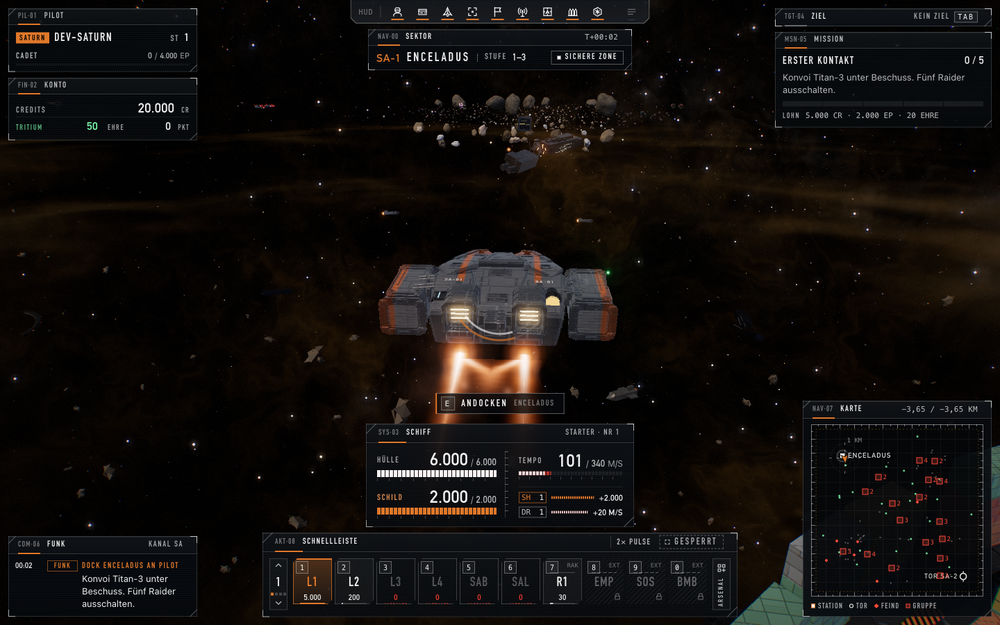
- 1,2 s · Hänger 266 ms (Beute: Crate einsammeln): 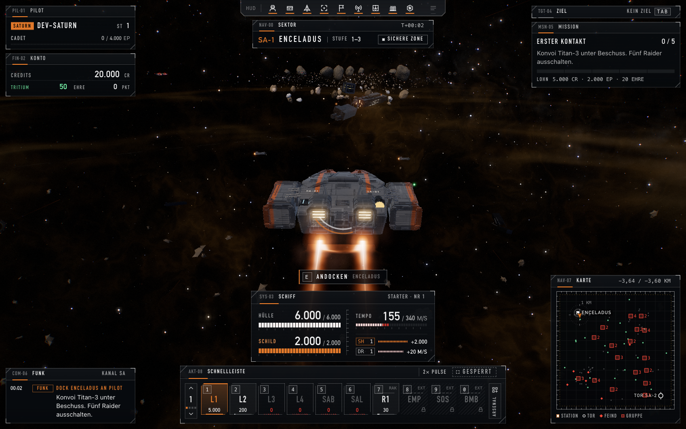
- 31,3 s · Angedockt: Station/Shop: 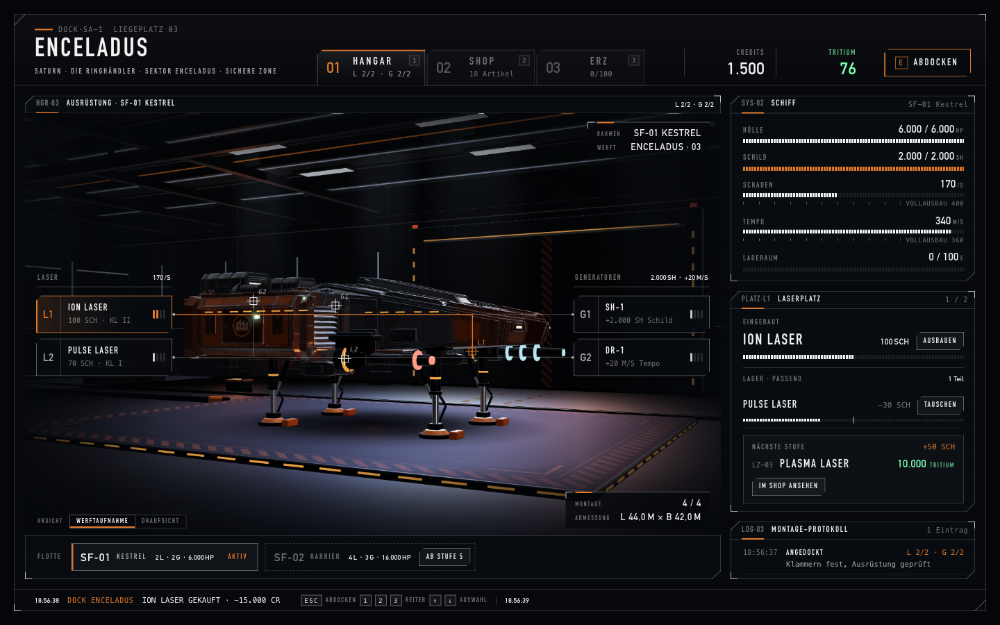
- 49,3 s · Erster Kampf (1,5 s nach dem ersten Schuss): 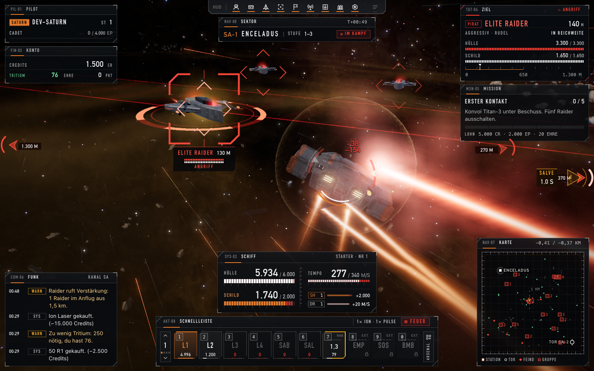
- 73,4 s · Abschuss raider (elite): 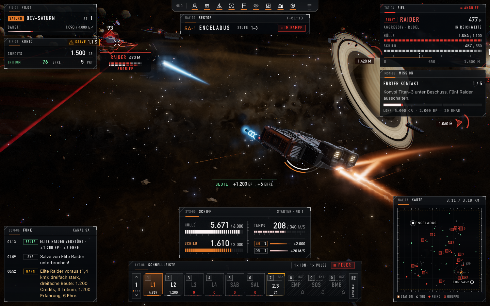
- 89,6 s · Neuer Sektor SA-2 (Mimas): 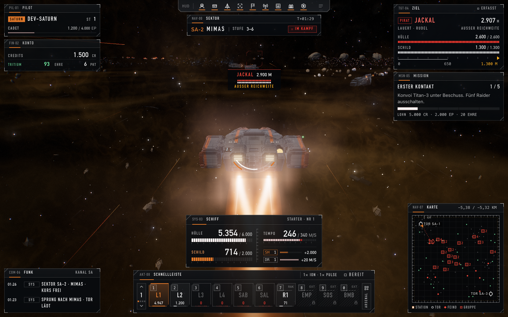
- 102,9 s · Abgeschossen: Reparatur-Auswahl: 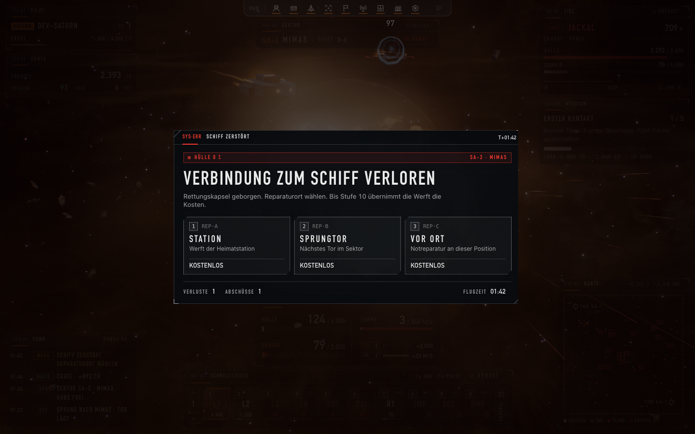
- 120,0 s · Ende der Spielzeit: 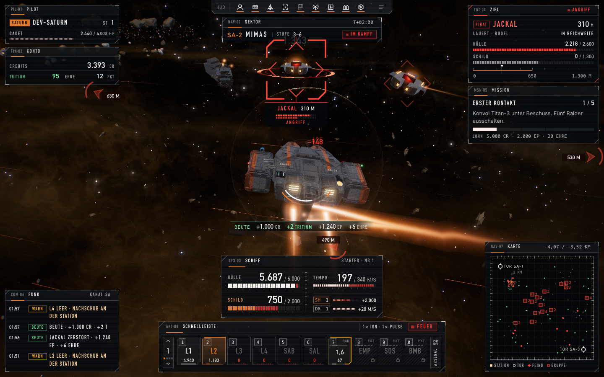

## ERIS · 120 s gespielt · ER-1 → ER-2

Qualität: Stufe HOCH, Auflösungsfaktor 0,86, Pixeldichte 1,51, Puffer 2167x1354, GPU-Zeitmessung ja. Ladezeit bis Flug 1,4 s.

### Bildzeiten (Mittel / p95 / längste, ms)
| Abschnitt | Bilder | Bilder/s | Bildabstand | CPU-Rechenzeit | GPU | Bildzeit max(CPU,GPU) | > 20 ms | > 25 ms | > 33 ms |
|---|---|---|---|---|---|---|---|---|---|
| Gesamt | 6.860 | 59,2 | 16,9 / 18,2 / 933,3 | 2,2 / 3,2 / 92,5 | 6,9 / 10,1 / 36,4 | 6,9 / 10,1 / 92,5 | 4 | 4 | 4 |
| Kampf | 5.348 | 59,8 | 16,7 / 18,2 / 246,8 | 2,3 / 3,2 / 92,5 | 6,6 / 9,4 / 19,8 | 6,6 / 9,4 / 92,5 | 2 | 2 | 2 |
| Ruhe | 1.327 | 60,0 | 16,7 / 18,2 / 18,8 | 2,3 / 3,2 / 16,3 | 6,9 / 10,6 / 36,4 | 6,9 / 11,0 / 36,4 | 0 | 0 | 0 |
| Erster Kampf (10 s) | 557 | 60,0 | 16,7 / 18,1 / 18,7 | 2,4 / 3,6 / 6,7 | 7,3 / 10,0 / 13,1 | 7,3 / 10,0 / 13,1 | 0 | 0 | 0 |
| Angedockt | 185 | 41,9 | 23,9 / 18,3 / 933,3 | 0,7 / 2,0 / 4,5 | 15,6 / 22,6 / 25,1 | 15,6 / 22,6 / 25,1 | 2 | 2 | 2 |

Längste Bilder mit Situation:
- 28,4 s: Bildabstand 933,3 ms, CPU 4,5 ms, GPU 9,0 ms · Angedockt: Shop · ER-1, 3 Gegner nah, 0 greifen an · zuletzt: profile×1 · 90 Draw Calls
- 28,4 s: Bildabstand 433,4 ms, CPU 1,6 ms, GPU 9,0 ms · Angedockt: Shop · ER-1, 4 Gegner nah, 0 greifen an · zuletzt: profile×1 · 90 Draw Calls
- 68,5 s: Bildabstand 246,8 ms, CPU 6,5 ms, GPU 7,3 ms · Flug zum Sprungtor (4049 m) · ER-1, 7 Gegner nah, 3 greifen an · zuletzt: nichts · 116 Draw Calls
- 88,9 s: Bildabstand 83,3 ms, CPU 16,6 ms, GPU 7,9 ms · Sprung lädt · ER-2, 0 Gegner nah, 0 greifen an · zuletzt: despawn×78, sector×1, message×1 · 146 Draw Calls
- 88,9 s: Bildabstand 18,5 ms, CPU 92,5 ms, GPU 7,9 ms · Sprung lädt · ER-2, 0 Gegner nah, 0 greifen an · zuletzt: despawn×78, sector×1, message×1 · 146 Draw Calls

### Kampfwerte
Schüsse 88 (Treffer 80,7 %), Raketen 16, Tode 1 (Todestest nachgeholfen: Stufe 2).
Eingesteckt: 637 Hülle + 2.562 Schild · je Quelle: raider 2.982, jackal 217.
Beute gesamt: 3.022 Credits, 4 Tritium, 2.540 Erfahrung, 13 Ehre.
Je Minute: **1.511 Credits, 2,0 Tritium, 1.270 Erfahrung, 6,5 Ehre**.
Profil: 20.000 → 4.522 Credits, 50 → 54 Tritium, Stufe 1 → 1.

| Gegner | Abschüsse | Zeit bis Abschuss Mittel / Median / max (s) |
|---|---|---|
| raider | 3 | 16,4 / 5,2 / 40,0 |
| jackal | 1 | 5,0 / 5,0 / 5,0 |

Munition (Versuche/erfolgreich/Vorrat danach): L1 1/1/4.998 · L2 1/1/1.200 · L3 1/0/0. Schüsse je Munition: L1 74, L2 14.
Schussrichtung zur Schiffsnase: Mittel 14,6°, p95 70,9°, 16 Schüsse über 45°, 0 über 90° (Laser feuern dann seitlich/rückwärts aus den Mündungen).
Einkäufe: ammo L2 ok (−1.000 Credits, −0 Tritium) · rocket R1 ok (−2.500 Credits, −0 Tritium) · ammo L3 abgelehnt: Zu wenig Tritium: 250 nötig, du hast 51. · ammo SAL abgelehnt: Zu wenig Tritium: 200 nötig, du hast 51. · ammo SAB abgelehnt: Zu wenig Tritium: 500 nötig, du hast 51. · laser ion ok (−15.000 Credits, −0 Tritium).
Dauer der Aufrufe: Andocken 661,3 ms, 6 Einkäufe 440,0 ms, Abdocken 0,2 ms.
Reparaturen: 105,6 s here ok (kostenlos (bis Stufe 10)). Sprünge: 88,9 s → ER-2. Stufenaufstiege: keine.

### Gegnerverhalten
| Typ | Stichproben | Zeitanteile | Abstand zum Spieler im Angriff (Mittel/Median/min m) | Ausweichen | Angriffsbeginn selbst/Sicht/mitgezogen | Flucht | übereinander | Schüsse/Treffer |
|---|---|---|---|---|---|---|---|---|
| raider | 3.175 | patrouille 53,3 %, anfliegen / flanke 26,0 %, hold / wartet im kreis 6,1 %, umkreisen / flanke 4,2 %, fliehen / rückzug zum heilen 4,0 %, abdrehen / flanke 1,7 %, ausweichen / flanke 1,0 %, anfliegen / lädt salve 0,8 %, angreifen (stehend) / lädt salve 0,7 %, angreifen (stehend) / salve 0,5 %, umkreisen / lädt salve 0,4 %, hold 0,3 %, abdrehen 0,2 %, angreifen (stehend) / flanke 0,2 %, abdrehen / lädt salve 0,2 %, umkreisen 0,1 %, anfliegen 0,1 %, umkreisen / schildwall 0,1 %, angreifen (stehend) 0,1 %, abdrehen / salve 0,1 %, ausweichen 0,0 %, anfliegen / schildwall 0,0 %, ausweichen / rückzug zum heilen 0,0 % | 779 / 696 / 10 | 11 | 2/11/7 | 7 | 0,0 % | 96/59 |
| larva | 190 | patrouille 100,0 % | – | 0 | 0/0/0 | 0 | 0,0 % | 0/0 |
| jackal | 386 | patrouille 65,0 %, anfliegen / springt an 8,8 %, umkreisen / springt an 5,7 %, patrouille / lauert getarnt 4,9 %, hold / wartet im kreis 4,4 %, anfliegen / rammt 3,4 %, anfliegen / lädt rammangriff 1,8 %, fliehen / rückzug zum heilen 1,3 %, anfliegen 1,0 %, ausweichen / springt an 0,8 %, abdrehen / lädt rammangriff 0,8 %, angreifen (stehend) / lädt rammangriff 0,5 %, angreifen (stehend) / rammt 0,3 %, ausweichen 0,3 %, angreifen (stehend) / springt an 0,3 %, umkreisen / lädt rammangriff 0,3 %, abdrehen / rammt 0,3 %, umkreisen / rammt 0,3 % | 675 / 717 / 199 | 1 | 1/0/4 | 1 | 0,0 % | 3/3 |

Übereinander (Abstand < 0,75 × Summe der Trefferradien): in 0,0 % der Stichproben, Vorfälle keine, höchstens 0 Paare gleichzeitig. Hilfe-/Verstärkungsmeldungen: 8, vorübergehend erzeugte Gegner: 5.

### Ausrichtung der Modelle
nicht geprüft

### Konsole
1 Fehler, 0 Warnungen, 5 Hinweise (Netz).
- 1× Fehler: Failed to load resource: the server responded with a status of 404 (Not Found)
- 1× Hinweis: HEAD /models/station-europa.glb abgebrochen
- 1× Hinweis: HEAD /models/station-saturn.glb abgebrochen
- 1× Hinweis: HEAD /models/station-eris.glb abgebrochen
- 1× Hinweis: HEAD /models/europa-starter.glb abgebrochen
- 1× Hinweis: HEAD /models/eris-starter.glb abgebrochen

### Bilder
- 1,2 s · Ereignis: Erster Kontakt: 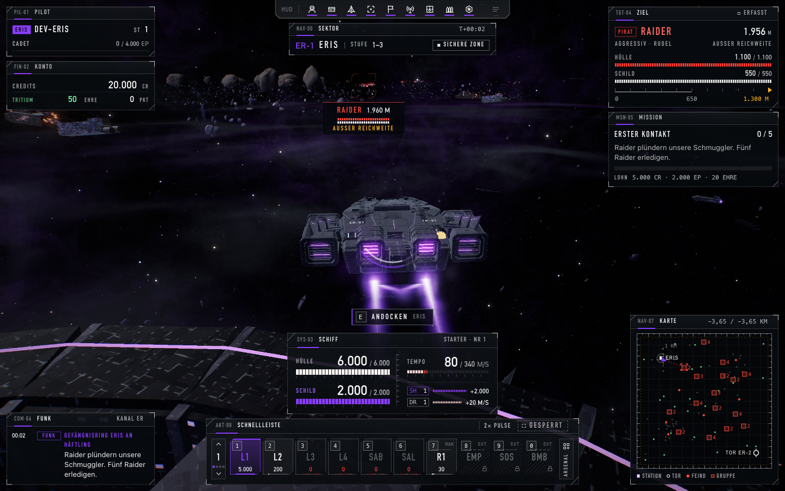
- 9,1 s · Erster Kampf (1,5 s nach dem ersten Schuss): 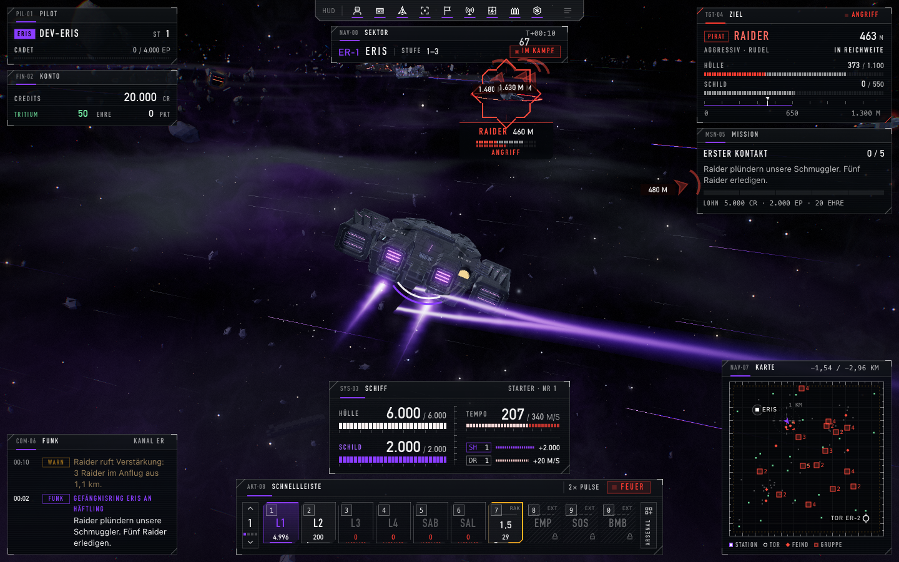
- 28,4 s · Hänger 933 ms (Angedockt: Shop): 
- 29,6 s · Angedockt: Station/Shop: 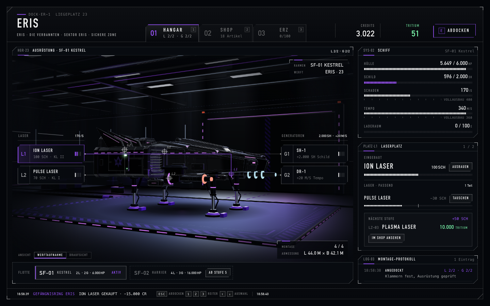
- 91,4 s · Neuer Sektor ER-2 (Dysnomia): 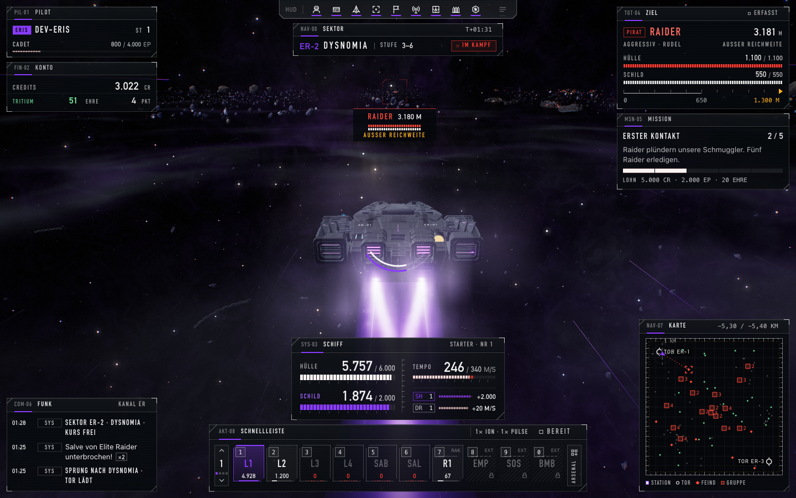
- 103,0 s · Abgeschossen: Reparatur-Auswahl: 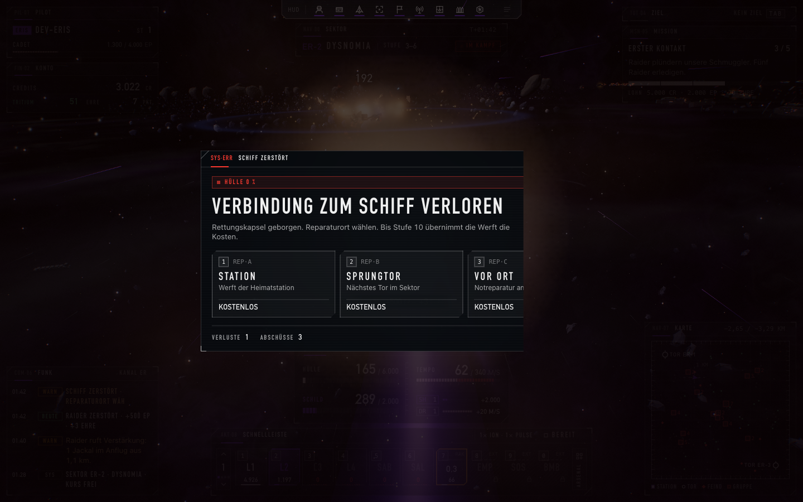
- 120,0 s · Ende der Spielzeit: 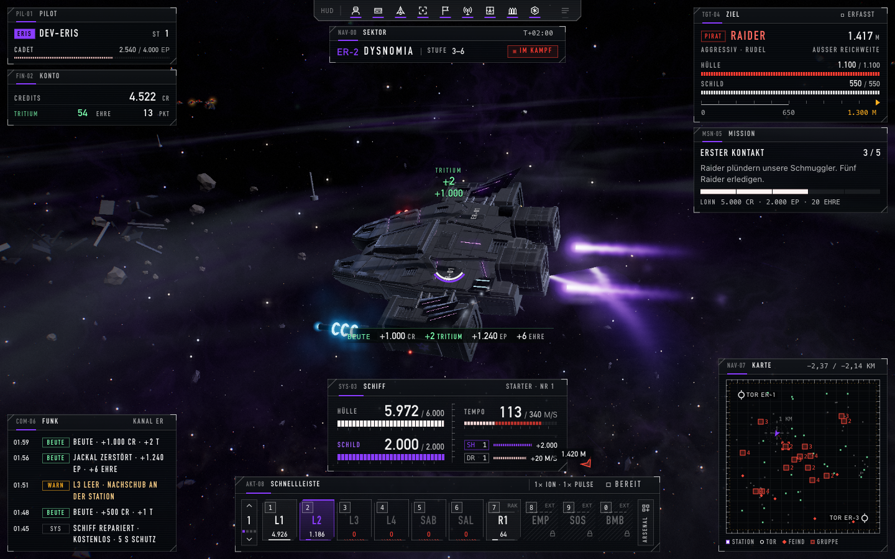
