# Test-Pilot · 2026-10-30_22-02-02

saturn · je 2,0 min · Qualität hoch · Fenster 1440×900 (Pixeldichte 2) · Chrome sichtbar

Ziele: Mac Qualität HOCH im Kampf unter 8 ms je Bild · normaler Laptop Full HD MITTEL mindestens 60 Bilder/s · erster Kampf ohne Hänger über 25 ms.

## SATURN · 120 s gespielt · SA-1 → SA-2

Qualität: Stufe HOCH, Auflösungsfaktor 0,86, Pixeldichte 1,51, Puffer 2167x1354, GPU-Zeitmessung ja. Ladezeit bis Flug 1,6 s.

### Bildzeiten (Mittel / p95 / längste, ms)
| Abschnitt | Bilder | Bilder/s | Bildabstand | CPU-Rechenzeit | GPU | Bildzeit max(CPU,GPU) | > 20 ms | > 25 ms | > 33 ms |
|---|---|---|---|---|---|---|---|---|---|
| Gesamt | 6.867 | 59,2 | 16,9 / 18,2 / 951,7 | 2,4 / 3,2 / 87,7 | 6,9 / 10,0 / 40,1 | 6,9 / 10,0 / 87,7 | 4 | 4 | 4 |
| Kampf | 4.709 | 60,0 | 16,7 / 18,1 / 18,7 | 2,4 / 3,2 / 8,7 | 6,7 / 9,5 / 13,3 | 6,7 / 9,5 / 13,3 | 0 | 0 | 0 |
| Ruhe | 1.978 | 59,8 | 16,7 / 18,2 / 83,4 | 2,5 / 3,2 / 87,7 | 6,9 / 9,8 / 40,1 | 6,9 / 9,8 / 87,7 | 2 | 2 | 2 |
| Erster Kampf (10 s) | 556 | 60,0 | 16,7 / 18,2 / 18,7 | 2,5 / 3,6 / 8,5 | 6,8 / 9,6 / 11,7 | 6,8 / 9,6 / 11,7 | 0 | 0 | 0 |
| Angedockt | 180 | 41,1 | 24,4 / 18,3 / 951,7 | 1,3 / 4,6 / 7,1 | 11,9 / 19,6 / 31,8 | 11,9 / 19,6 / 31,8 | 2 | 2 | 2 |

Längste Bilder mit Situation:
- 27,2 s: Bildabstand 951,7 ms, CPU 5,2 ms, GPU 6,1 ms · Angedockt: Shop · SA-1, 3 Gegner nah, 0 greifen an · zuletzt: profile×1 · 111 Draw Calls
- 27,2 s: Bildabstand 466,5 ms, CPU 1,5 ms, GPU 6,1 ms · Angedockt: Shop · SA-1, 3 Gegner nah, 0 greifen an · zuletzt: profile×1 · 111 Draw Calls
- 83,6 s: Bildabstand 83,4 ms, CPU 18,3 ms, GPU 8,2 ms · Sprung lädt · SA-2, 0 Gegner nah, 0 greifen an · zuletzt: despawn×78, sector×1, message×1 · 75 Draw Calls
- 0,3 s: Bildabstand 34,4 ms, CPU 2,6 ms, GPU 11,6 ms · Beute: Crate einsammeln · SA-1, 0 Gegner nah, 0 greifen an · zuletzt: modell-geladen×1 · 319 Draw Calls
- 83,6 s: Bildabstand 16,6 ms, CPU 87,7 ms, GPU 8,2 ms · Sprung lädt · SA-2, 0 Gegner nah, 0 greifen an · zuletzt: despawn×78, sector×1, message×1 · 75 Draw Calls

### Kampfwerte
Schüsse 122 (Treffer 77,9 %), Raketen 18, Tode 2 (Todestest nachgeholfen: Stufe 1).
Eingesteckt: 6.837 Hülle + 5.953 Schild · je Quelle: raider 2.614, jackal 10.176.
Beute gesamt: 4.108 Credits, 5 Tritium, 3.280 Erfahrung, 16 Ehre.
Je Minute: **2.054 Credits, 2,5 Tritium, 1.640 Erfahrung, 8,0 Ehre**.
Profil: 20.000 → 5.608 Credits, 50 → 55 Tritium, Stufe 1 → 1.

| Gegner | Abschüsse | Zeit bis Abschuss Mittel / Median / max (s) |
|---|---|---|
| raider | 2 | 4,6 / 4,0 / 5,1 |
| jackal | 2 | 9,9 / 5,2 / 14,6 |

Munition (Versuche/erfolgreich/Vorrat danach): L1 1/1/5.405 · L2 1/1/2.000 · L3 1/1/500 · L4 1/1/100 · SAB 1/1/250. Schüsse je Munition: L1 64, L2 9, L3 9, L4 8, SAB 32.
Schussrichtung zur Schiffsnase: Mittel 9,5°, p95 62,4°, 12 Schüsse über 45°, 0 über 90° (Laser feuern dann seitlich/rückwärts aus den Mündungen).
Einkäufe: ammo L2 ok (−1.000 Credits, −0 Tritium) · rocket R1 ok (−2.500 Credits, −0 Tritium) · ammo L3 abgelehnt: Zu wenig Tritium: 250 nötig, du hast 51. · ammo SAL abgelehnt: Zu wenig Tritium: 200 nötig, du hast 51. · ammo SAB abgelehnt: Zu wenig Tritium: 500 nötig, du hast 51. · laser ion ok (−15.000 Credits, −0 Tritium).
Dauer der Aufrufe: Andocken 664,9 ms, 6 Einkäufe 470,4 ms, Abdocken 0,4 ms.
Reparaturen: 101,5 s here ok (kostenlos (bis Stufe 10)). Sprünge: 83,6 s → SA-2. Stufenaufstiege: keine.

### Gegnerverhalten
| Typ | Stichproben | Zeitanteile | Abstand zum Spieler im Angriff (Mittel/Median/min m) | Ausweichen | Angriffsbeginn selbst/Sicht/mitgezogen | Flucht | übereinander | Schüsse/Treffer |
|---|---|---|---|---|---|---|---|---|
| raider | 2.746 | patrouille 57,9 %, anfliegen / flanke 19,3 %, fliehen / rückzug zum heilen 6,4 %, umkreisen / flanke 4,6 %, angreifen (anderes Ziel) / überfällt konvoi 3,5 %, hold / wartet im kreis 2,4 %, ausweichen / flanke 1,3 %, abdrehen / flanke 1,1 %, umkreisen / lädt salve 0,8 %, angreifen (stehend) / salve 0,5 %, angreifen (stehend) / lädt salve 0,4 %, hold 0,4 %, anfliegen / lädt salve 0,3 %, umkreisen 0,2 %, angreifen (anderes Ziel) 0,2 %, angreifen (stehend) / flanke 0,2 %, anfliegen 0,1 %, abdrehen 0,1 %, angreifen (stehend) 0,1 %, abdrehen / salve 0,1 %, ausweichen / lädt salve 0,1 %, abdrehen / lädt salve 0,0 % | 746 / 620 / 17 | 10 | 1/14/4 | 7 | 0,1 % | 186/51 |
| larva | 249 | patrouille 100,0 % | – | 0 | 0/0/0 | 0 | 0,0 % | 0/0 |
| jackal | 880 | patrouille 63,9 %, patrouille / lauert getarnt 7,6 %, umkreisen / springt an 6,8 %, anfliegen / springt an 5,6 %, abdrehen / springt an 5,1 %, hold / wartet im kreis 4,0 %, anfliegen / rammt 2,0 %, abdrehen / lädt rammangriff 1,4 %, ausweichen / springt an 1,0 %, umkreisen / lädt rammangriff 1,0 %, angreifen (stehend) / springt an 0,5 %, anfliegen 0,3 %, umkreisen 0,2 %, fliehen / rückzug zum heilen 0,2 %, angreifen (stehend) / rammt 0,2 %, ausweichen 0,1 % | 361 / 343 / 30 | 3 | 1/5/1 | 2 | 0,5 % | 68/57 |

Übereinander (Abstand < 0,75 × Summe der Trefferradien): in 0,5 % der Stichproben, Vorfälle raider 1, jackal 2, höchstens 1 Paare gleichzeitig. Hilfe-/Verstärkungsmeldungen: 6, vorübergehend erzeugte Gegner: 11.

### Ausrichtung der Modelle
| Modell | Art | Bug laut Rumpfform (°) | Form eindeutig | Mündungen vor Mitte | Laufrichtung (°) | Triebwerke hinter Mitte | Schweif (°) | Flug im Spiel (Median/p95 °) | Flug in Szene (°) | Befund · Hinweise |
|---|---|---|---|---|---|---|---|---|---|---|
| ship:s1:europa | GLB fehlt | – | nein (Achse –, Verjüngung –) | – | – | – | – | – | 161,4 | GLB nicht geladen · nur Rumpfform |
| ship:s1:europa:platzhalter | Platzhalter | 0,0 | ja (Achse 0,63, Verjüngung 2,05) | 0,64 0,77 | 0 0 | 1,00 1,00 0,58 0,58 | 0 0 0 0 | – | – | ok · Rumpf verjüngt sich zum Bug 0° |
| ship:s2:europa | GLB fehlt | – | nein (Achse –, Verjüngung –) | – | – | – | – | – | 161,4 | GLB nicht geladen · nur Rumpfform |
| ship:s2:europa:platzhalter | Platzhalter | 0,0 | ja (Achse 0,68, Verjüngung 1,49) | 0,64 0,76 0,56 0,66 | 0 0 0 0 | 1,00 1,00 0,58 0,58 1,00 | 0 0 0 0 0 | – | – | ok · Rumpf verjüngt sich zum Bug 0° |
| ship:s1:saturn | GLB | 0,0 | ja (Achse 0,85, Verjüngung 1,62) | 0,77 0,92 | -0 -0 | 1,14 1,14 | 0 0 | 0,4 / 150,5 (567) | 161,4 | ok · Cockpit-Glas vorn 0°, Hoheitszeichen links/rechts 0°, Rumpf verjüngt sich zum Bug -180° |
| ship:s1:saturn:platzhalter | Platzhalter | 0,0 | ja (Achse 0,71, Verjüngung 2,07) | 0,64 0,76 | 0 0 | 1,00 1,00 0,58 0,58 | 0 0 0 0 | – | – | ok · Rumpf verjüngt sich zum Bug 0° |
| ship:s2:saturn | GLB fehlt | – | nein (Achse –, Verjüngung –) | – | – | – | – | – | 161,4 | GLB nicht geladen · nur Rumpfform |
| ship:s2:saturn:platzhalter | Platzhalter | 0,0 | ja (Achse 0,66, Verjüngung 1,50) | 0,64 0,76 0,56 0,66 | 0 0 0 0 | 1,00 1,00 0,58 0,58 1,00 | 0 0 0 0 0 | – | – | ok · Rumpf verjüngt sich zum Bug 0° |
| ship:s1:eris | GLB fehlt | – | nein (Achse –, Verjüngung –) | – | – | – | – | – | 161,4 | GLB nicht geladen · nur Rumpfform |
| ship:s1:eris:platzhalter | Platzhalter | 0,0 | ja (Achse 0,63, Verjüngung 2,01) | 0,64 0,76 | 0 0 | 1,00 1,00 0,58 0,58 | 0 0 0 0 | – | – | ok · Rumpf verjüngt sich zum Bug 0° |
| ship:s2:eris | GLB fehlt | – | nein (Achse –, Verjüngung –) | – | – | – | – | – | 161,4 | GLB nicht geladen · nur Rumpfform |
| ship:s2:eris:platzhalter | Platzhalter | 0,0 | ja (Achse 0,60, Verjüngung 1,47) | 0,64 0,76 0,56 0,66 | 0 0 0 0 | 1,00 1,00 0,58 0,58 1,00 | 0 0 0 0 0 | – | – | ok · Rumpf verjüngt sich zum Bug 0° |
| enemy:raider | Platzhalter | 0,0 | ja (Achse 1,00, Verjüngung 2.085.278,75) | – | – | 0,98 0,98 | 0 0 | 0,0 / 0,1 (1446) | 0,0 | ok · Rumpf verjüngt sich zum Bug 0° |
| enemy:larva | Platzhalter | 0,0 | ja (Achse 1,00, Verjüngung 2,49) | – | – | – | – | 0,0 / 0,0 (201) | 0,0 | ok · Rumpf verjüngt sich zum Bug 0° |
| enemy:jackal | Platzhalter | 0,0 | ja (Achse 1,00, Verjüngung 1,50) | – | – | 0,68 0,68 | 0 0 | 0,0 / 21,5 (397) | 0,0 | ok · Rumpf verjüngt sich zum Bug 0° |
| enemy:spiker | Platzhalter | 165,0 | ja (Achse 0,47, Verjüngung 3,12) | – | – | – | – | – | dreht | dreht sich ständig (gewollt), keine Bugprüfung · Rumpf verjüngt sich zum Bug 165° |
| enemy:vulture | Platzhalter | 0,0 | ja (Achse 1,00, Verjüngung 3,25) | – | – | 0,50 0,50 | 0 0 | – | 0,0 | ok · Rumpf verjüngt sich zum Bug 0° |

Abweichungen:
- **ship:s1:europa**: 161,4° GLB nicht geladen · Bild: 2026-10-30_22-02-02/saturn-08-ausrichtung-ship-s1-europa.png
- **ship:s2:europa**: 161,4° GLB nicht geladen · Bild: 2026-10-30_22-02-02/saturn-09-ausrichtung-ship-s2-europa.png
- **ship:s1:saturn**: 161,4°  · Bild: 2026-10-30_22-02-02/saturn-10-ausrichtung-ship-s1-saturn.png
- **ship:s2:saturn**: 161,4° GLB nicht geladen · Bild: 2026-10-30_22-02-02/saturn-11-ausrichtung-ship-s2-saturn.png
- **ship:s1:eris**: 161,4° GLB nicht geladen · Bild: 2026-10-30_22-02-02/saturn-12-ausrichtung-ship-s1-eris.png
- **ship:s2:eris**: 161,4° GLB nicht geladen · Bild: 2026-10-30_22-02-02/saturn-13-ausrichtung-ship-s2-eris.png

### Konsole
2 Fehler, 0 Warnungen, 5 Hinweise (Netz).
- 2× Fehler: Failed to load resource: the server responded with a status of 404 (Not Found)
- 1× Hinweis: HEAD /models/station-europa.glb abgebrochen
- 1× Hinweis: HEAD /models/station-saturn.glb abgebrochen
- 1× Hinweis: HEAD /models/station-eris.glb abgebrochen
- 1× Hinweis: HEAD /models/europa-starter.glb abgebrochen
- 1× Hinweis: HEAD /models/eris-starter.glb abgebrochen

### Bilder
- 1,1 s · Ereignis: Erster Kontakt: 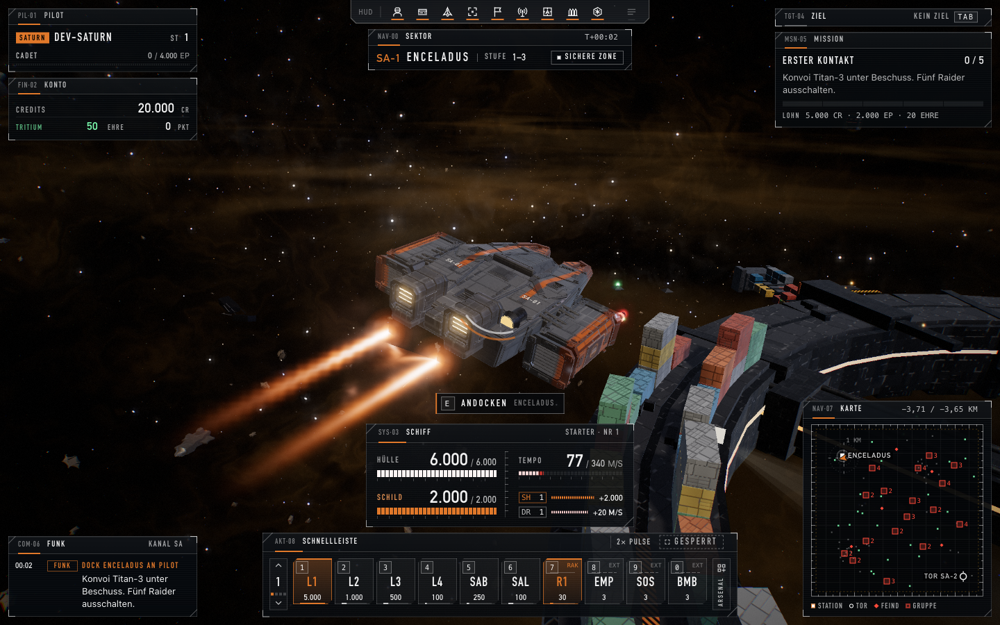
- 14,4 s · Erster Kampf (1,5 s nach dem ersten Schuss): 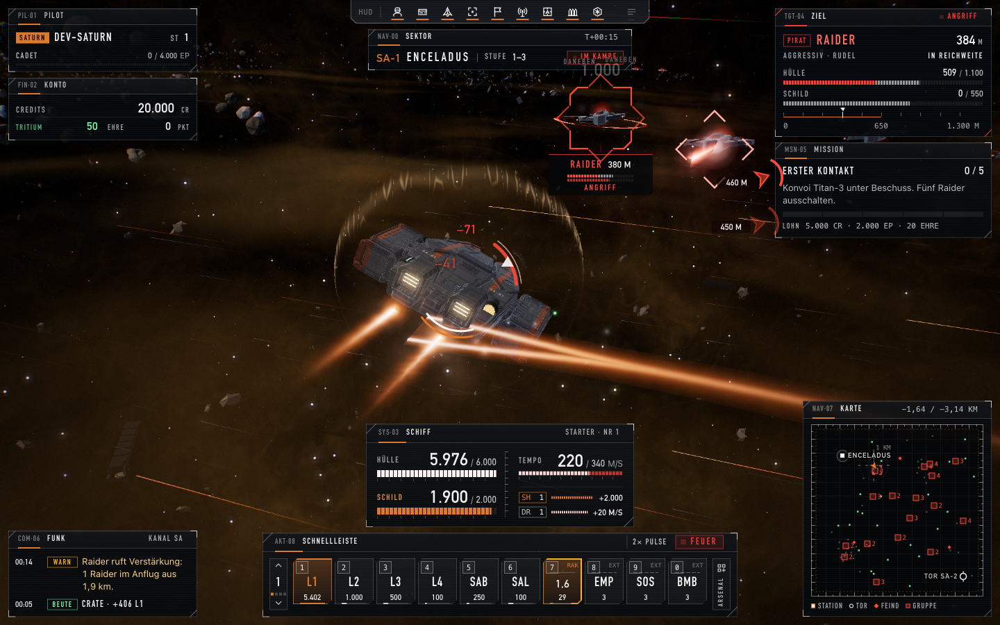
- 27,2 s · Hänger 952 ms (Angedockt: Shop): 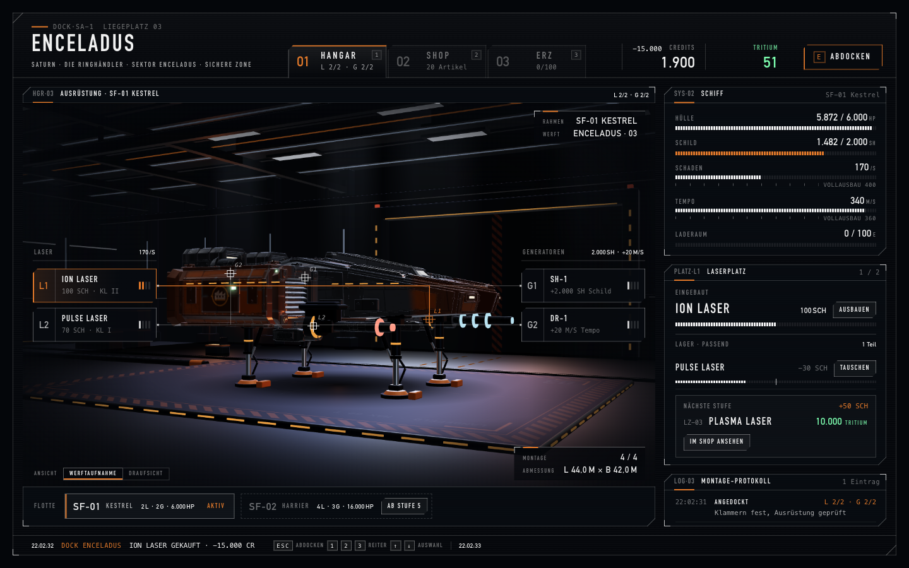
- 28,4 s · Angedockt: Station/Shop: 
- 86,1 s · Neuer Sektor SA-2 (Mimas): 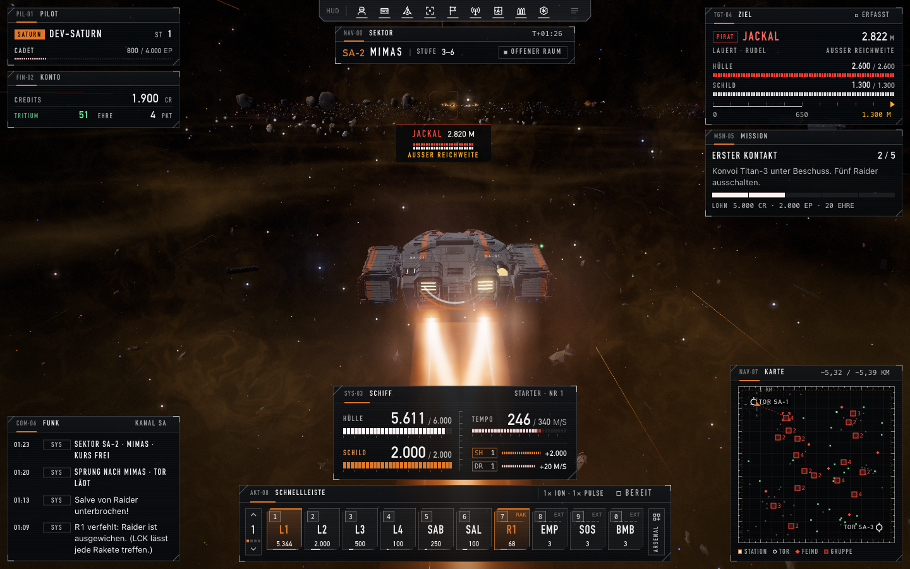
- 99,0 s · Abgeschossen: Reparatur-Auswahl: 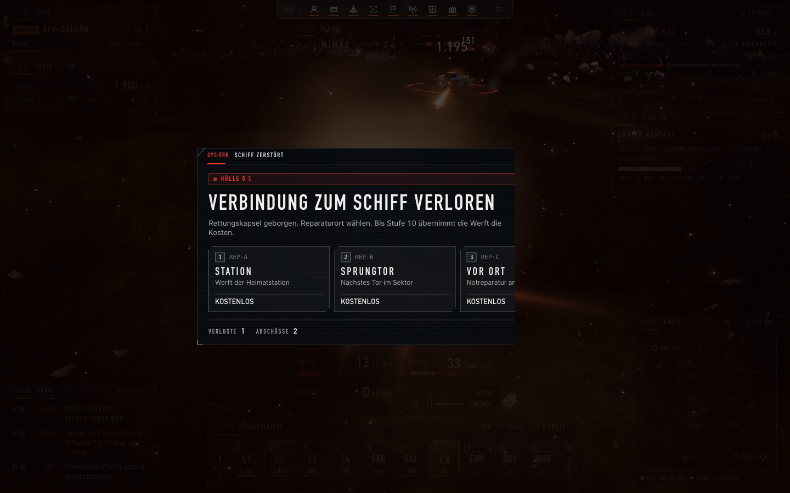
- 120,0 s · Ende der Spielzeit: 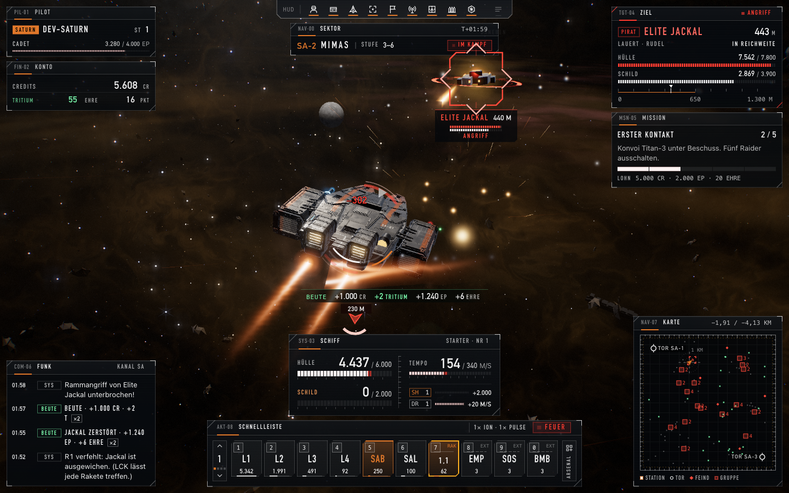
- 149,5 s · Ausrichtung ship:s1:europa: 161.4° (ABWEICHUNG): 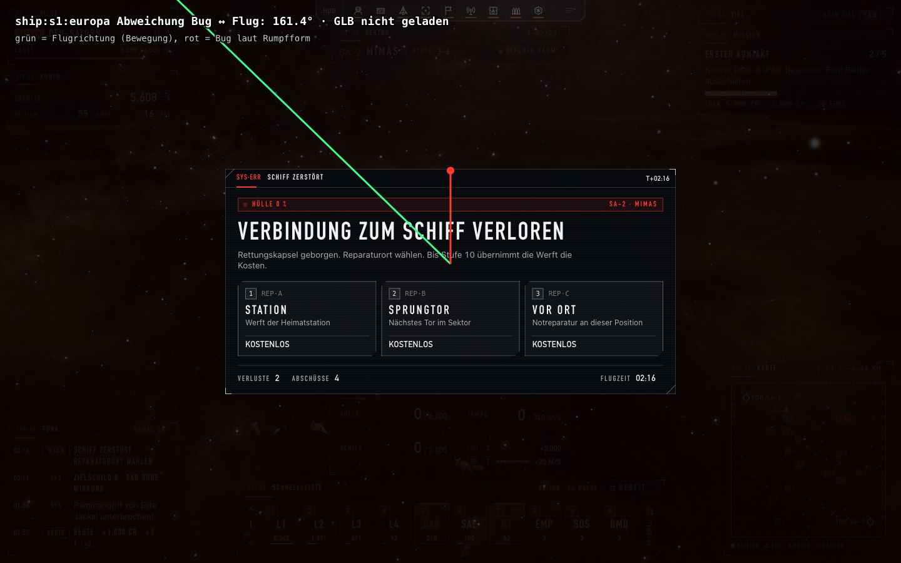
- 153,7 s · Ausrichtung ship:s2:europa: 161.4° (ABWEICHUNG): 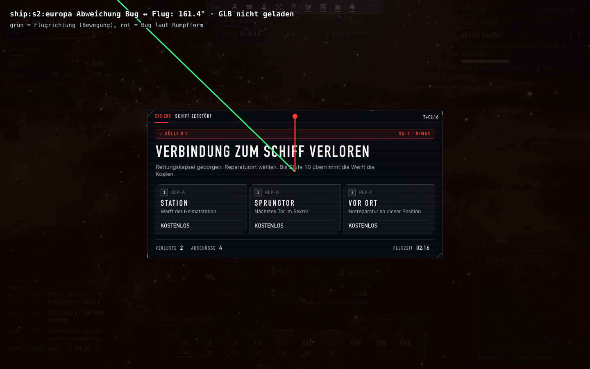
- 157,2 s · Ausrichtung ship:s1:saturn: 161.4° (ABWEICHUNG): 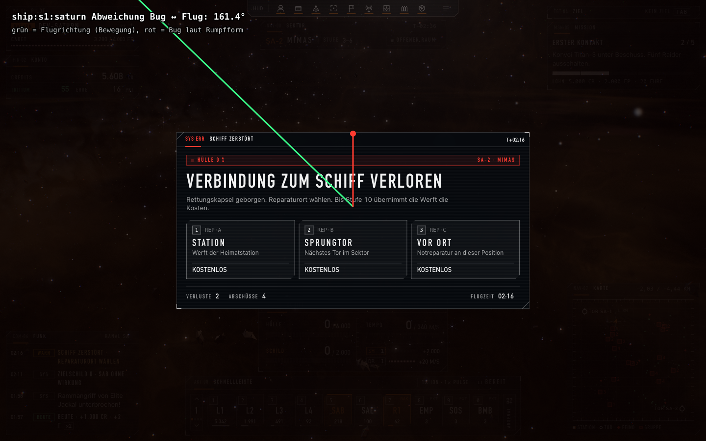
- 164,3 s · Ausrichtung ship:s2:saturn: 161.4° (ABWEICHUNG): 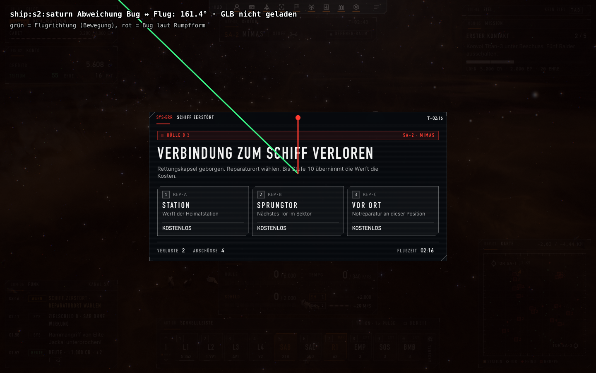
- 168,4 s · Ausrichtung ship:s1:eris: 161.4° (ABWEICHUNG): 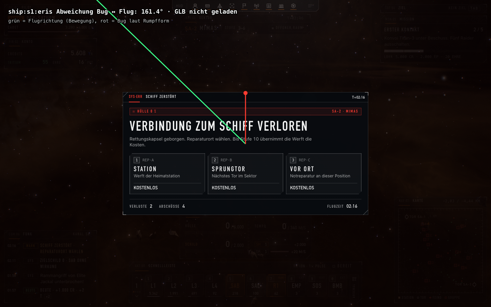
- 172,4 s · Ausrichtung ship:s2:eris: 161.4° (ABWEICHUNG): 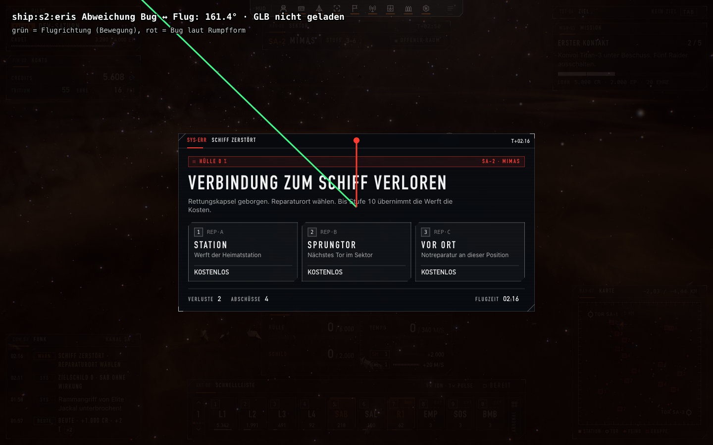
