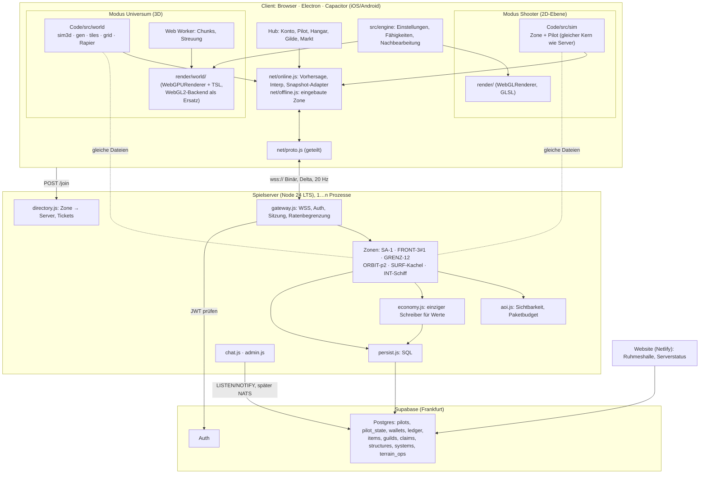

# LAST SIGNALS · Architektur-Fahrplan Sandbox-MMO

Stand 03.11.2026, Zweig `claude/fertigstellung-live`. Dieses Dokument führt die Architektur-Entwürfe „Server und persistente Welt“ und „Universum und Planeten“ sowie die Fragen zu Wirtschaft, Gilden, Bauen und WebGPU-Renderer zu **einem** Fahrplan zusammen. Grundlage ist der gelesene Code (`Code/src/sim`, `Code/src/net`, `Code/src/render`, Zweig `claude/engine` in `../wt-engine`) und die Planungsdateien `MEHRSPIELER.md`, `KONTEN.md`, `BACKEND.md`, `SCHNITTSTELLEN.md`, `FLUGGEFUEHL.md`, `ENGINE.md`.

Kurz gesagt:

- **Zuerst** wird der heutige Shooter ein vorbildliches, fertiges Spiel. Parallel entsteht ohne Umweg der gemeinsame Unterbau (Mehrpiloten-Kern, Befehle, Hauptbuch, Bezugsrahmen im Datenformat).
- **Dann** wird der Shooter ein echtes Online-Spiel mit eigenem Spielserver (Node, gleicher JS-Kern), danach kommen Gilden, Wirtschaft und erstes Bauen.
- **Erst danach** entsteht das Universum (3D-Flug, Planeten, Landen, zu Fuß) als **eigener Spielmodus** mit neuer 3D-Simulation und WebGPU-Weltrenderer. Es nutzt Konto, Server, Hauptbuch, Gilden und Gegenstände mit, die bis dahin schon laufen.
- Star-Citizen-Freiheit gibt es in **kleinerem Maßstab**: wenige Systeme, verkleinerte prozedurale Planeten, feste Zonen statt Server-Meshing, Bauten mit Unterhalt.

---

## 1. Zielbild

### 1.1 Was das Spiel am Ende kann

| Wunsch | Umsetzung in LAST SIGNALS | Phase |
|---|---|---|
| Vorbildlicher Space-Shooter | heutiger Modus (Ebene, Klickflug mit Zielaufschaltung, Sektoren 1–8 je Fraktion), fertig poliert, auf Desktop, Browser und Mobil | A |
| Persistente Welt | Server-Wahrheit, Zonen schlafen ohne Spieler und holen die Zeit beim Aufwachen rechnerisch nach | B |
| Eigene Gilden | Mitglieder, Ränge, Rechte, Kasse, Chat, Marker, Gildenaufträge, später Gebiete und Planetenkacheln | C |
| Handel und Wirtschaft | Direkthandel, Markt je Station, Ressourcenketten (Erz → Raffinerie → Bauteil), Hauptbuch | C |
| Bauen und Erschaffen | v1: Außenposten aus Stationsmodulen im Grenzraum des Shooters. v2: Bausatz auf 2,5-m-Raster für Basen, Stationen und Schiffsinnenräume, auf Planeten und im All | C, E |
| Eigene Planeten | Planet = Seed + Rezept; Gilden beanspruchen Kacheln; gespeichert werden nur Anspruch, Bauten und kleine Geländeänderungen | E |
| Planeten bereisen, landen ohne Ladebildschirm | Würfelkugel mit Quadtree-LOD, Atmosphäre vom Orbit bis zum Boden, Streaming mit Tempobegrenzung nach Höhe, vorverbundene Zonenübergabe beim Atmosphäreneintritt | D, E |
| Ego-Perspektive zu Fuß | Figur mit Rapier-Controller, Innenräume als bewegte Bezugsrahmen, später Ego-Kampf und Entern | D (offline), F (online) |

### 1.2 Bewusst nicht im Ziel

- Hunderte Spieler nahtlos an einem Ort, Server-Meshing (dynamisches Aufteilen eines Raums auf mehrere Server).
- Planeten in Erdgröße, Hunderte Sternsysteme, echte Orbitmechanik beim Fliegen.
- Planeten ganz aus Voxeln mit frei grabbaren Höhlen, Fracht als einzelne Physikkisten.
- Viele gleichzeitig physikalisch simulierte Schiffsinnenräume, handgebaute Städte auf vielen Planeten.

### 1.3 Maßstab

- **2–4 Sternsysteme**: je Fraktion ein Heimatsystem (Europa, Saturn, Eris als Lore-Anker) plus ein umkämpftes Grenzsystem. Weitere Systeme kommen aus dem Generator.
- **Planeten mit 30–300 km Radius** (ähnlich Kerbal Space Program): kurze Flugzeiten, füllbare Oberfläche, und float32 reicht auf der GPU (siehe 2.6).
- **Ein Pilot, ein Konto, zwei Modi**: Shooter und Universum teilen Konto, Pilot, Gegenstände, Erze (`core/data.js`), Gilden, Modelle, Audio, UI-Bausatz und Engine-Einstellungen.

---

## 2. Grundsatzentscheidungen

Jede Entscheidung nennt, welcher Widerspruch zwischen den Entwürfen damit aufgelöst ist.

### 2.1 Zwei Spielmodi, ein Unterbau (statt „den Kern auf 3D umbauen“)

- **Widerspruch:** Der Server-Entwurf wollte den Shooter-Kern in M5 auf x/y/z und Quaternion umbauen. Der Universums-Entwurf sagt, die Ebene lasse sich nicht schrittweise zu 3D machen, und will eine neue 3D-Simulation.
- **Entscheidung:** Der Shooter bleibt **dauerhaft ein 2D-Modus** (Ebene, `y = 0`, Klickflug). Das Universum bekommt eine **neue Simulation `src/world/sim3d.js`** mit 6 Freiheitsgraden und Rapier.
- **Begründung:** Klickflug mit Zielaufschaltung ist ein eigenes, mobiltaugliches Genre und verträgt 100–150 ms Latenz. Ein Umbau auf 3D würde Balance und Fluggefühl des fertigen Shooters zerstören und trotzdem keine Planeten, Atmosphäre oder Figuren liefern. Gemeinsam wird alles, was nicht von der Dimension abhängt: Zonen-Schnittstelle, Pilot-Zustand, Befehle, Hauptbuch, Persistenz, Netzprotokoll, Server, Konto, Gilden.
- **Folge:** Shooter-Sektoren werden im Universum zu „Einsatzgebieten“ (Tor oder Einsatzauftrag führt hinein). Es gibt kein M5 „Kern auf 3D“ mehr; dafür spart der Plan 3–5 Monate.

### 2.2 Eigener Spielserver in Node.js mit demselben JS-Kern

- Ein schlanker Server (etwa 2–4 Tsd. Zeilen) in **Node.js 24 LTS**, plain JS, ESM, importiert `Code/src/sim`, später `Code/src/world` und `Code/src/core/data.js` direkt ohne Build.
- **Begründung:** keine Doppelpflege. Messung vom 03.11.2026 (Headless-Bot, 60 Schritte/s, 37–52 Gegner): 1,4–3,6 ms CPU je Sim-Sekunde und Sektor, also unter 1 % einer Cloud-vCPU. Rust oder Go sind aus CPU-Gründen nicht begründet. Heiße Teile (Physik, Geländerauschen) laufen, falls nötig, als WASM in **beiden** Laufzeiten, nie als zweiter Server.
- Abgelehnt: Colyseus (Zustand in Schema-Klassen zwingen), Nakama (zweites System neben Supabase, JS-Laufzeit goja statt Node), SpacetimeDB (Kern neu schreiben). Nakama bleibt eine Option als Meta-Dienst, falls Freunde, Gilden und Chat zu viel Eigenarbeit werden.

### 2.3 Supabase bleibt für Konto und Postgres, Realtime fällt als Spielnetz weg

- Auth, `pilots`, Ruhmeshalle und neue Tabellen bleiben bei Supabase (Frankfurt). Der Spielserver schreibt mit eigener DB-Rolle über den Pooler.
- **Supabase Realtime ist kein Spielnetz:** Presence schließt den Kanal beim 6. `track` in 20–30 s (gemessen, `MEHRSPIELER.md`), und Nachrichtenkontingente zählen je Empfänger. `coop.js` und `mp.js` bleiben hinter einem Schalter (`?net=supabase|server`), bis Phase B2 live ist.
- **Der Client verliert das Schreibrecht auf Online-Spielzustand** (RLS). Offline-Piloten bleiben wie heute und werden strikt getrennt geführt.

### 2.4 Zone als Einheit der Autorität, kein Server-Meshing

- Eine Zone ist ein Shooter-Sektor, ein Orbit, eine Planetenkachel oder ein Innenraum. Ein Prozess hostet viele Zonen; leere Zonen schlafen.
- Volle Shooter-Zonen werden instanziert (`FRONT-3#2`). **Bebaubare Zonen werden nie instanziert**, sonst gäbe es zwei Wahrheiten über eine Basis.
- Übergaben (Sprungtor, Atmosphäreneintritt, Andockring) laufen vorverbunden: Der Client verbindet sich mit der Zielzone, während eine Animation (Sprung, Wiedereintritt) die Zeit deckt.
- **Widerspruch aufgelöst:** Die Planetenzonen des Server-Entwurfs (`SURF-<planet>-<kachel>`, 8–16 km) und die Kachelschlüssel des Universums-Entwurfs werden ein Schema: Eine Oberflächenzone **ist** ein Quadtree-Knoten auf fester Stufe (siehe 4.1).

### 2.5 Netz: WebSocket mit eigenem Binärprotokoll, Bezugsrahmen von Anfang an

- WebSocket über TLS (überall vorhanden, auch in WKWebView). Delta gegen den zuletzt gesendeten Stand, Schema in einer geteilten Datei `net/proto.js`, Protokollversion n und n−1 (Store-Apps aktualisieren verzögert).
- **Ab dem ersten Byte** tragen Positionen ein Bezugssystem (`frame`) und `y`, auch wenn der Shooter `y = 0` sendet. Die Ausrichtung ist im Shooter ein Winkel (u8), im Universum eine Quaternion (smallest-three).
- WebTransport-Datagramme erst mit Ego-Kampf (Phase F). Die Nachrichtenschicht ist transportneutral.

### 2.6 Koordinaten: double auf der CPU, kameranah auf der GPU, Baum aus Bezugsrahmen

- CPU-Positionen in JS-`number` (64 Bit). Gezeichnet wird **relativ zum Auge**: Die Kamera steht immer bei (0,0,0), je Wurzelobjekt wird `pos − cam` in double gerechnet und erst dann in float32 umgewandelt. Kein Floating-Origin-Sprung, keine Sonderfälle bei Partikeln und Schatten.
- In Planetennähe lebt alles im **planetenfesten Rahmen**; Tag und Nacht entstehen durch die drehende Sonnenrichtung. Bauten haben feste Koordinaten, das Netz muss keine Rotation ausgleichen.
- Rapier rechnet float32: Jede Physikwelt hat einen Ursprung nahe dem Spieler und wird bei Bedarf unsichtbar versetzt. **Jedes fliegende Schiff ist ein eigener Rahmen mit eigener Physikwelt**; das wird von Anfang an so angelegt, ein späterer Umbau wäre sehr teuer.
- Tiefe in drei Ebenen: Fernraum (verkleinerte Szene für Sterne und Planeten über ~50 km), Nahwelt (0,3 m bis 50–100 km, Reversed-Z mit `depth32float` unter WebGPU, sonst logarithmische Tiefe), Ego/Cockpit (0,02–40 m, gibt es heute schon als `render/cockpit.js`).

### 2.7 WebGPU-Renderer: neuer Weltrenderer in TSL, Shooter bleibt vorerst auf WebGL

- **Heute:** three r170, `WebGLRenderer`, eigene GLSL-Shader in 25 Dateien unter `render/` (`onBeforeCompile`, `RawShaderMaterial`). `ENGINE.md` (Zweig `claude/engine`) hält fest: kein WebGPU-Pfad, weil diese Shader im `WebGPURenderer` nicht laufen. Der Arbeitsbaum `../wt-webgpu` steht auf demselben Stand wie `claude/engine` und enthält noch keine WebGPU-Arbeit.
- **Entscheidung:**
  1. three.js in einem eigenen Zweig auf eine aktuelle Version heben (exakte Version beim Upgrade festlegen) und mit `Code/tools/bilder/ansichten.mjs` vorher und nachher vergleichen, ob der Shooter gleich aussieht.
  2. Den **neuen Weltrenderer** (`src/render/world/`) **nur in TSL auf `WebGPURenderer`** schreiben. TSL übersetzt nach WGSL und nach GLSL; ohne WebGPU läuft er über das WebGL2-Backend. Wo Compute auf WebGL2 fehlt, gibt es einen Ersatz über Web Worker. **WebGPU beschleunigt, ist aber keine Voraussetzung.**
  3. Der **Shooter bleibt auf `WebGLRenderer`**. Beim Wechsel Hub → Universum wird der Renderer getauscht; beide teilen sich die Leinwand nicht gleichzeitig. Eine Portierung der Shooter-Shader nach TSL lohnt erst, wenn sie im Universum gebraucht werden.
  4. Die Engine-Schicht (`src/engine`: Einstellungs-Schema, Fähigkeiten, Kette aus Bausteinen) wird **vorher** in den Hauptstand geführt und bekommt die neuen Qualitätsschlüssel (Geländefehler in Pixeln, Streudichte, Atmosphäre, Wolken, Schattenkaskaden, Lichter je Raum, GPU-Budget).
- **Wo WebGPU echten Gewinn bringt:** Gelände per Compute (unter 0,1 ms je Chunk statt 1–3 ms im Worker), GPU-Culling mit indirektem Zeichnen für Steine, Pflanzen, Asteroiden und Trümmer, Clustered Lighting in Innenräumen (Hunderte Lichter statt 4–8), Atmosphäre v2 und Volumenwolken als Compute, Partikel, `depth32float`.
- **Plattformen:** Electron (Chromium) hat WebGPU. Für Chrome/Edge, Android-Chrome, Safari (macOS, iOS) und Firefox gilt: Stand bei Phase D prüfen und messen; die WebGL2-Rückfallebene bleibt Pflicht. Im iOS-WKWebView gilt ein GPU-Budget von etwa 0,8–1 GB, im Browser-Tab 1,5–2 GB.

### 2.8 Planeten: Funktion statt Voxel, CPU ist die Wahrheit

- Würfelkugel mit 6 Quadtrees, Chunks mit 33² bzw. 65² Eckpunkten, Teilung nach Bildschirmfehler, Nähte mit Schürzen. Bei 100 km Radius liegen auf Stufe 11 etwa 1,2 m zwischen zwei Eckpunkten.
- **`heightAt()` in JS (double) ist bindend** für Physik, Server und Bauen. Die GPU-Version ist nur Optik; ein Selbsttest vergleicht 10.000 Punkte und lässt höchstens 5 cm Abweichung zu.
- **Widerspruch aufgelöst:** Der Server-Entwurf speicherte Geländeänderungen als `bytea` je Chunk, der Universums-Entwurf als kleine Operationen. Entscheidung: **Operationen** (`flatten`, `ramp`) je Kachel, angewendet beim Erzeugen des Chunks. Das ist kleiner, netzfreundlich und versionierbar. Höhlen sind handgebaute Bausatz-Teile.
- Jeder Generator hat eine `genVersion`, die je System festgeschrieben ist. Ein neuer Generator verschiebt sonst Gelände unter bestehenden Bauten.

### 2.9 Wirtschaft: ein einziger Schreiber, Hauptbuch, Idempotenz

- `server/economy.js` ist der **einzige** Code, der Werte (Credits, Tritium, Gegenstände, Gildenkasse, Bauten) ändert: jede Änderung in einer DB-Transaktion mit Idempotenzschlüssel, `check (amount >= 0)` und Hauptbucheintrag. Handel sperrt beide Container in fester ID-Reihenfolge.
- Im Kern ersetzt eine `ledger`-Schnittstelle alle direkten Schreibzugriffe auf `profile`: offline schreibt sie ins Profil wie heute, online übernimmt `economy.js`. Das ist der Grund, warum die Wirtschaft schon im Shooter (Phase C) entsteht und im Universum unverändert weiterläuft.
- **Nichts Gebautes ist ewig:** Bauten und Gebietsansprüche haben Unterhalt, sonst füllen verlassene Bauten Welt und Datenbank. Belagerung nur in einem vom Besitzer gewählten Fenster.

### 2.10 Bauen in zwei Stufen

- **Widerspruch:** Der Server-Entwurf baut Außenposten in 2D-Grenzraum-Zonen (M4), der Universums-Entwurf einen Raster-Bausatz für Basen und Innenräume in 3D.
- **Entscheidung:** Beides, nacheinander, mit **demselben Datenmodell** (`structures`, `claims`, Unterhalt, Belagerungsfenster). v1 im Shooter-Grenzraum mit den vorhandenen Stationsmodellen, Platzierung auf der Ebene; v2 im Universum mit dem Bausatz auf 2,5-m-Raster.
- **Begründung:** v1 liefert früh „Erschaffen“ und testet die teuren Serverteile (Ansprüche, Unterhalt beim Schlafen der Zone, Belagerung, Dupe-Schutz) mit wenig Grafikarbeit. Was v2 neu braucht, ist nur Platzierung, Raster und Innenraum, nicht die Serverlogik. `pos` ist schon eine Pose mit `frame`, damit wandern die Daten mit.

### 2.11 Reihenfolge: Spieler vor Planeten, aber Machbarkeit früh prüfen

- **Widerspruch:** Der Server-Entwurf will M0–M4 vor 3D, das Universum wäre damit erst in 2–3 Jahren sichtbar und sein Risiko lange unbekannt.
- **Entscheidung:** Hauptreihenfolge bleibt „Shooter fertig → online → Gilden und Wirtschaft → Universum“, weil jede Stufe für sich spielbar ist und Spieler bringt. Dazu kommt **früh ein zeitlich begrenzter Machbarkeits-Spike** (2–3 Wochen, im Arbeitsbaum `../wt-webgpu`, Wegwerfcode erlaubt): ein Planet mit Quadtree-LOD unter `WebGPURenderer`, Anflug vom Orbit, gemessen auf Mac, Windows-PC und iPhone. Sein Ergebnis entscheidet, ob Phase D so bleibt.

---

## 3. Architektur



### 3.1 Bausteine und Verzeichnisse

| Ort | Inhalt | Läuft in |
|---|---|---|
| `Code/src/sim/` | Shooter-Kern: `Zone` (heute `World` ohne Spieler), `Pilot`, KI, Kampf, Ereignisse; `ledger`- und `persist`-Schnittstelle | Client und Server |
| `Code/src/world/` (neu) | `coords.js` (Vec3d, Frames, Posen), `gen/` (Rauschen, System, Körper, Chunk), `tiles.js` (Kachelschlüssel), `grid.js` (Bauraster), `physics/` (Rapier), `sim3d.js` (Schiffe 6DOF, Figuren, Gravitation, Rahmenwechsel) | Client, Worker, Server |
| `Code/src/render/` | heutiger Shooter-Renderer (WebGL) | Client |
| `Code/src/render/world/` (neu) | `view.js` (kameranah, drei Tiefenebenen), `planet.js`, `atmo.js`, `scatter.js`, `interior.js`, `character.js` | Client |
| `Code/src/engine/` (aus `claude/engine`) | Einstellungs-Schema, Fähigkeiten, Nachbearbeitungskette | Client |
| `Code/src/net/` | `proto.js`, `online.js`, `offline.js`; bis B2 zusätzlich `coop.js`, `mp.js` hinter Schalter; `account*.js`, `cloud-logic.js` bleiben für Offline-Piloten | Client (proto auch Server) |
| `Code/src/modes/` (neu) | Hub, Shooter, Universum; Renderer-Tausch beim Moduswechsel | Client |
| `server/` (neu, Repo-Wurzel) | `main.js`, `gateway.js`, `aoi.js`, `economy.js`, `persist.js`, `directory.js`, `chat.js`, `admin.js` | Server |

### 3.2 Laufzeitregeln

1. Der Server rechnet alles, was Fortschritt, Geld, Rang oder andere Spieler betrifft. Der Client sendet Absichten (Befehle), keine Positionen.
2. Ein Kern, zwei Orte: Offline läuft dieselbe Zone im Browser als „eingebauter Server“. Jeder Meilenstein bleibt offline spielbar.
3. RAM ist die Wahrheit der laufenden Zone, Postgres die Wahrheit über die Zeit. Werte sofort transaktional, Ort und Kampfzustand alle 30–60 s sowie bei Andocken, Zonenwechsel und Abmelden.
4. Leere Zonen schlafen und holen beim Aufwachen Respawns, Erzwachstum und Unterhalt rechnerisch nach. Das ist der größte Kostenhebel einer persistenten Welt mit wenigen Spielern.
5. Eine Ausnahme in einer Zone lädt nur diese Zone neu, der Prozess läuft weiter.
6. Ein Pilot hat eine Sitzung. Verbindungsabbruch: Schiff bleibt 10 s (im Kampf 20 s), Wiederverbinden mit Sitzungstoken innerhalb von 60 s (wichtig für iOS im Hintergrund).

### 3.3 Sichtbarkeit (Interest Management)

| Stufe | Radius | Inhalt | Rate |
|---|---|---|---|
| nah | ≤ 2,5 km (mit dem Renderer abstimmen) | voller Zustand | 20 Hz |
| mittel | ≤ 6 km | Position, Typ, Rang | 5 Hz |
| Karte | ganze Zone | nur Spieler, Bosse, Ereignisse, grob | 1 Hz |

Budget etwa 1.200 Byte je Paket, Priorität nach Nähe × Wichtigkeit mit Altersgewichtung, 10 % Hysterese, Getarntes wird nicht gesendet. Im Universum kommt als Kandidatenquelle der Kachelbaum dazu (Nachbarkacheln der eigenen Zone als Nur-Lesen-Abo, etwa 500 m tief).

### 3.4 Anti-Cheat (nach Wirkung)

1. Server-Autorität über Bewegung, Treffer, Schaden, Beute, Preise, Belohnungen.
2. Eingabeprüfung: Länge, Wertebereich, Rate (Befehle ≤ 30/s, Chat 4 je 8 s wie heute).
3. Wirtschaft: Hauptbuch, Idempotenz, Ertragsraten je Pilot und Stunde mit Alarm.
4. Sichtbarkeit: nur senden, was der Pilot sehen darf.
5. Bots und Mehrfachkonten: Heuristiken, Melden-Knopf, Moderationswerkzeug, abnehmender Ertrag im Belohnungsdesign.
6. PvP entscheidet der Server (heute entscheidet das Opfer), Ehre nur aus Server-Abschüssen.
7. Ab Ego-Kampf: Lag-Kompensation mit 500 ms Positionshistorie, Prüfung der Schusslinie.
8. Bewusst nicht: Verschleierung des Client-Codes, Client-Anti-Cheat-Software.

---

## 4. Datenmodelle

### 4.1 Gemeinsame Schlüssel und Posen

```js
// Bezugsrahmen: Baum. Alles Bewegte hängt an genau einem Frame.
Frame = {
  id,                       // 'sec:sa-3' | 'sys:ls-3' | 'body:ls-3/p2' | 'grid:8812' | 'room:8812/4'
  parent,                   // null für 'sec:*' und 'sys:*'
  kind: 'sector' | 'system' | 'body' | 'grid' | 'room',
  p: [x, y, z], q: [x, y, z, w],   // relativ zum Elternrahmen, double
}
Pose = { frame, p: Float64Array(3), q: Float32Array(4), v: Float64Array(3), w: Float32Array(3) }
// Shooter: frame = 'sec:<sektor>', p = [x, 0, z], q aus rot (Drehung um y)

TileKey = `${bodyId}/${face}/${level}/${x}/${y}`   // Gelände, Streaming, Interesse, Speicherung

ZoneId =
  'SA-1' | 'FRONT-3' (+ '#n' Instanz)            // Shooter, heute
  | 'GRENZ-12'                                   // Shooter-Grenzraum, bebaubar, nie instanziert
  | 'SPACE-ls-3'                                 // Systemraum (bei Bedarf in feste Zellen geteilt)
  | 'ORBIT-ls-3/p2'                              // bis etwa 3 × Radius
  | 'SURF-' + TileKey auf Zonenstufe Lz          // Lz so gewählt, dass eine Kachel 8–16 km misst
  | 'INT-grid:8812'                              // Innenraum eines Schiffs oder einer Station
```

Netz-IDs sind `u16` je Zone; die Zuordnung zu heutigen String-IDs (`'player'`, `'ally'`, `rp:<sid>`) bleibt im Client-Adapter.

### 4.2 Universum (generiert, nicht gespeichert)

```js
SystemDef = { id, seed, genVersion, star: { type, lum, color }, bodies: BodyDef[], zones: ZoneDef[] }
BodyDef = {
  id, kind: 'rocky' | 'ice' | 'desert' | 'ocean' | 'gas' | 'moon' | 'belt',
  parent, orbit: { a, e, i, node, peri, M0 },   // auf Schienen: Systemkarte und Licht
  radius, gravity, dayLength, axis, seed, recipe, genVersion,
  atmo: { top, rayleigh: [r, g, b], mie, mieG, density } | null,
  sea: { level, color } | null,
  landable,
}
Recipe = {                                       // Datei je Planetentyp, von Hand gepflegt
  height: { continents, ridges, craters, terraces, warp },
  biomes: [{ id, temp, humid, ground, rock, scatter }],
  ores: [{ ore, biome, dens }],                  // knüpft an ORES in core/data.js an
}
```

### 4.3 Postgres (Skizze)

```sql
-- bestehend: pilots(id, user_id, callsign, faction, title, founder), pilot_saves (nur Offline/Übergang), hall_of_fame
create table pilot_state (
  pilot_id bigint primary key references pilots,
  mode text not null,                 -- 'shooter' | 'universe'
  zone text not null,
  pose jsonb not null,                -- Pose {frame, p, q}; Shooter: p[1] = 0
  ship_id uuid, level int, xp bigint, honor bigint, kills int,
  quests jsonb, settings jsonb,
  version int not null default 0, updated_at timestamptz default now()
);
create table wallets (owner_kind text, owner_id bigint, currency text,   -- pilot|guild; credits|tritium|nova
  amount bigint not null check (amount >= 0), primary key (owner_kind, owner_id, currency));
create table ledger (id bigserial primary key, at timestamptz default now(),   -- nur anhängen
  owner_kind text, owner_id bigint, currency text, delta bigint,
  reason text, ref text, idem uuid unique);
create table containers (id bigserial primary key, kind text,  -- ship_cargo|hangar|guild_bank|structure|mail
  owner_kind text, owner_id bigint, zone text, capacity int);
create table items (id uuid primary key, type text, qty int check (qty > 0),
  container_id bigint references containers, slot int, level smallint default 0,
  attrs jsonb, created_at timestamptz default now());
create table ships (id uuid primary key, pilot_id bigint, type text, loadout jsonb, hull int,
  interior text, destroyed_at timestamptz);             -- interior: Bausatz-Vorlage (Universum)
create table guilds (id bigserial primary key, tag citext unique, name citext unique, faction text, created_at timestamptz);
create table guild_ranks (guild_id bigint, rank smallint, name text, perms bigint, primary key (guild_id, rank));
create table guild_members (guild_id bigint, pilot_id bigint unique, rank smallint, joined_at timestamptz,
  primary key (guild_id, pilot_id));
create table market_orders (id bigserial primary key, station text, pilot_id bigint, side char(1),
  item_type text, qty int, price bigint, created_at timestamptz, expires_at timestamptz);
create table systems (id text primary key, seed bigint, gen_version int not null, overrides jsonb);
create table claims (id bigserial primary key,
  zone text,                          -- 'GRENZ-12' oder 'SURF-<TileKey>'
  area jsonb, guild_id bigint, since timestamptz, upkeep_paid_until timestamptz,
  siege_window jsonb);                -- vom Besitzer gewählt, z. B. {dow: 6, from: '19:00', hours: 2}
create table structures (id uuid primary key, zone text, frame text, type text,
  owner_kind text, owner_id bigint, pose jsonb, hp int, state jsonb,
  grid jsonb,                         -- v2: Bausatz-Teile und Verbindungen (grid.js)
  upkeep_paid_until timestamptz, created_at timestamptz);
create table terrain_ops (body_id text, tile text, rev int, ops jsonb,   -- [{op:'flatten', ...}, {op:'ramp', ...}]
  gen_version int, primary key (body_id, tile));
-- dazu: mail, friends, blocks, reports, audit (Moderation)
```

Grenzen: Bauten und Geländeänderungen kommen **nie** in `pilot_saves` (jsonb, höchstens 512 kB). Planeten selbst stehen nicht in der Datenbank, nur `systems` mit Seed, `gen_version` und Ausnahmen.

### 4.4 Schnittstellen im Kern

```js
class Zone {                                           // Shooter: Code/src/sim · Universum: Code/src/world
  constructor(def, { seed, ledger, persist, emit })    // emit(type, payload, scope): scope = pilotId | 'zone' | {x, z, r}
  addPilot(pilotState) -> Pilot
  removePilot(pilotId, reason) -> pilotState
  command(pilotId, cmd)        // {t:'move',x,z} {t:'target',id} {t:'attack',on} {t:'jump'} {t:'dock'} {t:'buy',...} …
  step(dt)                     // 1/60
  wake(elapsedSeconds)
  entities, pilots, time
}
ledger.grant(pilotId, { credits, tritium, xp, honor, items }, reason, idem)
ledger.spend(pilotId, cost, reason, idem) -> boolean
persist.loadPilot(id) · persist.savePilot(state, { critical }) · persist.loadZone(id) · persist.saveStructures(zoneId, changes)
```

### 4.5 Netzprotokoll (Kern)

| Richtung | Code | Nachricht |
|---|---|---|
| C → S | 0x01–0x05 | move, target, attack, Munition/Rakete/Extra, jump/dock/undock/repair (je `seq u16`) |
| C → S | 0x06 (Universum) | Steuerung 6DOF: Schub i8 × 3, Drehung i8 × 3, Modus u8 |
| C → S | 0x10, 0x30 | shop/equip/sell, trade/market/guild/build (JSON, selten) |
| C → S | 0x20 | chat |
| S → C | 0x80 | snap: `tick u32, ackSeq u16, n u8, [netId u16, mask u8, Felder…]` |
| S → C | 0x81–0x88 | spawn, despawn, event (adressiert), self, wallet/inventory, chat, handover (Zielzone, Ticket), error |

Felder im Shooter: x/z als i16 bei 0,5 m, Nase und Kurs u8, Tempo u8, Hülle/Schild u8 %, Flags, Ziel. Im Universum zusätzlich `frame u16` (Index in einer Rahmentabelle der Zone), y, Position relativ zum Rahmen, Quaternion smallest-three. Rund 7 kB/s je Spieler im Shooter, etwa 25 MB je Spielstunde; Ziel im Universum unter 10 kB/s.

---

## 5. Fahrplan

Aufwand in Wochen (W) oder Monaten (Mo) **Vollzeit mit KI-Unterstützung**. Nebenbei mit etwa 15 Stunden pro Woche ungefähr **× 2,5**. Inhalte (Modelle, Gegner, Quests) und Balance sind nicht eingerechnet; sie sind erfahrungsgemäß der größere Teil. Eine Phase beginnt erst, wenn die vorige live ist. Kosten sind Größenordnungen nach Preisstand der Entwürfe, vor Bestellung prüfen.

### Phase A · Fundament (jetzt)

| # | Inhalt | Spielbarer Mehrwert | Voraussetzung | Aufwand | Kosten/Monat |
|---|---|---|---|---|---|
| **A1 Shooter fertig** | laufende Arbeit aus `AUSBAU_NAECHSTE_RUNDE.md`, Controller, Apps, Release | fertiges Spiel auf allen Plattformen | – | läuft | wie heute |
| **A2 Mehrpiloten-Kern** | Umbau aus Abschnitt 6.2 (Schritte 1–7): `system-quests.js` sauber, `persist` aus dem Kern, `world.command()`, `player` → `pilots`, `ledger`, adressierte Ereignisse, Selbsttest mit 2–4 Piloten | KI-Flügelmann im Einzelspiel; Koop rechnet den Gast als echten Piloten statt `_hitFrom = 'ally'` | – | 3–5 W | 0 € |
| **A3 Engine + three.js aktuell** | `claude/engine` in den Hauptstand, dann three-Upgrade in eigenem Zweig, Vergleichsbilder mit `tools/bilder/ansichten.mjs` | Engine-Qualitätsstufen im Spiel, Grundlage für WebGPU | – | 1–2 W | 0 € |
| **A4 Konventionen festschreiben** | `Pose`/`frame`, `TileKey`, `ZoneId`, Netz-IDs in `SCHNITTSTELLEN.md` | – (verhindert späteren Umbau) | A2 | 2–3 Tage | 0 € |
| **A5 WebGPU-Spike** | im Arbeitsbaum `../wt-webgpu`: ein Planet als Würfelkugel mit Quadtree-LOD unter `WebGPURenderer`/TSL, kameranahes Zeichnen, einfache Atmosphäre, Anflug vom Orbit, Messung auf Mac, Windows und iPhone, WebGL2-Backend im Vergleich | Demo-Video, Entscheidungsgrundlage | A3 | 2–3 W, hart begrenzt | 0 € |

Fertig, wenn: `npm run check` grün, Bot-Kennzahlen (`npm run balance`) vor und nach A2 gleich, Spike-Bericht mit Bildrate und Speicher je Gerät liegt in `Planung/`.

### Phase B · Shooter online (Server-Wahrheit)

| # | Inhalt | Spielbarer Mehrwert | Voraussetzung | Aufwand | Kosten/Monat |
|---|---|---|---|---|---|
| **B1 Server für die Front** | Node-Server, Auth (JWT als erste WS-Nachricht), Verzeichnis, Zonen `FRONT-2..8`, `net/proto.js`, Vorhersage, Interp. Heimat bleibt lokal; Übergang über `pilot_saves` | echte gemeinsame Gegner, Gruppenjagd, Bosse mit „letztem Treffer“, faires PvP | A2, A4 | 5–7 W | 5–15 € |
| **B2 Ganze Welt online** | Heimatsektoren auf dem Server, Instanzen, AOI-Stufen, Chat über Server (Realtime fällt weg), `pilot_state`, RLS gesperrt, Ruhmeshalle aus Serverwerten, Moderationswerkzeug, Serverstatus auf der Website | fälschungssichere Ruhmeshalle; „nur ein Admiral je Fraktion und Server“ (Vault-Entscheidung 30) wird möglich | B1 | 6–10 W | 30–50 € (Supabase Pro) |

Fertig, wenn: 200 Lastbots stabil bei Taktzeit unter 5 ms, zwei echte Spieler über Mobilfunk, Online-Pilot nicht mehr per Browser veränderbar, Wartungsneustart ohne Verlust.

### Phase C · Gemeinschaft, Wirtschaft, Bauen v1

| # | Inhalt | Spielbarer Mehrwert | Voraussetzung | Aufwand | Kosten/Monat |
|---|---|---|---|---|---|
| **C1 Wirtschaft und Gilden** | `items`, `wallets`, `ledger`, `economy.js`, Direkthandel, Markt je Station, Postfach, Gilden (Ränge, Rechte, Kasse, Chat, Marker, Gildenaufträge) | soziales Spiel, Spielerwirtschaft | B2 | 8–12 W | +0–10 € |
| **C2 Bauen v1** | Grenzraum-Zonen `GRENZ-n` (prozedural, nie instanziert), Gebietsanspruch mit Unterhalt, Außenposten aus Stationsmodulen (Raffinerie, Lager, Werft, Geschütz, Andockring), Abbau → Herstellung, Belagerungsfenster | „Erschaffen“, Gildenkonflikte, persistente Spuren | C1 | 6–10 W | +10–30 € |

Fertig, wenn: Dupe-Test (paralleler Handel, Abbruch mittendrin) besteht, Unterhalt und Verfall laufen beim Schlafen der Zone korrekt nach.

**Zwischenstand nach C:** ein vollständiges Online-Spiel mit Gilden, Wirtschaft und Bauen. Summe A–C etwa 30–50 W Vollzeit, nebenbei etwa 1,5–2 Jahre. Ab hier ist eine Pause oder Konzentration auf Inhalte jederzeit vertretbar.

### Phase D · Universum offline (Vertikalschnitt)

| # | Inhalt | Spielbarer Mehrwert | Voraussetzung | Aufwand |
|---|---|---|---|---|
| **D1 Ein System, ein Planet** | `src/world` (coords, gen, tiles), `render/world` (view, planet, atmo v1, scatter), Chunk-Worker bzw. Compute, Tiefenebenen, Selbsttest CPU/GPU-Höhe | vom Orbit bis zum Boden ohne Ladebildschirm | A5-Ergebnis positiv, C abgeschlossen | 2–3 Mo |
| **D2 Flug 6DOF und Landung** | `sim3d.js` mit Rapier, Schwebemodus, Landehilfe, Tempobegrenzung nach Höhe, Wiedereintritt als Effekt, Quantensprung im System | eigenes Schiff fliegen und landen | D1 | 1–2 Mo |
| **D3 Zu Fuß** | Figur (Standard-Skelett, Animationen), Rapier-Controller, Gravitation nach Planetenmitte, ein betretbares Schiff aus dem Bausatz, Ein- und Aussteigen, Rahmenwechsel | aussteigen, laufen, wieder einsteigen | D2 | 2–3 Mo |

Fertig, wenn: stabile Bildrate in den Stufen der Engine auf Desktop und iPhone im GPU-Budget, Landen und Starten ohne Bruch, Laufen im fliegenden Schiff ruckelfrei. Kosten: 0 € zusätzlich (offline). Spielbar als Ausflug aus dem Hub mit dem eigenen Piloten.

### Phase E · Universum online, Planeten für Gilden

| # | Inhalt | Spielbarer Mehrwert | Voraussetzung | Aufwand | Kosten/Monat |
|---|---|---|---|---|---|
| **E1 3D-Zonen auf dem Server** | Universums-Zonen (`SPACE`, `ORBIT`, `SURF`, `INT`) im selben Server, Protokoll mit `frame`/Quaternion, Vorhersage für 6DOF, Übergabe beim Atmosphäreneintritt vorverbunden; leere Kacheln kosten 0 CPU | gemeinsam fliegen und landen | B2, D2 | 3–5 Mo | +20–60 € |
| **E2 Planetenansprüche, Bauen v2** | Gilden beanspruchen `SURF`-Kacheln (gleiche `claims`), Bausatz auf 2,5-m-Raster (`grid.js`) für Basen, `terrain_ops`, Ressourcen aus `Recipe.ores` in die bestehende Wirtschaft | eigene Planeten, Gildenbasen | E1, C2 | 3–4 Mo | inbegriffen |

### Phase F · Zu Fuß online, Ego-Kampf

| # | Inhalt | Spielbarer Mehrwert | Voraussetzung | Aufwand |
|---|---|---|---|---|
| **F1 Figuren online** | Charakter-Controller auf dem Server, Vorhersage, Innenräume als `INT`-Zonen bzw. bewegte Rahmen | gemeinsam in Schiffen und Basen | E1, D3 | 2–3 Mo |
| **F2 Ego-Kampf und Entern** | Lag-Kompensation, Schusslinienprüfung, optional WebTransport, Clustered Lighting für Innenräume | Ego-Perspektive, Entern | F1 | 2–4 Mo |

**Summe D–F** etwa 15–24 Monate Vollzeit. Höchstes Risiko: F2.

### Kosten nach Spielerzahl (Server, ab Phase B)

| Gleichzeitige Spieler | Server | Datenbank | Summe pro Monat |
|---|---|---|---|
| bis 50 (Test) | 1 kleiner Cloud-Server | Supabase Free | 5–10 € |
| 50–300 | 1 Server, 4 vCPU | Supabase Pro | 40–50 € |
| 300–1.000 | 2–3 Server | Pro + Compute | 100–150 € |
| 1.000–5.000 | 5–15 Server | eigener Postgres | 300–800 € |

Hosting: Hetzner Cloud Deutschland (Docker, Caddy für `wss://`), etwa 5 ms bis Supabase Frankfurt. Daneben Sicherungsspeicher (3–5 €), Domain, Store-Gebühren (Apple 99 $/Jahr, Google einmalig 25 $). Der eigentliche Engpass ist Zeit für Betrieb, Moderation und Support.

---

## 6. Was der heutige Code leistet und was umgebaut werden muss

### 6.1 Was trägt

| Stelle | Befund | Nutzen |
|---|---|---|
| `sim/world.js` (Kopf) | reine Logik ohne Grafik und DOM, `STEP = 1/60`, `MAX_STEPS_PER_UPDATE = 8`, Zufall mit Seed (`rng.js`), `spatial.js` | Kern läuft headless auf dem Server |
| `sim/selftest.mjs` | `World` unter Node mit Fake-`localStorage`, läuft über `npm test` | Testgerüst für Server, Mehrpiloten, später Gelände |
| Befehls-API, `input.js` | Eingaben enden in `moveTo`, `setTarget`, `toggleAttack` | Client sendet Absichten; Zielaufschaltung verträgt Latenz |
| `net/coop.js` | Gastgeber rechnet, sendet Gegner 8×/s, Treffer des Gastes sind Wünsche | Muster der Server-Autorität ist schon da |
| `net/mp-core.js` | `Interp` (130 ms Verzögerung, Vorhersage, Uhrversatz), Ratenbegrenzung, Chat-Reinigung, PvP-Regeln im Selbsttest | direkt wiederverwendbar |
| `net/cloud-logic.js`, `account*.js` | Versions- und Konfliktregeln, austauschbare Netzschicht | bleibt für Offline-Piloten und Altstände |
| `core/data.js` `sectorsFor` | gleicher Index = gleiche Geometrie, Front ab Index 2 gemeinsam | Front-Zonen für alle Fraktionen sind angelegt |
| `render/cockpit.js`, `renderer.js` | eigene Cockpit-Ebene (near 0,05 m) neben der Hauptkamera (near 25 m, far 95 km) | Grundlage für drei Tiefenebenen |
| `render/planets.js` | GLSL-Bake von 9 Planetentypen als Rundumbild | Fernansicht und Albedo-Grundlage für echte Planeten |
| `renderer.js` `EXTRA_MODELS`/`_need`, GLB mit LOD und meshopt | Nachladen nach Bedarf | Muster für Asset-Streaming je System und Biom |
| `src/engine` (Zweig `claude/engine`) | Einstellungs-Schema, Fähigkeiten, Kette aus Bausteinen | Heimat der neuen Qualitätsschlüssel |
| `tools/playtest`, `tools/balance`, `tools/bilder` | Bots, Balance-Messung, Vergleichsbilder | Lastbots, Regressionsschutz beim Umbau und beim three-Upgrade |

### 6.2 Was umgebaut werden muss (Reihenfolge, nach jedem Schritt `npm test` grün und Spiel unverändert)

1. **`sim/system-quests.js`:** `window`-Ereignisse über den Bus leiten, `Math.random` durch `world.rng` ersetzen. Klein.
2. **Speichern aus dem Kern lösen:** `save()`/`saveNow()` und den `store`-Import aus `world.js` in einen `persist`-Adapter, den `main.js` übergibt. Klein.
3. **Befehlseingang `world.command(cmd)`:** `input.js`, Gamepad-Flug und die direkten Aufrufe von `buy/equip/sell/repair/dock` in `ui/` rufen nur noch `command`. Mittel.
4. **`player` → `pilots` (Map):** heute 66 Stellen in `world.js`, 19 in `abilities.js`, 14 in `ai.js`, 6 in `system-quests.js`, 4 in `events.js`, 3 in `drones.js`, 1 in `spawn.js`. Reihenfolge `drones` → `abilities` → `ai` (`targetId === 'player'` wird beliebiger Pilot, `directCombat` je Ziel) → `events` → `world`. Der Koop-Behelf `_hitFrom = 'ally'` entfällt. Größter Schritt, 2–3 W.
5. **Profiländerungen über `ledger`:** Kauf, Ausrüstung, Belohnung, Reparatur, Erzverkauf, Drohnen, Quests. Mittel.
6. **Ereignisse mit `scope`** (Pilot, Zone, Ort). Klein.
7. **Selbsttest erweitern:** 2–4 Piloten, Zielwechsel der Gegner, Beuteregel, `removePilot` → `addPilot` ohne Verlust; `npm run balance` vorher und nachher.
8. **Erst danach** `net/proto.js` und `server/`.

Später, für das Universum, kein Umbau, sondern neu: `src/world/`, `src/render/world/`, `src/modes/`. `World` (2.533 Zeilen, mischt Kampf, Wirtschaft, Profil, Quests) wird durch Schritte 2, 4 und 5 so weit entflochten, dass Wirtschaft, Quests und Profil auch von `sim3d` genutzt werden können.

**Nicht anfassen:** Shooter-Renderer, HUD-Darstellung, Werte in `data.js`, Konto-UI.

---

## 7. Risiken und Gegenmaßnahmen

| Risiko | Wirkung | Gegenmaßnahme |
|---|---|---|
| Zielausweitung Richtung Star Citizen | nichts wird fertig | Phase erst nach Live-Stand der vorigen; nach C ist das Spiel vollständig; D erst nach positivem Spike |
| Umbau `player` → `pilots` verändert Kampfgefühl | Rückschritt beim Shooter | kleine Schritte, Selbsttest, Bot-Kennzahlen vorher und nachher |
| WebGPU auf Zielgeräten instabil oder langsam | Universum läuft nicht auf iPhone oder älteren PCs | TSL mit WebGL2-Backend, Worker-Ersatz für Compute, Spike A5 misst früh, Qualitätsstufen über `src/engine` |
| three-Upgrade bricht eigene GLSL-Shader | Shooter sieht anders aus | eigener Zweig, Vergleichsbilder mit `ansichten.mjs`, Shooter bleibt auf `WebGLRenderer` |
| GPU-Speicher im iOS-WKWebView | Prozess wird beendet | Budget 0,8–1 GB, Chunk-Cache mit Obergrenze, KTX2-Texturen, Streaming nach Priorität |
| Gelände auf CPU und GPU weichen ab | Schiffe schweben oder versinken, Bauten falsch | `heightAt()` in JS bindend, Selbsttest mit 5-cm-Grenze in `npm test` |
| Generator ändert sich | Gelände verschiebt sich unter Bauten | `genVersion` je System festgeschrieben, Änderung nur mit Migration |
| Zu wenige Spieler, leere Welt | persistente Welt wirkt tot | Instanzen zusammenlegen, Zonen schlafen, alles PvE-tauglich ohne Mitspieler, wenige Systeme |
| Wirtschaft kaputt (Dupes, Inflation) | Vertrauensverlust, Neustart | einziger Schreiber, Hauptbuch, Idempotenz, Senken (Unterhalt, Reparatur, Gebühren), Ertragskennzahlen |
| Datenverlust bei Absturz | Frust | Werte sofort transaktional, sonst höchstens 60 s, nächtlicher `pg_dump` auf eigenen Speicher |
| Zwei Wahrheiten online und offline | Schummeln über Offline-Stände | Online- und Offline-Piloten strikt getrennt |
| Store-Apps mit alter Protokollversion | Spieler ausgesperrt | Version n/n−1, klare Update-Meldung |
| Spielerinhalte (Gildennamen, Chat, Bauten) | Rechts- und Jugendschutzpflichten | Melden, Sperren, Wortfilter (gibt es), Moderationswerkzeug ab B2 |
| iOS trennt Verbindung im Hintergrund | Abbrüche | Sitzungstoken, 60 s Wiederverbinden, Schiff bleibt 10–20 s |
| Supabase Free pausiert inaktive Projekte | Ausfall in ruhigen Testphasen | spätestens mit B2 auf Pro |
| Ein Betreiber allein | Ausfälle nachts | automatischer Neustart, Statusseite, angekündigte Wartungsfenster |
| Innenräume für Meshy-Schiffe fehlen | Schiffe nicht betretbar | anfangs ein betretbares Schiff, Bausatz-Innenraum passend zur Hülle |

### Entscheidungen für Toni

1. **Online- und Offline-Piloten trennen?** Empfehlung: ja.
2. **Altstände aus `pilot_saves` bei B2:** Empfehlung: Neustart als „Saison 1“ mit Abzeichen für frühe Piloten und Gründer. Alternative: Übernahme mit Obergrenzen, dann bleibt die Ruhmeshalle angreifbar.
3. **Belagerungsfenster für Bauten:** Empfehlung: ja, vom Besitzer gewählt.
4. **Shooter dauerhaft 2D (Abschnitt 2.1)?** Empfehlung: ja; 3D-Flug gibt es im Universum.
5. **WebGPU-Spike (A5) vor Phase B einschieben?** Empfehlung: ja, hart begrenzt auf 3 Wochen.
6. **Hosting:** Hetzner (günstig) oder Railway (bequemer, falls schon genutzt).

---

## 8. Nächste drei konkrete Schritte

1. **Kern entkoppeln (Abschnitt 6.2, Schritte 1 und 2).** In `Code/src/sim/system-quests.js` die `window`-Ereignisse über den Bus führen und `Math.random` durch `world.rng` ersetzen; `save()`, `saveNow()` und den `store`-Import aus `world.js` in einen `persist`-Adapter verschieben, den `main.js` übergibt. Prüfung: `npm run check` grün, Spielstand speichert wie vorher, `npm run balance` unverändert. Etwa 2–4 Tage.
2. **Befehlseingang `world.command(cmd)` (Schritt 3) und Konventionen festschreiben (A4).** Alle Eingabewege und die UI-Aufrufe auf `command` umstellen; `Pose`, `frame`, `TileKey`, `ZoneId` und Netz-IDs als verbindlichen Abschnitt in `Planung/SCHNITTSTELLEN.md` aufnehmen. Danach beginnt der Umbau `player` → `pilots`. Etwa 1 Woche.
3. **Engine-Zweig zusammenführen und three.js-Upgrade prüfen (A3).** `claude/engine` in `claude/fertigstellung-live` führen, danach in einem eigenen Zweig three.js anheben, mit `Code/tools/bilder/ansichten.mjs` Vorher-Nachher-Bilder vergleichen und die Abweichungen der eigenen Shader auflisten. Das ist die Voraussetzung für den WebGPU-Spike in `../wt-webgpu`. Etwa 1–2 Wochen.
